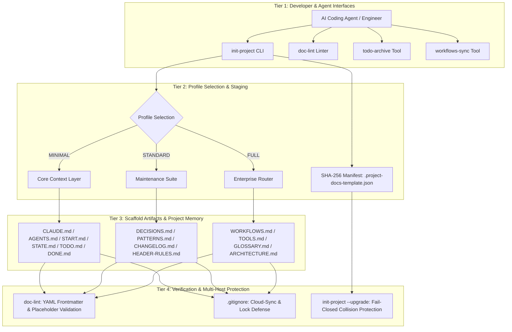
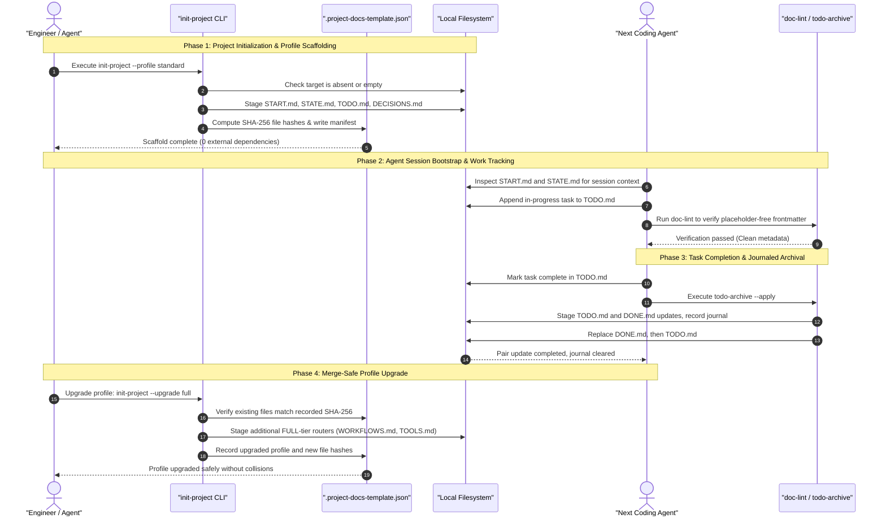

# Project Docs Template

**[English](README.md) · [Deutsch](README_de.md) · [Español](README_es.md)**

<p align="center"></p>

[](https://github.com/ellmos-ai/project-docs-template)
[](./pyproject.toml)
[](./pyproject.toml)
[](./RELEASE_GATE.md)
[](./tests)
[](./CONTRIBUTING.md)
[](./SECURITY.md)
[](./SECURITY.md)
[](./SECURITY.md)
[](./THIRD_PARTY_LICENSES.txt)
[](./SECURITY.md)
[](./NOTICE)
[](https://github.com/ellmos-ai)
[](https://github.com/open-bricks)
[](./llms.txt)
[](https://github.com/ellmos-ai/project-docs-template/actions/workflows/ci.yml)
[](./README_de.md)
[](./LICENSE)
[](./MARKETING-LOG.txt)
[](./THIRD_PARTY_LICENSES.md)
[](./MARKETING-LOG.txt)

Agent-ready project documentation template with START/STATE/TODO/DONE,
workflows, lightweight tooling, and LLM-friendly project memory.

> [!NOTE]
> **AI / LLM Indexing**: AI agents and automated tools can inspect [llms.txt](llms.txt) for a machine-readable summary, search terms, and disambiguation details. Last checked: **2026-10-30**.

> Independent project — not affiliated with Anthropic, OpenAI, or Google.
> See [Trademarks](#trademarks).

### 🧭 Quick Navigation

1. [Executive Summary & Core Identity](#executive-summary--core-identity)
2. [Visual Architecture Topology & Decoupled Layers](#visual-architecture-topology)
3. [End-to-End Multi-Agent Lifecycle & Tooling Flow](#end-to-end-multi-agent-lifecycle)
4. [Target Personas & High-Intent SEO Queries](#target-personas--core-use-cases)
5. [Project Capabilities & Limits](#comparative-matrix-vs-alternatives)
6. [Governance & Runtime Invariants Matrix](#governance--runtime-invariants)
7. [When to Use This Template](#use-this-template-when)
8. [What Is Included & Scaffold Structure](#what-is-included)
9. [Quick Start & Common CLI Workflows](#quick-start)
10. [Merge-Safe Profile Upgrades & Migration](#merge-safe-profile-upgrades)
11. [Profile Comparison Matrix (MINIMAL / STANDARD / FULL)](#profile-comparison)
12. [Design Principles & Architecture Invariants](#design-principles)
13. [Testing, Verification & Quality Gates](#verification)
14. [Security Policy & Vulnerability Reporting](#security-policy)
15. [Third-Party Licenses & Dependency Inventory](#third-party-licenses--transparency)
16. [Bundles, Partners & Ecosystem Sibling Tools](#ecosystem--sibling-tools)
17. [Trademarks & Independence Notice](#trademarks)
18. [Statutory Notice, Liability Limitation & License (§ 521 BGB)](#license)

---

## <a id="sec-01"></a><a id="executive-summary--core-identity"></a><a id="what-is-project-docs-template"></a>1. Executive Summary & Core Identity

`project-docs-template` provides a lightweight, agent-ready documentation and project memory architecture engineered for autonomous AI coding agents (Claude Code, OpenAI Codex, Antigravity/Gemini), multi-agent swarms, and human maintainers operating across software, research, and operations repositories.

Instead of turning projects into heavyweight, rigid operating systems or relying on proprietary SaaS portals, `project-docs-template` uses transparent, standard plain-text Markdown registers (`START.md`, `STATE.md`, `TODO.md`, `DONE.md`, `DECISIONS.md`). Universal entry contracts (`CLAUDE.md`, `AGENTS.md`) give agents a consistent place to read project state, architectural invariants, and active tasks. They provide context; they cannot guarantee that an agent interprets or follows it accurately.

### Core Value Propositions
- **Local-First Operation**: `SECURITY.md` documents local-disk operation without telemetry or outbound network calls for template generation and the listed maintenance tools.
- **Zero Runtime Dependencies**: Pure Python standard library (3.10+) for all scaffolding, staging, validation, and task archival tools.
- **Shared Session Context for Agent Handoffs**: Dedicated session notes (`START.md`) and a current-state snapshot (`STATE.md`) provide a common reference for later sessions. The files support handoffs but do not guarantee agent behavior or prevent context loss.
- **Profile Upgrades with Change Detection**: SHA-256 manifest tracking (`.project-docs-template.json`) checks managed files and lets upgrades refuse detected edits or unowned collisions before committing the next profile step.
- **Journaled Task Archival**: `todo-archive` stages updates to both task files, records a journal, attempts rollback after replacement errors, and can recover an interrupted pair commit. Divergent files can leave the journal for manual review.

---

## <a id="sec-02"></a><a id="visual-architecture-topology"></a><a id="architecture--flow"></a>2. Visual Architecture Topology & Decoupled Layers

The diagram below illustrates the four operational tiers of `project-docs-template`, from developer/agent interfaces down to repository files, validation, and documented cloud-sync conflict filters:



### Four-View Architectural Projection

```text
+--------------------------------------------------------------------------------------------------+
|                  [VIEW 1: CLI COCKPIT, LINTER & AGENT INTERFACE HARNESS]                         |
|  - init-project: Deterministic scaffolding, SHA-256 manifest stamping & profile migrations      |
|  - doc-lint: Static markdown validation, frontmatter linting & header contract enforcement       |
|  - todo-archive: Journaled two-file task archive with staged replacement & recovery            |
|  - workflows-sync: Bidirectional orchestration synchronization & prompt template extraction      |
+--------------------------------------------------------------------------------------------------+
                                                |
                                                v
+--------------------------------------------------------------------------------------------------+
|                  [VIEW 2: TIERED PROFILE ENGINE & MERGE-SAFE STAGING]                            |
|  - MINIMAL Profile: Lightweight context boundary (CLAUDE.md, AGENTS.md, START.md, STATE.md)     |
|  - STANDARD Profile: Complete project memory (TODO.md, DONE.md, DECISIONS.md, PATTERNS.md)       |
|  - FULL Profile: Enterprise architecture & governance (WORKFLOWS.md, TOOLS.md, GLOSSARY.md)      |
|  - SHA-256 Manifest: tracks managed files and detects edits or unowned collisions                |
+--------------------------------------------------------------------------------------------------+
                                                |
                                                v
+--------------------------------------------------------------------------------------------------+
|                  [VIEW 3: RUNTIME PERSISTENCE, REPOSITORY MEMORY & AUDIT]                        |
|  - Entry Instructions: CLAUDE.md / AGENTS.md provide a place to read project guidance             |
|  - Session Memory: START.md (session bootloader) & STATE.md (live operational ledger)            |
|  - Task Tracking: Structured task cards, recurring checklists, and verification criteria        |
|  - Decision Ledger: ADR-style architectural records (DECISIONS.md) & code patterns (PATTERNS.md)|
+--------------------------------------------------------------------------------------------------+
                                                |
                                                v
+--------------------------------------------------------------------------------------------------+
|                  [VIEW 4: DOCUMENTED SECURITY POLICY & FILE CONFLICT FILTERS]                     |
|  - User Context: tools run without requiring administrator or root elevation                    |
|  - Zero-Egress Policy: SECURITY.md documents local operation without outbound traffic             |
|  - Conflict-Copy Filters: .gitignore lists known cloud-sync conflict patterns                    |
|  - Legal & Governance: § 521 BGB notice; SECURITY.md says best-effort, no guaranteed response    |
+--------------------------------------------------------------------------------------------------+
```

---

## <a id="sec-03"></a><a id="end-to-end-multi-agent-lifecycle"></a>3. End-to-End Multi-Agent Lifecycle & Tooling Flow

The sequence diagram below shows how human engineers and AI coding agents can use `project-docs-template` during scaffolding, session startup, task completion, and profile upgrades. The documentation provides handoff context; the agent remains responsible for reading and applying it.



---

## <a id="sec-04"></a><a id="target-personas--discoverability"></a><a id="target-personas--core-use-cases"></a>4. Target Personas & Core Use Cases

`project-docs-template` is designed to help address context drift, handoff loss, and governance friction across four primary technical user journeys:

| Target Persona | Key Pain Point | How `project-docs-template` Solves It | Core Artifacts |
|:---|:---|:---|:---|
| **Multi-Agent Systems Engineers** | Heterogeneous coding agents (Claude Code, Antigravity/Gemini, Codex) can lose project context between sessions or use divergent file formats. | Universal entry point contracts (`CLAUDE.md`, `AGENTS.md`) and session/state registers (`START.md`, `STATE.md`) give agents a shared place to read instructions and recorded context. Reliable handoffs still depend on agents and maintainers using those files. | `CLAUDE.md`, `AGENTS.md`, `START.md`, `STATE.md` |
| **Solo Developers & Open-Source Maintainers** | Juggling issues, feature backlogs, and release histories without a heavy project-management SaaS platform. | Minimal-overhead Markdown task loops (`TODO.md`, `DONE.md`) paired with the journaled archival tool (`todo-archive`) and standard `CHANGELOG.md`. | `TODO.md`, `DONE.md`, `_tools/todo-archive`, `CHANGELOG.md` |
| **Enterprise Architecture & AI Governance Leads** | Lack of auditable decision trails, compliance transparency, and risk of accidental data egress in corporate agent workflows. | Architecture Decision Records (`DECISIONS.md`), strict `SECURITY.md` local-first invariants, and zero external runtime dependencies. | `DECISIONS.md`, `SECURITY.md`, `THIRD_PARTY_LICENSES.md` |
| **Research & Scientific Pipeline Developers** | Complex multi-stage experiment pipelines drift over weeks of autonomous LLM reasoning runs. | Scalable FULL profile with operational runbooks (`WORKFLOWS.md`), domain terminology (`GLOSSARY.md`), and automated table sync (`workflows-sync`). | `WORKFLOWS.md`, `GLOSSARY.md`, `_tools/workflows-sync` |

### High-Intent Discovery Search Queries
- `agent-ready project documentation template`
- `claude code documentation scaffold`
- `multi-agent session handoff state start todo done`
- `offline local-first project template python`
- `zero-egress developer scaffolding stdlib`
- `deterministic documentation staging and profile upgrades`
- `llm friendly project memory repository template`

---

## <a id="sec-05"></a><a id="comparative-matrix-vs-alternatives"></a><a id="comparative-architecture"></a>5. Project Capabilities & Limits

The table below summarizes the ten documented project invariants and the behavior and limits supported by this source commit:

| # | Invariant | Documented capability | Scope / limit |
|---|:---|:---|:---|
| 1 | **INV-LOCAL-01: Local-first, zero egress** | `SECURITY.md` states that template generation and listed maintenance tools operate on local disk without outbound telemetry or network traffic. | This is the documented scope for these tools, not an operating-system network sandbox. |
| 2 | **INV-SEC-02: Caller process context** | The scripts inherit the invoking process context; the CLI does not request privilege elevation. | A privileged caller stays privileged; no standard-user enforcement or certification is claimed. |
| 3 | **INV-FAIL-03: Fail-closed checks** | Generation rejects an existing non-empty target; upgrades reject detected edits to managed files and unowned collisions before commit. | Generation creates its parent/staging area and writes staged files before promotion; this is not a blanket no-write guarantee. |
| 4 | **INV-STG-04: Staged profile upgrades** | Upgrades verify manifest hashes, stage the next profile, back up files, and use hash-guarded rollback attempts if commit fails. | Restoration is conditional; concurrent changes or further filesystem errors can prevent full rollback. |
| 5 | **INV-HANDOFF-05: Session context** | `START.md` and `STATE.md` provide shared project and session records for agents and maintainers. | The template cannot ensure that an agent reads, follows, or retains those records. |
| 6 | **INV-TIER-06: Tiered profiles** | The template provides `MINIMAL`, `STANDARD`, and `FULL` profiles; upgrades proceed one profile step at a time. | These are documentation scaffolds, not a runtime agent framework. |
| 7 | **INV-SYNC-07: Conflict-copy filtering** | Repository and template `.gitignore` files list patterns for known conflict copies and lock files. | Ignore patterns do not coordinate concurrent writers or provide a live distributed lock. |
| 8 | **INV-AUDIT-08: TODO/DONE archival** | `todo-archive` journals and stages the two-file update, attempts rollback after replacement errors, and can recover an interrupted pair commit. | Divergent files leave the journal for manual review; rollback can itself fail in a catastrophic filesystem case. |
| 9 | **INV-LIC-09: Runtime dependency scope** | The project declares `dependencies = []` and uses the Python standard library at runtime. | This describes runtime dependencies; development and test tools are separate. |
| 10 | **INV-SLA-10: Security response policy** | `SECURITY.md` prioritizes fixes on a best-effort basis for supported `0.1.x` and states that response time is not guaranteed. | Do not infer a 48-hour response or 5-business-day triage commitment; follow the listed private reporting channels. |

---

## <a id="sec-06"></a><a id="governance--runtime-invariants"></a>6. Governance & Runtime Invariants Matrix

The project documents ten runtime, staging, and governance invariants across its scaffolding tools, maintenance CLI utilities, and generated repository profiles:

| Canonical ID | Invariant | Documented behavior and scope |
|:---|:---|:---|
| **INV-LOCAL-01** | **Local-First & Zero-Egress** | `SECURITY.md` documents local-disk operation for template generation and the listed maintenance scripts, with no outbound telemetry or network traffic during instantiation or upgrade. |
| **INV-SEC-02** | **Caller Process Context** | The scripts inherit the invoking process context; the CLI does not request privilege elevation. | A privileged caller stays privileged; no standard-user enforcement or certification is claimed. |
| **INV-FAIL-03** | **Fail-Closed Checks** | New generation rejects an existing non-empty target; upgrades reject detected edits to managed files and unowned collisions before commit. Generation still creates the parent/staging area and writes in staging before promotion. |
| **INV-STG-04** | **Staged Upgrade & Guarded Recovery** | Upgrades check manifest hashes and stage a profile before commit. Backups and hash checks support rollback attempts; restoration is conditional and can be blocked by further filesystem errors or concurrent changes. |
| **INV-HANDOFF-05** | **Agent Session Context** | `START.md` and `STATE.md` store project and session context. Whether agents read, follow, or retain it depends on their behavior and the surrounding workflow. |
| **INV-TIER-06** | **Tiered Scalable Profiles** | The three profiles (`MINIMAL`, `STANDARD`, `FULL`) provide different documentation structures and maintenance scope. |
| **INV-SYNC-07** | **Cloud-Sync Conflict Filtering** | Root and template `.gitignore` files filter listed conflict-copy and lock-file patterns; they do not coordinate live writers. |
| **INV-AUDIT-08** | **Journaled Task Archival** | `todo-archive` stages `TODO.md` and `DONE.md`, records a journal, attempts restoration after a replacement error, and supports recovery of an interrupted pair commit. Divergence leaves the journal for manual review. |
| **INV-LIC-09** | **Runtime Dependencies** | Runtime dependencies are declared as `dependencies = []` and use the Python standard library. Development and test tooling is outside that runtime-dependency claim. |
| **INV-SLA-10** | **Security Reporting Policy** | `SECURITY.md` lists best-effort maintenance for `0.1.x` and says there is no guaranteed response time; it prioritizes security fixes. |

---

## <a id="sec-07"></a><a id="use-this-template-when"></a>7. When to Use This Template

| Situation | Why it helps |
|:---|:---|
| A new project will be maintained by Claude Code, Codex, Gemini CLI, or another coding agent | Gives the agent a predictable bootstrap path and current-state file. |
| An existing repo has scattered notes, stale task files, or no handoff trail | Separates active work, completed work, decisions, patterns, and session state. |
| Multiple agents or humans need to resume work safely | Keeps instructions, current state, workflows, and tools in distinct files. |

This is a documentation and coordination template, not a runtime framework. It
is meant to sit inside ordinary software, research, or operations repositories.

---

## <a id="sec-08"></a><a id="what-is-included"></a>8. What Is Included & Scaffold Structure

- `CLAUDE.md` and `AGENTS.md` for agent instructions
- `START.md` and `STATE.md` for session bootstrap and current state
- `TODO.md` and `DONE.md` with optional archival tooling
- `DECISIONS.md`, `PATTERNS.md`, `CHANGELOG.md`, and `HEADER-RULES.md`
- Optional FULL-profile routers: `WORKFLOWS.md`, `TOOLS.md`, `GLOSSARY.md`
- Local helpers in `_tools/`, including `init-project`, `doc-lint`, `todo-archive`, and `workflows-sync`

The actual template files live in [`template/`](./template/).

---

## <a id="sec-09"></a><a id="quick-start"></a>9. Quick Start & Common CLI Workflows

Clone the repository and scaffold an agent-ready workspace in seconds:

```bash
git clone https://github.com/ellmos-ai/project-docs-template.git
cd project-docs-template

# Inspect scaffold generation without writing changes (dry-run)
python template/_tools/init-project --target /path/to/my-project --name "my-project" --profile STANDARD --dry-run

# Render STANDARD profile (12 root contracts & tools with SHA-256 manifest)
python template/_tools/init-project --target /path/to/my-project --name "my-project" --profile STANDARD

# Optional: initialize Git repository with staged initial commit
python template/_tools/init-project --target /path/to/my-project --name "my-project" --profile STANDARD --git
```

### Staged Generation Walkthrough (Terminal Output)

When `init-project` runs, it creates a sibling staging directory, renders the selected profile, runs preparation and validation, writes its manifest, and then promotes the staged result. The target may be absent or an existing empty directory:

```text
==> Root:    /path/to/.my-project.staging-xyz123
==> Max age: 30 days

Results:
  OK   CLAUDE.md
  OK   START.md
  OK   STATE.md

OK: Alle geprüften Files bestehen (oder wurden gefixt)
==> Target:  /path/to/my-project
==> Name:    my-project
==> Author:  Alex Developer
==> Date:    2026-10-30

==> Profil: STANDARD
    Ernsthafte Projekte mit mehrmonatiger Lebensdauer
  OK: AGENTS.md
  OK: CLAUDE.md
  OK: README.md
  OK: START.md
  OK: STATE.md
  OK: CHANGELOG.md
  OK: HEADER-RULES.md
  OK: CUT-AND-CLUE.md
  OK: DECISIONS.md
  OK: PATTERNS.md
  OK: TODO.md
  OK: DONE.md
  OK: .gitignore
  OK: _tools/README.md
  OK: _tools/todo-archive
  OK: _tools/doc-lint

==> Fertig: /path/to/my-project
```

### Common CLI Maintenance Workflows in Generated Projects

Generated workspaces include lightweight, zero-dependency tools in `_tools/`:

```bash
# Lint project documentation and verify YAML frontmatter & staleness
python _tools/doc-lint

# Automatically insert missing frontmatter fields & refresh verification dates
python _tools/doc-lint --fix --update-dates

# Archive completed tasks with journaling
python _tools/todo-archive --apply

# Synchronize workflow tables across routers (FULL profile)
python _tools/workflows-sync --apply
```

> [!NOTE]
> **Template language:** The repository documentation is English, but the template bodies under [`template/`](./template/) — `CLAUDE.md`, `START.md`, `STATE.md`, `TODO.md` and the rest — and the CLI output of `init-project`, `doc-lint`, `todo-archive` and `workflows-sync` are written in German. The file names, profile markers and YAML front matter keys are language-neutral, so an English project can use the structure and replace the prose; an English template set is planned — see [`TODO.md`](./TODO.md).

---

## <a id="sec-10"></a><a id="merge-safe-profile-upgrades"></a>10. Merge-Safe Profile Upgrades & Migration

Existing projects can be upgraded to the next profile step:

```bash
# Upgrade existing project to FULL profile
python template/_tools/init-project /path/to/my-project --upgrade full
```

### Safety Checks During Upgrade
- **Manifest Verification**: Reads `.project-docs-template.json` and compares hashes for managed files.
- **Fail-Closed on Unowned Collisions**: If a file to be added already exists outside the prior manifest, the upgrade aborts before committing changes to the target. A staging directory may already have been created.
- **Refusal on Managed-File Changes**: If a managed file no longer matches its manifest hash, the upgrade refuses to proceed. No confirmation prompt or automatic overwrite is offered.
- **Conditional Rollback Attempt**: During commit, backups and current-hash checks support restoration of files changed by that invocation. If another change is detected, restoration is skipped to avoid overwriting it; a further filesystem error can also prevent rollback from completing.

---

## <a id="sec-11"></a><a id="profile-comparison"></a>11. Profile Comparison Matrix

| Feature / Document | `MINIMAL` | `STANDARD` | `FULL` |
|:---|:---:|:---:|:---:|
| `CLAUDE.md` & `AGENTS.md` (Agent Instructions) | ✅ Included | ✅ Included | ✅ Included |
| `START.md` & `STATE.md` (Session Memory) | ✅ Included | ✅ Included | ✅ Included |
| `TODO.md` & `DONE.md` (Task Tracking) | ✅ Included | ✅ Included | ✅ Included |
| `_tools/todo-archive` (Task Archival) | ✅ Included | ✅ Included | ✅ Included |
| `_tools/doc-lint` (Documentation Linter) | ✅ Included | ✅ Included | ✅ Included |
| `DECISIONS.md` (Architecture Decisions) | — | ✅ Included | ✅ Included |
| `PATTERNS.md` (Design Patterns) | — | ✅ Included | ✅ Included |
| `CHANGELOG.md` & `HEADER-RULES.md` | — | ✅ Included | ✅ Included |
| `WORKFLOWS.md` & `_tools/workflows-sync` | — | — | ✅ Included |
| `TOOLS.md` & `GLOSSARY.md` (Domain Routers) | — | — | ✅ Included |
| `ARCHITECTURE.md` & `.github/` Workflows | — | — | ✅ Included |

---

## <a id="sec-12"></a><a id="design-principles"></a>12. Design Principles & Architecture Invariants

- **Separation of Concerns**: Every file has a single, well-defined operational responsibility.
- **Explicit Session Handoff**: Session start and current state are documented in short, predictable files (`START.md`, `STATE.md`) for agents and maintainers to consult.
- **Low Maintenance Burden**: Focuses on high-value context documents rather than generating sprawling, unmaintained wikis.
- **Router Pattern**: High-level routers (`WORKFLOWS.md`, `TOOLS.md`) index details rather than duplicating them.
- **Journaled Task Lifecycle**: `todo-archive` uses a journal and staged file replacement to archive completed tasks; recovery depends on the journal and current file state.

See [`template/TEMPLATE.md`](./template/TEMPLATE.md) for the complete design rationale.

---

## <a id="sec-13"></a><a id="verification"></a>13. Testing, Verification & Quality Gates

The test suite is run with Python's standard `unittest` or `pytest`:

```bash
# Run test suite via pytest
pytest -ra -v

# Run test suite via standard unittest
python -m unittest discover -s tests -v
```

The tests cover all profiles, Git initialization, YAML frontmatter repair, workflow metadata escaping, refusal of modified or colliding upgrade targets, rollback on an injected manifest-commit failure, rollback after an injected second TODO/DONE replacement failure, and recovery of an interrupted archive from its journal. The same suite is configured for Linux, Windows, and macOS; see [`RELEASE_GATE.md`](./RELEASE_GATE.md).

---

## <a id="sec-14"></a><a id="security-policy"></a>14. Security Policy & Vulnerability Reporting

`project-docs-template` follows the policy documented in `SECURITY.md`:
- **Local-First & Zero-Egress**: `SECURITY.md` states that template generation and the listed maintenance tools operate on local disk without outbound telemetry or network traffic during instantiation and upgrade.
- **Staged Generation and Upgrade Checks**: Generation stages its output beside the target, validates before promotion, and rejects existing non-empty targets. Profile upgrades check managed hashes and unowned collisions before commit; rollback remains conditional.
- **Supported Versions and Response Policy**: `SECURITY.md` lists `0.1.x` on `main` as best-effort maintenance and prioritizes security fixes, with no guaranteed response time. Versions below `0.1.0` are unsupported.

Report potential vulnerabilities as documented in [`SECURITY.md`](./SECURITY.md): use the GitHub Private Security Advisory (preferred) or the listed direct maintainer contacts. Please do not report unpatched vulnerabilities in public issues; coordinated disclosure is requested until a patch is released. The policy lists `security@ellmos.ai`, `support@lukasgeiger.com`, and `lukas@open-bricks.org`.

---

## <a id="sec-15"></a><a id="third-party-licenses--transparency"></a>15. Third-Party Licenses & Dependency Inventory

`project-docs-template` maintains a **strict Zero-Runtime-Dependency architecture** (`dependencies = []`). All runtime code relies exclusively on Python's standard library (3.10+).

| Component | Scope | Declared License | Status |
|:---|:---|:---|:---|
| **Python Standard Library** | Core Runtime | PSFL-2.0 | 100% Permissive (Built-in) |
| **pytest** | Development / Test | MIT License | 100% Permissive |
| **ruff** | Development / QA | MIT / Apache-2.0 | 100% Permissive |
| **setuptools** | Build Backend | MIT License | 100% Permissive |

The declared runtime and development dependency licenses and dependency inventory are listed in [THIRD_PARTY_LICENSES.md](THIRD_PARTY_LICENSES.md) and the plain-text companion [THIRD_PARTY_LICENSES.txt](THIRD_PARTY_LICENSES.txt). These files document the listed entries; no independent audit or Level 1 SBOM certification is claimed here.

---

## <a id="sec-16"></a><a id="ecosystem--sibling-tools"></a><a id="bundles-and-partners"></a>16. Bundles, Partners & Ecosystem Sibling Tools

`project-docs-template` is an essential scaffolding component within the [`ellmos-ai`](https://github.com/ellmos-ai) ecosystem and the umbrella [`open-bricks`](https://github.com/open-bricks) open-source collective:

| Repository | Purpose | Primary Surface |
|:---|:---|:---|
| [`policy-registry`](https://github.com/ellmos-ai/policy-registry) | Machine-readable policy registry with signed delegations | CLI / API / MCP |
| [`DevCenter`](https://github.com/dev-bricks/DevCenter) | Local-first Python IDE and developer toolkit | GUI / PySide6 |
| [`CodeBox`](https://github.com/dev-bricks/CodeBox) | Desktop code editor and IDE | GUI / PySide6 |
| [`companion-for-agy`](https://github.com/ellmos-ai/companion-for-agy) | Extension & companion suite for Antigravity AI agents | CLI / Node.js |
| [`safe-start-for-codex`](https://github.com/dev-bricks/safe-start-for-codex) | Defensive bootstrapping and environment verifier | CLI / Python |
| [`automizer-for-claude-desktop`](https://github.com/dev-bricks/automizer-for-claude-desktop) | Bridge & automation toolkit for Claude Desktop | CLI / Python |
| [`system-gap-master`](https://github.com/ellmos-ai/system-gap-master) | Cross-system sync & divergence analyzer | CLI / Python |
| [`lock-master`](https://github.com/ellmos-ai/lock-master) | File & resource concurrency lock manager | CLI / Python |
| [`ticket-master`](https://github.com/ellmos-ai/ticket-master) | Local-first issue & ticketing orchestrator | CLI / Python |
| [`clutch`](https://github.com/ellmos-ai/clutch) | Provider-neutral LLM router and model orchestration engine | CLI / Python |
| [`memoryhooker`](https://github.com/ellmos-ai/memoryhooker) | Session memory extraction & hook injector | CLI / Python |
| [`workflowhooker`](https://github.com/ellmos-ai/workflowhooker) | Workflow automation lifecycle triggers | CLI / Python |
| [`ellmos-controlcenter-mcp`](https://github.com/ellmos-ai/ellmos-controlcenter-mcp) | MCP server for system inspection and skill discovery | MCP |
| [`ellmos-filecommander-mcp`](https://github.com/ellmos-ai/ellmos-filecommander-mcp) | MCP server for safe local file operations | MCP |
| [`open-bricks`](https://github.com/open-bricks) | Umbrella organization for developer & AI tools | Portal |

<!-- BEGIN GENERATED ELLMOS BUNDLE DISCOVERY -->
### Bundles and Partners Discovery Projection
Generated discovery projection for `module:project-docs-template` from `catalog:v4-bundles` (`546290dafbaafd810df1d59ef5a3d7183738472b48cd5a8a81f1e8f2b64d852e`). Target repository visibility: `public`.

- **`ellmos-dev-lifecycle-bundle`**: role `declared-component`, requirement `required`. Partners: `module:bundle-installer`, `module:ellmos-code-tools`, `module:ellmos-tests`, `module:github-onedrive-mirror`, `module:stack-system-installer`.
- **`ellmos-knowledge-bundle`**: role `declared-component`, requirement `recommended`. Partners: `module:KnowledgeDigest`, `module:WikiStub-Seed`, `module:report-forge`, `module:web-scraper`.
<!-- END GENERATED ELLMOS BUNDLE DISCOVERY -->

---

## <a id="sec-17"></a><a id="trademarks"></a>17. Trademarks & Independence Notice

This project is an independent, community-maintained documentation template.
It is **not** affiliated with, endorsed by, sponsored by, or otherwise connected
to Anthropic, OpenAI, or Google.

"Claude" and "Claude Code", "Codex", "Gemini" and "Antigravity" are trademarks
or registered trademarks of their respective owners (Anthropic PBC, OpenAI,
Google LLC). All other product names, logos, and brands are the property of
their respective owners. They are used here solely to describe compatibility
and interoperability, and their use does not imply any endorsement,
authorisation, or business relationship.

---

## <a id="sec-18"></a><a id="license"></a><a id="statutory-notice-liability-limitation--license"></a>18. Statutory Notice, Liability Limitation & License (§ 521 BGB)

### Statutory Notice & Limitation of Liability (§ 521 BGB)
The provision of this software and template scaffold is made free of charge as a statutory courtesy (*Gefälligkeit* / *unentgeltliche Schenkung* pursuant to **§ 521 BGB** of the German Civil Code). Under German statutory law, liability of the author and contributors is strictly limited to intent and gross negligence (*Vorsatz und grobe Fahrlässigkeit*). Mandatory statutory liability — in particular for intent (Section 276(3) BGB) and for injury to life, body, or health — remains unaffected.

### License
This project is licensed under the terms of the **MIT License**. See [LICENSE](LICENSE) and [NOTICE](NOTICE) for complete copyright attribution.