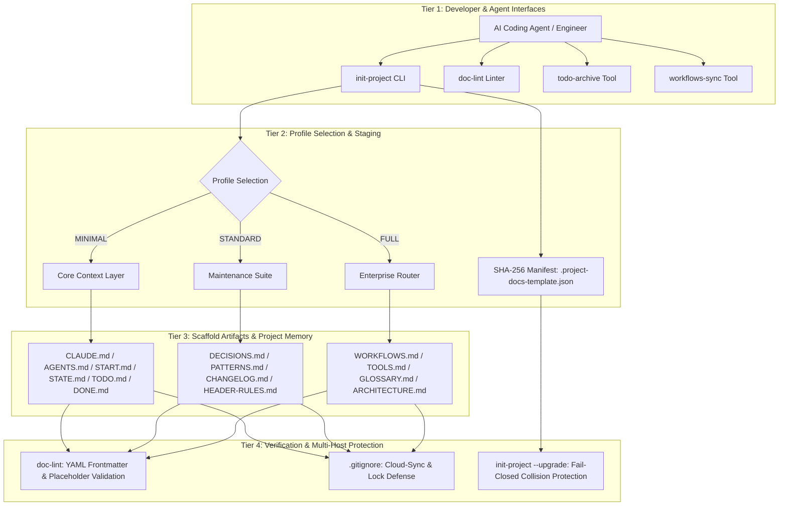
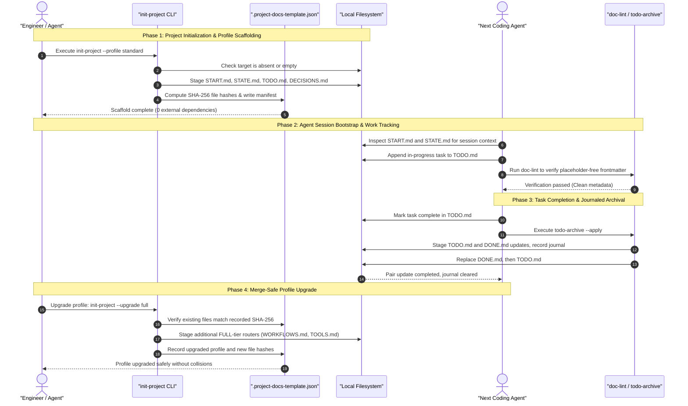

# Project Docs Template

**[English](README.md) · [Deutsch](README_de.md) · [Español](README_es.md) · [Français](README_fr.md) · [Русский](README_ru.md) · [日本語](README_ja.md) · [简体中文](README_zh.md) · [हिन्दी](README_hi.md) · [العربية](README_ar.md)**

<p align="center"></p>

[](https://github.com/ellmos-ai/project-docs-template)
[](./pyproject.toml)
[](./pyproject.toml)
[](./RELEASE_GATE.md)
[](./tests)
[](./CONTRIBUTING.md)
[](./SECURITY.md)
[](./SECURITY.md)
[](./SECURITY.md)
[](./THIRD_PARTY_LICENSES.txt)
[](./SECURITY.md)
[](./NOTICE)
[](https://github.com/ellmos-ai)
[](https://github.com/open-bricks)
[](./llms.txt)
[](https://github.com/ellmos-ai/project-docs-template/actions/workflows/ci.yml)
[](./README_de.md)
[](./LICENSE)
[](./MARKETING-LOG.txt)
[](./THIRD_PARTY_LICENSES.md)
[](./MARKETING-LOG.txt)

قالب لتوثيق المشروعات مهيأ للعمل مع الوكلاء، ويضم START/STATE/TODO/DONE،
وسير العمل والأدوات الخفيفة وذاكرة للمشروع ملائمة لنماذج LLM.

> [!NOTE]
> **فهرسة AI / LLM**: يمكن لوكلاء AI والأدوات المؤتمتة الاطلاع على [llms.txt](llms.txt) للحصول على ملخص قابل للقراءة آلياً ومصطلحات بحث وتفاصيل لإزالة الالتباس. آخر تحقق: **2026-10-30**.

> مشروع مستقل غير تابع لـ Anthropic أو OpenAI أو Google.
> راجع [العلامات التجارية](#trademarks).

### 🧭 تنقل سريع

1. [الملخص التنفيذي والهوية الأساسية](#executive-summary--core-identity)
2. [البنية المرئية والطبقات المفصولة](#visual-architecture-topology)
3. [دورة حياة متعددة الوكلاء من البداية إلى النهاية وتدفق الأدوات](#end-to-end-multi-agent-lifecycle)
4. [الفئات المستهدفة وحالات الاستخدام الأساسية](#target-personas--core-use-cases)
5. [قدرات المشروع وحدوده](#comparative-matrix-vs-alternatives)
6. [مصفوفة الحوكمة والثوابت وقت التشغيل](#governance--runtime-invariants)
7. [متى تستخدم هذا القالب](#use-this-template-when)
8. [المحتويات وبنية الهيكل الأولي](#what-is-included)
9. [البدء السريع وسير عمل CLI الشائع](#quick-start)
10. [ترقية الملفات التعريفية مع كشف التغييرات والترحيل](#merge-safe-profile-upgrades)
11. [مصفوفة مقارنة الملفات التعريفية (MINIMAL / STANDARD / FULL)](#profile-comparison)
12. [مبادئ التصميم وثوابت البنية](#design-principles)
13. [الاختبار والتحقق وبوابات الجودة](#verification)
14. [سياسة الأمان والإبلاغ عن الثغرات](#security-policy)
15. [تراخيص الجهات الخارجية وجرد التبعيات](#third-party-licenses--transparency)
16. [الحزم والشركاء والأدوات المرتبطة بالمنظومة](#ecosystem--sibling-tools)
17. [العلامات التجارية وإشعار الاستقلال](#trademarks)
18. [إشعار قانوني وحدود المسؤولية والترخيص (§ 521 BGB)](#license)

---

## <a id="sec-01"></a><a id="executive-summary--core-identity"></a><a id="what-is-project-docs-template"></a>1. الملخص التنفيذي والهوية الأساسية

يوفر `project-docs-template` بنية خفيفة للتوثيق وذاكرة المشروعات، مهيأة لوكلاء برمجة AI المستقلين (Claude Code وOpenAI Codex وAntigravity/Gemini)، ومجموعات الوكلاء المتعددة، ومشرفي المستودعات من البشر في مجالات البرمجيات والبحث والعمليات.

بدلاً من تحويل المشروعات إلى أنظمة تشغيل ثقيلة وجامدة أو الاعتماد على بوابات SaaS مملوكة، يستخدم `project-docs-template` سجلات Markdown نصية عادية وشفافة وموحدة (`START.md` و`STATE.md` و`TODO.md` و`DONE.md` و`DECISIONS.md`). توفر ملفات الدخول الموحدة (`CLAUDE.md` و`AGENTS.md`) مكاناً ثابتاً للوكلاء كي يطّلعوا على حالة المشروع وثوابت البنية والمهام النشطة. تقدم هذه الملفات سياقاً، لكنها لا تضمن أن الوكيل سيفهمه أو يتبعه بدقة.

### أبرز المزايا
- **التشغيل المحلي أولاً**: توضح `SECURITY.md` أن إنشاء القالب وأدوات الصيانة المذكورة يعملان على القرص المحلي من دون قياس عن بُعد أو اتصالات شبكة صادرة.
- **لا تبعيات وقت التشغيل**: تعتمد جميع أدوات إنشاء الهيكل الأولي والتهيئة المرحلية والتحقق وأرشفة المهام على مكتبة Python القياسية فقط (الإصدار 3.10 فأحدث).
- **سياق جلسة مشترك لتسليم العمل بين الوكلاء**: توفر ملاحظات الجلسة (`START.md`) ولقطة الحالة الحالية (`STATE.md`) مرجعاً مشتركاً للجلسات اللاحقة. تساعد هذه الملفات على التسليم، لكنها لا تضمن سلوك الوكيل ولا تمنع فقدان السياق.
- **ترقية الملفات التعريفية مع كشف التغييرات**: يتتبع بيان SHA-256 (`.project-docs-template.json`) الملفات المُدارة ويتيح رفض الترقية عند رصد تعديلات أو تعارضات مع ملفات غير مُدارة قبل تثبيت مستوى الملف التعريفي التالي.
- **أرشفة المهام مع سجل**: يهيئ `todo-archive` تحديثات ملفي المهام، ويسجل العملية، ويحاول التراجع بعد أخطاء الاستبدال، ويمكنه استعادة تثبيت زوج الملفات إذا انقطع. وقد تتطلب الملفات المتباينة مراجعة السجل يدوياً.

---

## <a id="sec-02"></a><a id="visual-architecture-topology"></a><a id="architecture--flow"></a>2. البنية المرئية والطبقات المفصولة

يوضح الرسم أدناه المستويات التشغيلية الأربعة في `project-docs-template`، من واجهات المطورين والوكلاء إلى ملفات المستودع والتحقق ومرشحات نسخ التعارض في مزامنة السحابة الموثقة:



### تصور البنية المعمارية عبر أربعة مناظير

```text
+--------------------------------------------------------------------------------------------------+
|                  [VIEW 1: CLI COCKPIT, LINTER & AGENT INTERFACE HARNESS]                         |
|  - init-project: Deterministic scaffolding, SHA-256 manifest stamping & profile migrations      |
|  - doc-lint: Static markdown validation, frontmatter linting & header contract enforcement       |
|  - todo-archive: Journaled two-file task archive with staged replacement & recovery            |
|  - workflows-sync: Bidirectional orchestration synchronization & prompt template extraction      |
+--------------------------------------------------------------------------------------------------+
                                                |
                                                v
+--------------------------------------------------------------------------------------------------+
|                  [VIEW 2: TIERED PROFILE ENGINE & MERGE-SAFE STAGING]                            |
|  - MINIMAL Profile: Lightweight context boundary (CLAUDE.md, AGENTS.md, START.md, STATE.md)     |
|  - STANDARD Profile: Complete project memory (TODO.md, DONE.md, DECISIONS.md, PATTERNS.md)       |
|  - FULL Profile: Enterprise architecture & governance (WORKFLOWS.md, TOOLS.md, GLOSSARY.md)      |
|  - SHA-256 Manifest: tracks managed files and detects edits or unowned collisions                |
+--------------------------------------------------------------------------------------------------+
                                                |
                                                v
+--------------------------------------------------------------------------------------------------+
|                  [VIEW 3: RUNTIME PERSISTENCE, REPOSITORY MEMORY & AUDIT]                        |
|  - Entry Instructions: CLAUDE.md / AGENTS.md provide a place to read project guidance             |
|  - Session Memory: START.md (session bootloader) & STATE.md (live operational ledger)            |
|  - Task Tracking: Structured task cards, recurring checklists, and verification criteria        |
|  - Decision Ledger: ADR-style architectural records (DECISIONS.md) & code patterns (PATTERNS.md)|
+--------------------------------------------------------------------------------------------------+
                                                |
                                                v
+--------------------------------------------------------------------------------------------------+
|                  [VIEW 4: DOCUMENTED SECURITY POLICY & FILE CONFLICT FILTERS]                     |
|  - User Context: tools run without requiring administrator or root elevation                    |
|  - Zero-Egress Policy: SECURITY.md documents local operation without outbound traffic             |
|  - Conflict-Copy Filters: .gitignore lists known cloud-sync conflict patterns                    |
|  - Legal & Governance: § 521 BGB notice; SECURITY.md says best-effort, no guaranteed response    |
+--------------------------------------------------------------------------------------------------+
```

---

## <a id="sec-03"></a><a id="end-to-end-multi-agent-lifecycle"></a>3. دورة حياة متعددة الوكلاء من البداية إلى النهاية وتدفق الأدوات

يوضح مخطط التسلسل كيف يمكن للمطورين ووكلاء برمجة AI استخدام `project-docs-template` عند إنشاء الهيكل الأولي وبدء الجلسة وإنجاز المهام وترقية الملفات التعريفية. توفر الوثائق سياقاً لتسليم العمل، لكن الوكيل مسؤول عن قراءتها وتطبيقها.



---

## <a id="sec-04"></a><a id="target-personas--discoverability"></a><a id="target-personas--core-use-cases"></a>4. الفئات المستهدفة وحالات الاستخدام الأساسية

صُمم `project-docs-template` للمساعدة في معالجة انحراف السياق وفقدان المعلومات عند التسليم وصعوبات الحوكمة عبر أربع حالات استخدام تقنية رئيسية:

| الفئة المستهدفة | المشكلة الأساسية | كيف يساعد `project-docs-template` | الملفات الأساسية |
|:---|:---|:---|:---|
| **مهندسو أنظمة الوكلاء المتعددة** | قد تفقد وكلاء البرمجة المختلفة (Claude Code وAntigravity/Gemini وCodex) سياق المشروع بين الجلسات أو تستخدم تنسيقات ملفات متباينة. | توفر ملفات الدخول الموحدة (`CLAUDE.md` و`AGENTS.md`) وسجلات الجلسة والحالة (`START.md` و`STATE.md`) مكاناً مشتركاً للوكلاء لقراءة التعليمات والسياق المسجل. يظل نجاح التسليم معتمداً على استخدام الوكلاء والمشرفين لهذه الملفات. | `CLAUDE.md` و`AGENTS.md` و`START.md` و`STATE.md` |
| **المطورون المستقلون ومشرفو البرمجيات مفتوحة المصدر** | التعامل مع المشكلات وقوائم الميزات وسجل الإصدارات من دون منصة SaaS ثقيلة لإدارة المشروعات. | دورات مهام Markdown بسيطة (`TODO.md` و`DONE.md`) مع أداة الأرشفة المسجلة (`todo-archive`) وملف `CHANGELOG.md` القياسي. | `TODO.md` و`DONE.md` و`_tools/todo-archive` و`CHANGELOG.md` |
| **مسؤولو بنية المؤسسات وحوكمة AI** | نقص سجلات القرارات القابلة للتدقيق وشفافية الامتثال، مع خطر خروج البيانات عن غير قصد في سير عمل الوكلاء المؤسسي. | سجلات قرارات البنية (`DECISIONS.md`) وثوابت محلية صارمة موثقة في `SECURITY.md` وعدم وجود تبعيات خارجية وقت التشغيل. | `DECISIONS.md` و`SECURITY.md` و`THIRD_PARTY_LICENSES.md` |
| **مطورو مسارات البحث والعلوم** | قد تنحرف مسارات التجارب المعقدة متعددة المراحل خلال أسابيع من عمليات استدلال LLM المستقلة. | يتضمن الملف التعريفي FULL القابل للتوسع أدلة تشغيل (`WORKFLOWS.md`) ومصطلحات المجال (`GLOSSARY.md`) ومزامنة آلية للجداول (`workflows-sync`). | `WORKFLOWS.md` و`GLOSSARY.md` و`_tools/workflows-sync` |

### استعلامات البحث عالية النية
- `agent-ready project documentation template`
- `claude code documentation scaffold`
- `multi-agent session handoff state start todo done`
- `offline local-first project template python`
- `zero-egress developer scaffolding stdlib`
- `deterministic documentation staging and profile upgrades`
- `llm friendly project memory repository template`

---

## <a id="sec-05"></a><a id="comparative-matrix-vs-alternatives"></a><a id="comparative-architecture"></a>5. قدرات المشروع وحدوده

يلخص الجدول أدناه ثوابت المشروع العشرة الموثقة ويعرض السلوك والحدود التي تدعمها الشيفرة في هذا الالتزام البرمجي:

| # | الثابت | القدرة الموثقة | النطاق / الحد |
|---|:---|:---|:---|
| 1 | **INV-LOCAL-01: محلي أولاً ومن دون حركة بيانات صادرة** | تفيد `SECURITY.md` بأن إنشاء القالب وأدوات الصيانة المذكورة تعمل على القرص المحلي من دون قياس عن بُعد صادر أو حركة مرور شبكية. | هذا هو النطاق الموثق لهذه الأدوات، وليس حاجزاً شبكياً على مستوى نظام التشغيل. |
| 2 | **INV-SEC-02: سياق عملية الاستدعاء** | ترث البرامج النصية سياق عملية الاستدعاء. لا تطلب واجهة CLI رفع الامتيازات. | يحتفظ المستدعي الذي يعمل بامتيازات مسبقاً بهذه الامتيازات. ولا يُدّعى فرض التشغيل كمستخدم عادي أو الحصول على شهادة بذلك. |
| 3 | **INV-FAIL-03: فحوصات ترفض المتابعة عند الفشل** | يرفض الإنشاء هدفاً موجوداً غير فارغ. وترفض الترقيات التعديلات المكتشفة على الملفات المُدارة والتعارضات مع الملفات غير المُدارة قبل تثبيت التغييرات. | ينشئ الإنشاء الدليل الأب والمنطقة المرحلية ويكتب فيها الملفات المجهزة قبل نقل النتيجة إلى الهدف. وهذا لا يشكل ضماناً شاملاً لعدم الكتابة عند الفشل. |
| 4 | **INV-STG-04: ترقيات مرحلية للملفات التعريفية** | تتحقق الترقيات من تجزئات البيان، وتجهز المستوى التالي، وتنسخ الملفات احتياطياً، وتحاول التراجع المحمي بالتجزئة إذا أخفق تثبيت التغييرات. | الاستعادة مشروطة. وقد تمنع التغييرات المتزامنة أو أخطاء إضافية في نظام الملفات اكتمال التراجع. |
| 5 | **INV-HANDOFF-05: سياق الجلسة** | يوفر `START.md` و`STATE.md` سجلات مشتركة للمشروع والجلسة للوكلاء والمشرفين. | لا يستطيع القالب ضمان أن الوكيل سيقرأ هذه السجلات أو يتبعها أو يحتفظ بها. |
| 6 | **INV-TIER-06: ملفات تعريف متعددة المستويات** | يوفر القالب ملفات التعريف `MINIMAL` و`STANDARD` و`FULL`. وتتقدم الترقيات مستوى واحداً في كل مرة. | هذه هياكل للوثائق وليست إطار تشغيل للوكلاء. |
| 7 | **INV-SYNC-07: تصفية نسخ التعارض** | تسرد ملفات `.gitignore` في المستودع والقالب أنماط نسخ التعارض المعروفة وملفات الأقفال. | لا تنسق أنماط التجاهل الكتابة المتزامنة ولا توفر قفلاً موزعاً فعلياً. |
| 8 | **INV-AUDIT-08: أرشفة TODO/DONE** | يسجل `todo-archive` تحديث الملفين في سجل ويهيئهما، ويحاول التراجع بعد أخطاء الاستبدال، ويمكنه استعادة تثبيت زوج الملفات إذا انقطع. | تترك الملفات المتباينة السجل للمراجعة اليدوية. وقد يفشل التراجع نفسه في حالة عطل جسيم في نظام الملفات. |
| 9 | **INV-LIC-09: نطاق تبعيات وقت التشغيل** | يعلن المشروع `dependencies = []` ويستخدم مكتبة Python القياسية وقت التشغيل. | يتعلق ذلك بتبعيات وقت التشغيل. أما أدوات التطوير والاختبار فتُحسب بشكل منفصل. |
| 10 | **INV-SLA-10: سياسة الاستجابة الأمنية** | تعطي `SECURITY.md` أولوية للإصلاحات ضمن صيانة بأفضل جهد للإصدار المدعوم `0.1.x`، ولا تضمن مدة للاستجابة. | لا تفترض وجود التزام بالرد خلال 48 ساعة أو بإجراء تقييم أمني أولي خلال 5 أيام عمل. استخدم قنوات الإبلاغ الخاصة المذكورة. |

---

## <a id="sec-06"></a><a id="governance--runtime-invariants"></a>6. مصفوفة الحوكمة وثوابت وقت التشغيل

توثق المنظومة عشرة ثوابت للتشغيل والتهيئة المرحلية والحوكمة، تشمل أدوات إنشاء الهياكل الأولية وأدوات CLI للصيانة والملفات التعريفية للمستودعات المُنشأة:

| المعرّف المعتمد | الثابت | السلوك والنطاق الموثقان |
|:---|:---|:---|
| **INV-LOCAL-01** | **محلي أولاً ومن دون حركة بيانات صادرة** | توضح `SECURITY.md` أن إنشاء القالب وبرامج الصيانة المذكورة يعملان على القرص المحلي من دون قياس عن بُعد صادر أو حركة مرور شبكية أثناء الإعداد أو الترقية. |
| **INV-SEC-02** | **سياق عملية الاستدعاء** | ترث البرامج النصية سياق عملية الاستدعاء. لا تطلب واجهة CLI رفع الامتيازات. يحتفظ المستدعي ذو الامتيازات مسبقاً بها. ولا يُدّعى فرض التشغيل كمستخدم عادي أو الحصول على شهادة بذلك. |
| **INV-FAIL-03** | **فحوصات ترفض المتابعة عند الفشل** | يرفض الإنشاء الجديد هدفاً موجوداً غير فارغ. وترفض الترقيات التعديلات المكتشفة على الملفات المُدارة والتعارضات مع الملفات غير المُدارة قبل تثبيت التغييرات. ومع ذلك ينشئ الإنشاء الدليل الأب والمنطقة المرحلية ويكتب الملفات فيها قبل نقلها إلى الهدف. |
| **INV-STG-04** | **ترقية مرحلية واستعادة محمية** | تتحقق الترقيات من تجزئات البيان وتجهز ملفات المستوى قبل تثبيت التغييرات. وتساعد النسخ الاحتياطية وفحوصات التجزئة على محاولة الاستعادة، لكنها تظل مشروطة وقد تعوقها أخطاء إضافية في نظام الملفات أو تغييرات متزامنة. |
| **INV-HANDOFF-05** | **سياق جلسة الوكيل** | يخزن `START.md` و`STATE.md` سياق المشروع والجلسة. ويتوقف اطلاع الوكلاء عليه أو اتباعهم له أو الاحتفاظ به على سلوكهم وسير العمل المحيط. |
| **INV-TIER-06** | **ملفات تعريف متعددة المستويات قابلة للتوسع** | توفر الملفات التعريفية الثلاثة (`MINIMAL` و`STANDARD` و`FULL`) بُنى وثائق ونطاقات صيانة مختلفة. |
| **INV-SYNC-07** | **تصفية تعارضات المزامنة السحابية** | تصفي ملفات `.gitignore` في الجذر والقالب أنماط نسخ التعارض وملفات الأقفال المذكورة. لكنها لا تنسق الكُتّاب النشطين. |
| **INV-AUDIT-08** | **أرشفة المهام مع سجل** | يهيئ `todo-archive` تحديثي `TODO.md` و`DONE.md`، ويسجل العملية، ويحاول الاستعادة بعد خطأ الاستبدال ويدعم استعادة تثبيت زوج الملفات إذا انقطع. وقد يتطلب الاختلاف مراجعة السجل يدوياً. |
| **INV-LIC-09** | **تبعيات وقت التشغيل** | تُعلن تبعيات وقت التشغيل على أنها `dependencies = []` ويستخدم البرنامج مكتبة Python القياسية. ولا تدخل أدوات التطوير والاختبار ضمن ادعاء تبعيات وقت التشغيل هذا. |
| **INV-SLA-10** | **سياسة الإبلاغ الأمني** | تذكر `SECURITY.md` أن صيانة `0.1.x` تتم بأفضل جهد، من دون مدة استجابة مضمونة، وتعطي الأولوية للإصلاحات الأمنية. |

---

## <a id="sec-07"></a><a id="use-this-template-when"></a>7. متى تستخدم هذا القالب

| الحالة | سبب الفائدة |
|:---|:---|
| مشروع جديد ستتم صيانته باستخدام Claude Code أو Codex أو Gemini CLI أو وكيل برمجة آخر | يوفر للوكيل مسار تهيئة أولية متوقعاً وملفاً للحالة الراهنة. |
| يحتوي مستودع قائم على ملاحظات مبعثرة أو ملفات مهام قديمة أو يفتقر إلى سجل للتسليم | يفصل العمل الجاري عن المكتمل والقرارات والأنماط وحالة الجلسة. |
| يحتاج عدة وكلاء أو أشخاص إلى استئناف العمل بأمان | يضع التعليمات والحالة الراهنة وسير العمل والأدوات في ملفات منفصلة. |

هذا قالب للتوثيق والتنسيق، وليس إطاراً للتشغيل.
وهو مخصص للاستخدام داخل مستودعات البرامج أو الأبحاث أو العمليات المعتادة.

---

## <a id="sec-08"></a><a id="what-is-included"></a>8. المحتويات وبنية الهيكل الأولي

- `CLAUDE.md` و`AGENTS.md` لتعليمات الوكلاء
- `START.md` و`STATE.md` لبدء الجلسة والحالة الراهنة
- `TODO.md` و`DONE.md` مع أدوات اختيارية للأرشفة
- `DECISIONS.md` و`PATTERNS.md` و`CHANGELOG.md` و`HEADER-RULES.md`
- ملفات توجيه اختيارية لملف التعريف FULL: `WORKFLOWS.md` و`TOOLS.md` و`GLOSSARY.md`
- أدوات مساعدة محلية في `_tools/`، منها `init-project` و`doc-lint` و`todo-archive` و`workflows-sync`

توجد ملفات القالب الفعلية في [`template/`](./template/).

---

## <a id="sec-09"></a><a id="quick-start"></a>9. البدء السريع وسير عمل CLI الشائع

استنسخ المستودع وأنشئ مساحة عمل مهيأة للوكلاء خلال ثوانٍ:

```bash
git clone https://github.com/ellmos-ai/project-docs-template.git
cd project-docs-template

# Inspect scaffold generation without writing changes (dry-run)
python template/_tools/init-project --target /path/to/my-project --name "my-project" --profile STANDARD --dry-run

# Render STANDARD profile (12 root contracts & tools with SHA-256 manifest)
python template/_tools/init-project --target /path/to/my-project --name "my-project" --profile STANDARD

# Optional: initialize Git repository with staged initial commit
python template/_tools/init-project --target /path/to/my-project --name "my-project" --profile STANDARD --git
```

### شرح الإنشاء المرحلي (مخرجات الطرفية)

عند تشغيل `init-project`، ينشئ دليلاً مرحلياً مجاوراً، ويولّد ملف التعريف المحدد، وينفذ الإعداد والتحقق، ويكتب بيانه، ثم يضع النتيجة المرحلية في الوجهة. يمكن أن تكون الوجهة غير موجودة أو دليلاً موجوداً فارغاً:

```text
==> Root:    /path/to/.my-project.staging-xyz123
==> Max age: 30 days

Results:
  OK   CLAUDE.md
  OK   START.md
  OK   STATE.md

OK: Alle geprüften Files bestehen (oder wurden gefixt)
==> Target:  /path/to/my-project
==> Name:    my-project
==> Author:  Alex Developer
==> Date:    2026-10-30

==> Profil: STANDARD
    Ernsthafte Projekte mit mehrmonatiger Lebensdauer
  OK: AGENTS.md
  OK: CLAUDE.md
  OK: README.md
  OK: START.md
  OK: STATE.md
  OK: CHANGELOG.md
  OK: HEADER-RULES.md
  OK: CUT-AND-CLUE.md
  OK: DECISIONS.md
  OK: PATTERNS.md
  OK: TODO.md
  OK: DONE.md
  OK: .gitignore
  OK: _tools/README.md
  OK: _tools/todo-archive
  OK: _tools/doc-lint

==> Fertig: /path/to/my-project
```

### مهام صيانة CLI الشائعة في المشروعات المُنشأة

تتضمن مساحات العمل المُنشأة أدوات خفيفة بلا تبعيات في `_tools/`:

```bash
# Lint project documentation and verify YAML frontmatter & staleness
python _tools/doc-lint

# Automatically insert missing frontmatter fields & refresh verification dates
python _tools/doc-lint --fix --update-dates

# Archive completed tasks with journaling
python _tools/todo-archive --apply

# Synchronize workflow tables across routers (FULL profile)
python _tools/workflows-sync --apply
```

> [!NOTE]
> **لغة القالب:** وثائق المستودع بالإنجليزية، لكن نصوص القوالب في [`template/`](./template/) — `CLAUDE.md` و`START.md` و`STATE.md` و`TODO.md` وغيرها — ومخرجات CLI للأدوات `init-project` و`doc-lint` و`todo-archive` و`workflows-sync` مكتوبة بالألمانية. أسماء الملفات وعلامات الملفات التعريفية ومفاتيح ترويسة YAML محايدة لغوياً. لذلك يمكن لمشروع إنجليزي استخدام البنية واستبدال النصوص. ومن المخطط إعداد مجموعة قوالب إنجليزية. راجع [`TODO.md`](./TODO.md).

---

## <a id="sec-10"></a><a id="merge-safe-profile-upgrades"></a>10. ترقية الملفات التعريفية مع كشف التغييرات والترحيل

يمكن ترقية المشروعات القائمة إلى مستوى الملف التعريفي التالي:

```bash
# Upgrade existing project to FULL profile
python template/_tools/init-project /path/to/my-project --upgrade full
```

### فحوصات الأمان أثناء الترقية
- **التحقق من البيان**: يقرأ `.project-docs-template.json` ويقارن تجزئات الملفات المُدارة.
- **الرفض عند التعارض مع ملف غير مُدار**: إذا كان الملف المراد إضافته موجوداً مسبقاً خارج البيان السابق، تتوقف الترقية قبل تثبيت التغييرات في الوجهة. وقد يكون الدليل المرحلي قد أُنشئ بالفعل.
- **الرفض عند تغيير ملف مُدار**: إذا لم تعد تجزئة ملف مُدار تطابق تجزئته في البيان، ترفض الترقية المتابعة. لا يظهر طلب تأكيد ولا يحدث استبدال تلقائي.
- **محاولة تراجع مشروطة**: أثناء تثبيت التغييرات، تساعد النسخ الاحتياطية وفحوصات التجزئة الحالية على استعادة الملفات التي غيّرها ذلك التشغيل. وإذا رُصد تغيير آخر، تُترك الاستعادة لتجنب الكتابة فوقه. وقد يمنع خطأ إضافي في نظام الملفات اكتمال التراجع.

---

## <a id="sec-11"></a><a id="profile-comparison"></a>11. مصفوفة مقارنة الملفات التعريفية

| الميزة / المستند | `MINIMAL` | `STANDARD` | `FULL` |
|:---|:---:|:---:|:---:|
| `CLAUDE.md` و`AGENTS.md` (تعليمات الوكلاء) | ✅ مضمّن | ✅ مضمّن | ✅ مضمّن |
| `START.md` و`STATE.md` (ذاكرة الجلسة) | ✅ مضمّن | ✅ مضمّن | ✅ مضمّن |
| `TODO.md` و`DONE.md` (تتبع المهام) | ✅ مضمّن | ✅ مضمّن | ✅ مضمّن |
| `_tools/todo-archive` (أرشفة المهام) | ✅ مضمّن | ✅ مضمّن | ✅ مضمّن |
| `_tools/doc-lint` (مدقق الوثائق) | ✅ مضمّن | ✅ مضمّن | ✅ مضمّن |
| `DECISIONS.md` (قرارات البنية) | — | ✅ مضمّن | ✅ مضمّن |
| `PATTERNS.md` (أنماط التصميم) | — | ✅ مضمّن | ✅ مضمّن |
| `CHANGELOG.md` و`HEADER-RULES.md` | — | ✅ مضمّن | ✅ مضمّن |
| `WORKFLOWS.md` و`_tools/workflows-sync` | — | — | ✅ مضمّن |
| `TOOLS.md` و`GLOSSARY.md` (ملفات توجيه المجال) | — | — | ✅ مضمّن |
| `ARCHITECTURE.md` وسير عمل `.github/` | — | — | ✅ مضمّن |

---

## <a id="sec-12"></a><a id="design-principles"></a>12. مبادئ التصميم وثوابت البنية

- **فصل المسؤوليات**: لكل ملف مسؤولية تشغيلية واحدة ومحددة جيداً.
- **تسليم صريح للجلسة**: يوثق بدء الجلسة والحالة الراهنة في ملفات قصيرة ومتوقعة (`START.md` و`STATE.md`) ليطلع عليها الوكلاء والمشرفون.
- **عبء صيانة منخفض**: يركز على وثائق السياق عالية القيمة بدلاً من إنشاء موسوعات متضخمة لا تتم صيانتها.
- **نمط التوجيه**: تفهرس ملفات التوجيه العليا (`WORKFLOWS.md` و`TOOLS.md`) التفاصيل بدلاً من تكرارها.
- **دورة حياة المهام المسجلة**: يستخدم `todo-archive` سجلاً واستبدالاً مرحلياً للملفات لأرشفة المهام المكتملة. وتعتمد الاستعادة على السجل والحالة الراهنة للملفات.

للاطلاع على مبررات التصميم كاملة، راجع [`template/TEMPLATE.md`](./template/TEMPLATE.md).

---

## <a id="sec-13"></a><a id="verification"></a>13. الاختبار والتحقق وبوابات الجودة

تُشغّل مجموعة الاختبارات باستخدام `unittest` القياسي في Python أو `pytest`:

```bash
# Run test suite via pytest
pytest -ra -v

# Run test suite via standard unittest
python -m unittest discover -s tests -v
```

تغطي الاختبارات جميع الملفات التعريفية وتهيئة Git وإصلاح ترويسة YAML ومعالجة محارف الإفلات في بيانات سير العمل الوصفية ورفض أهداف الترقية المعدلة أو المتعارضة والتراجع عند محاكاة إخفاق تثبيت البيان والتراجع بعد محاكاة إخفاق الاستبدال الثاني لـ TODO/DONE واستعادة أرشفة منقطعة من سجلها. وقد أُعدت المجموعة نفسها لأنظمة Linux وWindows وmacOS. راجع [`RELEASE_GATE.md`](./RELEASE_GATE.md).

---

## <a id="sec-14"></a><a id="security-policy"></a>14. سياسة الأمان والإبلاغ عن الثغرات

يتبع `project-docs-template` السياسة الموثقة في `SECURITY.md`:
- **محلي أولاً ومن دون حركة بيانات صادرة**: تفيد `SECURITY.md` بأن إنشاء القالب وأدوات الصيانة المذكورة تعمل على القرص المحلي من دون قياس عن بُعد صادر أو حركة مرور شبكية أثناء الإعداد والترقية.
- **إنشاء مرحلي وفحوصات الترقية**: يجهز الإنشاء مخرجاته بجانب الوجهة، ويتحقق منها قبل وضعها، ويرفض الوجهات الموجودة غير الفارغة. وتفحص ترقيات الملفات التعريفية تجزئات الملفات المُدارة والتعارضات مع الملفات غير المُدارة قبل تثبيت التغييرات. يظل التراجع مشروطاً.
- **الإصدارات المدعومة وسياسة الاستجابة**: تسرد `SECURITY.md` صيانة `0.1.x` على `main` بأفضل جهد ممكن وتعطي أولوية للإصلاحات الأمنية من دون ضمان مدة للاستجابة. الإصدارات الأقدم من `0.1.0` غير مدعومة.

أبلغ عن الثغرات المحتملة وفق [`SECURITY.md`](./SECURITY.md)، ويفضل استخدام GitHub Private Security Advisory أو التواصل المباشر مع المشرفين المذكورين. يرجى عدم الإبلاغ عن الثغرات غير المصلحة في القضايا العامة. تطلب السياسة الإفصاح المنسق إلى حين إصدار تصحيح. وتتضمن عناوين الاتصال `security@ellmos.ai` و`support@lukasgeiger.com` و`lukas@open-bricks.org`.

---

## <a id="sec-15"></a><a id="third-party-licenses--transparency"></a>15. تراخيص الجهات الخارجية وجرد التبعيات

يتبع `project-docs-template` **بنية صارمة بلا تبعيات وقت التشغيل** (`dependencies = []`). ويعتمد كل كود وقت التشغيل حصرياً على مكتبة Python القياسية (3.10 فأحدث).

| المكوّن | النطاق | الترخيص المعلن | الحالة |
|:---|:---|:---|:---|
| **مكتبة Python القياسية** | بيئة التشغيل الأساسية | PSFL-2.0 | ترخيص متسامح 100% (مضمّن) |
| **pytest** | تبعية تطوير واختبار من جهة خارجية | MIT License | ترخيص متسامح 100% |
| **ruff** | تطوير / ضمان الجودة | MIT / Apache-2.0 | ترخيص متسامح 100% |
| **setuptools** | خلفية البناء | MIT License | ترخيص متسامح 100% |

تُدرج التراخيص المعلنة لتبعيات وقت التشغيل والتطوير وجرد التبعيات في [THIRD_PARTY_LICENSES.md](THIRD_PARTY_LICENSES.md) والملف النصي المرافق [THIRD_PARTY_LICENSES.txt](THIRD_PARTY_LICENSES.txt). توثق هذه الملفات العناصر المذكورة. ولا يُدّعى هنا إجراء تدقيق مستقل أو الحصول على شهادة SBOM من المستوى 1.

---

## <a id="sec-16"></a><a id="ecosystem--sibling-tools"></a><a id="bundles-and-partners"></a>16. الحزم والشركاء والأدوات المرتبطة بالمنظومة

يُعد `project-docs-template` مكوّناً أساسياً لإنشاء هياكل المشروعات ضمن منظومة [`ellmos-ai`](https://github.com/ellmos-ai) والتجمع الشامل المفتوح المصدر [`open-bricks`](https://github.com/open-bricks):

| المستودع | الغرض | الواجهة الأساسية |
|:---|:---|:---|
| [`policy-registry`](https://github.com/ellmos-ai/policy-registry) | سجل سياسات مقروء آلياً مع تفويضات موقعة | CLI / API / MCP |
| [`DevCenter`](https://github.com/dev-bricks/DevCenter) | بيئة Python IDE محلية أولاً ومجموعة أدوات للمطورين | GUI / PySide6 |
| [`CodeBox`](https://github.com/dev-bricks/CodeBox) | محرر شيفرة لسطح المكتب وبيئة IDE | GUI / PySide6 |
| [`companion-for-agy`](https://github.com/ellmos-ai/companion-for-agy) | امتداد ومجموعة أدوات مصاحبة لوكلاء Antigravity AI | CLI / Node.js |
| [`safe-start-for-codex`](https://github.com/dev-bricks/safe-start-for-codex) | تهيئة أولية دفاعية ومدقق للبيئة | CLI / Python |
| [`automizer-for-claude-desktop`](https://github.com/dev-bricks/automizer-for-claude-desktop) | جسر وأدوات أتمتة لـ Claude Desktop | CLI / Python |
| [`system-gap-master`](https://github.com/ellmos-ai/system-gap-master) | مزامنة بين الأنظمة وتحليل الاختلافات | CLI / Python |
| [`lock-master`](https://github.com/ellmos-ai/lock-master) | مدير أقفال التزامن للملفات والموارد | CLI / Python |
| [`ticket-master`](https://github.com/ellmos-ai/ticket-master) | منسق محلي أولاً للمشكلات والتذاكر | CLI / Python |
| [`clutch`](https://github.com/ellmos-ai/clutch) | موجّه LLM محايد تجاه مزودي الخدمة ومحرك لتنسيق النماذج | CLI / Python |
| [`memoryhooker`](https://github.com/ellmos-ai/memoryhooker) | استخراج ذاكرة الجلسة وحقن الخطافات | CLI / Python |
| [`workflowhooker`](https://github.com/ellmos-ai/workflowhooker) | مشغلات دورة حياة أتمتة سير العمل | CLI / Python |
| [`ellmos-controlcenter-mcp`](https://github.com/ellmos-ai/ellmos-controlcenter-mcp) | خادم MCP لفحص النظام واكتشاف المهارات | MCP |
| [`ellmos-filecommander-mcp`](https://github.com/ellmos-ai/ellmos-filecommander-mcp) | خادم MCP لعمليات الملفات المحلية الآمنة | MCP |
| [`open-bricks`](https://github.com/open-bricks) | منظمة جامعة لأدوات المطورين والذكاء الاصطناعي | بوابة |

<!-- BEGIN GENERATED ELLMOS BUNDLE DISCOVERY -->
### Bundles and Partners Discovery Projection
Generated discovery projection for `module:project-docs-template` from `catalog:v4-bundles` (`546290dafbaafd810df1d59ef5a3d7183738472b48cd5a8a81f1e8f2b64d852e`). Target repository visibility: `public`.

- **`ellmos-dev-lifecycle-bundle`**: role `declared-component`, requirement `required`. Partners: `module:bundle-installer`, `module:ellmos-code-tools`, `module:ellmos-tests`, `module:github-onedrive-mirror`, `module:stack-system-installer`.
- **`ellmos-knowledge-bundle`**: role `declared-component`, requirement `recommended`. Partners: `module:KnowledgeDigest`, `module:WikiStub-Seed`, `module:report-forge`, `module:web-scraper`.
<!-- END GENERATED ELLMOS BUNDLE DISCOVERY -->

---

## <a id="sec-17"></a><a id="trademarks"></a>17. العلامات التجارية وإشعار الاستقلال

هذا قالب توثيق مستقل تتولى المجتمعات صيانته.
هذا المشروع **غير تابع** لـ Anthropic أو OpenAI أو Google، ولم يحصل على تأييد أو رعاية منها
ولا تربطه بهذه الشركات أي صلة أخرى.

«Claude» و«Claude Code» و«Codex» و«Gemini» و«Antigravity» علامات تجارية
أو علامات تجارية مسجلة لأصحابها المعنيين (Anthropic PBC وOpenAI و
Google LLC). أما أسماء المنتجات والشعارات والعلامات التجارية الأخرى فهي ملك لأصحابها
المعنيين. ويقتصر استخدامها هنا على وصف التوافق
والتشغيل البيني، ولا يعني استخدامها أي تأييد أو
ترخيص أو علاقة تجارية.

---

## <a id="sec-18"></a><a id="license"></a><a id="statutory-notice-liability-limitation--license"></a>18. إشعار قانوني وحدود المسؤولية والترخيص (§ 521 BGB)

### إشعار قانوني وحدود المسؤولية (§ 521 BGB)
يُتاح هذا البرنامج وهيكل القالب مجاناً على سبيل المجاملة المقررة قانوناً (*Gefälligkeit* / *unentgeltliche Schenkung* بموجب **§ 521 BGB** من القانون المدني الألماني). وبموجب القانون الألماني، تقتصر مسؤولية المؤلفين والمساهمين بدقة على التعمد والإهمال الجسيم (*Vorsatz und grobe Fahrlässigkeit*). ولا تتأثر المسؤوليات القانونية الإلزامية، ولا سيما المسؤولية عن التعمد (المادة 276(3) من BGB) وعن الضرر الذي يصيب الحياة أو الجسد أو الصحة.

### الترخيص
يُرخص هذا المشروع بموجب شروط **ترخيص MIT**. راجع [LICENSE](LICENSE) و[NOTICE](NOTICE) للاطلاع على الإسناد الكامل لحقوق النشر.