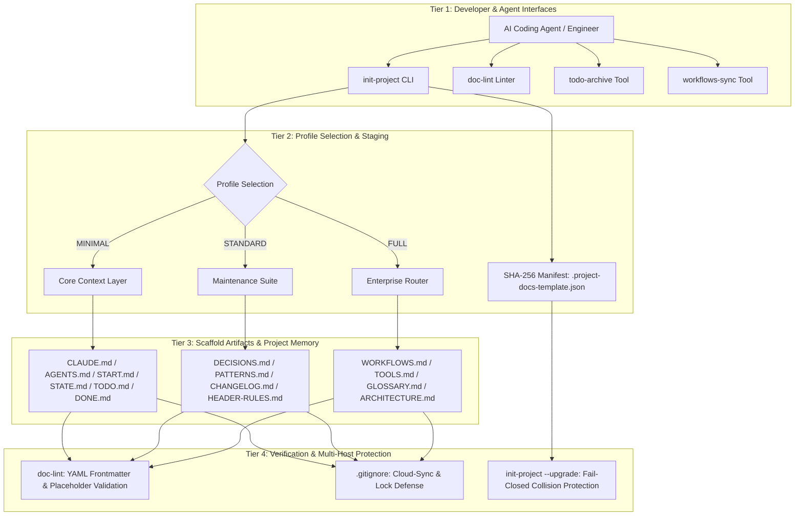
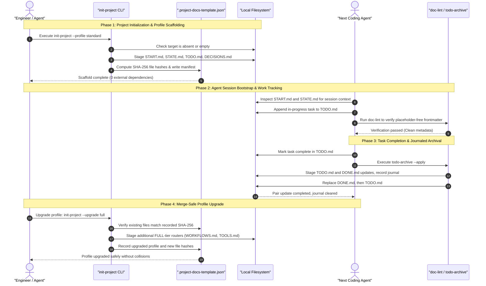

# Project Docs Template

**[English](README.md) · [Deutsch](README_de.md) · [Español](README_es.md) · [Français](README_fr.md) · [Русский](README_ru.md) · [日本語](README_ja.md) · [简体中文](README_zh.md) · [हिन्दी](README_hi.md) · [العربية](README_ar.md) · [বাংলা](README_bn.md) · [Português](README_pt.md)**

<p align="center"></p>

[](https://github.com/ellmos-ai/project-docs-template)
[](./pyproject.toml)
[](./pyproject.toml)
[](./RELEASE_GATE.md)
[](./tests)
[](./CONTRIBUTING.md)
[](./SECURITY.md)
[](./SECURITY.md)
[](./SECURITY.md)
[](./THIRD_PARTY_LICENSES.txt)
[](./SECURITY.md)
[](./NOTICE)
[](https://github.com/ellmos-ai)
[](https://github.com/open-bricks)
[](./llms.txt)
[](https://github.com/ellmos-ai/project-docs-template/actions/workflows/ci.yml)
[](./README_de.md)
[](./LICENSE)
[](./MARKETING-LOG.txt)
[](./THIRD_PARTY_LICENSES.md)
[](./MARKETING-LOG.txt)

এজেন্টের জন্য প্রস্তুত প্রকল্প-নথির টেমপ্লেট, যাতে রয়েছে START/STATE/TODO/DONE,
কর্মপ্রবাহ, হালকা টুল এবং LLM-উপযোগী প্রকল্প-স্মৃতি।

> [!NOTE]
> **AI / LLM সূচিকরণ**: AI এজেন্ট ও স্বয়ংক্রিয় টুল [llms.txt](llms.txt) দেখে মেশিনে-পাঠযোগ্য সারাংশ, অনুসন্ধান শব্দ এবং দ্ব্যর্থতা নিরসনের তথ্য পেতে পারে। সর্বশেষ পরীক্ষা: **2026-10-30**।

> স্বাধীন প্রকল্প, Anthropic, OpenAI বা Google-এর সঙ্গে কোনো সংশ্লিষ্টতা নেই।
> [ট্রেডমার্ক](#trademarks) দেখুন।

### 🧭 দ্রুত নেভিগেশন

1. [সারসংক্ষেপ ও মূল পরিচিতি](#executive-summary--core-identity)
2. [দৃশ্যমান স্থাপত্য ও পৃথক স্তর](#visual-architecture-topology)
3. [একাধিক এজেন্টের পূর্ণ জীবনচক্র ও টুলের প্রবাহ](#end-to-end-multi-agent-lifecycle)
4. [লক্ষ্য ব্যবহারকারী ও প্রধান ব্যবহারক্ষেত্র](#target-personas--core-use-cases)
5. [প্রকল্পের সক্ষমতা ও সীমা](#comparative-matrix-vs-alternatives)
6. [শাসনব্যবস্থা ও রানটাইম ইনভেরিয়েন্টের ম্যাট্রিক্স](#governance--runtime-invariants)
7. [কখন এই টেমপ্লেট ব্যবহার করবেন](#use-this-template-when)
8. [কী রয়েছে এবং প্রকল্পের প্রাথমিক কাঠামো](#what-is-included)
9. [দ্রুত শুরু ও প্রচলিত CLI কর্মপ্রবাহ](#quick-start)
10. [পরিবর্তন শনাক্তকারী প্রোফাইল আপগ্রেড ও মাইগ্রেশন](#merge-safe-profile-upgrades)
11. [প্রোফাইল তুলনা ম্যাট্রিক্স (MINIMAL / STANDARD / FULL)](#profile-comparison)
12. [নকশার নীতি ও স্থাপত্যগত ইনভেরিয়েন্ট](#design-principles)
13. [পরীক্ষা, যাচাই ও গুণমানের গেট](#verification)
14. [নিরাপত্তা নীতি ও দুর্বলতা প্রতিবেদন](#security-policy)
15. [তৃতীয় পক্ষের লাইসেন্স ও নির্ভরতা তালিকা](#third-party-licenses--transparency)
16. [ইকোসিস্টেমের বান্ডল, অংশীদার ও সংশ্লিষ্ট টুল](#ecosystem--sibling-tools)
17. [ট্রেডমার্ক ও স্বাধীনতার ঘোষণা](#trademarks)
18. [আইনি বিজ্ঞপ্তি, দায়বদ্ধতার সীমা ও লাইসেন্স (§ 521 BGB)](#license)

---

## <a id="sec-01"></a><a id="executive-summary--core-identity"></a><a id="what-is-project-docs-template"></a>1. সারসংক্ষেপ ও মূল পরিচিতি

`project-docs-template` স্বায়ত্তশাসিত AI কোডিং এজেন্ট (Claude Code, OpenAI Codex, Antigravity/Gemini), একাধিক এজেন্টের দল এবং সফটওয়্যার, গবেষণা ও পরিচালন-সংক্রান্ত রিপোজিটরির মানব রক্ষণাবেক্ষণকারীদের জন্য হালকা, এজেন্ট-উপযোগী নথি ও প্রকল্প-স্মৃতির কাঠামো দেয়।

প্রকল্পকে ভারী, অনমনীয় অপারেটিং সিস্টেমে পরিণত করা বা মালিকানাধীন SaaS পোর্টালের ওপর নির্ভর করার বদলে, `project-docs-template` স্বচ্ছ, মানসম্মত সাধারণ-পাঠ্য Markdown রেজিস্টার (`START.md`, `STATE.md`, `TODO.md`, `DONE.md`, `DECISIONS.md`) ব্যবহার করে। সবার জন্য অভিন্ন প্রবেশ-ফাইল (`CLAUDE.md`, `AGENTS.md`) এজেন্টদের প্রকল্পের অবস্থা, স্থাপত্যগত ইনভেরিয়েন্ট এবং সক্রিয় কাজ পড়ার একটি নির্দিষ্ট জায়গা দেয়। এগুলো প্রসঙ্গ সরবরাহ করে, তবে এজেন্ট সেগুলো সঠিকভাবে বুঝবে বা অনুসরণ করবে, এমন নিশ্চয়তা দেয় না।

### মূল মূল্য-প্রস্তাব
- **স্থানীয়ভাবে চালানো অগ্রাধিকার**: `SECURITY.md`-তে বলা হয়েছে, টেমপ্লেট তৈরি এবং তালিকাভুক্ত রক্ষণাবেক্ষণ টুল স্থানীয় ডিস্কে চলে, টেলিমেট্রি বা বহির্গামী নেটওয়ার্ক সংযোগ ছাড়া।
- **রানটাইম নির্ভরতা নেই**: প্রাথমিক কাঠামো তৈরি, স্টেজিং, যাচাই ও কাজ আর্কাইভ করার সব টুল কেবল Python 3.10+ স্ট্যান্ডার্ড লাইব্রেরি ব্যবহার করে।
- **এজেন্ট হ্যান্ডঅফের জন্য ভাগ করা সেশন-প্রসঙ্গ**: সেশনের নোট (`START.md`) এবং বর্তমান অবস্থার স্ন্যাপশট (`STATE.md`) পরবর্তী সেশনগুলোর জন্য অভিন্ন রেফারেন্স দেয়। এই ফাইলগুলো হ্যান্ডঅফে সহায়তা করে, তবে এজেন্টের আচরণের নিশ্চয়তা দেয় না বা প্রসঙ্গ হারানো ঠেকায় না।
- **পরিবর্তন শনাক্তসহ প্রোফাইল আপগ্রেড**: SHA-256 ম্যানিফেস্ট (`.project-docs-template.json`) পরিচালিত ফাইল যাচাই করে এবং পরবর্তী প্রোফাইল ধাপ স্থির করার আগে শনাক্ত করা সম্পাদনা বা অ-পরিচালিত ফাইলের সঙ্গে সংঘাত থাকলে আপগ্রেড প্রত্যাখ্যান করতে পারে।
- **জার্নালসহ কাজ আর্কাইভ**: `todo-archive` দুইটি কাজের ফাইলের আপডেট স্টেজ করে, জার্নাল নথিভুক্ত করে, প্রতিস্থাপনজনিত ত্রুটির পর রোলব্যাকের চেষ্টা করে এবং মাঝপথে থেমে যাওয়া দুই-ফাইলের কমিট পুনরুদ্ধার করতে পারে। ফাইলের অমিল থাকলে জার্নাল হাতে পর্যালোচনা করতে হতে পারে।

---

## <a id="sec-02"></a><a id="visual-architecture-topology"></a><a id="architecture--flow"></a>2. দৃশ্যমান স্থাপত্য ও পৃথক স্তর

নিচের চিত্রে `project-docs-template`-এর চারটি কার্যকরী স্তর দেখানো হয়েছে। এতে ডেভেলপার ও এজেন্টের ইন্টারফেস থেকে রিপোজিটরির ফাইল, যাচাই এবং নথিভুক্ত ক্লাউড-সিঙ্ক সংঘাত-প্রতি ফিল্টার পর্যন্ত সব রয়েছে।



### চার দৃষ্টিকোণ থেকে স্থাপত্যের রূপ

```text
+--------------------------------------------------------------------------------------------------+
|                  [VIEW 1: CLI COCKPIT, LINTER & AGENT INTERFACE HARNESS]                         |
|  - init-project: Deterministic scaffolding, SHA-256 manifest stamping & profile migrations      |
|  - doc-lint: Static markdown validation, frontmatter linting & header contract enforcement       |
|  - todo-archive: Journaled two-file task archive with staged replacement & recovery            |
|  - workflows-sync: Bidirectional orchestration synchronization & prompt template extraction      |
+--------------------------------------------------------------------------------------------------+
                                                |
                                                v
+--------------------------------------------------------------------------------------------------+
|                  [VIEW 2: TIERED PROFILE ENGINE & MERGE-SAFE STAGING]                            |
|  - MINIMAL Profile: Lightweight context boundary (CLAUDE.md, AGENTS.md, START.md, STATE.md)     |
|  - STANDARD Profile: Complete project memory (TODO.md, DONE.md, DECISIONS.md, PATTERNS.md)       |
|  - FULL Profile: Enterprise architecture & governance (WORKFLOWS.md, TOOLS.md, GLOSSARY.md)      |
|  - SHA-256 Manifest: tracks managed files and detects edits or unowned collisions                |
+--------------------------------------------------------------------------------------------------+
                                                |
                                                v
+--------------------------------------------------------------------------------------------------+
|                  [VIEW 3: RUNTIME PERSISTENCE, REPOSITORY MEMORY & AUDIT]                        |
|  - Entry Instructions: CLAUDE.md / AGENTS.md provide a place to read project guidance             |
|  - Session Memory: START.md (session bootloader) & STATE.md (live operational ledger)            |
|  - Task Tracking: Structured task cards, recurring checklists, and verification criteria        |
|  - Decision Ledger: ADR-style architectural records (DECISIONS.md) & code patterns (PATTERNS.md)|
+--------------------------------------------------------------------------------------------------+
                                                |
                                                v
+--------------------------------------------------------------------------------------------------+
|                  [VIEW 4: DOCUMENTED SECURITY POLICY & FILE CONFLICT FILTERS]                     |
|  - User Context: tools run without requiring administrator or root elevation                    |
|  - Zero-Egress Policy: SECURITY.md documents local operation without outbound traffic             |
|  - Conflict-Copy Filters: .gitignore lists known cloud-sync conflict patterns                    |
|  - Legal & Governance: § 521 BGB notice; SECURITY.md says best-effort, no guaranteed response    |
+--------------------------------------------------------------------------------------------------+
```

---

## <a id="sec-03"></a><a id="end-to-end-multi-agent-lifecycle"></a>3. একাধিক এজেন্টের পূর্ণ জীবনচক্র ও টুলের প্রবাহ

সিকোয়েন্স ডায়াগ্রামে দেখানো হয়েছে, ডেভেলপার ও AI কোডিং এজেন্টরা প্রাথমিক কাঠামো তৈরি, সেশন শুরু, কাজ সম্পন্ন ও প্রোফাইল আপগ্রেডের সময় কীভাবে `project-docs-template` ব্যবহার করতে পারে। নথি হ্যান্ডঅফের প্রসঙ্গ দেয়। সেগুলো পড়া ও প্রয়োগের দায়িত্ব এজেন্টের।



---

## <a id="sec-04"></a><a id="target-personas--discoverability"></a><a id="target-personas--core-use-cases"></a>4. লক্ষ্য ব্যবহারকারী ও প্রধান ব্যবহারক্ষেত্র

`project-docs-template` প্রসঙ্গের বিচ্যুতি, হ্যান্ডঅফে তথ্য হারানো এবং শাসনগত জটিলতা সামলাতে চারটি প্রধান প্রযুক্তিগত ব্যবহারক্ষেত্রে সহায়তার জন্য তৈরি:

| লক্ষ্য ব্যবহারকারী | প্রধান সমস্যা | `project-docs-template` কীভাবে সাহায্য করে | মূল ফাইল |
|:---|:---|:---|:---|
| **মাল্টি-এজেন্ট সিস্টেম প্রকৌশলী** | ভিন্নধর্মী কোডিং এজেন্ট (Claude Code, Antigravity/Gemini, Codex) সেশনগুলোর মধ্যে প্রকল্পের প্রসঙ্গ হারাতে পারে বা ভিন্ন ফাইল ফরম্যাট ব্যবহার করতে পারে। | অভিন্ন প্রবেশ-ফাইল (`CLAUDE.md`, `AGENTS.md`) এবং সেশন/অবস্থা রেজিস্টার (`START.md`, `STATE.md`) এজেন্টদের নির্দেশ ও নথিভুক্ত প্রসঙ্গ পড়ার ভাগ করা জায়গা দেয়। নির্ভরযোগ্য হ্যান্ডঅফের জন্য এজেন্ট ও রক্ষণাবেক্ষণকারীদের এই ফাইল ব্যবহার করা এখনও জরুরি। | `CLAUDE.md`, `AGENTS.md`, `START.md`, `STATE.md` |
| **স্বাধীন ডেভেলপার ও ওপেন-সোর্স রক্ষণাবেক্ষণকারী** | ভারী প্রকল্প-ব্যবস্থাপনা SaaS ছাড়া সমস্যা, ফিচারের ব্যাকলগ এবং রিলিজের ইতিহাস সামলানো। | কম-ঝামেলার Markdown কাজের চক্র (`TODO.md`, `DONE.md`), জার্নালসহ আর্কাইভ টুল (`todo-archive`) এবং মানক `CHANGELOG.md`। | `TODO.md`, `DONE.md`, `_tools/todo-archive`, `CHANGELOG.md` |
| **এন্টারপ্রাইজ স্থাপত্য ও AI শাসনের নেতৃত্ব** | নিরীক্ষাযোগ্য সিদ্ধান্তের রেকর্ড ও কমপ্লায়েন্সের স্বচ্ছতার অভাব, পাশাপাশি কর্পোরেট এজেন্ট কর্মপ্রবাহে অনিচ্ছাকৃত তথ্য বাইরে চলে যাওয়ার ঝুঁকি। | স্থাপত্য সিদ্ধান্তের রেকর্ড (`DECISIONS.md`), `SECURITY.md`-তে নথিভুক্ত কঠোর স্থানীয়-প্রথম ইনভেরিয়েন্ট এবং রানটাইমে বাহ্যিক নির্ভরতার অনুপস্থিতি। | `DECISIONS.md`, `SECURITY.md`, `THIRD_PARTY_LICENSES.md` |
| **গবেষণা ও বৈজ্ঞানিক পাইপলাইন ডেভেলপার** | জটিল বহু-ধাপের পরীক্ষামূলক পাইপলাইন কয়েক সপ্তাহের স্বায়ত্তশাসিত LLM যুক্তি-চালনার সময় বিচ্যুত হতে পারে। | সম্প্রসারণযোগ্য FULL প্রোফাইলে পরিচালন রানবুক (`WORKFLOWS.md`), ক্ষেত্রভিত্তিক পরিভাষা (`GLOSSARY.md`) এবং স্বয়ংক্রিয় টেবিল সিঙ্ক (`workflows-sync`) রয়েছে। | `WORKFLOWS.md`, `GLOSSARY.md`, `_tools/workflows-sync` |

### উচ্চ-উদ্দেশ্য অনুসন্ধান প্রশ্ন
- `agent-ready project documentation template`
- `claude code documentation scaffold`
- `multi-agent session handoff state start todo done`
- `offline local-first project template python`
- `zero-egress developer scaffolding stdlib`
- `deterministic documentation staging and profile upgrades`
- `llm friendly project memory repository template`

---

## <a id="sec-05"></a><a id="comparative-matrix-vs-alternatives"></a><a id="comparative-architecture"></a>5. প্রকল্পের সক্ষমতা ও সীমা

নিচের টেবিলে প্রকল্পের নথিভুক্ত দশটি ইনভেরিয়েন্ট এবং এই সোর্স কমিটে সমর্থিত আচরণ ও সীমা সংক্ষেপে দেখানো হয়েছে:

| # | ইনভেরিয়েন্ট | নথিভুক্ত সক্ষমতা | পরিধি / সীমা |
|---|:---|:---|:---|
| 1 | **INV-LOCAL-01: স্থানীয়ভাবে অগ্রাধিকার, বাইরে ডেটা পাঠানো হয় না** | `SECURITY.md` অনুযায়ী টেমপ্লেট তৈরি এবং তালিকাভুক্ত রক্ষণাবেক্ষণ টুল স্থানীয় ডিস্কে চলে, বহির্গামী টেলিমেট্রি বা নেটওয়ার্ক ট্র্যাফিক ছাড়া। | এটি ওই টুলগুলোর নথিভুক্ত পরিধি, অপারেটিং-সিস্টেম স্তরের নেটওয়ার্ক স্যান্ডবক্স নয়। |
| 2 | **INV-SEC-02: কলকারী প্রক্রিয়ার প্রসঙ্গ** | স্ক্রিপ্টগুলো কলকারী প্রক্রিয়ার প্রসঙ্গ গ্রহণ করে। CLI উচ্চতর অনুমতি চায় না। | আগে থেকেই বিশেষাধিকারপ্রাপ্ত কলকারী সেই অধিকার ধরে রাখে। সাধারণ ব্যবহারকারী হিসেবে চালানো বাধ্যতামূলক করা বা এ বিষয়ে কোনো সনদ থাকার দাবি করা হয় না। |
| 3 | **INV-FAIL-03: ব্যর্থতার ক্ষেত্রে পরিবর্তন বন্ধ রাখা** | নতুন তৈরি প্রক্রিয়া আগে থেকে থাকা অ-খালি লক্ষ্য প্রত্যাখ্যান করে। আপগ্রেডে পরিচালিত ফাইলে শনাক্ত পরিবর্তন বা অ-পরিচালিত ফাইলের সঙ্গে সংঘাত থাকলে পরিবর্তন কমিট করার আগে তা প্রত্যাখ্যান করা হয়। | তৈরি প্রক্রিয়া অভিভাবক ডিরেক্টরি ও স্টেজিং এলাকা তৈরি করে এবং ফলাফল লক্ষ্যে বসানোর আগে প্রস্তুত ফাইল সেখানে লেখে। ব্যর্থ হলে কোনো লেখাই হবে না, এমন সার্বিক নিশ্চয়তা এটি নয়। |
| 4 | **INV-STG-04: স্টেজ করা প্রোফাইল আপগ্রেড** | আপগ্রেডে ম্যানিফেস্ট হ্যাশ যাচাই করা হয়, পরের প্রোফাইল স্টেজ করা হয়, ফাইলের ব্যাকআপ নেওয়া হয় এবং কমিট ব্যর্থ হলে হ্যাশ-সুরক্ষিত রোলব্যাকের চেষ্টা করা হয়। | পুনরুদ্ধার শর্তসাপেক্ষ। সমসাময়িক পরিবর্তন বা পরবর্তী ফাইল-সিস্টেম ত্রুটি সম্পূর্ণ রোলব্যাক ঠেকাতে পারে। |
| 5 | **INV-HANDOFF-05: সেশন প্রসঙ্গ** | `START.md` এবং `STATE.md` এজেন্ট ও রক্ষণাবেক্ষণকারীদের জন্য প্রকল্প ও সেশনের ভাগ করা রেকর্ড দেয়। | এজেন্ট ওই রেকর্ড পড়বে, অনুসরণ করবে বা মনে রাখবে, টেমপ্লেট তা নিশ্চিত করতে পারে না। |
| 6 | **INV-TIER-06: স্তরভিত্তিক প্রোফাইল** | টেমপ্লেটে `MINIMAL`, `STANDARD` এবং `FULL` প্রোফাইল আছে। আপগ্রেড একবারে একটি প্রোফাইল ধাপ এগোয়। | এগুলো নথির কাঠামো, এজেন্টের রানটাইম ফ্রেমওয়ার্ক নয়। |
| 7 | **INV-SYNC-07: সংঘাত-প্রতি ফিল্টারিং** | রিপোজিটরি ও টেমপ্লেটের `.gitignore` ফাইলে পরিচিত সংঘাত-প্রতি এবং লক ফাইলের প্যাটার্ন তালিকাভুক্ত আছে। | উপেক্ষার প্যাটার্ন একযোগে লেখকদের সমন্বয় করে না বা সচল বিতরণকৃত লক দেয় না। |
| 8 | **INV-AUDIT-08: TODO/DONE আর্কাইভ** | `todo-archive` দুই ফাইলের আপডেট জার্নালে নথিভুক্ত ও স্টেজ করে, প্রতিস্থাপন ত্রুটির পর রোলব্যাকের চেষ্টা করে এবং মাঝপথে থেমে যাওয়া দুই-ফাইলের কমিট পুনরুদ্ধার করতে পারে। | ফাইলে অমিল থাকলে জার্নাল হাতে পর্যালোচনা করতে হয়। গুরুতর ফাইল-সিস্টেম ত্রুটিতে রোলব্যাক নিজেও ব্যর্থ হতে পারে। |
| 9 | **INV-LIC-09: রানটাইম নির্ভরতার পরিধি** | প্রকল্প `dependencies = []` ঘোষণা করে এবং রানটাইমে Python স্ট্যান্ডার্ড লাইব্রেরি ব্যবহার করে। | এটি রানটাইম নির্ভরতার বিবরণ। উন্নয়ন ও পরীক্ষার টুল আলাদা। |
| 10 | **INV-SLA-10: নিরাপত্তা প্রতিক্রিয়া নীতি** | `SECURITY.md` সমর্থিত `0.1.x` সংস্করণের জন্য সর্বোচ্চ প্রচেষ্টায় রক্ষণাবেক্ষণ এবং নিরাপত্তা সংশোধনকে অগ্রাধিকার দেওয়ার কথা বলে। প্রতিক্রিয়ার সময়সীমা নিশ্চিত নয়। | 48 ঘণ্টার মধ্যে উত্তর বা 5 কর্মদিবসের মধ্যে প্রাথমিক নিরাপত্তা মূল্যায়নের প্রতিশ্রুতি ধরে নেবেন না। তালিকাভুক্ত গোপনীয় প্রতিবেদন-চ্যানেল ব্যবহার করুন। |

---

## <a id="sec-06"></a><a id="governance--runtime-invariants"></a>6. শাসনব্যবস্থা ও রানটাইম ইনভেরিয়েন্টের ম্যাট্রিক্স

প্রকল্পের কাঠামো তৈরির টুল, রক্ষণাবেক্ষণের CLI ইউটিলিটি এবং তৈরি রিপোজিটরি প্রোফাইলজুড়ে রানটাইম, স্টেজিং ও শাসনব্যবস্থার দশটি ইনভেরিয়েন্ট নথিভুক্ত রয়েছে:

| স্বীকৃত ID | ইনভেরিয়েন্ট | নথিভুক্ত আচরণ ও পরিধি |
|:---|:---|:---|
| **INV-LOCAL-01** | **স্থানীয়ভাবে অগ্রাধিকার, বাইরে ডেটা পাঠানো হয় না** | `SECURITY.md` নথিভুক্ত করে যে টেমপ্লেট তৈরি এবং তালিকাভুক্ত রক্ষণাবেক্ষণ স্ক্রিপ্ট প্রকল্প শুরু বা আপগ্রেডের সময় বহির্গামী টেলিমেট্রি ও নেটওয়ার্ক ট্র্যাফিক ছাড়া স্থানীয় ডিস্কে চলে। |
| **INV-SEC-02** | **কলকারী প্রক্রিয়ার প্রসঙ্গ** | স্ক্রিপ্টগুলো কলকারী প্রক্রিয়ার প্রসঙ্গ গ্রহণ করে। CLI উচ্চতর অনুমতি চায় না। আগে থেকেই বিশেষাধিকারপ্রাপ্ত কলকারী সেই অধিকার ধরে রাখে। সাধারণ ব্যবহারকারী হিসেবে চালানো বাধ্যতামূলক করা বা এ বিষয়ে কোনো সনদ থাকার দাবি করা হয় না। |
| **INV-FAIL-03** | **ব্যর্থতার ক্ষেত্রে পরিবর্তন বন্ধ রাখা** | নতুন তৈরি প্রক্রিয়া আগে থেকে থাকা অ-খালি লক্ষ্য প্রত্যাখ্যান করে। আপগ্রেডে পরিচালিত ফাইলে শনাক্ত পরিবর্তন বা অ-পরিচালিত ফাইলের সঙ্গে সংঘাত কমিটের আগে প্রত্যাখ্যান করা হয়। তৈরি প্রক্রিয়া তবু অভিভাবক ডিরেক্টরি ও স্টেজিং এলাকা তৈরি করে এবং লক্ষ্যে বসানোর আগে সেখানে ফাইল লেখে। |
| **INV-STG-04** | **স্টেজ করা আপগ্রেড ও সুরক্ষিত পুনরুদ্ধার** | কমিটের আগে আপগ্রেডে ম্যানিফেস্ট হ্যাশ পরীক্ষা ও প্রোফাইলের ফাইল স্টেজ করা হয়। ব্যাকআপ ও হ্যাশ পরীক্ষা পুনরুদ্ধারের চেষ্টা সমর্থন করে। পুনরুদ্ধার শর্তসাপেক্ষ এবং অতিরিক্ত ফাইল-সিস্টেম ত্রুটি বা সমসাময়িক পরিবর্তনে আটকে যেতে পারে। |
| **INV-HANDOFF-05** | **এজেন্ট সেশনের প্রসঙ্গ** | `START.md` এবং `STATE.md`-তে প্রকল্প ও সেশনের প্রসঙ্গ রাখা হয়। এজেন্ট এগুলো পড়বে, অনুসরণ করবে বা মনে রাখবে কি না তা তাদের আচরণ এবং আশপাশের কর্মপ্রবাহের ওপর নির্ভর করে। |
| **INV-TIER-06** | **সম্প্রসারণযোগ্য স্তরভিত্তিক প্রোফাইল** | তিনটি প্রোফাইল (`MINIMAL`, `STANDARD`, `FULL`) ভিন্ন নথি-কাঠামো ও রক্ষণাবেক্ষণের পরিধি দেয়। |
| **INV-SYNC-07** | **ক্লাউড-সিঙ্ক সংঘাত ফিল্টারিং** | রুট ও টেমপ্লেটের `.gitignore` ফাইলগুলো তালিকাভুক্ত সংঘাত-প্রতি ও লক ফাইলের প্যাটার্ন ফিল্টার করে। এগুলো সচল লেখকদের সমন্বয় করে না। |
| **INV-AUDIT-08** | **জার্নালসহ কাজ আর্কাইভ** | `todo-archive` `TODO.md` ও `DONE.md`-এর আপডেট স্টেজ করে, জার্নাল রাখে, প্রতিস্থাপন ত্রুটির পর পুনরুদ্ধারের চেষ্টা করে এবং মাঝপথে থেমে যাওয়া দুই-ফাইলের কমিট পুনরুদ্ধারে সহায়তা করে। অমিল থাকলে জার্নাল হাতে পর্যালোচনা করতে হয়। |
| **INV-LIC-09** | **রানটাইম নির্ভরতা** | রানটাইম নির্ভরতা `dependencies = []` হিসেবে ঘোষিত এবং প্রোগ্রাম Python স্ট্যান্ডার্ড লাইব্রেরি ব্যবহার করে। উন্নয়ন ও পরীক্ষার টুল এই রানটাইম নির্ভরতার দাবির বাইরে। |
| **INV-SLA-10** | **নিরাপত্তা প্রতিবেদন নীতি** | `SECURITY.md` বলে যে `0.1.x` সংস্করণের রক্ষণাবেক্ষণ সর্বোচ্চ প্রচেষ্টায় করা হয়, প্রতিক্রিয়ার সময় নিশ্চিত নয় এবং নিরাপত্তা সংশোধন অগ্রাধিকার পায়। |

---

## <a id="sec-07"></a><a id="use-this-template-when"></a>7. কখন এই টেমপ্লেট ব্যবহার করবেন

| পরিস্থিতি | কেন এটি সহায়ক |
|:---|:---|
| নতুন প্রকল্প Claude Code, Codex, Gemini CLI বা অন্য কোনো কোডিং এজেন্ট দিয়ে রক্ষণাবেক্ষণ করা হবে | এজেন্টকে অনুমানযোগ্য বুটস্ট্র্যাপ ধাপ এবং বর্তমান অবস্থার ফাইল দেয়। |
| বিদ্যমান রিপোজিটরিতে নোট ছড়ানো, কাজের ফাইল পুরোনো বা হ্যান্ডঅফের রেকর্ড নেই | চলমান ও সম্পন্ন কাজ, সিদ্ধান্ত, প্যাটার্ন এবং সেশনের অবস্থা আলাদা করে। |
| একাধিক এজেন্ট বা মানুষের নিরাপদে কাজ আবার শুরু করা দরকার | নির্দেশনা, বর্তমান অবস্থা, কর্মপ্রবাহ ও টুল আলাদা ফাইলে রাখে। |

এটি নথি ও সমন্বয়ের টেমপ্লেট, রানটাইম ফ্রেমওয়ার্ক নয়।
এটি সাধারণ সফটওয়্যার, গবেষণা বা পরিচালন-সংক্রান্ত রিপোজিটরির ভেতরে ব্যবহারের জন্য তৈরি।

---

## <a id="sec-08"></a><a id="what-is-included"></a>8. কী রয়েছে এবং প্রকল্পের প্রাথমিক কাঠামো

- এজেন্ট নির্দেশনার জন্য `CLAUDE.md` ও `AGENTS.md`
- সেশন বুটস্ট্র্যাপ ও বর্তমান অবস্থার জন্য `START.md` ও `STATE.md`
- ঐচ্ছিক আর্কাইভ টুলসহ `TODO.md` ও `DONE.md`
- `DECISIONS.md`, `PATTERNS.md`, `CHANGELOG.md` ও `HEADER-RULES.md`
- FULL প্রোফাইলের ঐচ্ছিক রাউটার: `WORKFLOWS.md`, `TOOLS.md`, `GLOSSARY.md`
- `_tools/`-এ স্থানীয় সহায়ক টুল, যেমন `init-project`, `doc-lint`, `todo-archive` ও `workflows-sync`

টেমপ্লেটের আসল ফাইলগুলো [`template/`](./template/) ডিরেক্টরিতে রয়েছে।

---

## <a id="sec-09"></a><a id="quick-start"></a>9. দ্রুত শুরু ও প্রচলিত CLI কর্মপ্রবাহ

রিপোজিটরি ক্লোন করে কয়েক সেকেন্ডে এজেন্ট-উপযোগী ওয়ার্কস্পেস তৈরি করুন:

```bash
git clone https://github.com/ellmos-ai/project-docs-template.git
cd project-docs-template

# Inspect scaffold generation without writing changes (dry-run)
python template/_tools/init-project --target /path/to/my-project --name "my-project" --profile STANDARD --dry-run

# Render STANDARD profile (12 root contracts & tools with SHA-256 manifest)
python template/_tools/init-project --target /path/to/my-project --name "my-project" --profile STANDARD

# Optional: initialize Git repository with staged initial commit
python template/_tools/init-project --target /path/to/my-project --name "my-project" --profile STANDARD --git
```

### ধাপে ধাপে তৈরি (টার্মিনাল আউটপুট)

`init-project` চালালে এটি পাশে একটি স্টেজিং ডিরেক্টরি তৈরি করে, নির্বাচিত প্রোফাইল রেন্ডার করে, প্রস্তুতি ও যাচাই চালায়, ম্যানিফেস্ট লেখে এবং পরে স্টেজ করা ফলাফল লক্ষ্যস্থলে বসায়। লক্ষ্য ডিরেক্টরি না-ও থাকতে পারে, অথবা আগে থেকে থাকা খালি ডিরেক্টরি হতে পারে:

```text
==> Root:    /path/to/.my-project.staging-xyz123
==> Max age: 30 days

Results:
  OK   CLAUDE.md
  OK   START.md
  OK   STATE.md

OK: Alle geprüften Files bestehen (oder wurden gefixt)
==> Target:  /path/to/my-project
==> Name:    my-project
==> Author:  Alex Developer
==> Date:    2026-10-30

==> Profil: STANDARD
    Ernsthafte Projekte mit mehrmonatiger Lebensdauer
  OK: AGENTS.md
  OK: CLAUDE.md
  OK: README.md
  OK: START.md
  OK: STATE.md
  OK: CHANGELOG.md
  OK: HEADER-RULES.md
  OK: CUT-AND-CLUE.md
  OK: DECISIONS.md
  OK: PATTERNS.md
  OK: TODO.md
  OK: DONE.md
  OK: .gitignore
  OK: _tools/README.md
  OK: _tools/todo-archive
  OK: _tools/doc-lint

==> Fertig: /path/to/my-project
```

### তৈরি প্রোজেক্টে প্রচলিত CLI রক্ষণাবেক্ষণ কর্মপ্রবাহ

তৈরি করা ওয়ার্কস্পেসে `_tools/`-এর মধ্যে হালকা, নির্ভরতাহীন টুল থাকে:

```bash
# Lint project documentation and verify YAML frontmatter & staleness
python _tools/doc-lint

# Automatically insert missing frontmatter fields & refresh verification dates
python _tools/doc-lint --fix --update-dates

# Archive completed tasks with journaling
python _tools/todo-archive --apply

# Synchronize workflow tables across routers (FULL profile)
python _tools/workflows-sync --apply
```

> [!NOTE]
> **টেমপ্লেটের ভাষা:** রিপোজিটরির নথি ইংরেজিতে, কিন্তু [`template/`](./template/) ডিরেক্টরির টেমপ্লেটের মূল লেখা (`CLAUDE.md`, `START.md`, `STATE.md`, `TODO.md` ইত্যাদি) এবং `init-project`, `doc-lint`, `todo-archive`, `workflows-sync`-এর CLI আউটপুট জার্মান ভাষায়। ফাইলের নাম, প্রোফাইল মার্কার এবং YAML ফ্রন্ট ম্যাটারের কী ভাষা-নিরপেক্ষ। তাই ইংরেজি প্রকল্প এই কাঠামো ব্যবহার করে মূল লেখা বদলে নিতে পারে। ইংরেজি টেমপ্লেট সেটের পরিকল্পনা রয়েছে। বিস্তারিত [`TODO.md`](./TODO.md)-তে।

---

## <a id="sec-10"></a><a id="merge-safe-profile-upgrades"></a>10. পরিবর্তন শনাক্তকারী প্রোফাইল আপগ্রেড ও মাইগ্রেশন

বিদ্যমান প্রকল্পকে পরের প্রোফাইল স্তরে আপগ্রেড করা যায়:

```bash
# Upgrade existing project to FULL profile
python template/_tools/init-project /path/to/my-project --upgrade full
```

### আপগ্রেডের সময় নিরাপত্তা যাচাই
- **ম্যানিফেস্ট যাচাই**: `.project-docs-template.json` পড়ে পরিচালিত ফাইলগুলোর হ্যাশ তুলনা করে।
- **অ-পরিচালিত ফাইলের সংঘাতে থামা**: যোগ করার ফাইলটি আগে থেকেই থাকলে এবং আগের ম্যানিফেস্টের বাইরে হলে, লক্ষ্যস্থলে পরিবর্তন কমিট করার আগেই আপগ্রেড থেমে যায়। তখন স্টেজিং ডিরেক্টরি তৈরি হয়ে থাকতে পারে।
- **পরিচালিত ফাইল বদলালে প্রত্যাখ্যান**: পরিচালিত ফাইলের হ্যাশ ম্যানিফেস্টের সঙ্গে না মিললে আপগ্রেড এগোয় না। কোনো নিশ্চিতকরণ প্রম্পট বা স্বয়ংক্রিয় ওভাররাইট হয় না।
- **শর্তসাপেক্ষ রোলব্যাকের চেষ্টা**: পরিবর্তন কমিটের সময় ব্যাকআপ ও বর্তমান হ্যাশ যাচাই ওই রান দ্বারা বদলানো ফাইল পুনরুদ্ধারে সহায়তা করে। অন্য পরিবর্তন শনাক্ত হলে সেটি ওভাররাইট এড়াতে পুনরুদ্ধার বাদ দেওয়া হয়। অতিরিক্ত ফাইল-সিস্টেম ত্রুটিতেও রোলব্যাক সম্পূর্ণ নাও হতে পারে।

---

## <a id="sec-11"></a><a id="profile-comparison"></a>11. প্রোফাইল তুলনা ম্যাট্রিক্স

| বৈশিষ্ট্য / নথি | `MINIMAL` | `STANDARD` | `FULL` |
|:---|:---:|:---:|:---:|
| `CLAUDE.md` ও `AGENTS.md` (এজেন্ট নির্দেশনা) | ✅ অন্তর্ভুক্ত | ✅ অন্তর্ভুক্ত | ✅ অন্তর্ভুক্ত |
| `START.md` ও `STATE.md` (সেশন স্মৃতি) | ✅ অন্তর্ভুক্ত | ✅ অন্তর্ভুক্ত | ✅ অন্তর্ভুক্ত |
| `TODO.md` ও `DONE.md` (কাজের ট্র্যাকিং) | ✅ অন্তর্ভুক্ত | ✅ অন্তর্ভুক্ত | ✅ অন্তর্ভুক্ত |
| `_tools/todo-archive` (কাজ আর্কাইভ) | ✅ অন্তর্ভুক্ত | ✅ অন্তর্ভুক্ত | ✅ অন্তর্ভুক্ত |
| `_tools/doc-lint` (নথি লিন্টার) | ✅ অন্তর্ভুক্ত | ✅ অন্তর্ভুক্ত | ✅ অন্তর্ভুক্ত |
| `DECISIONS.md` (স্থাপত্যগত সিদ্ধান্ত) | — | ✅ অন্তর্ভুক্ত | ✅ অন্তর্ভুক্ত |
| `PATTERNS.md` (নকশার প্যাটার্ন) | — | ✅ অন্তর্ভুক্ত | ✅ অন্তর্ভুক্ত |
| `CHANGELOG.md` ও `HEADER-RULES.md` | — | ✅ অন্তর্ভুক্ত | ✅ অন্তর্ভুক্ত |
| `WORKFLOWS.md` ও `_tools/workflows-sync` | — | — | ✅ অন্তর্ভুক্ত |
| `TOOLS.md` ও `GLOSSARY.md` (ডোমেইন রাউটার) | — | — | ✅ অন্তর্ভুক্ত |
| `ARCHITECTURE.md` ও `.github/` কর্মপ্রবাহ | — | — | ✅ অন্তর্ভুক্ত |

---

## <a id="sec-12"></a><a id="design-principles"></a>12. নকশার নীতি ও স্থাপত্যগত ইনভেরিয়েন্ট

- **দায়িত্বের বিভাজন**: প্রতিটি ফাইলের একটি সুস্পষ্টভাবে নির্ধারিত পরিচালনগত দায়িত্ব রয়েছে।
- **সুস্পষ্ট সেশন হ্যান্ডঅফ**: এজেন্ট ও রক্ষণাবেক্ষণকারীদের দেখার জন্য সেশন শুরুর তথ্য ও বর্তমান অবস্থা ছোট, অনুমানযোগ্য ফাইলে (`START.md`, `STATE.md`) নথিভুক্ত থাকে।
- **কম রক্ষণাবেক্ষণ-ভার**: বিশাল, অরক্ষণাবেক্ষিত উইকি তৈরির বদলে উচ্চ-মূল্যের প্রসঙ্গ নথিতে মনোযোগ দেয়।
- **রাউটার প্যাটার্ন**: উচ্চস্তরের রাউটার (`WORKFLOWS.md`, `TOOLS.md`) বিস্তারিত নকল না করে সেগুলোর সূচি দেয়।
- **জার্নালসহ কাজের জীবনচক্র**: `todo-archive` সম্পন্ন কাজ আর্কাইভ করতে জার্নাল ও স্টেজ করা ফাইল প্রতিস্থাপন ব্যবহার করে। পুনরুদ্ধার জার্নাল ও ফাইলের বর্তমান অবস্থার ওপর নির্ভর করে।

সম্পূর্ণ নকশাগত যুক্তির জন্য [`template/TEMPLATE.md`](./template/TEMPLATE.md) দেখুন।

---

## <a id="sec-13"></a><a id="verification"></a>13. পরীক্ষা, যাচাই ও গুণমানের গেট

টেস্ট স্যুট Python-এর স্ট্যান্ডার্ড `unittest` অথবা `pytest` দিয়ে চালানো হয়:

```bash
# Run test suite via pytest
pytest -ra -v

# Run test suite via standard unittest
python -m unittest discover -s tests -v
```

পরীক্ষায় সব প্রোফাইল, Git ইনিশিয়ালাইজেশন, YAML ফ্রন্ট ম্যাটার মেরামত, কর্মপ্রবাহ মেটাডেটা এস্কেপিং, পরিবর্তিত বা সংঘাতপূর্ণ আপগ্রেড লক্ষ্য প্রত্যাখ্যান, ম্যানিফেস্ট কমিটে কৃত্রিম ব্যর্থতার পর রোলব্যাক, TODO/DONE-এর দ্বিতীয় প্রতিস্থাপনে কৃত্রিম ব্যর্থতার পর রোলব্যাক এবং জার্নাল থেকে বাধাপ্রাপ্ত আর্কাইভ পুনরুদ্ধার অন্তর্ভুক্ত। একই স্যুট Linux, Windows ও macOS-এর জন্য কনফিগার করা। [`RELEASE_GATE.md`](./RELEASE_GATE.md) দেখুন।

---

## <a id="sec-14"></a><a id="security-policy"></a>14. নিরাপত্তা নীতি ও দুর্বলতা প্রতিবেদন

`project-docs-template` `SECURITY.md`-তে নথিভুক্ত নীতি অনুসরণ করে:
- **স্থানীয়ভাবে অগ্রাধিকার, বাইরে ডেটা পাঠানো হয় না**: `SECURITY.md` অনুযায়ী, প্রকল্প ইনিশিয়ালাইজ ও আপগ্রেড করার সময় টেমপ্লেট তৈরি এবং তালিকাভুক্ত রক্ষণাবেক্ষণ টুল স্থানীয় ডিস্কে চলে, বহির্গামী টেলিমেট্রি বা নেটওয়ার্ক ট্র্যাফিক ছাড়া।
- **ধাপে তৈরি ও আপগ্রেড যাচাই**: তৈরি প্রক্রিয়া লক্ষ্যস্থলের পাশে আউটপুট স্টেজ করে, বসানোর আগে যাচাই করে এবং আগে থেকে থাকা অ-খালি লক্ষ্য প্রত্যাখ্যান করে। প্রোফাইল আপগ্রেড কমিটের আগে পরিচালিত ফাইলের হ্যাশ ও অ-পরিচালিত ফাইলের সংঘাত যাচাই করে। রোলব্যাক শর্তসাপেক্ষ।
- **সমর্থিত সংস্করণ ও প্রতিক্রিয়া নীতি**: `SECURITY.md`-তে বলা হয়েছে, `0.1.x` সংস্করণের `main` শাখা সর্বোচ্চ প্রচেষ্টায় রক্ষণাবেক্ষণ করা হয় এবং নিরাপত্তা সংশোধন অগ্রাধিকার পায়। প্রতিক্রিয়ার সময় নিশ্চিত নয়। `0.1.0`-এর আগের সংস্করণ সমর্থিত নয়।

সম্ভাব্য দুর্বলতা [`SECURITY.md`](./SECURITY.md)-এর নির্দেশনা অনুযায়ী জানান। অগ্রাধিকারপ্রাপ্ত পদ্ধতি GitHub Private Security Advisory, অথবা তালিকাভুক্ত রক্ষণাবেক্ষণকারীদের সঙ্গে সরাসরি যোগাযোগ করুন। প্যাচ না হওয়া দুর্বলতা প্রকাশ্য ইস্যুতে জানাবেন না। প্যাচ প্রকাশ না হওয়া পর্যন্ত নীতি সমন্বিত প্রকাশের অনুরোধ করে। নীতিতে `security@ellmos.ai`, `support@lukasgeiger.com` ও `lukas@open-bricks.org` ঠিকানা রয়েছে।

---

## <a id="sec-15"></a><a id="third-party-licenses--transparency"></a>15. তৃতীয় পক্ষের লাইসেন্স ও নির্ভরতা তালিকা

`project-docs-template`-এ **কঠোর রানটাইম-নির্ভরতাহীন স্থাপত্য** (`dependencies = []`) রয়েছে। সব রানটাইম কোড একচেটিয়াভাবে Python স্ট্যান্ডার্ড লাইব্রেরির ওপর নির্ভরশীল (3.10+)।

| উপাদান | পরিধি | ঘোষিত লাইসেন্স | অবস্থা |
|:---|:---|:---|:---|
| **Python স্ট্যান্ডার্ড লাইব্রেরি** | মূল রানটাইম | PSFL-2.0 | 100% পারমিসিভ লাইসেন্স (অন্তর্ভুক্ত) |
| **pytest** | তৃতীয় পক্ষের উন্নয়ন/পরীক্ষা নির্ভরতা | MIT লাইসেন্স | 100% পারমিসিভ লাইসেন্স |
| **ruff** | উন্নয়ন／গুণমান নিশ্চয়তা | MIT / Apache-2.0 | 100% পারমিসিভ লাইসেন্স |
| **setuptools** | বিল্ড ব্যাকএন্ড | MIT লাইসেন্স | 100% পারমিসিভ লাইসেন্স |

রানটাইম ও উন্নয়ন নির্ভরতার ঘোষিত লাইসেন্স এবং নির্ভরতার তালিকা [THIRD_PARTY_LICENSES.md](THIRD_PARTY_LICENSES.md) ও এর সাধারণ-পাঠ্য সহায়ক [THIRD_PARTY_LICENSES.txt](THIRD_PARTY_LICENSES.txt)-এ দেওয়া আছে। এই ফাইলগুলো তালিকাভুক্ত বিষয় নথিভুক্ত করে। এখানে স্বাধীন অডিট বা স্তর 1 SBOM সার্টিফিকেশনের দাবি করা হয়নি।

---

## <a id="sec-16"></a><a id="ecosystem--sibling-tools"></a><a id="bundles-and-partners"></a>16. বান্ডল, অংশীদার ও ইকোসিস্টেমের সংশ্লিষ্ট সরঞ্জাম

`project-docs-template` হলো [`ellmos-ai`](https://github.com/ellmos-ai) ইকোসিস্টেম এবং বৃহত্তর [`open-bricks`](https://github.com/open-bricks) ওপেন-সোর্স সমষ্টির একটি গুরুত্বপূর্ণ স্ক্যাফোল্ডিং উপাদান:

| রিপোজিটরি | উদ্দেশ্য | প্রধান ইন্টারফেস |
|:---|:---|:---|
| [`policy-registry`](https://github.com/ellmos-ai/policy-registry) | স্বাক্ষরিত অর্পণসহ মেশিন-পাঠযোগ্য নীতির রেজিস্ট্রি | CLI / API / MCP |
| [`DevCenter`](https://github.com/dev-bricks/DevCenter) | স্থানীয়-প্রথম Python IDE ও ডেভেলপার টুলকিট | GUI / PySide6 |
| [`CodeBox`](https://github.com/dev-bricks/CodeBox) | ডেস্কটপ কোড এডিটর ও IDE | GUI / PySide6 |
| [`companion-for-agy`](https://github.com/ellmos-ai/companion-for-agy) | Antigravity AI এজেন্টের জন্য এক্সটেনশন ও সহচর টুলসমষ্টি | CLI / Node.js |
| [`safe-start-for-codex`](https://github.com/dev-bricks/safe-start-for-codex) | প্রতিরক্ষামূলক বুটস্ট্র্যাপিং ও পরিবেশ যাচাইকারী | CLI / Python |
| [`automizer-for-claude-desktop`](https://github.com/dev-bricks/automizer-for-claude-desktop) | Claude Desktop-এর জন্য ব্রিজ ও অটোমেশন টুলকিট | CLI / Python |
| [`system-gap-master`](https://github.com/ellmos-ai/system-gap-master) | সিস্টেমজুড়ে সিঙ্ক ও অমিল বিশ্লেষক | CLI / Python |
| [`lock-master`](https://github.com/ellmos-ai/lock-master) | ফাইল ও রিসোর্সে সমসাময়িক প্রবেশের লক ব্যবস্থাপক | CLI / Python |
| [`ticket-master`](https://github.com/ellmos-ai/ticket-master) | স্থানীয়-প্রথম ইস্যু ও টিকিট অর্কেস্ট্রেটর | CLI / Python |
| [`clutch`](https://github.com/ellmos-ai/clutch) | প্রোভাইডার-নিরপেক্ষ LLM রাউটার ও মডেল অর্কেস্ট্রেশন ইঞ্জিন | CLI / Python |
| [`memoryhooker`](https://github.com/ellmos-ai/memoryhooker) | সেশন মেমরি আহরণ ও হুক ইনজেক্টর | CLI / Python |
| [`workflowhooker`](https://github.com/ellmos-ai/workflowhooker) | ওয়ার্কফ্লো অটোমেশনের জীবনচক্র ট্রিগার | CLI / Python |
| [`ellmos-controlcenter-mcp`](https://github.com/ellmos-ai/ellmos-controlcenter-mcp) | সিস্টেম পরিদর্শন ও স্কিল আবিষ্কারের জন্য MCP সার্ভার | MCP |
| [`ellmos-filecommander-mcp`](https://github.com/ellmos-ai/ellmos-filecommander-mcp) | নিরাপদ স্থানীয় ফাইল কার্যক্রমের জন্য MCP সার্ভার | MCP |
| [`open-bricks`](https://github.com/open-bricks) | ডেভেলপার ও AI সরঞ্জামের ছাতাসংগঠন | পোর্টাল |

<!-- BEGIN GENERATED ELLMOS BUNDLE DISCOVERY -->
### Bundles and Partners Discovery Projection
Generated discovery projection for `module:project-docs-template` from `catalog:v4-bundles` (`546290dafbaafd810df1d59ef5a3d7183738472b48cd5a8a81f1e8f2b64d852e`). Target repository visibility: `public`.

- **`ellmos-dev-lifecycle-bundle`**: role `declared-component`, requirement `required`. Partners: `module:bundle-installer`, `module:ellmos-code-tools`, `module:ellmos-tests`, `module:github-onedrive-mirror`, `module:stack-system-installer`.
- **`ellmos-knowledge-bundle`**: role `declared-component`, requirement `recommended`. Partners: `module:KnowledgeDigest`, `module:WikiStub-Seed`, `module:report-forge`, `module:web-scraper`.
<!-- END GENERATED ELLMOS BUNDLE DISCOVERY -->

---

## <a id="sec-17"></a><a id="trademarks"></a>17. ট্রেডমার্ক ও স্বাধীনতার ঘোষণা

এই প্রকল্পটি একটি স্বাধীন, সম্প্রদায়-রক্ষণাবেক্ষিত ডকুমেন্টেশন টেমপ্লেট।
এটি Anthropic, OpenAI বা Google-এর সঙ্গে কোনোভাবে
সম্পৃক্ত নয়, তাদের অনুমোদিত বা পৃষ্ঠপোষকতাপ্রাপ্ত নয়, এবং তাদের সঙ্গে অন্য কোনো সংযোগও নেই।

"Claude" ও "Claude Code", "Codex", "Gemini" ও "Antigravity" ট্রেডমার্ক
বা নিজ নিজ মালিকের (Anthropic PBC, OpenAI,
Google LLC) নিবন্ধিত ট্রেডমার্ক। অন্য সব পণ্যের নাম, লোগো ও ব্র্যান্ড তাদের
নিজ নিজ মালিকের সম্পত্তি। এখানে এগুলো কেবল সামঞ্জস্য
ও আন্তঃকার্যক্ষমতা বোঝাতে ব্যবহৃত হয়েছে, এবং এ ব্যবহারে কোনো অনুমোদন,
অনুমোদনপত্র বা ব্যবসায়িক সম্পর্কের ইঙ্গিত নেই।

---

## <a id="sec-18"></a><a id="license"></a><a id="statutory-notice-liability-limitation--license"></a>18. বিধিবদ্ধ বিজ্ঞপ্তি, দায়সীমা ও লাইসেন্স (§ 521 BGB)

### বিধিবদ্ধ বিজ্ঞপ্তি ও দায়সীমা (§ 521 BGB)
এই সফটওয়্যার ও টেমপ্লেট স্ক্যাফোল্ডটি *Gefälligkeit* / *unentgeltliche Schenkung* হিসেবে, জার্মান সিভিল কোডের **§ 521 BGB** অনুসারে, আইনগত সৌজন্য হিসেবে বিনামূল্যে প্রদান করা হয়। জার্মান বিধিবদ্ধ আইনে লেখক ও অবদানকারীদের দায় কেবল ইচ্ছাকৃত কাজ ও গুরুতর অবহেলার (*Vorsatz und grobe Fahrlässigkeit*) ক্ষেত্রেই সীমাবদ্ধ। বাধ্যতামূলক বিধিবদ্ধ দায়—বিশেষত ইচ্ছাকৃত কাজের জন্য (BGB-এর ধারা 276(3)) এবং জীবন, শরীর বা স্বাস্থ্যের ক্ষতির জন্য—অপরিবর্তিত থাকে।

### লাইসেন্স
এই প্রকল্পটি **MIT License**-এর শর্তে লাইসেন্সপ্রাপ্ত। সম্পূর্ণ কপিরাইট স্বীকৃতির জন্য [LICENSE](LICENSE) ও [NOTICE](NOTICE) দেখুন।