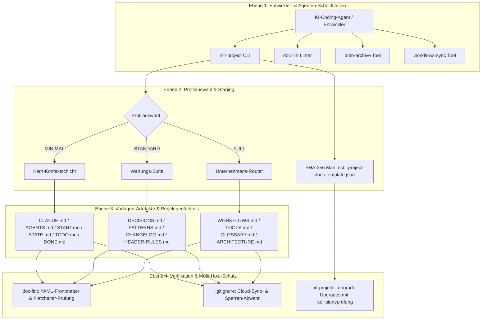
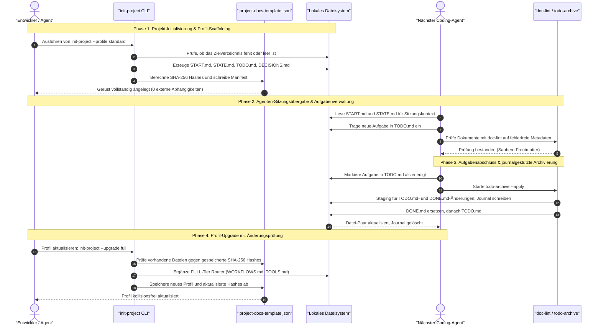

# Project Docs Template (Deutsche Dokumentation)

**[English](README.md) · [Deutsch](README_de.md) · [Español](README_es.md)**

<p align="center"></p>

[](https://github.com/ellmos-ai/project-docs-template)
[](./pyproject.toml)
[](./pyproject.toml)
[](./RELEASE_GATE.md)
[](./tests)
[](./CONTRIBUTING.md)
[](./SECURITY.md)
[](./SECURITY.md)
[](./SECURITY.md)
[](./THIRD_PARTY_LICENSES.txt)
[](./SECURITY.md)
[](./NOTICE)
[](https://github.com/ellmos-ai)
[](https://github.com/open-bricks)
[](./llms.txt)
[](https://github.com/ellmos-ai/project-docs-template/actions/workflows/ci.yml)
[](./README.md)
[](./LICENSE)
[](./MARKETING-LOG.txt)
[](./THIRD_PARTY_LICENSES.md)
[](./MARKETING-LOG.txt)

Agenten-optimierte Projektdokumentations-Vorlage mit START/STATE/TODO/DONE,
Workflows, leichtgewichtigen Tools und KI-freundlichem Projektgedächtnis.

> [!NOTE]
> **KI / LLM-Indexierung**: KI-Agenten und automatisierte Werkzeuge können [llms.txt](llms.txt) für eine maschinenlesbare Übersicht, Suchbegriffe und Disambiguierung einsehen. Letzte Prüfung: **2026-10-30**.

> Unabhängiges Projekt — keine geschäftliche Verbindung zu Anthropic, OpenAI oder Google.
> Siehe [Marken](#marken).

### 🧭 Schnellnavigation

1. [Management-Zusammenfassung & Kernidentität](#management-zusammenfassung--kernidentitaet)
2. [Visuelle Architektur-Topologie & Entkoppelte Schichten](#visuelle-architektur-topologie)
3. [Ende-zu-Ende Multi-Agenten-Lebenszyklus & Tooling-Ablauf](#ende-zu-ende-lebenszyklus)
4. [Zielgruppen & High-Intent SEO-Suchanfragen](#zielgruppen--kern-anwendungsfaelle)
5. [Projektumfang und Grenzen](#vergleichsmatrix-gegenueber-alternativen)
6. [Governance & Laufzeit-Invarianten Matrix](#governance--laufzeit-invarianten)
7. [Einsatzszenarien für diese Vorlage](#verwendungsszenarien)
8. [Lieferumfang & Scaffold-Struktur](#was-enthalten-ist)
9. [Schnellstart & CLI-Workflows](#schnellstart)
10. [Profil-Upgrades mit Änderungsprüfung & Migration](#merge-sichere-profil-upgrades)
11. [Profilvergleich (MINIMAL / STANDARD / FULL)](#profil-vergleich)
12. [Design-Prinzipien & Architektur-Invarianten](#design-prinzipien)
13. [Verifikation, Tests & Qualitäts-Gates](#verifizierung)
14. [Sicherheitsrichtlinie & Meldung von Schwachstellen](#sicherheitsrichtlinie)
15. [Drittanbieter-Lizenzen & Abhängigkeitsverzeichnis](#drittanbieter-lizenzen--transparenz)
16. [Bundles, Partner & Ökosystem-Geschwister](#oekosystem--geschwistertools)
17. [Markenhinweise & Unabhängigkeitserklärung](#marken)
18. [Gesetzliche Hinweise, Haftungsbeschränkung & Lizenz (§ 521 BGB)](#lizenz)

---

## <a id="sec-01"></a><a id="management-zusammenfassung--kernidentitaet"></a><a id="was-ist-project-docs-template"></a>1. Management-Zusammenfassung & Kernidentität

`project-docs-template` liefert eine schlanke, agentenfähige Dokumentations- und Kontext-Architektur, konzipiert für autonome KI-Coding-Agenten (Claude Code, OpenAI Codex, Antigravity/Gemini), Multi-Agenten-Schwärme sowie menschliche Maintainer in Software-, Forschungs- und Betriebsprojekten.

Statt Repositories in schwerfällige, unübersichtliche Betriebssysteme zu verwandeln oder proprietäre SaaS-Portale vorauszusetzen, setzt `project-docs-template` auf transparente, strukturierte Klartext-Markdown-Register (`START.md`, `STATE.md`, `TODO.md`, `DONE.md`, `DECISIONS.md`). Universelle Einstiegspunkte (`CLAUDE.md`, `AGENTS.md`) bieten einen festen Ort, an dem Agenten Projektstatus, architektonische Invarianten und aktive Aufgaben nachlesen können. Diese Dateien liefern Kontext, garantieren aber nicht, dass ein Agent ihn richtig interpretiert oder befolgt.

### Zentrale Nutzenversprechen
- **Local-First-Betrieb**: `SECURITY.md` beschreibt den lokalen Betrieb ohne Telemetrie oder ausgehende Netzaufrufe für die Vorlagenerzeugung und die dort aufgeführten Wartungsskripte.
- **Zero Runtime Dependencies**: Reine Python-Standardbibliothek (3.10+) für sämtliche Generierungs-, Upgrade-, Validierungs- und Archivierungswerkzeuge.
- **Gemeinsamer Sitzungskontext für Übergaben**: `START.md` und `STATE.md` bieten Agenten und Maintainer:innen eine gemeinsame Referenz. Ob Agenten diese Dateien lesen und befolgen, hängt von ihrem Verhalten und dem Arbeitsablauf ab.
- **Profil-Upgrades mit Änderungsprüfung**: SHA-256-Hashes aus `.project-docs-template.json` helfen, bearbeitete verwaltete Dateien und nicht verwaltete Kollisionen vor dem Commit eines Upgrades zu erkennen.
- **Journalgestützte Aufgabenarchivierung**: `todo-archive` legt aktualisierte Fassungen beider Aufgabendateien im Staging ab, schreibt ein Journal, versucht bei Fehlern beim Ersetzen eine Wiederherstellung und kann einen unterbrochenen Austausch des Dateipaars fortsetzen. Bei abweichenden Dateien kann das Journal zur manuellen Prüfung liegen bleiben.

---

## <a id="sec-02"></a><a id="visuelle-architektur-topologie"></a><a id="architektur--ablauf"></a>2. Visuelle Architektur-Topologie & Entkoppelte Schichten

Das folgende Diagramm zeigt die vier entkoppelten Betriebsebenen von `project-docs-template`, von Schnittstellen für Entwickler und Agenten bis hin zum persistenten Repository-Zustand und den Cloud-Sync-Schutzmechanismen:



### Vier-Sichten-Architekturprojektion

```text
+--------------------------------------------------------------------------------------------------+
|                  [SICHT 1: CLI-COCKPIT, LINTER & AGENTEN-SCHNITTSTELLEN]                         |
|  - init-project: Vorlage, SHA-256-Manifest und Profil-Upgrades                                   |
|  - doc-lint: Statische Markdown-Validierung, Frontmatter-Prüfung & Header-Vertragskontrolle     |
|  - todo-archive: Journalgestützte Archivierung von TODO.md und DONE.md                           |
|  - workflows-sync: Bidirektionale Orchestrierungs-Synchronisation & Prompt-Vorlagen-Extraktion   |
+--------------------------------------------------------------------------------------------------+
                                                |
                                                v
+--------------------------------------------------------------------------------------------------+
|                  [SICHT 2: PROFIL-ENGINE & UPGRADES MIT KOLLISIONSPRÜFUNG]            |
|  - MINIMAL-Profil: Schlanke Kontextgrenze (CLAUDE.md, AGENTS.md, START.md, STATE.md)            |
|  - STANDARD-Profil: Vollständiges Projektgedächtnis (TODO.md, DONE.md, DECISIONS.md, PATTERNS)  |
|  - FULL-Profil: Enterprise-Architektur & Governance (WORKFLOWS.md, TOOLS.md, GLOSSARY.md)       |
|  - SHA-256 Manifest: .project-docs-template.json schützt eigene Dateiänderungen vor Kollisionen  |
+--------------------------------------------------------------------------------------------------+
                                                |
                                                v
+--------------------------------------------------------------------------------------------------+
|                  [SICHT 3: LAUFZEIT-PERSISTENZ, REPOSITORY-MEMORY & AUDITIERBARKEIT]             |
|  - Universeller Agenten-Bootstrap: CLAUDE.md / AGENTS.md sofortige Workspace-Ausrichtung        |
|  - Sitzungsgedächtnis: START.md (Sitzungs-Bootloader) & STATE.md (lebendes Betriebsregister)    |
|  - Aufgaben-Tracking: Strukturierte Task-Karten, wiederkehrende Checklisten & Prüfkriterien      |
|  - Entscheidungsregister: ADR-konforme Architektureinträge (DECISIONS.md) & Muster (PATTERNS.md) |
+--------------------------------------------------------------------------------------------------+
                                                |
                                                v
+--------------------------------------------------------------------------------------------------+
|                  [SICHT 4: LOKALE TOOLS, PROZESSKONTEXT & GOVERNANCE]                             |
|  - CLI übernimmt Aufrufkontext und fordert keine Rechteerhöhung an                                |
|  - SECURITY.md beschreibt lokale Tools ohne Telemetrie oder ausgehende Netzaufrufe                 |
|  - Multi-Host Cloud-Sync-Abwehr: .gitignore-Filter für Konfliktkopien (*-WORKSTATION-LG*)        |
|  - Sicherheitsmeldungen: best effort, keine garantierte Antwortzeit laut SECURITY.md             |
+--------------------------------------------------------------------------------------------------+
```

---

## <a id="sec-03"></a><a id="ende-zu-ende-lebenszyklus"></a>3. Ende-zu-Ende Multi-Agenten-Lebenszyklus & Tooling-Ablauf

Das Sequenzdiagramm verdeutlicht, wie Entwickler und autonome KI-Agenten über Gerüsterstellung, Sitzungsstart, Arbeitsabschluss und Profil-Upgrades hinweg zusammenarbeiten:



---

## <a id="sec-04"></a><a id="zielgruppen--auffindbarkeit"></a><a id="zielgruppen--kern-anwendungsfaelle"></a><a id="zielgruppen--kern-anwendungsfälle"></a>4. Zielgruppen & Kern-Anwendungsfälle

`project-docs-template` soll helfen, Kontextdrift, Verluste bei Übergaben und Governance-Reibung in vier typischen technischen Abläufen zu verringern:

| Zielgruppe | Zentrales Problem | Wie `project-docs-template` das Problem löst | Kern-Artefakte |
|:---|:---|:---|:---|
| **Teams mit mehreren Coding-Agenten** | Agenten können zwischen Sitzungen Projektkontext verlieren oder unterschiedliche Dateiformate verwenden. | `CLAUDE.md`, `AGENTS.md`, `START.md` und `STATE.md` bieten einen gemeinsamen Ort für Anweisungen und festgehaltenen Kontext. Verlässliche Übergaben setzen weiterhin voraus, dass Agenten und Maintainer:innen diese Dateien nutzen. | `CLAUDE.md`, `AGENTS.md`, `START.md`, `STATE.md` |
| **Solo-Entwickler:innen und Open-Source-Maintainer:innen** | Aufgaben, Rückstände und Veröffentlichungshistorie ohne aufwendiges Projektmanagement verwalten. | Markdown-Aufgabenlisten (`TODO.md`, `DONE.md`) mit dem journalgestützten Werkzeug `todo-archive` und dem standardmäßigen `CHANGELOG.md`. | `TODO.md`, `DONE.md`, `_tools/todo-archive`, `CHANGELOG.md` |
| **Verantwortliche für Architektur und KI-Governance** | Bedarf an nachvollziehbaren Architekturentscheidungen und Schutz vor unbeabsichtigtem Datenabfluss in Agentenabläufen. | `DECISIONS.md` dokumentiert Entscheidungen; `SECURITY.md` beschreibt den lokalen Betrieb der Vorlagenerzeugung und aufgeführten Wartungsskripte. | `DECISIONS.md`, `SECURITY.md`, `THIRD_PARTY_LICENSES.md` |
| **Forschungs- & Pipeline-Entwickler** | Komplexe mehrstufige Experimentier-Pipelines driften über Wochen autonomer KI-Ausführungen ab. | Skalierbares FULL-Profil mit standardisierten Runbooks (`WORKFLOWS.md`), Terminologie-Definitionen (`GLOSSARY.md`) und tabellensicherem Tabellen-Sync (`workflows-sync`). | `WORKFLOWS.md`, `GLOSSARY.md`, `_tools/workflows-sync` |

### High-Intent Suchbegriffe (Auffindbarkeit)
- `agenten-fähiges Projekt-Dokumentations-Template`
- `Claude Code Dokumentationsgerüst`
- `Multi-Agenten Sitzungsübergabe Start State Todo Done`
- `Offline Local-First Projektvorlage Python`
- `Zero-Egress Entwickler Scaffolding Standardbibliothek`
- `deterministisches Staging und Profil-Upgrades`
- `LLM-optimierte Repository-Dokumentation`

---

## <a id="sec-05"></a><a id="vergleichsmatrix-gegenueber-alternativen"></a><a id="vergleichsmatrix-gegenüber-alternativen"></a><a id="architekturvergleich"></a>5. Projektumfang und Grenzen

Die folgende Tabelle fasst die zehn dokumentierten Projektinvarianten sowie das Verhalten und die Grenzen zusammen, die durch diesen Quellstand belegt sind:

| # | Invariante | Dokumentierte Funktion | Geltungsbereich / Grenze |
|---|:---|:---|:---|
| 1 | **INV-LOCAL-01: Local-First und kein Egress** | `SECURITY.md` beschreibt lokalen Betrieb für Vorlagenerzeugung und aufgeführte Wartungsskripte ohne Telemetrie oder ausgehende Netzaufrufe. | Dokumentierter Umfang dieser Tools, keine Betriebssystem-Netzwerksandbox. |
| 2 | **INV-SEC-02: Prozesskontext des Aufrufers** | Die Skripte übernehmen den Prozesskontext des Aufrufers; die CLI fordert keine Rechteerhöhung an. | Ein privilegierter Aufrufer bleibt privilegiert; keine Durchsetzung des Standardbenutzermodus oder Zertifizierung wird behauptet. |
| 3 | **INV-FAIL-03: Prüfungen mit Abbruch bei erkannten Konflikten** | Bei der Generierung wird ein vorhandenes, nicht leeres Ziel abgelehnt; Upgrades weisen erkannte Änderungen an verwalteten Dateien und nicht verwaltete Kollisionen vor dem Commit zurück. | Die Generierung legt Zielpfad und Staging an und schreibt vor der Promotion Dateien ins Staging; keine allgemeine Garantie, dass zuvor nichts geschrieben wird. |
| 4 | **INV-STG-04: Profil-Upgrades mit Staging** | Upgrades prüfen Manifest-Hashes, bereiten das nächste Profil im Staging vor, erstellen Backups und versuchen bei Commit-Fehlern einen hash-geschützten Rollback. | Die Wiederherstellung ist bedingt; parallele Änderungen oder weitere Dateisystemfehler können einen vollständigen Rollback verhindern. |
| 5 | **INV-HANDOFF-05: Sitzungskontext** | `START.md` und `STATE.md` bieten gemeinsame Projekt- und Sitzungsnotizen für Agenten und Maintainer:innen. | Die Vorlage kann nicht sicherstellen, dass Agenten diese Notizen lesen, befolgen oder behalten. |
| 6 | **INV-TIER-06: Gestaffelte Profile** | Die Vorlage enthält `MINIMAL`, `STANDARD` und `FULL`; Upgrades erfolgen schrittweise. | Dokumentationsgerüste, kein Laufzeit-Agentenframework. |
| 7 | **INV-SYNC-07: Filter für Konfliktkopien** | `.gitignore`-Dateien im Repository und in der Vorlage listen Muster für bekannte Konfliktkopien und Sperrdateien auf. | Ignore-Muster koordinieren keine parallelen Schreibvorgänge und bieten keine verteilte Live-Sperre. |
| 8 | **INV-AUDIT-08: TODO-/DONE-Archivierung** | `todo-archive` journalisiert und stagt die Aktualisierung beider Dateien, versucht nach Fehlern beim Ersetzen eine Wiederherstellung und kann einen unterbrochenen Austausch fortsetzen. | Abweichende Dateien können das Journal zur manuellen Prüfung zurücklassen; ein Rollback kann selbst an Dateisystemfehlern scheitern. |
| 9 | **INV-LIC-09: Laufzeitabhängigkeiten** | Das Projekt deklariert `dependencies = []` und verwendet zur Laufzeit die Python-Standardbibliothek. | Diese Aussage betrifft Laufzeitabhängigkeiten; Entwicklungs- und Testwerkzeuge sind davon getrennt. |
| 10 | **INV-SLA-10: Richtlinie für Sicherheitsmeldungen** | `SECURITY.md` priorisiert Sicherheitskorrekturen und nennt best-effort-Wartung für unterstützte `0.1.x`-Versionen. | Es gibt keine garantierte Antwortzeit; Versionen unter `0.1.0` werden nicht unterstützt. |

---

## <a id="sec-06"></a><a id="governance--runtime-invariants"></a><a id="governance--laufzeit-invarianten"></a>6. Governance & Laufzeit-Invarianten-Matrix

Das Projekt dokumentiert zehn Laufzeit-, Staging- und Governance-Invarianten für seine Gerüst- und Wartungswerkzeuge sowie die generierten Projektprofile:

| Kanonische ID | Invariante | Dokumentiertes Verhalten und Umfang |
|:---|:---|:---|
| **INV-LOCAL-01** | **Local-First und kein Egress** | `SECURITY.md` beschreibt lokalen Betrieb für Vorlagenerzeugung und aufgeführte Wartungsskripte ohne Telemetrie oder ausgehende Netzaufrufe. Dies ist der dokumentierte Tool-Umfang, keine Betriebssystem-Netzwerksandbox. |
| **INV-SEC-02** | **Prozesskontext des Aufrufers** | Die Skripte übernehmen den Prozesskontext des Aufrufers; die CLI fordert keine Rechteerhöhung an. Ein privilegierter Aufrufer bleibt privilegiert. |
| **INV-FAIL-03** | **Prüfungen mit Abbruch bei erkannten Konflikten** | Die Generierung lehnt ein vorhandenes, nicht leeres Ziel ab; Upgrades weisen erkannte Änderungen an verwalteten Dateien und nicht verwaltete Kollisionen vor dem Commit zurück. Die Generierung erstellt Zielpfad und Staging und schreibt vor der Promotion Dateien ins Staging. |
| **INV-STG-04** | **Profil-Upgrades mit Staging und bedingter Wiederherstellung** | Upgrades prüfen Manifest-Hashes und erstellen Staging und Backups vor dem Commit. Hash-Prüfungen unterstützen Wiederherstellungsversuche; parallele Änderungen und weitere Dateisystemfehler können sie verhindern. |
| **INV-HANDOFF-05** | **Sitzungskontext für Agenten** | `START.md` und `STATE.md` halten Projekt- und Sitzungskontext fest. Ob Agenten die Dateien lesen, befolgen und behalten, hängt von ihrem Verhalten und dem Arbeitsablauf ab. |
| **INV-TIER-06** | **Gestaffelte Profile** | `MINIMAL`, `STANDARD` und `FULL` bieten unterschiedliche Dokumentationsstrukturen und Wartungsumfänge. |
| **INV-SYNC-07** | **Filter für Cloud-Sync-Konfliktkopien** | Die `.gitignore`-Dateien im Root und in der Vorlage filtern aufgeführte Konfliktkopien und Sperrdateien; sie koordinieren keine aktiven Schreibvorgänge. |
| **INV-AUDIT-08** | **Journalgestützte Aufgabenarchivierung** | `todo-archive` stagt Änderungen an `TODO.md` und `DONE.md`, schreibt ein Journal, versucht nach Ersetzungsfehlern die Wiederherstellung und unterstützt die Erholung von einem unterbrochenen Paar-Update. Abweichungen können eine manuelle Prüfung erfordern. |
| **INV-LIC-09** | **Laufzeitabhängigkeiten** | Laufzeitabhängigkeiten sind als `dependencies = []` deklariert; zur Laufzeit wird die Python-Standardbibliothek verwendet. Entwicklungs- und Testwerkzeuge fallen nicht unter diese Aussage. |
| **INV-SLA-10** | **Richtlinie für Sicherheitsmeldungen** | `SECURITY.md` nennt best-effort-Wartung für `0.1.x` auf `main`, priorisiert Sicherheitskorrekturen und garantiert keine Antwortzeit. Versionen unter `0.1.0` werden nicht unterstützt. |

---

## <a id="sec-07"></a><a id="verwendungsszenarien"></a>7. Einsatzszenarien für diese Vorlage

| Situation | Vorteil |
|:---|:---|
| Ein neues Projekt wird von Claude Code, Codex, Gemini CLI oder einem anderen Agenten betreut | Bietet dem Agenten einen vorhersehbaren Bootstrap-Pfad und eine aktuelle Statusdatei. |
| Ein bestehendes Repo hat verstreute Notizen oder keine Übergabespur | Trennt aktive Arbeit, abgeschlossene Arbeit, Entscheidungen und Sitzungsstatus sauber. |
| Mehrere Agenten oder Entwickler müssen die Arbeit sicher fortsetzen | Hält Anweisungen, Status, Workflows und Tools in dedizierten Dateien. |

Dies ist eine Dokumentations- und Koordinationsvorlage, kein Laufzeitframework. Sie wird direkt in bestehende Software-, Forschungs- oder Betriebsprojekte integriert.

---

## <a id="sec-08"></a><a id="was-enthalten-ist"></a>8. Lieferumfang & Scaffold-Struktur

- `CLAUDE.md` und `AGENTS.md` für Agenten-Anweisungen
- `START.md` und `STATE.md` für Sitzungs-Bootstrap und aktuellen Status
- `TODO.md` und `DONE.md` mit optionaler journalgestützter Archivierung
- `DECISIONS.md`, `PATTERNS.md`, `CHANGELOG.md` und `HEADER-RULES.md`
- Optionale FULL-Profil-Router: `WORKFLOWS.md`, `TOOLS.md`, `GLOSSARY.md`
- Lokale Werkzeuge in `_tools/`: `init-project`, `doc-lint`, `todo-archive` und `workflows-sync`

Die eigentlichen Vorlagendateien liegen unter [`template/`](./template/).

---

## <a id="sec-09"></a><a id="schnellstart"></a>9. Schnellstart & CLI-Workflows

Repository klonen und in Sekunden ein agenten-fähiges Arbeitsverzeichnis einrichten:

```bash
git clone https://github.com/ellmos-ai/project-docs-template.git
cd project-docs-template

# Erstellung vorab prüfen, ohne Dateien zu schreiben (Trockenlauf)
python template/_tools/init-project --target /pfad/zu/meinem-projekt --name "mein-projekt" --profile STANDARD --dry-run

# STANDARD-Profil generieren (12 Root-Verträge & Tools mit SHA-256-Manifest)
python template/_tools/init-project --target /pfad/zu/meinem-projekt --name "mein-projekt" --profile STANDARD

# Optional: Direkt Git-Repository mit initialem Commit anlegen
python template/_tools/init-project --target /pfad/zu/meinem-projekt --name "mein-projekt" --profile STANDARD --git
```

### Generierung mit Staging (Terminal-Showcase)

Bei `init-project` muss das Zielverzeichnis fehlen oder leer sein. Der Generator kann zunächst den Zielpfad und ein daneben liegendes Staging-Verzeichnis anlegen und schreibt die gerenderten Dateien in dieses Staging. Dort werden sie validiert, bevor die Promotion ins Ziel beginnt. Bei einem Fehler während der Promotion versucht das Werkzeug, ein zuvor leeres Ziel wiederherzustellen; das ist keine Garantie für jeden I/O-Fehler.

```text
==> Root:    /pfad/zu/.mein-projekt.staging-xyz123
==> Max age: 30 days

Results:
  OK   CLAUDE.md
  OK   START.md
  OK   STATE.md

OK: Alle geprüften Files bestehen (oder wurden gefixt)
==> Target:  /pfad/zu/meinem-projekt
==> Name:    mein-projekt
==> Author:  Alex Developer
==> Date:    2026-10-30

==> Profil: STANDARD
    Ernsthafte Projekte mit mehrmonatiger Lebensdauer
  OK: AGENTS.md
  OK: CLAUDE.md
  OK: README.md
  OK: START.md
  OK: STATE.md
  OK: CHANGELOG.md
  OK: HEADER-RULES.md
  OK: CUT-AND-CLUE.md
  OK: DECISIONS.md
  OK: PATTERNS.md
  OK: TODO.md
  OK: DONE.md
  OK: .gitignore
  OK: _tools/README.md
  OK: _tools/todo-archive
  OK: _tools/doc-lint

==> Fertig: /pfad/zu/meinem-projekt
```

### Typische CLI-Wartungsabläufe im generierten Projekt

Generierte Arbeitsbereiche enthalten eigenständige, abhängigkeitsfreie Werkzeuge unter `_tools/`:

```bash
# Projektdokumentation und YAML-Frontmatter auf Gültigkeit & Aktualität prüfen
python _tools/doc-lint

# Fehlende Frontmatter-Felder automatisch ergänzen & Datumsstempel aktualisieren
python _tools/doc-lint --fix --update-dates

# Erledigte Aufgaben mit Journal protokolliert archivieren
python _tools/todo-archive --apply

# Workflow-Tabellen über Router hinweg abgleichen (FULL-Profil)
python _tools/workflows-sync --apply
```

> [!NOTE]
> **Vorlagensprache:** Die Repository-Dokumentation ist auf Englisch verfasst, die erzeugten Vorlagendokumente unter [`template/`](./template/) — `CLAUDE.md`, `START.md`, `STATE.md`, `TODO.md` und die weiteren — sowie die CLI-Ausgaben von `init-project`, `doc-lint`, `todo-archive` und `workflows-sync` sind auf Deutsch. Die Dateinamen, Profilmarker und YAML-Frontmatter-Schlüssel sind sprachneutral; englischsprachige Projekte können die Struktur unverändert übernehmen.

---

## <a id="sec-10"></a><a id="merge-sichere-profil-upgrades"></a>10. Profil-Upgrades mit Änderungsprüfung & Migration

Bestehende Projekte können schrittweise auf das nächste Profil aktualisiert werden:

```bash
# Vorhandenes Projekt auf FULL-Profil anheben
python template/_tools/init-project /pfad/zu/meinem-projekt --upgrade full
```

### Prüfungen und Grenzen beim Upgrade
- **Manifest-Verifikation**: Liest `.project-docs-template.json` zur Prüfung des aktiven Profils und der SHA-256-Hashes.
- **Fail-Closed bei Fremdkollisionen**: Existiert eine Datei bereits, die nicht Teil des vorherigen Profils war, bricht das Upgrade sofort ab.
- **Fail-Closed bei Anwendermutationen**: Wurde eine Vorlagendatei manuell angepasst, wird sie nicht stillschweigend überschrieben.
- **Bedingter Rollback-Versuch**: Backups und Hash-Prüfungen unterstützen die Wiederherstellung der von diesem Lauf geänderten Dateien. Wird eine parallele Änderung erkannt, wird die Wiederherstellung übersprungen, damit sie diese Änderung nicht überschreibt; zusätzliche Dateisystemfehler können den Rollback verhindern.

---

## <a id="sec-11"></a><a id="profil-vergleich"></a>11. Profilvergleich (MINIMAL / STANDARD / FULL)

| Feature / Dokument | `MINIMAL` | `STANDARD` | `FULL` |
|:---|:---:|:---:|:---:|
| `CLAUDE.md` & `AGENTS.md` (Agenten-Instruktionen) | ✅ Enthalten | ✅ Enthalten | ✅ Enthalten |
| `START.md` & `STATE.md` (Sitzungsgedächtnis) | ✅ Enthalten | ✅ Enthalten | ✅ Enthalten |
| `TODO.md` & `DONE.md` (Aufgabenverwaltung) | ✅ Enthalten | ✅ Enthalten | ✅ Enthalten |
| `_tools/todo-archive` (Aufgaben-Archivierer) | ✅ Enthalten | ✅ Enthalten | ✅ Enthalten |
| `_tools/doc-lint` (Dokumentations-Linter) | ✅ Enthalten | ✅ Enthalten | ✅ Enthalten |
| `DECISIONS.md` (Architekturentscheidungen) | — | ✅ Enthalten | ✅ Enthalten |
| `PATTERNS.md` (Design-Patterns) | — | ✅ Enthalten | ✅ Enthalten |
| `CHANGELOG.md` & `HEADER-RULES.md` | — | ✅ Enthalten | ✅ Enthalten |
| `WORKFLOWS.md` & `_tools/workflows-sync` | — | — | ✅ Enthalten |
| `TOOLS.md` & `GLOSSARY.md` (Domänen-Router) | — | — | ✅ Enthalten |
| `ARCHITECTURE.md` & `.github/` Workflows | — | — | ✅ Enthalten |

---

## <a id="sec-12"></a><a id="design-prinzipien"></a>12. Design-Prinzipien & Architektur-Invarianten

- **Klare Aufgabenverteilung**: Jede Datei besitzt eine einzige, präzise definierte operative Rolle.
- **Explizite Übergabe**: Sitzungsstart und aktueller Projektstatus sind in kurzen, vorhersehbaren Registern dokumentiert (`START.md`, `STATE.md`).
- **Niedriger Pflegeaufwand**: Konzentration auf hochwertige Kontextdateien statt unübersichtlicher Monster-Wikis.
- **Router-Muster**: Übergeordnete Router (`WORKFLOWS.md`, `TOOLS.md`) verweisen auf Details, statt sie zu duplizieren.
- **Journalgestützte Archivierung**: Das Werkzeug aktualisiert `TODO.md` und `DONE.md` über Staging und ein Journal; Wiederherstellung wird versucht, kann aber bei abweichenden Dateien eine manuelle Prüfung erfordern.

Vollständige Hintergründe und Dateierklärungen finden sich in [`template/TEMPLATE.md`](./template/TEMPLATE.md).

---

## <a id="sec-13"></a><a id="verifizierung"></a>13. Verifikation, Tests & Qualitäts-Gates

Die Testsuite kann mit Pythons Standard-`unittest` oder `pytest` ausgeführt werden:

```bash
# Mit pytest ausführen
pytest -ra -v

# Mit unittest ausführen
python -m unittest discover -s tests -v
```

Die Suite testet jedes Profil, echte Git-Initialisierungen, Frontmatter-Reparaturen, Metadaten-Maskierung und Rollback-Verhalten bei Fehlern. Sie läuft plattformübergreifend auf Linux, Windows und macOS; siehe [`RELEASE_GATE.md`](./RELEASE_GATE.md).

---

## <a id="sec-14"></a><a id="sicherheitsrichtlinie"></a>14. Sicherheitsrichtlinie & Meldung von Schwachstellen

`SECURITY.md` beschreibt die Sicherheits- und Wartungspolitik des Projekts:
- **Lokaler Betrieb**: Vorlagenerzeugung und aufgeführte Wartungsskripte arbeiten laut Richtlinie lokal und senden keine Telemetrie oder ausgehenden Netzaufrufe.
- **Geprüfte Änderungen**: Generierung verwendet Staging; Upgrades prüfen verwaltete Dateien und Kollisionen vor dem Commit. Wiederherstellungsversuche sind bedingt.
- **Wartungsversionen**: Für `0.1.x` auf `main` gilt best-effort-Wartung; Sicherheitskorrekturen haben Priorität. Eine garantierte Antwortzeit gibt es nicht. Versionen unter `0.1.0` werden nicht unterstützt.

Melde mögliche Schwachstellen nach [`SECURITY.md`](./SECURITY.md), bevorzugt über ein privates GitHub Security Advisory oder an die dort aufgeführten Kontakte: `security@ellmos.ai`, `support@lukasgeiger.com` und `lukas@open-bricks.org`. Bitte melde ungepatchte Schwachstellen nicht öffentlich; die Richtlinie bittet bis zur Veröffentlichung eines Patches um koordinierte Offenlegung.

---

## <a id="sec-15"></a><a id="drittanbieter-lizenzen--transparenz"></a>15. Drittanbieter-Lizenzen & Abhängigkeitsverzeichnis

`project-docs-template` arbeitet unter einer **strengen Zero-Runtime-Dependency-Architektur** (`dependencies = []`). Der gesamte Produktivcode nutzt ausschließlich die Python-Standardbibliothek (3.10+).

| Komponente | Rolle | Lizenz | Status |
|:---|:---|:---|:---|
| **Python Standard Library** | Laufzeitkern | PSFL-2.0 | 100% Frei / Zulässig (Integriert) |
| **pytest** | Entwicklung / Test | MIT License | 100% Frei / Zulässig |
| **ruff** | Entwicklung / QA | MIT / Apache-2.0 | 100% Frei / Zulässig |
| **setuptools** | Build-Backend | MIT License | 100% Frei / Zulässig |

Die deklarierten Laufzeit- und Entwicklungsabhängigkeiten samt Lizenzangaben sowie das Abhängigkeitsverzeichnis sind in [THIRD_PARTY_LICENSES.md](THIRD_PARTY_LICENSES.md) und der Klartext-Begleitdatei [THIRD_PARTY_LICENSES.txt](THIRD_PARTY_LICENSES.txt) aufgeführt. Die Dateien dokumentieren ihre Einträge; eine unabhängige Prüfung oder Level-1-SBOM-Zertifizierung wird hier nicht behauptet.

---

## <a id="sec-16"></a><a id="oekosystem--geschwistertools"></a><a id="ökosystem--geschwisterwerkzeuge"></a><a id="bundles-und-partner"></a>16. Bundles, Partner & Ökosystem-Geschwister

`project-docs-template` ist ein grundlegender Baustein im [`ellmos-ai`](https://github.com/ellmos-ai)-Ökosystem sowie der Dachorganisation [`open-bricks`](https://github.com/open-bricks):

| Repository | Zweck | Primäre Schnittstelle |
|:---|:---|:---|
| [`policy-registry`](https://github.com/ellmos-ai/policy-registry) | Maschinenlesbare Richtlinien-Registry mit signierten Delegationen | CLI / API / MCP |
| [`DevCenter`](https://github.com/dev-bricks/DevCenter) | Lokale Python-IDE und Entwickler-Toolkit | GUI / PySide6 |
| [`CodeBox`](https://github.com/dev-bricks/CodeBox) | Desktop-Codeeditor und IDE | GUI / PySide6 |
| [`companion-for-agy`](https://github.com/ellmos-ai/companion-for-agy) | Erweiterungssuite für Antigravity KI-Agenten | CLI / Node.js |
| [`safe-start-for-codex`](https://github.com/dev-bricks/safe-start-for-codex) | Defensive Startumgebung und Verifizierer für Codex | CLI / Python |
| [`automizer-for-claude-desktop`](https://github.com/dev-bricks/automizer-for-claude-desktop) | Bridge- und Automations-Toolkit für Claude Desktop | CLI / Python |
| [`system-gap-master`](https://github.com/ellmos-ai/system-gap-master) | Systemübergreifende Synchronisation und Divergenzanalyse | CLI / Python |
| [`lock-master`](https://github.com/ellmos-ai/lock-master) | Concurrency- und Dateisperren-Manager für Multi-Agenten | CLI / Python |
| [`ticket-master`](https://github.com/ellmos-ai/ticket-master) | Lokale Issue- und Ticket-Verwaltung | CLI / Python |
| [`clutch`](https://github.com/ellmos-ai/clutch) | Provider-neutraler LLM-Router und Orchestrierungsmotor | CLI / Python |
| [`memoryhooker`](https://github.com/ellmos-ai/memoryhooker) | Sitzungsgedächtnis-Extraktion und Hook-Injektion | CLI / Python |
| [`workflowhooker`](https://github.com/ellmos-ai/workflowhooker) | Workflow-Automatisierungs-Trigger | CLI / Python |
| [`ellmos-controlcenter-mcp`](https://github.com/ellmos-ai/ellmos-controlcenter-mcp) | MCP-Server für Systeminspektion und Skill-Erkennung | MCP |
| [`ellmos-filecommander-mcp`](https://github.com/ellmos-ai/ellmos-filecommander-mcp) | MCP-Server für sichere Dateioperationen | MCP |
| [`open-bricks`](https://github.com/open-bricks) | Dachorganisation für Entwickler- und KI-Werkzeuge | Portal |

<!-- BEGIN GENERATED ELLMOS BUNDLE DISCOVERY -->
### Bundles und Partner Entdeckungsprojektion
Generierte Entdeckungsprojektion für `module:project-docs-template` aus `catalog:v4-bundles` (`546290dafbaafd810df1d59ef5a3d7183738472b48cd5a8a81f1e8f2b64d852e`). Ziel-Sichtbarkeit: `public`.

- **`ellmos-dev-lifecycle-bundle`**: Rolle `declared-component`, Anforderung `required`. Partner: `module:bundle-installer`, `module:ellmos-code-tools`, `module:ellmos-tests`, `module:github-onedrive-mirror`, `module:stack-system-installer`.
- **`ellmos-knowledge-bundle`**: Rolle `declared-component`, Anforderung `recommended`. Partner: `module:KnowledgeDigest`, `module:WikiStub-Seed`, `module:report-forge`, `module:web-scraper`.
<!-- END GENERATED ELLMOS BUNDLE DISCOVERY -->

---

## <a id="sec-17"></a><a id="marken"></a><a id="markenhinweise"></a>17. Markenhinweise & Unabhängigkeitserklärung

Dieses Projekt ist eine unabhängige, gemeinschaftlich gepflegte Dokumentationsvorlage.
Es besteht **keine** geschäftliche Verbindung, Autorisierung oder Förderung durch
Anthropic, OpenAI oder Google.

"Claude" und "Claude Code", "Codex", "Gemini" und "Antigravity" sind Marken
oder eingetragene Marken der jeweiligen Eigentümer (Anthropic PBC, OpenAI,
Google LLC). Alle weiteren genannten Produktnamen, Logos und Marken sind
Eigentum ihrer jeweiligen Inhaber. Die Nennung dient ausschließlich der
Beschreibung von Kompatibilität und Schnittstellen.

---

## <a id="sec-18"></a><a id="lizenz"></a><a id="gesetzliche-hinweise-haftungsbeschraenkung--lizenz"></a>18. Gesetzliche Hinweise, Haftungsbeschränkung & Lizenz (§ 521 BGB)

### Gesetzlicher Hinweis & Haftungsbeschränkung (§ 521 BGB)
Die Bereitstellung dieser Software und Vorlagen erfolgt unentgeltlich als gesetzliche Gefälligkeit bzw. Schenkung im Sinne von **§ 521 BGB**. Gemäß deutschem Recht ist die Haftung des Autors und der Mitwirkenden auf Vorsatz und grobe Fahrlässigkeit beschränkt. Die zwingende gesetzliche Haftung — insbesondere für Vorsatz (§ 276 Abs. 3 BGB) sowie für Schäden aus der Verletzung des Lebens, des Körpers oder der Gesundheit — bleibt unberührt.

### Lizenz
Dieses Projekt ist unter den Bedingungen der **MIT-Lizenz** lizenziert. Siehe [LICENSE](LICENSE) und [NOTICE](NOTICE) für Urheberrechts- und Lizenzhinweise.