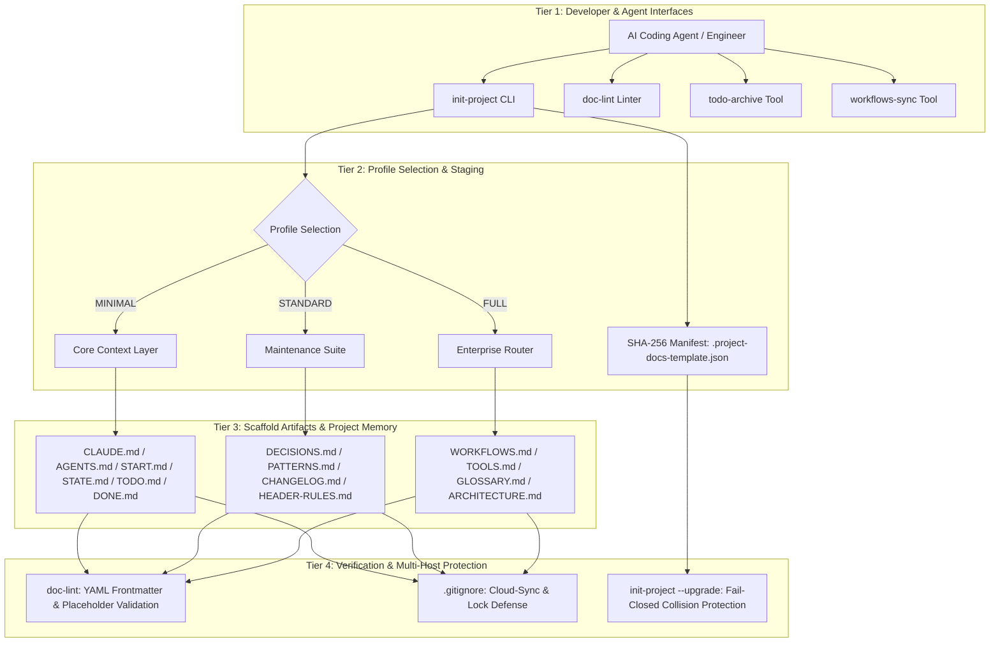
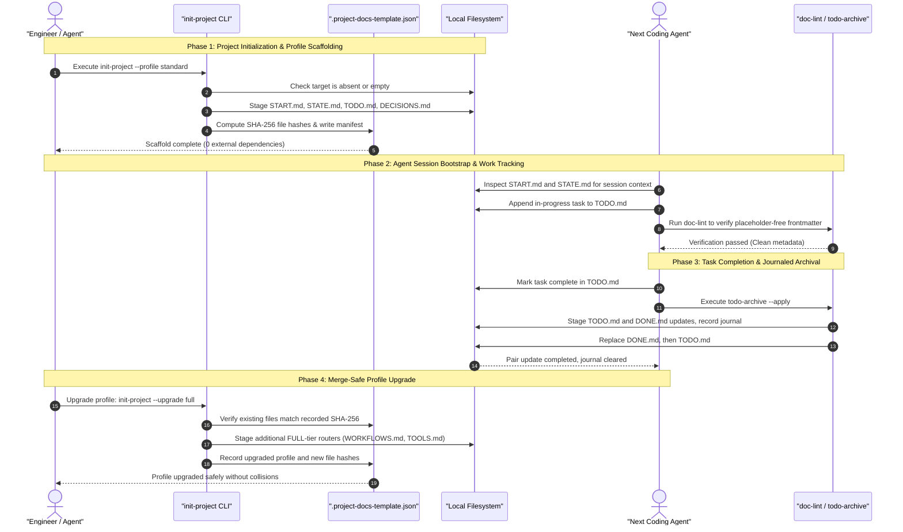

# Plantilla de documentación de proyectos

**[English](README.md) · [Deutsch](README_de.md) · [Español](README_es.md) · [Français](README_fr.md)**

<p align="center"></p>

[](https://github.com/ellmos-ai/project-docs-template)
[](./pyproject.toml)
[](./pyproject.toml)
[](./RELEASE_GATE.md)
[](./tests)
[](./CONTRIBUTING.md)
[](./SECURITY.md)
[](./SECURITY.md)
[](./SECURITY.md)
[](./THIRD_PARTY_LICENSES.txt)
[](./SECURITY.md)
[](./NOTICE)
[](https://github.com/ellmos-ai)
[](https://github.com/open-bricks)
[](./llms.txt)
[](https://github.com/ellmos-ai/project-docs-template/actions/workflows/ci.yml)
[](./README_de.md)
[](./LICENSE)
[](./MARKETING-LOG.txt)
[](./THIRD_PARTY_LICENSES.md)
[](./MARKETING-LOG.txt)

Plantilla de documentación de proyectos preparada para agentes, con START/STATE/TODO/DONE,
flujos de trabajo, herramientas ligeras y memoria de proyecto adaptada a los LLM.

> [!NOTE]
> **Indexación para IA / LLM**: los agentes de IA y las herramientas automatizadas pueden consultar [llms.txt](llms.txt) para obtener un resumen legible por máquinas, términos de búsqueda y detalles para desambiguar. Última comprobación: **2026-10-30**.

> Proyecto independiente, no afiliado a Anthropic, OpenAI ni Google.
> Consulta [Marcas registradas](#trademarks).

### 🧭 Navegación rápida

1. [Resumen ejecutivo e identidad central](#executive-summary--core-identity)
2. [Topología visual de la arquitectura y capas desacopladas](#visual-architecture-topology)
3. [Ciclo de vida multiagente de extremo a extremo y flujo de herramientas](#end-to-end-multi-agent-lifecycle)
4. [Perfiles de usuario y consultas SEO de alta intención](#target-personas--core-use-cases)
5. [Capacidades y límites del proyecto](#comparative-matrix-vs-alternatives)
6. [Matriz de gobernanza e invariantes de ejecución](#governance--runtime-invariants)
7. [Cuándo usar esta plantilla](#use-this-template-when)
8. [Contenido y estructura del esqueleto](#what-is-included)
9. [Inicio rápido y flujos de trabajo habituales de la CLI](#quick-start)
10. [Actualizaciones de perfiles con detección de cambios](#merge-safe-profile-upgrades)
11. [Matriz comparativa de perfiles (MINIMAL / STANDARD / FULL)](#profile-comparison)
12. [Principios de diseño e invariantes de arquitectura](#design-principles)
13. [Pruebas, verificación y controles de calidad](#verification)
14. [Política de seguridad y reporte de vulnerabilidades](#security-policy)
15. [Licencias de terceros e inventario de dependencias](#third-party-licenses--transparency)
16. [Bundles, socios y herramientas relacionadas del ecosistema](#ecosystem--sibling-tools)
17. [Marcas registradas y aviso de independencia](#trademarks)
18. [Aviso legal, limitación de responsabilidad y licencia (§ 521 BGB)](#license)

---

## <a id="sec-01"></a><a id="executive-summary--core-identity"></a><a id="what-is-project-docs-template"></a>1. Resumen ejecutivo e identidad central

`project-docs-template` ofrece una arquitectura ligera de documentación y memoria de proyecto, preparada para agentes y diseñada para agentes de programación de IA autónomos (Claude Code, OpenAI Codex, Antigravity/Gemini), enjambres multiagente y personas mantenedoras que trabajan en repositorios de software, investigación y operaciones.

En lugar de convertir los proyectos en sistemas operativos pesados y rígidos o depender de portales SaaS propietarios, `project-docs-template` utiliza registros Markdown de texto plano, transparentes y estándar (`START.md`, `STATE.md`, `TODO.md`, `DONE.md`, `DECISIONS.md`). Los puntos de entrada (`CLAUDE.md`, `AGENTS.md`) ofrecen un lugar común para que los agentes consulten el estado del proyecto, las invariantes de arquitectura y las tareas activas. Aportan contexto; no garantizan que un agente lo interprete o aplique correctamente.

### Propuestas de valor principales
- **Funcionamiento local**: `SECURITY.md` documenta que la generación de plantillas y las herramientas de mantenimiento enumeradas operan en disco local, sin telemetría ni llamadas de red salientes.
- **Cero dependencias en tiempo de ejecución**: utiliza únicamente la biblioteca estándar de Python (3.10+) para todas las herramientas de generación de estructuras, preparación, validación y archivo de tareas.
- **Contexto compartido para los traspasos de sesión**: `START.md` y `STATE.md` ofrecen una referencia común a agentes y mantenedores. Que los agentes lean y sigan esos archivos depende de su comportamiento y del flujo de trabajo.
- **Actualizaciones de perfil con detección de cambios**: los hashes SHA-256 de `.project-docs-template.json` permiten detectar cambios en archivos administrados y colisiones con archivos no administrados antes de confirmar el siguiente paso del perfil.
- **Archivado de tareas con diario**: `todo-archive` prepara cambios para ambos archivos, registra un diario, intenta restaurarlos si falla el reemplazo y puede recuperar una actualización interrumpida del par. Si los archivos divergen, el diario puede quedar pendiente de revisión manual.

---

## <a id="sec-02"></a><a id="visual-architecture-topology"></a><a id="architecture--flow"></a>2. Topología visual de la arquitectura y capas desacopladas

El diagrama siguiente muestra los cuatro niveles operativos desacoplados de `project-docs-template`, desde las interfaces de desarrollo y de los agentes hasta el estado persistente del repositorio, los controles de validación y los filtros para copias en conflicto durante la sincronización en la nube:



### Proyección de la arquitectura desde cuatro perspectivas

```text
+--------------------------------------------------------------------------------------------------+
|                  [VIEW 1: CLI COCKPIT, LINTER & AGENT INTERFACE HARNESS]                         |
|  - init-project: Deterministic scaffolding, SHA-256 manifest stamping & profile migrations      |
|  - doc-lint: Static markdown validation, frontmatter linting & header contract enforcement       |
|  - todo-archive: Journaled two-file task archive with staged replacement & recovery            |
|  - workflows-sync: Bidirectional orchestration synchronization & prompt template extraction      |
+--------------------------------------------------------------------------------------------------+
                                                |
                                                v
+--------------------------------------------------------------------------------------------------+
|                  [VIEW 2: TIERED PROFILE ENGINE & MERGE-SAFE STAGING]                            |
|  - MINIMAL Profile: Lightweight context boundary (CLAUDE.md, AGENTS.md, START.md, STATE.md)     |
|  - STANDARD Profile: Complete project memory (TODO.md, DONE.md, DECISIONS.md, PATTERNS.md)       |
|  - FULL Profile: Enterprise architecture & governance (WORKFLOWS.md, TOOLS.md, GLOSSARY.md)      |
|  - SHA-256 Manifest: tracks managed files and detects edits or unowned collisions                |
+--------------------------------------------------------------------------------------------------+
                                                |
                                                v
+--------------------------------------------------------------------------------------------------+
|                  [VIEW 3: RUNTIME PERSISTENCE, REPOSITORY MEMORY & AUDIT]                        |
|  - Entry Instructions: CLAUDE.md / AGENTS.md provide a place to read project guidance             |
|  - Session Memory: START.md (session bootloader) & STATE.md (live operational ledger)            |
|  - Task Tracking: Structured task cards, recurring checklists, and verification criteria        |
|  - Decision Ledger: ADR-style architectural records (DECISIONS.md) & code patterns (PATTERNS.md)|
+--------------------------------------------------------------------------------------------------+
                                                |
                                                v
+--------------------------------------------------------------------------------------------------+
|                  [VIEW 4: DOCUMENTED SECURITY POLICY & FILE CONFLICT FILTERS]                     |
|  - User Context: tools run without requiring administrator or root elevation                    |
|  - Zero-Egress Policy: SECURITY.md documents local operation without outbound traffic             |
|  - Conflict-Copy Filters: .gitignore lists known cloud-sync conflict patterns                    |
|  - Legal & Governance: § 521 BGB notice; SECURITY.md says best-effort, no guaranteed response    |
+--------------------------------------------------------------------------------------------------+
```

---

## <a id="sec-03"></a><a id="end-to-end-multi-agent-lifecycle"></a>3. Ciclo de vida multiagente de extremo a extremo y flujo de herramientas

El diagrama de secuencia siguiente muestra un flujo posible para que personas desarrolladoras y agentes de programación de IA utilicen `project-docs-template` durante la generación, el inicio de sesión, la finalización de tareas y la actualización de perfiles. La documentación aporta contexto para los traspasos; cada agente sigue siendo responsable de leerla y aplicarla.



---

## <a id="sec-04"></a><a id="target-personas--discoverability"></a><a id="target-personas--core-use-cases"></a>4. Perfiles de usuario y casos de uso principales

`project-docs-template` pretende ayudar a abordar la deriva de contexto, las pérdidas en los traspasos y las dificultades de gobernanza en cuatro recorridos técnicos habituales:

| Perfil de usuario | Problema principal | Cómo lo resuelve `project-docs-template` | Artefactos clave |
|:---|:---|:---|:---|
| **Equipos con varios agentes de programación** | Los agentes pueden perder contexto del proyecto entre sesiones o utilizar formatos de archivo distintos. | `CLAUDE.md`, `AGENTS.md`, `START.md` y `STATE.md` ofrecen un lugar común para consultar instrucciones y contexto registrado. Los traspasos fiables siguen dependiendo de que agentes y mantenedores utilicen esos archivos. | `CLAUDE.md`, `AGENTS.md`, `START.md`, `STATE.md` |
| **Desarrolladores individuales y mantenedores de código abierto** | Gestionar tareas, trabajo pendiente e historial de versiones sin depender de una plataforma de gestión de proyectos. | Listas de tareas Markdown (`TODO.md`, `DONE.md`) con la herramienta de archivo con diario `todo-archive` y el `CHANGELOG.md` habitual. | `TODO.md`, `DONE.md`, `_tools/todo-archive`, `CHANGELOG.md` |
| **Responsables de arquitectura y gobernanza de IA** | Necesidad de mantener un registro de decisiones y reducir el riesgo de salida accidental de datos en flujos de trabajo con agentes. | `DECISIONS.md` registra decisiones; `SECURITY.md` documenta el funcionamiento local de la generación de plantillas y las herramientas de mantenimiento enumeradas. | `DECISIONS.md`, `SECURITY.md`, `THIRD_PARTY_LICENSES.md` |
| **Desarrolladores de investigación y de flujos científicos** | Los complejos flujos de experimentación en varias etapas pierden coherencia durante semanas de ciclos de razonamiento autónomo con LLM. | Perfil FULL ampliable, con guías operativas (`WORKFLOWS.md`), terminología del dominio (`GLOSSARY.md`) y sincronización automatizada de tablas (`workflows-sync`). | `WORKFLOWS.md`, `GLOSSARY.md`, `_tools/workflows-sync` |

### Consultas de búsqueda con alta intención
- `agent-ready project documentation template`
- `claude code documentation scaffold`
- `multi-agent session handoff state start todo done`
- `offline local-first project template python`
- `zero-egress developer scaffolding stdlib`
- `deterministic documentation staging and profile upgrades`
- `llm friendly project memory repository template`

---

## <a id="sec-05"></a><a id="comparative-matrix-vs-alternatives"></a><a id="comparative-architecture"></a>5. Capacidades y límites del proyecto

La tabla resume las diez invariantes documentadas, junto con las capacidades y los límites respaldados por este commit:

| # | Invariante | Capacidad documentada | Alcance / límite |
|---|:---|:---|:---|
| 1 | **INV-LOCAL-01: Funcionamiento local, sin tráfico saliente** | `SECURITY.md` documenta el funcionamiento en disco local de la generación de plantillas y las herramientas de mantenimiento enumeradas, sin telemetría ni llamadas de red salientes. | Alcance documentado para esas herramientas; no es una sandbox de red del sistema operativo. |
| 2 | **INV-SEC-02: Contexto del proceso que invoca** | Los scripts heredan el contexto del proceso que los invoca; la CLI no solicita elevar privilegios. | Un proceso invocador con privilegios conserva esos privilegios; no se afirma que el sistema fuerce el modo de usuario estándar ni que exista una certificación. |
| 3 | **INV-FAIL-03: Comprobaciones con rechazo de conflictos detectados** | La generación rechaza un destino existente que no esté vacío; las actualizaciones rechazan cambios detectados en archivos administrados y colisiones con archivos no administrados antes del commit. | La generación crea la ruta padre y el área de preparación, y escribe allí antes de promoverla; no se garantiza que no haya escrituras previas. |
| 4 | **INV-STG-04: Actualizaciones de perfiles con preparación** | Las actualizaciones verifican los hashes del manifiesto, preparan el siguiente perfil, crean copias de seguridad e intentan revertir el commit con comprobaciones de hash. | La restauración es condicional; cambios concurrentes u otros errores del sistema de archivos pueden impedir una reversión completa. |
| 5 | **INV-HANDOFF-05: Contexto de sesión** | `START.md` y `STATE.md` ofrecen registros compartidos del proyecto y de la sesión para agentes y mantenedores. | La plantilla no puede asegurar que los agentes lean, sigan o conserven esos registros. |
| 6 | **INV-TIER-06: Perfiles por niveles** | La plantilla ofrece `MINIMAL`, `STANDARD` y `FULL`; las actualizaciones avanzan un nivel cada vez. | Son estructuras documentales, no un marco de ejecución de agentes. |
| 7 | **INV-SYNC-07: Filtros de copias en conflicto** | Los archivos `.gitignore` del repositorio y de la plantilla enumeran patrones para copias en conflicto y archivos de bloqueo conocidos. | Las reglas de exclusión no coordinan escritores simultáneos ni crean un bloqueo distribuido activo. |
| 8 | **INV-AUDIT-08: Archivo de tareas TODO/DONE** | `todo-archive` prepara las actualizaciones de ambos archivos, registra un diario, intenta restaurarlos tras un error de reemplazo y puede recuperar una actualización interrumpida del par. | Si los archivos divergen, el diario puede quedar pendiente de revisión manual; la reversión también puede fallar por errores del sistema de archivos. |
| 9 | **INV-LIC-09: Dependencias en tiempo de ejecución** | El proyecto declara `dependencies = []` y utiliza la biblioteca estándar de Python durante la ejecución. | Esta afirmación se limita a las dependencias de ejecución; las herramientas de desarrollo y pruebas son aparte. |
| 10 | **INV-SLA-10: Política de reporte de seguridad** | `SECURITY.md` prioriza las correcciones de seguridad y ofrece mantenimiento según el mejor esfuerzo para las versiones `0.1.x` compatibles. | No hay un plazo de respuesta garantizado; las versiones anteriores a `0.1.0` no tienen soporte. |

---

## <a id="sec-06"></a><a id="governance--runtime-invariants"></a>6. Matriz de gobernanza e invariantes de ejecución

El proyecto documenta diez invariantes de ejecución, preparación y gobernanza para sus herramientas de generación y mantenimiento, y para las estructuras de proyecto generadas:

| ID canónico | Invariante | Comportamiento documentado y alcance |
|:---|:---|:---|
| **INV-LOCAL-01** | **Funcionamiento local, sin tráfico saliente** | `SECURITY.md` documenta el funcionamiento en disco local de la generación de plantillas y las herramientas de mantenimiento enumeradas, sin telemetría ni llamadas de red salientes. Este es el alcance documentado de esas herramientas, no una sandbox de red del sistema operativo. |
| **INV-SEC-02** | **Contexto del proceso que invoca** | Los scripts heredan el contexto del proceso que los invoca y la CLI no solicita elevar privilegios. Un proceso invocador privilegiado conserva sus privilegios. |
| **INV-FAIL-03** | **Comprobaciones con rechazo de conflictos detectados** | La generación rechaza un destino existente que no esté vacío; las actualizaciones rechazan cambios detectados en archivos administrados y colisiones no administradas antes del commit. La generación crea la ruta padre y el área de preparación, y escribe allí antes de promoverla. |
| **INV-STG-04** | **Actualización de perfiles con preparación y restauración condicional** | Las actualizaciones verifican hashes del manifiesto y preparan archivos y copias de seguridad antes del commit. Los hashes permiten intentar una restauración; cambios concurrentes u otros errores del sistema de archivos pueden impedirla. |
| **INV-HANDOFF-05** | **Contexto de sesión para agentes** | `START.md` y `STATE.md` guardan contexto del proyecto y de la sesión. Que los agentes lean, sigan o conserven esos datos depende de su comportamiento y del flujo de trabajo. |
| **INV-TIER-06** | **Perfiles por niveles** | `MINIMAL`, `STANDARD` y `FULL` ofrecen distintas estructuras documentales y ámbitos de mantenimiento. |
| **INV-SYNC-07** | **Filtros de copias de sincronización en conflicto** | Los `.gitignore` de la raíz y de la plantilla filtran los patrones enumerados de copias en conflicto y archivos de bloqueo; no coordinan escrituras activas. |
| **INV-AUDIT-08** | **Archivo de tareas con diario** | `todo-archive` prepara cambios para `TODO.md` y `DONE.md`, escribe un diario, intenta restaurarlos tras errores de reemplazo y permite recuperarse de una actualización interrumpida del par. Las divergencias pueden requerir revisión manual. |
| **INV-LIC-09** | **Dependencias en tiempo de ejecución** | Las dependencias de ejecución se declaran como `dependencies = []` y el programa utiliza la biblioteca estándar de Python. Las herramientas de desarrollo y pruebas quedan fuera de esta afirmación. |
| **INV-SLA-10** | **Política de reportes de seguridad** | `SECURITY.md` ofrece mantenimiento según el mejor esfuerzo para `0.1.x` en `main`, prioriza las correcciones de seguridad y no garantiza plazos de respuesta. Las versiones anteriores a `0.1.0` no tienen soporte. |

---

## <a id="sec-07"></a><a id="use-this-template-when"></a>7. Cuándo usar esta plantilla

| Situación | Por qué resulta útil |
|:---|:---|
| Un proyecto nuevo estará a cargo de Claude Code, Codex, Gemini CLI u otro agente de programación | Proporciona al agente una ruta de inicio predecible y un archivo con el estado actual. |
| Un repositorio existente tiene notas dispersas, archivos de tareas obsoletos o carece de historial de traspasos | Separa el trabajo activo y completado, las decisiones, los patrones y el estado de la sesión. |
| Varios agentes o personas necesitan retomar el trabajo de forma segura | Mantiene las instrucciones, el estado actual, los flujos de trabajo y las herramientas en archivos distintos. |

Esta es una plantilla de documentación y coordinación, no un framework de
ejecución. Está pensada para incluirse en repositorios habituales de software, investigación u operaciones.

---

## <a id="sec-08"></a><a id="what-is-included"></a>8. Contenido y estructura del esqueleto

- `CLAUDE.md` y `AGENTS.md` para las instrucciones de los agentes
- `START.md` y `STATE.md` para iniciar la sesión y consultar el estado actual
- `TODO.md` y `DONE.md`, con herramientas de archivado opcionales
- `DECISIONS.md`, `PATTERNS.md`, `CHANGELOG.md` y `HEADER-RULES.md`
- Enrutadores opcionales del perfil FULL: `WORKFLOWS.md`, `TOOLS.md`, `GLOSSARY.md`
- Ayudantes locales en `_tools/`, incluidos `init-project`, `doc-lint`, `todo-archive` y `workflows-sync`

Los archivos reales de la plantilla están en [`template/`](./template/).

---

## <a id="sec-09"></a><a id="quick-start"></a>9. Inicio rápido y flujos de trabajo habituales de la CLI

Clona el repositorio y genera en segundos un espacio de trabajo preparado para agentes:

```bash
git clone https://github.com/ellmos-ai/project-docs-template.git
cd project-docs-template

# Inspect scaffold generation without writing changes (dry-run)
python template/_tools/init-project --target /path/to/my-project --name "my-project" --profile STANDARD --dry-run

# Render STANDARD profile (12 root contracts & tools with SHA-256 manifest)
python template/_tools/init-project --target /path/to/my-project --name "my-project" --profile STANDARD

# Optional: initialize Git repository with staged initial commit
python template/_tools/init-project --target /path/to/my-project --name "my-project" --profile STANDARD --git
```

### Generación con archivos de preparación (salida del terminal)

Para ejecutar `init-project`, el directorio de destino debe no existir o estar vacío. El generador puede crear primero la ruta padre y un directorio de preparación adyacente; allí escribe y valida los archivos renderizados antes de promocionarlos al destino. Si falla la promoción, intenta restaurar el destino vacío anterior. Esto no garantiza la reversión ante cualquier error de E/S.

```text
==> Root:    /path/to/.my-project.staging-xyz123
==> Max age: 30 days

Results:
  OK   CLAUDE.md
  OK   START.md
  OK   STATE.md

OK: Alle geprüften Files bestehen (oder wurden gefixt)
==> Target:  /path/to/my-project
==> Name:    my-project
==> Author:  Alex Developer
==> Date:    2026-10-30

==> Profil: STANDARD
    Ernsthafte Projekte mit mehrmonatiger Lebensdauer
  OK: AGENTS.md
  OK: CLAUDE.md
  OK: README.md
  OK: START.md
  OK: STATE.md
  OK: CHANGELOG.md
  OK: HEADER-RULES.md
  OK: CUT-AND-CLUE.md
  OK: DECISIONS.md
  OK: PATTERNS.md
  OK: TODO.md
  OK: DONE.md
  OK: .gitignore
  OK: _tools/README.md
  OK: _tools/todo-archive
  OK: _tools/doc-lint

==> Fertig: /path/to/my-project
```

### Flujos habituales de mantenimiento de la CLI en los proyectos generados

Los espacios de trabajo generados incluyen herramientas ligeras y sin dependencias en `_tools/`:

```bash
# Lint project documentation and verify YAML frontmatter & staleness
python _tools/doc-lint

# Automatically insert missing frontmatter fields & refresh verification dates
python _tools/doc-lint --fix --update-dates

# Archiva las tareas completadas con registro en un diario
python _tools/todo-archive --apply

# Synchronize workflow tables across routers (FULL profile)
python _tools/workflows-sync --apply
```

> [!NOTE]
> **Idioma de la plantilla:** La documentación del repositorio está en inglés, pero los cuerpos de las plantillas en [`template/`](./template/) —`CLAUDE.md`, `START.md`, `STATE.md`, `TODO.md` y los demás— y la salida de la CLI de `init-project`, `doc-lint`, `todo-archive` y `workflows-sync` están en alemán. Los nombres de archivo, los marcadores de perfil y las claves del bloque de metadatos YAML no dependen del idioma, así que un proyecto en inglés puede usar la estructura y sustituir el texto; hay una versión en inglés del conjunto de plantillas prevista — consulta [`TODO.md`](./TODO.md).

---

## <a id="sec-10"></a><a id="merge-safe-profile-upgrades"></a>10. Actualizaciones de perfiles con detección de cambios y migración

Los proyectos existentes pueden actualizarse al siguiente nivel de perfil:

```bash
# Upgrade existing project to FULL profile
python template/_tools/init-project /path/to/my-project --upgrade full
```

### Comprobaciones y límites durante la actualización
- **Verificación del manifiesto**: Lee `.project-docs-template.json` para verificar el perfil actual y los hashes SHA-256.
- **Cierre seguro ante colisiones con archivos no administrados**: Si un archivo que se va a añadir ya existe y no formaba parte del perfil anterior, la actualización se detiene de inmediato.
- **Rechazo de cambios en archivos administrados**: Si el hash de un archivo administrado ya no coincide con el manifiesto, la actualización se niega a continuar. No muestra una solicitud de confirmación ni sobrescribe automáticamente el archivo.
- **Intento de reversión condicional**: Las copias de seguridad y las comprobaciones de hash permiten intentar restaurar los archivos modificados por esa ejecución. Si se detecta un cambio concurrente, se omite la restauración para no sobrescribirlo; otro error del sistema de archivos también puede impedir completar la reversión.

---

## <a id="sec-11"></a><a id="profile-comparison"></a>11. Matriz comparativa de perfiles

| Funcionalidad / Documento | `MINIMAL` | `STANDARD` | `FULL` |
|:---|:---:|:---:|:---:|
| `CLAUDE.md` y `AGENTS.md` (instrucciones de los agentes) | ✅ Incluido | ✅ Incluido | ✅ Incluido |
| `START.md` y `STATE.md` (memoria de sesión) | ✅ Incluido | ✅ Incluido | ✅ Incluido |
| `TODO.md` y `DONE.md` (seguimiento de tareas) | ✅ Incluido | ✅ Incluido | ✅ Incluido |
| `_tools/todo-archive` (archivado de tareas) | ✅ Incluido | ✅ Incluido | ✅ Incluido |
| `_tools/doc-lint` (validador de documentación) | ✅ Incluido | ✅ Incluido | ✅ Incluido |
| `DECISIONS.md` (decisiones de arquitectura) | — | ✅ Incluido | ✅ Incluido |
| `PATTERNS.md` (patrones de diseño) | — | ✅ Incluido | ✅ Incluido |
| `CHANGELOG.md` y `HEADER-RULES.md` | — | ✅ Incluido | ✅ Incluido |
| `WORKFLOWS.md` y `_tools/workflows-sync` | — | — | ✅ Incluido |
| `TOOLS.md` y `GLOSSARY.md` (enrutadores del dominio) | — | — | ✅ Incluido |
| `ARCHITECTURE.md` y flujos de trabajo de `.github/` | — | — | ✅ Incluido |

---

## <a id="sec-12"></a><a id="design-principles"></a>12. Principios de diseño e invariantes de arquitectura

- **Separación de responsabilidades**: Cada archivo tiene una única responsabilidad operativa bien definida.
- **Traspaso explícito entre sesiones**: El inicio de la sesión y el estado actual se documentan en archivos breves y predecibles (`START.md`, `STATE.md`).
- **Baja carga de mantenimiento**: Prioriza documentos de contexto de alto valor en lugar de generar wikis extensas sin mantener.
- **Patrón de enrutador**: Los enrutadores de alto nivel (`WORKFLOWS.md`, `TOOLS.md`) sirven de índice para los detalles, en vez de duplicarlos.
- **Archivado de tareas con diario**: `todo-archive` prepara cambios en `TODO.md` y `DONE.md`, registra un diario e intenta restaurar los archivos si falla un reemplazo. La recuperación de archivos divergentes puede requerir una revisión manual.

Consulta [`template/TEMPLATE.md`](./template/TEMPLATE.md) para ver la justificación completa del diseño.

---

## <a id="sec-13"></a><a id="verification"></a>13. Pruebas, verificación y controles de calidad

Toda la suite de pruebas se puede ejecutar con el módulo `unittest` de Python o con `pytest`:

```bash
# Run test suite via pytest
pytest -ra -v

# Run test suite via standard unittest
python -m unittest discover -s tests -v
```

Las pruebas cubren todos los perfiles, la inicialización de Git, la reparación de metadatos YAML, el escape de metadatos de flujos de trabajo, el rechazo de actualizaciones con archivos modificados o colisiones, la reversión tras fallos inyectados al guardar el manifiesto y al reemplazar el segundo archivo TODO/DONE, y la recuperación de un archivo interrumpido mediante su diario. La suite está configurada para Linux, Windows y macOS; consulta [`RELEASE_GATE.md`](./RELEASE_GATE.md).

---

## <a id="sec-14"></a><a id="security-policy"></a>14. Política de seguridad y reporte de vulnerabilidades

`SECURITY.md` documenta la política de seguridad y mantenimiento del proyecto:
- **Funcionamiento local**: la generación de plantillas y las herramientas de mantenimiento enumeradas operan en disco local, sin telemetría ni llamadas de red salientes, según la política.
- **Generación y actualización**: la generación prepara los archivos y los valida antes de promocionarlos; las actualizaciones de perfil comprueban archivos administrados y colisiones. Los intentos de restauración son condicionales.
- **Versiones con mantenimiento**: `0.1.x` en `main` recibe mantenimiento según el mejor esfuerzo, con prioridad para las correcciones de seguridad. No se garantiza un plazo de respuesta. Las versiones anteriores a `0.1.0` no reciben soporte.

Reporta posibles vulnerabilidades según [`SECURITY.md`](./SECURITY.md), preferentemente mediante un GitHub Private Security Advisory o a los contactos allí indicados: `security@ellmos.ai`, `support@lukasgeiger.com` y `lukas@open-bricks.org`. No publiques vulnerabilidades sin corregir; la política solicita divulgación coordinada hasta que haya una corrección.

---

## <a id="sec-15"></a><a id="third-party-licenses--transparency"></a>15. Licencias de terceros e inventario de dependencias

`project-docs-template` mantiene una **arquitectura estricta sin dependencias en tiempo de ejecución** (`dependencies = []`). Todo el código de ejecución se basa exclusivamente en la biblioteca estándar de Python (3.10+).

| Componente | Ámbito | Licencia declarada | Estado |
|:---|:---|:---|:---|
| **Biblioteca estándar de Python** | Entorno de ejecución principal | PSFL-2.0 | 100 % permisiva (integrada) |
| **pytest** | Desarrollo / pruebas | Licencia MIT | 100 % permisiva |
| **ruff** | Desarrollo / control de calidad | MIT / Apache-2.0 | 100 % permisiva |
| **setuptools** | Backend de compilación | Licencia MIT | 100 % permisiva |

Las licencias declaradas para dependencias de ejecución y desarrollo, junto con el inventario de dependencias, se enumeran en [THIRD_PARTY_LICENSES.md](THIRD_PARTY_LICENSES.md) y en el archivo de texto [THIRD_PARTY_LICENSES.txt](THIRD_PARTY_LICENSES.txt). Estos archivos documentan las entradas listadas; aquí no se afirma que exista una auditoría independiente ni una certificación SBOM de nivel 1.

---

## <a id="sec-16"></a><a id="ecosystem--sibling-tools"></a><a id="bundles-and-partners"></a>16. Bundles, socios y herramientas relacionadas del ecosistema

`project-docs-template` es un componente esencial para generar estructuras dentro del ecosistema [`ellmos-ai`](https://github.com/ellmos-ai) y del colectivo de código abierto paraguas [`open-bricks`](https://github.com/open-bricks):

| Repositorio | Función | Interfaz principal |
|:---|:---|:---|
| [`policy-registry`](https://github.com/ellmos-ai/policy-registry) | Registro de políticas legible por máquinas, con delegaciones firmadas | CLI / API / MCP |
| [`DevCenter`](https://github.com/dev-bricks/DevCenter) | IDE de Python y conjunto de herramientas para desarrolladores, con prioridad al funcionamiento local | GUI / PySide6 |
| [`CodeBox`](https://github.com/dev-bricks/CodeBox) | Editor de código de escritorio e IDE | GUI / PySide6 |
| [`companion-for-agy`](https://github.com/ellmos-ai/companion-for-agy) | Suite de extensión y acompañamiento para agentes de IA Antigravity | CLI / Node.js |
| [`safe-start-for-codex`](https://github.com/dev-bricks/safe-start-for-codex) | Inicio protegido y verificador del entorno | CLI / Python |
| [`automizer-for-claude-desktop`](https://github.com/dev-bricks/automizer-for-claude-desktop) | Puente y conjunto de automatización para Claude Desktop | CLI / Python |
| [`system-gap-master`](https://github.com/ellmos-ai/system-gap-master) | Sincronización entre sistemas y analizador de divergencias | CLI / Python |
| [`lock-master`](https://github.com/ellmos-ai/lock-master) | Gestor de bloqueos de concurrencia para archivos y recursos | CLI / Python |
| [`ticket-master`](https://github.com/ellmos-ai/ticket-master) | Orquestador de incidencias y tickets con prioridad al uso local | CLI / Python |
| [`clutch`](https://github.com/ellmos-ai/clutch) | Enrutador de LLM independiente del proveedor y motor de orquestación de modelos | CLI / Python |
| [`memoryhooker`](https://github.com/ellmos-ai/memoryhooker) | Extracción de memoria de sesión e inyección de hooks | CLI / Python |
| [`workflowhooker`](https://github.com/ellmos-ai/workflowhooker) | Activadores del ciclo de vida para la automatización de flujos de trabajo | CLI / Python |
| [`ellmos-controlcenter-mcp`](https://github.com/ellmos-ai/ellmos-controlcenter-mcp) | Servidor MCP para inspeccionar sistemas y descubrir habilidades | MCP |
| [`ellmos-filecommander-mcp`](https://github.com/ellmos-ai/ellmos-filecommander-mcp) | Servidor MCP para operaciones seguras con archivos locales | MCP |
| [`open-bricks`](https://github.com/open-bricks) | Organización paraguas de herramientas para desarrolladores y de IA | Portal |

<!-- BEGIN GENERATED ELLMOS BUNDLE DISCOVERY -->
### Bundles and Partners Discovery Projection
Generated discovery projection for `module:project-docs-template` from `catalog:v4-bundles` (`546290dafbaafd810df1d59ef5a3d7183738472b48cd5a8a81f1e8f2b64d852e`). Target repository visibility: `public`.

- **`ellmos-dev-lifecycle-bundle`**: role `declared-component`, requirement `required`. Partners: `module:bundle-installer`, `module:ellmos-code-tools`, `module:ellmos-tests`, `module:github-onedrive-mirror`, `module:stack-system-installer`.
- **`ellmos-knowledge-bundle`**: role `declared-component`, requirement `recommended`. Partners: `module:KnowledgeDigest`, `module:WikiStub-Seed`, `module:report-forge`, `module:web-scraper`.
<!-- END GENERATED ELLMOS BUNDLE DISCOVERY -->

---

## <a id="sec-17"></a><a id="trademarks"></a>17. Marcas registradas y aviso de independencia

Este proyecto es una plantilla de documentación independiente, mantenida por la comunidad.
No está afiliado a Anthropic, OpenAI ni Google; tampoco cuenta con su respaldo, patrocinio ni
ningún otro tipo de vinculación.

"Claude" y "Claude Code", "Codex", "Gemini" y "Antigravity" son marcas comerciales
o marcas registradas de sus respectivos titulares (Anthropic PBC, OpenAI,
Google LLC). Los demás nombres de productos, logotipos y marcas son propiedad de
sus respectivos titulares. Se usan exclusivamente para describir compatibilidad
e interoperabilidad; su uso no implica respaldo,
autorización ni relación comercial alguna.

---

## <a id="sec-18"></a><a id="license"></a><a id="statutory-notice-liability-limitation--license"></a>18. Aviso legal, limitación de responsabilidad y licencia (§ 521 BGB)

### Aviso legal y limitación de responsabilidad (§ 521 BGB)
Este software y el esqueleto de plantilla se ofrecen gratuitamente como una liberalidad legal (*Gefälligkeit* / *unentgeltliche Schenkung* en el sentido del **§ 521 BGB** del Código Civil alemán). Conforme a la legislación alemana, la responsabilidad del autor y de quienes contribuyen se limita estrictamente al dolo y la negligencia grave (*Vorsatz und grobe Fahrlässigkeit*). La responsabilidad legal imperativa —en particular, por dolo (artículo 276(3) BGB) y por lesiones a la vida, la integridad física o la salud— permanece intacta.

### Licencia
Este proyecto se distribuye conforme a los términos de la **Licencia MIT**. Consulta [LICENSE](LICENSE) y [NOTICE](NOTICE) para ver la información completa de atribución de derechos de autor.