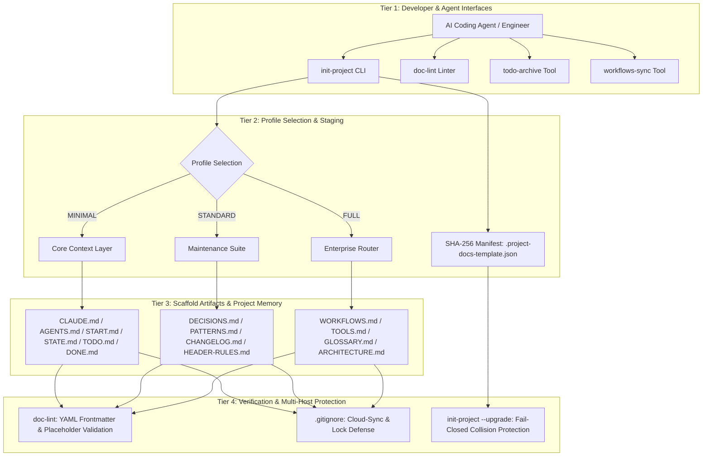
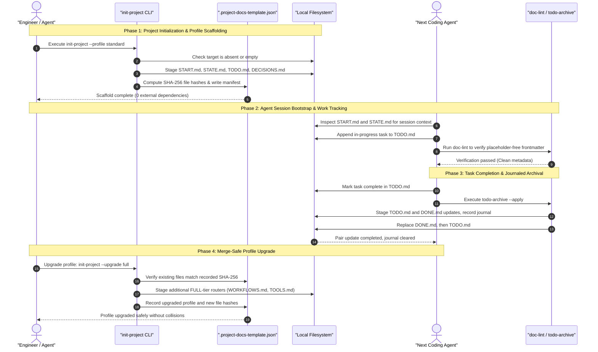

# Modèle de documentation de projet — Project Docs Template

**[English](README.md) · [Deutsch](README_de.md) · [Español](README_es.md) · [Français](README_fr.md) · [Русский](README_ru.md) · [日本語](README_ja.md) · [简体中文](README_zh.md)**

<p align="center"></p>

[](https://github.com/ellmos-ai/project-docs-template)
[](./pyproject.toml)
[](./pyproject.toml)
[](./RELEASE_GATE.md)
[](./tests)
[](./CONTRIBUTING.md)
[](./SECURITY.md)
[](./SECURITY.md)
[](./SECURITY.md)
[](./THIRD_PARTY_LICENSES.txt)
[](./SECURITY.md)
[](./NOTICE)
[](https://github.com/ellmos-ai)
[](https://github.com/open-bricks)
[](./llms.txt)
[](https://github.com/ellmos-ai/project-docs-template/actions/workflows/ci.yml)
[](./README_de.md)
[](./LICENSE)
[](./MARKETING-LOG.txt)
[](./THIRD_PARTY_LICENSES.md)
[](./MARKETING-LOG.txt)

Modèle de documentation de projet prêt pour les agents, avec START/STATE/TODO/DONE,
des flux de travail, des outils légers et une mémoire de projet adaptée aux LLM.

> [!NOTE]
> **Indexation IA / LLM** : les agents IA et les outils automatisés peuvent consulter [llms.txt](llms.txt) pour obtenir un résumé lisible par machine, des termes de recherche et des précisions de désambiguïsation. Dernière vérification : **2026-10-30**.

> Projet indépendant, sans affiliation avec Anthropic, OpenAI ou Google.
> Voir [Marques](#trademarks).

### 🧭 Navigation rapide

1. [Résumé exécutif et identité centrale](#executive-summary--core-identity)
2. [Architecture visuelle et couches découplées](#visual-architecture-topology)
3. [Cycle de vie multi-agent de bout en bout et déroulement des outils](#end-to-end-multi-agent-lifecycle)
4. [Publics cibles et principaux cas d’usage](#target-personas--core-use-cases)
5. [Capacités et limites du projet](#comparative-matrix-vs-alternatives)
6. [Matrice de gouvernance et invariants d’exécution](#governance--runtime-invariants)
7. [Quand utiliser ce modèle](#use-this-template-when)
8. [Contenu et structure générée](#what-is-included)
9. [Démarrage rapide et flux de travail CLI courants](#quick-start)
10. [Mises à niveau des profils et migration](#merge-safe-profile-upgrades)
11. [Matrice de comparaison des profils (MINIMAL / STANDARD / FULL)](#profile-comparison)
12. [Principes de conception et invariants d’architecture](#design-principles)
13. [Tests, vérification et critères de qualité](#verification)
14. [Politique de sécurité et signalement des vulnérabilités](#security-policy)
15. [Licences tierces et inventaire des dépendances](#third-party-licenses--transparency)
16. [Bundles, partenaires et outils associés de l’écosystème](#ecosystem--sibling-tools)
17. [Marques et avis d’indépendance](#trademarks)
18. [Avis légal, limitation de responsabilité et licence (§ 521 BGB)](#license)

---

## <a id="sec-01"></a><a id="executive-summary--core-identity"></a><a id="what-is-project-docs-template"></a>1. Résumé exécutif et identité centrale

`project-docs-template` fournit une architecture légère de documentation et de mémoire de projet, conçue pour les agents de programmation IA autonomes (Claude Code, OpenAI Codex, Antigravity/Gemini), les essaims multi-agents et les personnes qui maintiennent des dépôts logiciels, de recherche ou d’exploitation.

Au lieu de transformer les projets en systèmes d’exploitation lourds et rigides ou de dépendre de portails SaaS propriétaires, `project-docs-template` s’appuie sur des registres Markdown en texte brut, transparents et standardisés (`START.md`, `STATE.md`, `TODO.md`, `DONE.md`, `DECISIONS.md`). Les points d’entrée universels (`CLAUDE.md`, `AGENTS.md`) offrent aux agents un endroit cohérent où consulter l’état du projet, les invariants architecturaux et les tâches actives. Ils fournissent du contexte, mais ne peuvent garantir qu’un agent l’interprète ou le suive correctement.

### Principales propositions de valeur
- **Fonctionnement local** : `SECURITY.md` documente le fonctionnement sur disque local, sans télémétrie ni appels réseau sortants, pour la génération du modèle et les outils de maintenance répertoriés.
- **Aucune dépendance à l’exécution** : les outils de génération, de préparation, de validation et d’archivage des tâches utilisent uniquement la bibliothèque standard de Python (3.10+).
- **Contexte partagé pour les relais entre agents** : les notes de session (`START.md`) et l’instantané de l’état actuel (`STATE.md`) fournissent un point de référence commun aux sessions suivantes. Ces fichiers facilitent les relais, sans garantir le comportement des agents ni empêcher la perte de contexte.
- **Mises à niveau des profils avec détection des changements** : le suivi des empreintes SHA-256 (`.project-docs-template.json`) vérifie les fichiers gérés et permet de refuser les modifications détectées ou les collisions avec des fichiers non gérés avant de valider le niveau de profil suivant.
- **Archivage des tâches avec journal** : `todo-archive` prépare les mises à jour des deux fichiers de tâches, consigne un journal, tente une restauration après une erreur de remplacement et peut récupérer une mise à jour interrompue du duo. En cas de divergence des fichiers, le journal peut rester à examiner manuellement.

---

## <a id="sec-02"></a><a id="visual-architecture-topology"></a><a id="architecture--flow"></a>2. Architecture visuelle et couches découplées

Le diagramme ci-dessous présente les quatre niveaux opérationnels de `project-docs-template`, des interfaces pour développeurs et agents jusqu’aux fichiers du dépôt, à la validation et aux filtres documentés pour les copies de synchronisation cloud :



### Projection de l’architecture en quatre vues

```text
+--------------------------------------------------------------------------------------------------+
|                  [VIEW 1: CLI COCKPIT, LINTER & AGENT INTERFACE HARNESS]                         |
|  - init-project: Deterministic scaffolding, SHA-256 manifest stamping & profile migrations      |
|  - doc-lint: Static markdown validation, frontmatter linting & header contract enforcement       |
|  - todo-archive: Journaled two-file task archive with staged replacement & recovery            |
|  - workflows-sync: Bidirectional orchestration synchronization & prompt template extraction      |
+--------------------------------------------------------------------------------------------------+
                                                |
                                                v
+--------------------------------------------------------------------------------------------------+
|                  [VIEW 2: TIERED PROFILE ENGINE & MERGE-SAFE STAGING]                            |
|  - MINIMAL Profile: Lightweight context boundary (CLAUDE.md, AGENTS.md, START.md, STATE.md)     |
|  - STANDARD Profile: Complete project memory (TODO.md, DONE.md, DECISIONS.md, PATTERNS.md)       |
|  - FULL Profile: Enterprise architecture & governance (WORKFLOWS.md, TOOLS.md, GLOSSARY.md)      |
|  - SHA-256 Manifest: tracks managed files and detects edits or unowned collisions                |
+--------------------------------------------------------------------------------------------------+
                                                |
                                                v
+--------------------------------------------------------------------------------------------------+
|                  [VIEW 3: RUNTIME PERSISTENCE, REPOSITORY MEMORY & AUDIT]                        |
|  - Entry Instructions: CLAUDE.md / AGENTS.md provide a place to read project guidance             |
|  - Session Memory: START.md (session bootloader) & STATE.md (live operational ledger)            |
|  - Task Tracking: Structured task cards, recurring checklists, and verification criteria        |
|  - Decision Ledger: ADR-style architectural records (DECISIONS.md) & code patterns (PATTERNS.md)|
+--------------------------------------------------------------------------------------------------+
                                                |
                                                v
+--------------------------------------------------------------------------------------------------+
|                  [VIEW 4: DOCUMENTED SECURITY POLICY & FILE CONFLICT FILTERS]                     |
|  - User Context: tools run without requiring administrator or root elevation                    |
|  - Zero-Egress Policy: SECURITY.md documents local operation without outbound traffic             |
|  - Conflict-Copy Filters: .gitignore lists known cloud-sync conflict patterns                    |
|  - Legal & Governance: § 521 BGB notice; SECURITY.md says best-effort, no guaranteed response    |
+--------------------------------------------------------------------------------------------------+
```

---

## <a id="sec-03"></a><a id="end-to-end-multi-agent-lifecycle"></a>3. Cycle de vie multi-agent de bout en bout et déroulement des outils

Le diagramme de séquence montre comment les développeurs et les agents de programmation IA peuvent utiliser `project-docs-template` pendant la génération du modèle, le démarrage d’une session, la clôture des tâches et la mise à niveau des profils. La documentation fournit le contexte nécessaire aux relais, tandis que chaque agent reste responsable de la lire et de l’appliquer.



---

## <a id="sec-04"></a><a id="target-personas--discoverability"></a><a id="target-personas--core-use-cases"></a>4. Publics cibles et principaux cas d’usage

`project-docs-template` vise à aider à gérer la dérive du contexte, les pertes lors des relais et les frictions de gouvernance dans quatre parcours techniques principaux :

| Public cible | Difficulté rencontrée | Apport de `project-docs-template` | Fichiers clés |
|:---|:---|:---|:---|
| **Ingénieurs des systèmes multi-agents** | Les agents de programmation hétérogènes (Claude Code, Antigravity/Gemini, Codex) peuvent perdre le contexte du projet d’une session à l’autre ou utiliser des formats de fichiers différents. | Les points d’entrée universels (`CLAUDE.md`, `AGENTS.md`) et les registres de session et d’état (`START.md`, `STATE.md`) offrent un lieu commun où consulter les instructions et le contexte consigné. Des relais fiables dépendent toujours de l’utilisation de ces fichiers par les agents et les mainteneurs. | `CLAUDE.md`, `AGENTS.md`, `START.md`, `STATE.md` |
| **Développeurs indépendants et mainteneurs open source** | Gérer les problèmes, les listes de fonctionnalités et l’historique des versions sans plateforme SaaS de gestion de projet lourde. | Des listes de tâches Markdown légères (`TODO.md`, `DONE.md`), l’outil d’archivage avec journal (`todo-archive`) et le `CHANGELOG.md` standard. | `TODO.md`, `DONE.md`, `_tools/todo-archive`, `CHANGELOG.md` |
| **Responsables de l’architecture d’entreprise et de la gouvernance de l’IA** | Absence de traces vérifiables des décisions, besoin de transparence sur la conformité et risque de sortie accidentelle de données dans les flux de travail avec agents. | Les décisions d’architecture (`DECISIONS.md`), les règles local-first documentées dans `SECURITY.md` et l’absence de dépendances externes à l’exécution. | `DECISIONS.md`, `SECURITY.md`, `THIRD_PARTY_LICENSES.md` |
| **Développeurs de pipelines de recherche et scientifiques** | Des pipelines expérimentaux complexes, composés de plusieurs étapes, peuvent dériver au fil de semaines d’exécutions de raisonnement par LLM. | Le profil FULL, évolutif, propose des procédures opérationnelles (`WORKFLOWS.md`), la terminologie du domaine (`GLOSSARY.md`) et la synchronisation automatisée de tableaux (`workflows-sync`). | `WORKFLOWS.md`, `GLOSSARY.md`, `_tools/workflows-sync` |

### Requêtes de recherche à forte intention
- `agent-ready project documentation template`
- `claude code documentation scaffold`
- `multi-agent session handoff state start todo done`
- `offline local-first project template python`
- `zero-egress developer scaffolding stdlib`
- `deterministic documentation staging and profile upgrades`
- `llm friendly project memory repository template`

---

## <a id="sec-05"></a><a id="comparative-matrix-vs-alternatives"></a><a id="comparative-architecture"></a>5. Capacités et limites du projet

Le tableau suivant résume les dix invariants documentés ainsi que les comportements et limites étayés par ce commit source :

| # | Invariant | Capacité documentée | Périmètre / limite |
|---|:---|:---|:---|
| 1 | **INV-LOCAL-01 : fonctionnement local, aucun trafic sortant** | `SECURITY.md` indique que la génération du modèle et les outils de maintenance répertoriés fonctionnent sur disque local, sans télémétrie sortante ni trafic réseau. | Il s’agit du périmètre documenté de ces outils, pas d’une sandbox réseau au niveau du système d’exploitation. |
| 2 | **INV-SEC-02 : contexte du processus appelant** | Les scripts héritent du contexte du processus appelant et la CLI ne demande pas d’élévation de privilèges. | Un appelant déjà privilégié conserve ses privilèges. Aucune application forcée du mode utilisateur standard ni certification n’est revendiquée. |
| 3 | **INV-FAIL-03 : vérifications avec refus des conflits détectés** | La génération refuse une cible existante non vide et les mises à niveau refusent les modifications détectées de fichiers gérés ainsi que les collisions avec des fichiers non gérés avant le commit. | La génération crée les répertoires parent et de préparation, puis y écrit les fichiers avant leur promotion. Cela ne constitue pas une garantie générale qu’aucune écriture n’a lieu en cas d’échec. |
| 4 | **INV-STG-04 : mises à niveau de profil avec préparation** | Les mises à niveau vérifient les empreintes du manifeste, préparent le niveau suivant et sauvegardent les fichiers. En cas d’échec du commit, elles tentent un retour arrière protégé par empreinte. | La restauration est conditionnelle. Des changements concurrents ou d’autres erreurs du système de fichiers peuvent empêcher un retour arrière complet. |
| 5 | **INV-HANDOFF-05 : contexte de session** | `START.md` et `STATE.md` fournissent aux agents et aux mainteneurs des registres partagés sur le projet et les sessions. | Le modèle ne peut garantir qu’un agent lira, suivra ou conservera ces registres. |
| 6 | **INV-TIER-06 : profils à plusieurs niveaux** | Le modèle propose les profils `MINIMAL`, `STANDARD` et `FULL`. Les mises à niveau avancent d’un niveau à la fois. | Il s’agit de structures documentaires et non d’un framework d’exécution d’agents. |
| 7 | **INV-SYNC-07 : filtrage des copies de conflit** | Les fichiers `.gitignore` du dépôt et du modèle répertorient les motifs connus de copies de conflit et de fichiers de verrouillage. | Les motifs d’exclusion ne coordonnent pas les rédacteurs simultanés et ne fournissent pas de verrou distribué actif. |
| 8 | **INV-AUDIT-08 : archivage TODO/DONE** | `todo-archive` journalise et prépare la mise à jour des deux fichiers, tente une restauration après une erreur de remplacement et peut récupérer une mise à jour interrompue. | Des fichiers divergents peuvent laisser le journal à examiner manuellement. Le retour arrière peut lui-même échouer en cas d’erreur grave du système de fichiers. |
| 9 | **INV-LIC-09 : périmètre des dépendances à l’exécution** | Le projet déclare `dependencies = []` et utilise la bibliothèque standard de Python à l’exécution. | Cette indication concerne les dépendances d’exécution. Les outils de développement et de test sont distincts. |
| 10 | **INV-SLA-10 : politique de réponse de sécurité** | `SECURITY.md` indique que les corrections de sécurité sont prioritaires et que la maintenance des versions `0.1.x` prises en charge suit le meilleur effort. | Il ne faut pas déduire un délai de réponse de 48 heures ni un triage sous cinq jours ouvrés. Suivez les canaux privés indiqués. |

---

## <a id="sec-06"></a><a id="governance--runtime-invariants"></a>6. Matrice de gouvernance et invariants d’exécution

Le projet documente dix invariants d’exécution, de préparation et de gouvernance pour ses outils de génération et de maintenance CLI, ainsi que pour les structures générées :

| ID canonique | Invariant | Comportement documenté et périmètre |
|:---|:---|:---|
| **INV-LOCAL-01** | **Fonctionnement local, aucun trafic sortant** | `SECURITY.md` documente le fonctionnement sur disque local de la génération du modèle et des scripts de maintenance répertoriés, sans télémétrie sortante ni trafic réseau lors de l’instanciation ou de la mise à niveau. Il s’agit du périmètre documenté de ces outils, pas d’une sandbox réseau du système d’exploitation. |
| **INV-SEC-02** | **Contexte du processus appelant** | Les scripts héritent du contexte du processus appelant et la CLI ne demande pas d’élévation de privilèges. Un appelant déjà privilégié conserve ses privilèges. Aucune application forcée du mode utilisateur standard ni certification n’est revendiquée. |
| **INV-FAIL-03** | **Vérifications avec refus des conflits détectés** | La génération refuse une cible existante non vide et les mises à niveau refusent les modifications détectées de fichiers gérés ainsi que les collisions avec des fichiers non gérés avant le commit. La génération crée les répertoires parent et de préparation, puis y écrit avant la promotion. |
| **INV-STG-04** | **Mise à niveau préparée et récupération encadrée** | Les mises à niveau vérifient les empreintes du manifeste et préparent les fichiers avant le commit. Les sauvegardes et contrôles d’empreinte permettent de tenter une restauration, qui reste conditionnelle et peut échouer à cause de changements concurrents ou d’autres erreurs du système de fichiers. |
| **INV-HANDOFF-05** | **Contexte de session des agents** | `START.md` et `STATE.md` consignent le contexte du projet et des sessions. Leur lecture, leur suivi et leur conservation par les agents dépendent du comportement de ceux-ci et du flux de travail. |
| **INV-TIER-06** | **Profils à plusieurs niveaux** | Les trois profils (`MINIMAL`, `STANDARD`, `FULL`) proposent des structures documentaires et des périmètres de maintenance différents. |
| **INV-SYNC-07** | **Filtres de copies de conflit de synchronisation cloud** | Les `.gitignore` du dépôt et du modèle filtrent les motifs répertoriés de copies de conflit et de fichiers de verrouillage. Ils ne coordonnent pas les rédacteurs actifs. |
| **INV-AUDIT-08** | **Archivage des tâches avec journal** | `todo-archive` prépare les mises à jour de `TODO.md` et `DONE.md`, consigne un journal, tente une restauration après une erreur de remplacement et permet de récupérer une mise à jour interrompue. Les divergences peuvent nécessiter une vérification manuelle. |
| **INV-LIC-09** | **Dépendances à l’exécution** | Les dépendances d’exécution sont déclarées via `dependencies = []` et le programme utilise la bibliothèque standard de Python. Les outils de développement et de test ne relèvent pas de cette affirmation. |
| **INV-SLA-10** | **Politique de signalement de sécurité** | `SECURITY.md` prévoit une maintenance au mieux pour `0.1.x` et indique que les délais de réponse ne sont pas garantis. Les corrections de sécurité sont prioritaires. |

---

## <a id="sec-07"></a><a id="use-this-template-when"></a>7. Quand utiliser ce modèle

| Situation | Pourquoi est-ce utile ? |
|:---|:---|
| Un nouveau projet sera maintenu avec Claude Code, Codex, Gemini CLI ou un autre agent de programmation | Fournit à l’agent un parcours d’initialisation prévisible et un fichier décrivant l’état actuel. |
| Un dépôt existant contient des notes dispersées, des fichiers de tâches obsolètes ou aucun historique de passation | Distingue le travail en cours, le travail terminé, les décisions, les pratiques et l’état de la session. |
| Plusieurs agents ou personnes doivent reprendre le travail en toute sécurité | Sépare les consignes, l’état actuel, les workflows et les outils dans des fichiers distincts. |

Il s’agit d’un modèle de documentation et de coordination, pas d’un framework d’exécution. Il
est destiné aux dépôts courants de logiciels, de recherche ou d’exploitation.

---

## <a id="sec-08"></a><a id="what-is-included"></a>8. Contenu et structure du squelette de projet

- `CLAUDE.md` et `AGENTS.md` pour les consignes destinées aux agents
- `START.md` et `STATE.md` pour l’initialisation de session et l’état actuel
- `TODO.md` et `DONE.md`, avec des outils d’archivage facultatifs
- `DECISIONS.md`, `PATTERNS.md`, `CHANGELOG.md` et `HEADER-RULES.md`
- Routeurs facultatifs du profil FULL : `WORKFLOWS.md`, `TOOLS.md`, `GLOSSARY.md`
- Outils locaux dans `_tools/`, dont `init-project`, `doc-lint`, `todo-archive` et `workflows-sync`

Les fichiers réels du modèle se trouvent dans [`template/`](./template/).

---

## <a id="sec-09"></a><a id="quick-start"></a>9. Démarrage rapide et workflows CLI courants

Clonez le dépôt et créez en quelques secondes un espace de travail prêt pour les agents :

```bash
git clone https://github.com/ellmos-ai/project-docs-template.git
cd project-docs-template

# Inspect scaffold generation without writing changes (dry-run)
python template/_tools/init-project --target /path/to/my-project --name "my-project" --profile STANDARD --dry-run

# Render STANDARD profile (12 root contracts & tools with SHA-256 manifest)
python template/_tools/init-project --target /path/to/my-project --name "my-project" --profile STANDARD

# Optional: initialize Git repository with staged initial commit
python template/_tools/init-project --target /path/to/my-project --name "my-project" --profile STANDARD --git
```

### Parcours de génération par étapes (sortie du terminal)

Lorsque `init-project` s’exécute, il crée un répertoire de staging voisin, génère les fichiers du profil choisi, lance les étapes de préparation et de validation, écrit son manifeste, puis déplace le résultat préparé vers sa destination. La cible peut être absente ou être un répertoire existant vide :

```text
==> Root:    /path/to/.my-project.staging-xyz123
==> Max age: 30 days

Results:
  OK   CLAUDE.md
  OK   START.md
  OK   STATE.md

OK: Alle geprüften Files bestehen (oder wurden gefixt)
==> Target:  /path/to/my-project
==> Name:    my-project
==> Author:  Alex Developer
==> Date:    2026-10-30

==> Profil: STANDARD
    Ernsthafte Projekte mit mehrmonatiger Lebensdauer
  OK: AGENTS.md
  OK: CLAUDE.md
  OK: README.md
  OK: START.md
  OK: STATE.md
  OK: CHANGELOG.md
  OK: HEADER-RULES.md
  OK: CUT-AND-CLUE.md
  OK: DECISIONS.md
  OK: PATTERNS.md
  OK: TODO.md
  OK: DONE.md
  OK: .gitignore
  OK: _tools/README.md
  OK: _tools/todo-archive
  OK: _tools/doc-lint

==> Fertig: /path/to/my-project
```

### Workflows CLI de maintenance courants dans les projets générés

Les espaces de travail générés comprennent des outils légers, sans dépendances, dans `_tools/` :

```bash
# Lint project documentation and verify YAML frontmatter & staleness
python _tools/doc-lint

# Automatically insert missing frontmatter fields & refresh verification dates
python _tools/doc-lint --fix --update-dates

# Archive completed tasks with journaling
python _tools/todo-archive --apply

# Synchronize workflow tables across routers (FULL profile)
python _tools/workflows-sync --apply
```

> [!NOTE]
> **Langue du modèle :** la documentation du dépôt est en anglais, mais le contenu des fichiers de modèle dans [`template/`](./template/) — `CLAUDE.md`, `START.md`, `STATE.md`, `TODO.md` et les autres — ainsi que la sortie CLI de `init-project`, `doc-lint`, `todo-archive` et `workflows-sync` sont en allemand. Les noms de fichiers, les marqueurs de profil et les clés YAML front matter sont indépendants de la langue. Un projet en anglais peut donc reprendre la structure et remplacer le texte. Une version anglaise du jeu de modèles est prévue : voir [`TODO.md`](./TODO.md).

---

## <a id="sec-10"></a><a id="merge-safe-profile-upgrades"></a>10. Mises à niveau de profil avec détection des changements et migration

Les projets existants peuvent passer à l’étape de profil suivante :

```bash
# Upgrade existing project to FULL profile
python template/_tools/init-project /path/to/my-project --upgrade full
```

### Contrôles de sécurité pendant la mise à niveau
- **Vérification du manifeste** : lit `.project-docs-template.json` et compare les empreintes des fichiers gérés.
- **Arrêt en cas de collision avec un fichier non géré** : si un fichier à ajouter existe déjà sans figurer dans le manifeste précédent, la mise à niveau s’interrompt avant de valider des modifications dans la cible. Un répertoire de staging peut déjà avoir été créé.
- **Refus en cas de modification d’un fichier géré** : si un fichier géré ne correspond plus à l’empreinte inscrite dans son manifeste, la mise à niveau refuse de continuer. Aucune demande de confirmation ni aucun écrasement automatique n’est proposé.
- **Tentative conditionnelle de retour arrière** : pendant la validation, les sauvegardes et les vérifications d’empreinte actuelle permettent de restaurer les fichiers modifiés par cette exécution. Si une autre modification est détectée, la restauration est omise pour éviter de l’écraser. Une autre erreur du système de fichiers peut également empêcher le retour arrière d’aboutir.

---

## <a id="sec-11"></a><a id="profile-comparison"></a>11. Tableau comparatif des profils

| Fonctionnalité / document | `MINIMAL` | `STANDARD` | `FULL` |
|:---|:---:|:---:|:---:|
| `CLAUDE.md` et `AGENTS.md` (consignes pour les agents) | ✅ Inclus | ✅ Inclus | ✅ Inclus |
| `START.md` et `STATE.md` (mémoire de session) | ✅ Inclus | ✅ Inclus | ✅ Inclus |
| `TODO.md` et `DONE.md` (suivi des tâches) | ✅ Inclus | ✅ Inclus | ✅ Inclus |
| `_tools/todo-archive` (archivage des tâches) | ✅ Inclus | ✅ Inclus | ✅ Inclus |
| `_tools/doc-lint` (vérification de la documentation) | ✅ Inclus | ✅ Inclus | ✅ Inclus |
| `DECISIONS.md` (décisions d’architecture) | — | ✅ Inclus | ✅ Inclus |
| `PATTERNS.md` (modèles de conception) | — | ✅ Inclus | ✅ Inclus |
| `CHANGELOG.md` et `HEADER-RULES.md` | — | ✅ Inclus | ✅ Inclus |
| `WORKFLOWS.md` et `_tools/workflows-sync` | — | — | ✅ Inclus |
| `TOOLS.md` et `GLOSSARY.md` (routeurs de domaine) | — | — | ✅ Inclus |
| `ARCHITECTURE.md` et workflows `.github/` | — | — | ✅ Inclus |

---

## <a id="sec-12"></a><a id="design-principles"></a>12. Principes de conception et invariants d’architecture

- **Séparation des responsabilités** : chaque fichier a une responsabilité opérationnelle unique et bien définie.
- **Passation explicite de session** : le début de session et l’état actuel sont consignés dans des fichiers courts et prévisibles (`START.md`, `STATE.md`) que les agents et les personnes responsables de la maintenance peuvent consulter.
- **Faible charge de maintenance** : privilégie les documents de contexte utiles plutôt que la génération de wikis volumineux et laissés à l’abandon.
- **Modèle de routeur** : les routeurs de haut niveau (`WORKFLOWS.md`, `TOOLS.md`) indexent les détails au lieu de les dupliquer.
- **Cycle de vie des tâches avec journal** : `todo-archive` utilise un journal et le remplacement de fichiers préparés pour archiver les tâches terminées. La récupération dépend du journal et de l’état actuel des fichiers.

Voir [`template/TEMPLATE.md`](./template/TEMPLATE.md) pour la justification complète des choix de conception.

---

## <a id="sec-13"></a><a id="verification"></a>13. Tests, vérification et critères de qualité

La suite de tests s’exécute avec le module `unittest` de la bibliothèque standard Python ou avec `pytest` :

```bash
# Run test suite via pytest
pytest -ra -v

# Run test suite via standard unittest
python -m unittest discover -s tests -v
```

Les tests couvrent tous les profils, l’initialisation de Git, la réparation du front matter YAML, l’échappement des métadonnées des workflows, le refus de mises à niveau dont la cible a été modifiée ou comporte des collisions, le retour arrière après l’échec injecté de la validation du manifeste, le retour arrière après l’échec injecté du second remplacement de TODO/DONE, ainsi que la récupération d’un archivage interrompu à partir de son journal. La même suite est configurée pour Linux, Windows et macOS. Voir [`RELEASE_GATE.md`](./RELEASE_GATE.md).

---

## <a id="sec-14"></a><a id="security-policy"></a>14. Politique de sécurité et signalement des vulnérabilités

`project-docs-template` applique la politique décrite dans `SECURITY.md` :
- **Priorité au local et absence de trafic sortant** : `SECURITY.md` indique que la génération des modèles et les outils de maintenance répertoriés travaillent sur le disque local sans télémétrie sortante ni trafic réseau pendant l’instanciation et la mise à niveau.
- **Génération préparée et contrôles de mise à niveau** : la génération prépare les fichiers dans un répertoire voisin de la cible, les valide avant leur mise en place et rejette les cibles existantes non vides. Les mises à niveau de profil vérifient les empreintes des fichiers gérés et les collisions avec les fichiers non gérés avant la validation. Le retour arrière reste conditionnel.
- **Versions prises en charge et politique de réponse** : `SECURITY.md` indique que les versions `0.1.x` prises en charge sur la branche `main` bénéficient d’une maintenance au mieux, donnent la priorité aux correctifs de sécurité et ne garantissent aucun délai de réponse. Les versions antérieures à `0.1.0` ne sont pas prises en charge.

Pour signaler une vulnérabilité potentielle, suivez les indications de [`SECURITY.md`](./SECURITY.md) : utilisez de préférence un avis de sécurité GitHub privé ou les coordonnées directes des responsables qui y sont indiquées. Ne signalez pas publiquement les vulnérabilités non corrigées dans les issues. La politique demande une divulgation coordonnée jusqu’à la publication d’un correctif. Elle indique les adresses `security@ellmos.ai`, `support@lukasgeiger.com` et `lukas@open-bricks.org`.

---

## <a id="sec-15"></a><a id="third-party-licenses--transparency"></a>15. Licences tierces et inventaire des dépendances

`project-docs-template` suit une architecture sans dépendances d’exécution (`dependencies = []`). Tout le code exécuté repose uniquement sur la bibliothèque standard de Python (version 3.10 ou ultérieure).

| Composant | Périmètre | Licence déclarée | Statut |
|:---|:---|:---|:---|
| **Bibliothèque standard Python** | Exécution principale | PSFL-2.0 | 100 % permissive (intégrée) |
| **pytest** | Développement / tests | Licence MIT | 100 % permissive |
| **ruff** | Développement / assurance qualité | MIT / Apache-2.0 | 100 % permissive |
| **setuptools** | Backend de build | Licence MIT | 100 % permissive |

Les licences déclarées des dépendances d’exécution et de développement, ainsi que l’inventaire des dépendances, figurent dans [THIRD_PARTY_LICENSES.md](THIRD_PARTY_LICENSES.md) et son document compagnon en texte brut [THIRD_PARTY_LICENSES.txt](THIRD_PARTY_LICENSES.txt). Ces fichiers décrivent les éléments qui y sont répertoriés. Aucune certification SBOM de niveau 1 ni aucun audit indépendant n’est revendiqué ici.

---

## <a id="sec-16"></a><a id="ecosystem--sibling-tools"></a><a id="bundles-and-partners"></a>16. Bundles, partenaires et outils de l’écosystème

`project-docs-template` est un composant essentiel de création de squelettes de projet au sein de l’écosystème [`ellmos-ai`](https://github.com/ellmos-ai) et du collectif open source [`open-bricks`](https://github.com/open-bricks) qui les chapeaute :

| Dépôt | Fonction | Interface principale |
|:---|:---|:---|
| [`policy-registry`](https://github.com/ellmos-ai/policy-registry) | Registre de politiques lisible par machine avec délégations signées | CLI / API / MCP |
| [`DevCenter`](https://github.com/dev-bricks/DevCenter) | IDE Python local et boîte à outils pour développeurs | GUI / PySide6 |
| [`CodeBox`](https://github.com/dev-bricks/CodeBox) | Éditeur de code de bureau et IDE | GUI / PySide6 |
| [`companion-for-agy`](https://github.com/ellmos-ai/companion-for-agy) | Extension et suite compagnon pour les agents IA Antigravity | CLI / Node.js |
| [`safe-start-for-codex`](https://github.com/dev-bricks/safe-start-for-codex) | Initialisation défensive et vérification de l’environnement | CLI / Python |
| [`automizer-for-claude-desktop`](https://github.com/dev-bricks/automizer-for-claude-desktop) | Pont de connexion et boîte à outils d’automatisation pour Claude Desktop | CLI / Python |
| [`system-gap-master`](https://github.com/ellmos-ai/system-gap-master) | Synchronisation intersystèmes et analyse des divergences | CLI / Python |
| [`lock-master`](https://github.com/ellmos-ai/lock-master) | Gestionnaire de verrous pour fichiers et ressources partagés | CLI / Python |
| [`ticket-master`](https://github.com/ellmos-ai/ticket-master) | Orchestrateur local de tickets et de suivi des demandes | CLI / Python |
| [`clutch`](https://github.com/ellmos-ai/clutch) | Routeur LLM indépendant des fournisseurs et moteur d’orchestration de modèles | CLI / Python |
| [`memoryhooker`](https://github.com/ellmos-ai/memoryhooker) | Extraction de mémoire de session et injection de hooks | CLI / Python |
| [`workflowhooker`](https://github.com/ellmos-ai/workflowhooker) | Déclencheurs de cycle de vie pour l’automatisation des workflows | CLI / Python |
| [`ellmos-controlcenter-mcp`](https://github.com/ellmos-ai/ellmos-controlcenter-mcp) | Serveur MCP pour l’inspection du système et la recherche de compétences | MCP |
| [`ellmos-filecommander-mcp`](https://github.com/ellmos-ai/ellmos-filecommander-mcp) | Serveur MCP pour les opérations locales sur les fichiers avec protections | MCP |
| [`open-bricks`](https://github.com/open-bricks) | Organisation faîtière d’outils pour développeurs et IA | Portail |

<!-- BEGIN GENERATED ELLMOS BUNDLE DISCOVERY -->
### Bundles and Partners Discovery Projection
Generated discovery projection for `module:project-docs-template` from `catalog:v4-bundles` (`546290dafbaafd810df1d59ef5a3d7183738472b48cd5a8a81f1e8f2b64d852e`). Target repository visibility: `public`.

- **`ellmos-dev-lifecycle-bundle`**: role `declared-component`, requirement `required`. Partners: `module:bundle-installer`, `module:ellmos-code-tools`, `module:ellmos-tests`, `module:github-onedrive-mirror`, `module:stack-system-installer`.
- **`ellmos-knowledge-bundle`**: role `declared-component`, requirement `recommended`. Partners: `module:KnowledgeDigest`, `module:WikiStub-Seed`, `module:report-forge`, `module:web-scraper`.
<!-- END GENERATED ELLMOS BUNDLE DISCOVERY -->

---

## <a id="sec-17"></a><a id="trademarks"></a>17. Marques et avis d’indépendance

Ce projet est un modèle de documentation indépendant, maintenu par la communauté.
Ce projet n’est affilié à Anthropic, OpenAI ou Google, et n’est ni approuvé, ni parrainé, ni autrement lié
à ces sociétés.

« Claude » et « Claude Code », « Codex », « Gemini » et « Antigravity » sont des marques
ou des marques déposées appartenant à leurs propriétaires respectifs (Anthropic PBC, OpenAI,
Google LLC). Les autres noms de produits, logos et marques appartiennent à leurs
propriétaires respectifs. Ils sont utilisés ici uniquement pour décrire la compatibilité
et l’interopérabilité. Leur emploi n’implique aucune approbation,
autorisation ni relation commerciale.

---

## <a id="sec-18"></a><a id="license"></a><a id="statutory-notice-liability-limitation--license"></a>18. Avis légal, limitation de responsabilité et licence (§ 521 BGB)

### Avis légal et limitation de responsabilité (§ 521 BGB)
La mise à disposition de ce logiciel et du scaffold de modèle est gratuite et relève d’un service de complaisance (*Gefälligkeit* / *unentgeltliche Schenkung* au sens du **§ 521 BGB** du Code civil allemand). En vertu du droit allemand, la responsabilité de l’auteur et des contributeurs est strictement limitée aux cas d’intention et de faute lourde (*Vorsatz und grobe Fahrlässigkeit*). Les responsabilités légales impératives — notamment en cas d’intention (article 276, paragraphe 3, BGB) et d’atteinte à la vie, à l’intégrité physique ou à la santé — restent applicables.

### Licence
Ce projet est distribué sous les termes de la **licence MIT**. Voir [LICENSE](LICENSE) et [NOTICE](NOTICE) pour les mentions complètes relatives aux droits d’auteur.