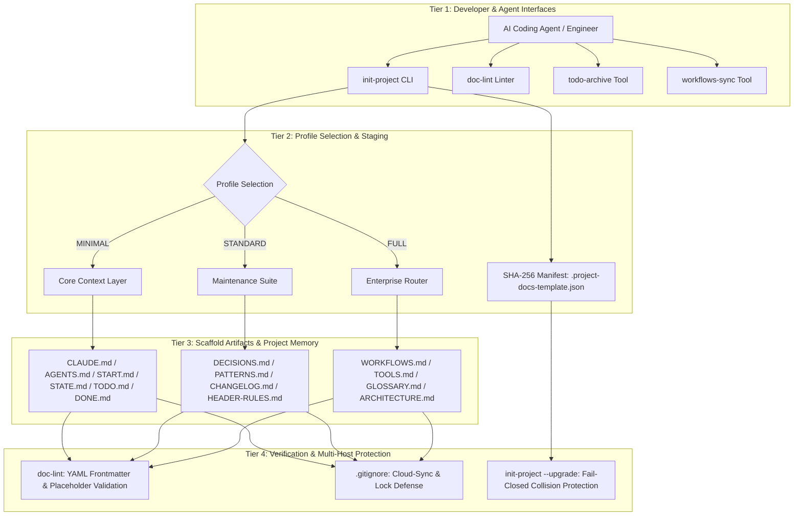
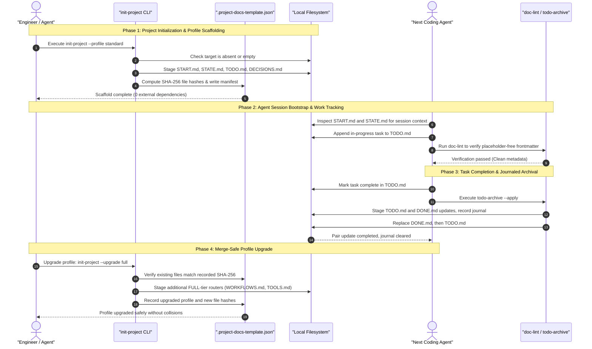

# Project Docs Template

**[English](README.md) · [Deutsch](README_de.md) · [Español](README_es.md) · [Français](README_fr.md) · [Русский](README_ru.md) · [日本語](README_ja.md) · [简体中文](README_zh.md) · [हिन्दी](README_hi.md) · [العربية](README_ar.md) · [বাংলা](README_bn.md) · [Português](README_pt.md)**

<p align="center"></p>

[](https://github.com/ellmos-ai/project-docs-template)
[](./pyproject.toml)
[](./pyproject.toml)
[](./RELEASE_GATE.md)
[](./tests)
[](./CONTRIBUTING.md)
[](./SECURITY.md)
[](./SECURITY.md)
[](./SECURITY.md)
[](./THIRD_PARTY_LICENSES.txt)
[](./SECURITY.md)
[](./NOTICE)
[](https://github.com/ellmos-ai)
[](https://github.com/open-bricks)
[](./llms.txt)
[](https://github.com/ellmos-ai/project-docs-template/actions/workflows/ci.yml)
[](./README_de.md)
[](./LICENSE)
[](./MARKETING-LOG.txt)
[](./THIRD_PARTY_LICENSES.md)
[](./MARKETING-LOG.txt)

एजेंटों के लिए तैयार परियोजना दस्तावेज़ टेम्पलेट, जिसमें START/STATE/TODO/DONE शामिल हैं,
साथ में वर्कफ़्लो, हल्के टूल और LLM-अनुकूल परियोजना स्मृति।

> [!NOTE]
> **AI / LLM इंडेक्सिंग**: AI एजेंट और स्वचालित टूल [llms.txt](llms.txt) में मशीन-पठनीय सारांश, खोज शब्द और अस्पष्टता दूर करने वाले विवरण देख सकते हैं। अंतिम जाँच: **2026-10-30**।

> स्वतंत्र परियोजना, Anthropic, OpenAI या Google से संबद्ध नहीं।
> [ट्रेडमार्क](#trademarks) देखें।

### 🧭 त्वरित नेविगेशन

1. [सारांश और मुख्य पहचान](#executive-summary--core-identity)
2. [दृश्य आर्किटेक्चर और अलग-अलग लेयर](#visual-architecture-topology)
3. [मल्टी-एजेंट का शुरू से अंत तक जीवनचक्र और टूल प्रवाह](#end-to-end-multi-agent-lifecycle)
4. [लक्षित उपयोगकर्ता और मुख्य उपयोग परिदृश्य](#target-personas--core-use-cases)
5. [परियोजना की क्षमताएँ और सीमाएँ](#comparative-matrix-vs-alternatives)
6. [गवर्नेंस और रनटाइम इनवेरिएंट मैट्रिक्स](#governance--runtime-invariants)
7. [यह टेम्पलेट कब उपयोग करें](#use-this-template-when)
8. [इसमें क्या शामिल है और प्रोजेक्ट स्कैफ़ोल्ड की संरचना](#what-is-included)
9. [त्वरित शुरुआत और आम CLI वर्कफ़्लो](#quick-start)
10. [बदलाव का पता लगाने वाले प्रोफ़ाइल अपग्रेड और माइग्रेशन](#merge-safe-profile-upgrades)
11. [प्रोफ़ाइल तुलना मैट्रिक्स (MINIMAL / STANDARD / FULL)](#profile-comparison)
12. [डिज़ाइन सिद्धांत और आर्किटेक्चर इनवेरिएंट](#design-principles)
13. [परीक्षण, सत्यापन और गुणवत्ता गेट](#verification)
14. [सुरक्षा नीति और कमज़ोरियों की रिपोर्टिंग](#security-policy)
15. [तृतीय-पक्ष लाइसेंस और निर्भरता सूची](#third-party-licenses--transparency)
16. [बंडल, साझेदार और इकोसिस्टम के संबद्ध टूल](#ecosystem--sibling-tools)
17. [ट्रेडमार्क और स्वतंत्रता संबंधी सूचना](#trademarks)
18. [वैधानिक सूचना, दायित्व की सीमा और लाइसेंस (§ 521 BGB)](#license)

---

## <a id="sec-01"></a><a id="executive-summary--core-identity"></a><a id="what-is-project-docs-template"></a>1. सारांश और मुख्य पहचान

`project-docs-template` स्वायत्त AI कोडिंग एजेंटों (Claude Code, OpenAI Codex, Antigravity/Gemini), मल्टी-एजेंट समूहों और सॉफ़्टवेयर, शोध तथा संचालन संबंधी रिपॉज़िटरी का रखरखाव करने वाले लोगों के लिए हल्का, एजेंट-अनुकूल दस्तावेज़ीकरण और परियोजना-स्मृति आर्किटेक्चर प्रदान करता है।

भारी और कठोर ऑपरेटिंग सिस्टम जैसे ढाँचे बनाने या मालिकाना SaaS पोर्टल पर निर्भर रहने के बजाय, `project-docs-template` पारदर्शी, मानक, सादे-पाठ Markdown रजिस्टर (`START.md`, `STATE.md`, `TODO.md`, `DONE.md`, `DECISIONS.md`) का उपयोग करता है। साझा प्रवेश फ़ाइलें (`CLAUDE.md`, `AGENTS.md`) एजेंटों को परियोजना की स्थिति, आर्किटेक्चर इनवेरिएंट और सक्रिय कार्य पढ़ने के लिए एक समान स्थान देती हैं। ये संदर्भ देती हैं, लेकिन यह गारंटी नहीं देतीं कि एजेंट उन्हें सही ढंग से समझेगा या उनका पालन करेगा।

### मुख्य मूल्य प्रस्ताव
- **लोकल-फर्स्ट संचालन**: `SECURITY.md` में दर्ज है कि टेम्पलेट जनरेशन और सूचीबद्ध रखरखाव टूल लोकल डिस्क पर काम करते हैं, बिना टेलीमेट्री या बाहर जाने वाले नेटवर्क अनुरोधों के।
- **रनटाइम निर्भरता शून्य**: स्कैफ़ोल्डिंग, स्टेजिंग, सत्यापन और कार्यों को संग्रहित करने वाले सभी टूल केवल Python 3.10+ की मानक लाइब्रेरी का उपयोग करते हैं।
- **एजेंट हैंडऑफ़ के लिए साझा सत्र संदर्भ**: सत्र नोट्स (`START.md`) और वर्तमान स्थिति का स्नैपशॉट (`STATE.md`) बाद के सत्रों के लिए साझा संदर्भ देते हैं। ये फ़ाइलें हैंडऑफ़ में मदद करती हैं, लेकिन एजेंट के व्यवहार की गारंटी नहीं देतीं और संदर्भ खोने से नहीं रोकतीं।
- **बदलाव पहचानने वाले प्रोफ़ाइल अपग्रेड**: SHA-256 मैनिफ़ेस्ट (`.project-docs-template.json`) प्रबंधित फ़ाइलों की जाँच करता है और अगला प्रोफ़ाइल स्तर लागू करने से पहले पहचाने गए संपादन या गैर-प्रबंधित फ़ाइलों से टकराव होने पर अपग्रेड अस्वीकार कर सकता है।
- **जर्नल के साथ कार्य संग्रहण**: `todo-archive` दोनों कार्य फ़ाइलों के अपडेट स्टेज करता है, जर्नल दर्ज करता है, प्रतिस्थापन त्रुटियों के बाद रोलबैक का प्रयास करता है और बीच में रुके दो-फ़ाइल कमिट को पुनः प्राप्त कर सकता है। फ़ाइलों में अंतर होने पर जर्नल की मैन्युअल समीक्षा करनी पड़ सकती है।

---

## <a id="sec-02"></a><a id="visual-architecture-topology"></a><a id="architecture--flow"></a>2. दृश्य आर्किटेक्चर और अलग-अलग लेयर

नीचे दिया गया आरेख `project-docs-template` की चार संचालन परतें दिखाता है। इसमें डेवलपर और एजेंट इंटरफ़ेस से लेकर रिपॉज़िटरी फ़ाइलें, सत्यापन और क्लाउड-सिंक की टकराव प्रतियों के दस्तावेज़ीकृत फ़िल्टर शामिल हैं।



### चार-दृश्य आर्किटेक्चर प्रक्षेपण

```text
+--------------------------------------------------------------------------------------------------+
|                  [VIEW 1: CLI COCKPIT, LINTER & AGENT INTERFACE HARNESS]                         |
|  - init-project: Deterministic scaffolding, SHA-256 manifest stamping & profile migrations      |
|  - doc-lint: Static markdown validation, frontmatter linting & header contract enforcement       |
|  - todo-archive: Journaled two-file task archive with staged replacement & recovery            |
|  - workflows-sync: Bidirectional orchestration synchronization & prompt template extraction      |
+--------------------------------------------------------------------------------------------------+
                                                |
                                                v
+--------------------------------------------------------------------------------------------------+
|                  [VIEW 2: TIERED PROFILE ENGINE & MERGE-SAFE STAGING]                            |
|  - MINIMAL Profile: Lightweight context boundary (CLAUDE.md, AGENTS.md, START.md, STATE.md)     |
|  - STANDARD Profile: Complete project memory (TODO.md, DONE.md, DECISIONS.md, PATTERNS.md)       |
|  - FULL Profile: Enterprise architecture & governance (WORKFLOWS.md, TOOLS.md, GLOSSARY.md)      |
|  - SHA-256 Manifest: tracks managed files and detects edits or unowned collisions                |
+--------------------------------------------------------------------------------------------------+
                                                |
                                                v
+--------------------------------------------------------------------------------------------------+
|                  [VIEW 3: RUNTIME PERSISTENCE, REPOSITORY MEMORY & AUDIT]                        |
|  - Entry Instructions: CLAUDE.md / AGENTS.md provide a place to read project guidance             |
|  - Session Memory: START.md (session bootloader) & STATE.md (live operational ledger)            |
|  - Task Tracking: Structured task cards, recurring checklists, and verification criteria        |
|  - Decision Ledger: ADR-style architectural records (DECISIONS.md) & code patterns (PATTERNS.md)|
+--------------------------------------------------------------------------------------------------+
                                                |
                                                v
+--------------------------------------------------------------------------------------------------+
|                  [VIEW 4: DOCUMENTED SECURITY POLICY & FILE CONFLICT FILTERS]                     |
|  - User Context: tools run without requiring administrator or root elevation                    |
|  - Zero-Egress Policy: SECURITY.md documents local operation without outbound traffic             |
|  - Conflict-Copy Filters: .gitignore lists known cloud-sync conflict patterns                    |
|  - Legal & Governance: § 521 BGB notice; SECURITY.md says best-effort, no guaranteed response    |
+--------------------------------------------------------------------------------------------------+
```

---

## <a id="sec-03"></a><a id="end-to-end-multi-agent-lifecycle"></a>3. मल्टी-एजेंट का शुरू से अंत तक जीवनचक्र और टूल प्रवाह

क्रम आरेख दिखाता है कि डेवलपर और AI कोडिंग एजेंट स्कैफ़ोल्ड जनरेशन, सत्र शुरू करने, कार्य पूरा करने और प्रोफ़ाइल अपग्रेड के दौरान `project-docs-template` का उपयोग कैसे कर सकते हैं। दस्तावेज़ हैंडऑफ़ के लिए संदर्भ देते हैं। उन्हें पढ़ने और लागू करने की ज़िम्मेदारी एजेंट की रहती है।



---

## <a id="sec-04"></a><a id="target-personas--discoverability"></a><a id="target-personas--core-use-cases"></a>4. लक्षित उपयोगकर्ता और मुख्य उपयोग परिदृश्य

`project-docs-template` संदर्भ के बहाव, हैंडऑफ़ में जानकारी खोने और गवर्नेंस की कठिनाइयों जैसी समस्याओं से निपटने में चार प्रमुख तकनीकी उपयोग परिदृश्यों को सहायता देने के लिए बनाया गया है:

| लक्षित उपयोगकर्ता | मुख्य समस्या | `project-docs-template` कैसे मदद करता है | मुख्य फ़ाइलें |
|:---|:---|:---|:---|
| **मल्टी-एजेंट सिस्टम इंजीनियर** | अलग-अलग कोडिंग एजेंट (Claude Code, Antigravity/Gemini, Codex) सत्रों के बीच परियोजना का संदर्भ खो सकते हैं या अलग-अलग फ़ाइल फ़ॉर्मैट उपयोग कर सकते हैं। | साझा प्रवेश फ़ाइलें (`CLAUDE.md`, `AGENTS.md`) और सत्र/स्थिति रजिस्टर (`START.md`, `STATE.md`) एजेंटों को निर्देश और दर्ज संदर्भ पढ़ने के लिए साझा स्थान देते हैं। भरोसेमंद हैंडऑफ़ के लिए एजेंट और रखरखावकर्ता इन फ़ाइलों का उपयोग करें, यह फिर भी आवश्यक है। | `CLAUDE.md`, `AGENTS.md`, `START.md`, `STATE.md` |
| **स्वतंत्र डेवलपर और ओपन-सोर्स रखरखावकर्ता** | भारी परियोजना-प्रबंधन SaaS के बिना मुद्दों, फ़ीचर बैकलॉग और रिलीज़ इतिहास को संभालना। | कम रखरखाव वाले Markdown कार्य चक्र (`TODO.md`, `DONE.md`), जर्नल-सहित संग्रह टूल (`todo-archive`) और मानक `CHANGELOG.md`। | `TODO.md`, `DONE.md`, `_tools/todo-archive`, `CHANGELOG.md` |
| **एंटरप्राइज़ आर्किटेक्चर और AI गवर्नेंस प्रमुख** | ऑडिट योग्य निर्णय रिकॉर्ड और अनुपालन पारदर्शिता का अभाव, साथ ही कॉर्पोरेट एजेंट वर्कफ़्लो में डेटा अनजाने में बाहर जाने का जोखिम। | आर्किटेक्चर निर्णय रिकॉर्ड (`DECISIONS.md`), `SECURITY.md` में दर्ज सख़्त लोकल-फर्स्ट इनवेरिएंट और रनटाइम पर बाहरी निर्भरताओं का अभाव। | `DECISIONS.md`, `SECURITY.md`, `THIRD_PARTY_LICENSES.md` |
| **शोध और वैज्ञानिक पाइपलाइन डेवलपर** | जटिल बहु-चरणीय प्रयोग पाइपलाइन कई सप्ताह के स्वायत्त LLM रीजनिंग रन के दौरान भटक सकती हैं। | विस्तार योग्य FULL प्रोफ़ाइल में संचालन रनबुक (`WORKFLOWS.md`), डोमेन शब्दावली (`GLOSSARY.md`) और स्वचालित टेबल सिंक (`workflows-sync`) शामिल हैं। | `WORKFLOWS.md`, `GLOSSARY.md`, `_tools/workflows-sync` |

### उच्च-इरादे वाले खोज प्रश्न
- `agent-ready project documentation template`
- `claude code documentation scaffold`
- `multi-agent session handoff state start todo done`
- `offline local-first project template python`
- `zero-egress developer scaffolding stdlib`
- `deterministic documentation staging and profile upgrades`
- `llm friendly project memory repository template`

---

## <a id="sec-05"></a><a id="comparative-matrix-vs-alternatives"></a><a id="comparative-architecture"></a>5. परियोजना की क्षमताएँ और सीमाएँ

नीचे दी गई तालिका में इस स्रोत कमिट से समर्थित परियोजना के दस दस्तावेज़ीकृत इनवेरिएंट, व्यवहार और सीमाओं का सार दिया गया है:

| # | इनवेरिएंट | दस्तावेज़ीकृत क्षमता | दायरा／सीमा |
|---|:---|:---|:---|
| 1 | **INV-LOCAL-01: लोकल-फर्स्ट, बाहर कोई डेटा नहीं** | `SECURITY.md` के अनुसार टेम्पलेट जनरेशन और सूचीबद्ध रखरखाव टूल लोकल डिस्क पर काम करते हैं, बिना बाहरी टेलीमेट्री या नेटवर्क ट्रैफ़िक के। | यह इन टूलों के दस्तावेज़ीकृत दायरे का वर्णन है, ऑपरेटिंग सिस्टम-स्तरीय नेटवर्क सैंडबॉक्स का नहीं। |
| 2 | **INV-SEC-02: कॉल करने वाली प्रक्रिया का संदर्भ** | स्क्रिप्ट कॉल करने वाली प्रक्रिया का निष्पादन संदर्भ ग्रहण करती हैं। CLI विशेषाधिकार बढ़ाने का अनुरोध नहीं करता। | पहले से विशेषाधिकार वाली कॉलर प्रक्रिया वही विशेषाधिकार बनाए रखती है। मानक उपयोगकर्ता के रूप में चलाने को लागू करने या प्रमाणन का दावा नहीं किया गया है। |
| 3 | **INV-FAIL-03: विफल-बंद जाँच** | जनरेशन पहले से मौजूद गैर-खाली लक्ष्य को अस्वीकार करता है। अपग्रेड, प्रतिबद्ध करने से पहले प्रबंधित फ़ाइलों में पहचाने गए बदलाव या गैर-प्रबंधित फ़ाइलों से टकराव को अस्वीकार करते हैं। | जनरेशन पैरेंट और स्टेजिंग क्षेत्र बनाता है और परिणाम को लक्ष्य पर रखने से पहले तैयार फ़ाइलें वहाँ लिखता है। यह विफलता पर किसी भी लेखन के न होने की व्यापक गारंटी नहीं है। |
| 4 | **INV-STG-04: स्टेज किए गए प्रोफ़ाइल अपग्रेड** | अपग्रेड मैनिफ़ेस्ट हैश की जाँच करते हैं, अगला प्रोफ़ाइल तैयार करते हैं, फ़ाइलों का बैकअप लेते हैं और कमिट विफल होने पर हैश-रक्षित रोलबैक का प्रयास करते हैं। | पुनर्स्थापन सशर्त है। प्रतिस्पर्धी बदलाव या आगे की फ़ाइल-सिस्टम त्रुटियाँ पूर्ण रोलबैक रोक सकती हैं। |
| 5 | **INV-HANDOFF-05: सत्र संदर्भ** | `START.md` और `STATE.md` एजेंटों और रखरखावकर्ताओं के लिए साझा परियोजना तथा सत्र रिकॉर्ड देते हैं। | टेम्पलेट यह सुनिश्चित नहीं कर सकता कि एजेंट उन रिकॉर्ड को पढ़ेगा, मानेगा या याद रखेगा। |
| 6 | **INV-TIER-06: स्तरित प्रोफ़ाइल** | टेम्पलेट `MINIMAL`, `STANDARD` और `FULL` प्रोफ़ाइल देता है। अपग्रेड एक बार में एक प्रोफ़ाइल स्तर आगे बढ़ाते हैं। | ये दस्तावेज़ीकरण के ढाँचे हैं, एजेंट रनटाइम फ़्रेमवर्क नहीं। |
| 7 | **INV-SYNC-07: टकराव प्रतियों की फ़िल्टरिंग** | रिपॉज़िटरी और टेम्पलेट की `.gitignore` फ़ाइलें ज्ञात टकराव प्रतियों और लॉक फ़ाइलों के पैटर्न सूचीबद्ध करती हैं। | अनदेखा करने के पैटर्न समकालिक लेखकों के बीच तालमेल नहीं करते और सक्रिय वितरित लॉक नहीं देते। |
| 8 | **INV-AUDIT-08: TODO/DONE संग्रहण** | `todo-archive` दो फ़ाइलों के अपडेट का जर्नल बनाता और उन्हें स्टेज करता है, प्रतिस्थापन त्रुटियों के बाद रोलबैक का प्रयास करता है और बीच में रुके दो-फ़ाइल कमिट को पुनः प्राप्त कर सकता है। | फ़ाइलों में अंतर होने पर जर्नल की मैन्युअल समीक्षा करनी पड़ती है। गंभीर फ़ाइल-सिस्टम त्रुटि में रोलबैक भी विफल हो सकता है। |
| 9 | **INV-LIC-09: रनटाइम निर्भरता का दायरा** | परियोजना `dependencies = []` घोषित करती है और रनटाइम पर Python मानक लाइब्रेरी का उपयोग करती है। | यह रनटाइम निर्भरताओं का वर्णन है। विकास और परीक्षण टूल अलग हैं। |
| 10 | **INV-SLA-10: सुरक्षा प्रतिक्रिया नीति** | `SECURITY.md` समर्थित `0.1.x` के लिए यथासंभव रखरखाव और सुरक्षा सुधारों को प्राथमिकता देने की बात करता है। प्रतिक्रिया समय की गारंटी नहीं है। | 48 घंटे में जवाब या 5 कार्यदिवस में प्रारंभिक सुरक्षा आकलन का वादा न मानें। सूचीबद्ध निजी रिपोर्टिंग चैनलों का उपयोग करें। |

---

## <a id="sec-06"></a><a id="governance--runtime-invariants"></a>6. गवर्नेंस और रनटाइम इनवेरिएंट मैट्रिक्स

परियोजना अपने स्कैफ़ोल्डिंग टूल, रखरखाव CLI उपयोगिताओं और जनरेट किए गए रिपॉज़िटरी प्रोफ़ाइलों से जुड़े रनटाइम, स्टेजिंग और गवर्नेंस के दस इनवेरिएंट दर्ज करती है:

| कैननिकल ID | इनवेरिएंट | दस्तावेज़ीकृत व्यवहार और दायरा |
|:---|:---|:---|
| **INV-LOCAL-01** | **लोकल-फर्स्ट, बाहर कोई डेटा नहीं** | `SECURITY.md` दस्तावेज़ीकृत करता है कि टेम्पलेट जनरेशन और सूचीबद्ध रखरखाव स्क्रिप्ट लोकल डिस्क पर काम करती हैं। प्रोजेक्ट शुरू करते या अपग्रेड करते समय कोई बाहरी टेलीमेट्री या नेटवर्क ट्रैफ़िक नहीं होता। |
| **INV-SEC-02** | **कॉलर प्रक्रिया का संदर्भ** | स्क्रिप्ट कॉल करने वाली प्रक्रिया का निष्पादन संदर्भ ग्रहण करती हैं। CLI विशेषाधिकार बढ़ाने का अनुरोध नहीं करता। पहले से विशेषाधिकार वाली कॉलर प्रक्रिया वही विशेषाधिकार बनाए रखती है। मानक उपयोगकर्ता के रूप में चलाने को लागू करने या प्रमाणन का दावा नहीं किया गया है। |
| **INV-FAIL-03** | **विफल-बंद जाँच** | नया जनरेशन पहले से मौजूद गैर-खाली लक्ष्य को अस्वीकार करता है। अपग्रेड प्रबंधित फ़ाइलों में पहचाने गए बदलाव या गैर-प्रबंधित फ़ाइलों से टकराव को कमिट से पहले अस्वीकार करते हैं। जनरेशन फिर भी पैरेंट और स्टेजिंग क्षेत्र बनाकर फ़ाइलें लक्ष्य पर रखने से पहले वहाँ लिखता है। |
| **INV-STG-04** | **स्टेज किया गया अपग्रेड और रक्षित पुनर्प्राप्ति** | कमिट से पहले अपग्रेड मैनिफ़ेस्ट हैश जाँचते हैं और प्रोफ़ाइल फ़ाइलें स्टेज करते हैं। बैकअप और हैश जाँच पुनर्स्थापन के प्रयास में मदद करते हैं, लेकिन पुनर्स्थापन सशर्त है और आगे की फ़ाइल-सिस्टम त्रुटियों या प्रतिस्पर्धी बदलावों से रुक सकता है। |
| **INV-HANDOFF-05** | **एजेंट सत्र संदर्भ** | `START.md` और `STATE.md` में परियोजना और सत्र का संदर्भ रखा जाता है। एजेंट इसे पढ़ेंगे, मानेंगे या याद रखेंगे या नहीं, यह उनके व्यवहार और आसपास के वर्कफ़्लो पर निर्भर करता है। |
| **INV-TIER-06** | **विस्तार योग्य स्तरित प्रोफ़ाइल** | तीनों प्रोफ़ाइल (`MINIMAL`, `STANDARD`, `FULL`) अलग-अलग दस्तावेज़ संरचनाएँ और रखरखाव दायरे देती हैं। |
| **INV-SYNC-07** | **क्लाउड-सिंक टकराव फ़िल्टरिंग** | रूट और टेम्पलेट की `.gitignore` फ़ाइलें सूचीबद्ध टकराव प्रतियों और लॉक फ़ाइलों के पैटर्न फ़िल्टर करती हैं। वे सक्रिय लेखकों के बीच तालमेल नहीं करतीं। |
| **INV-AUDIT-08** | **जर्नल के साथ कार्य संग्रहण** | `todo-archive` `TODO.md` और `DONE.md` के अपडेट स्टेज करता है, जर्नल दर्ज करता है, प्रतिस्थापन त्रुटि के बाद पुनर्स्थापन का प्रयास करता है और बीच में रुके दो-फ़ाइल कमिट की पुनर्प्राप्ति में मदद करता है। फ़ाइलों में अंतर होने पर जर्नल की मैन्युअल समीक्षा आवश्यक है। |
| **INV-LIC-09** | **रनटाइम निर्भरताएँ** | रनटाइम निर्भरताएँ `dependencies = []` के रूप में घोषित हैं और प्रोग्राम Python मानक लाइब्रेरी का उपयोग करता है। विकास और परीक्षण टूल इस रनटाइम निर्भरता दावे में शामिल नहीं हैं। |
| **INV-SLA-10** | **सुरक्षा रिपोर्टिंग नीति** | `SECURITY.md` के अनुसार `0.1.x` का रखरखाव यथासंभव किया जाता है और प्रतिक्रिया समय की गारंटी नहीं है। सुरक्षा सुधारों को प्राथमिकता दी जाती है। |

---

## <a id="sec-07"></a><a id="use-this-template-when"></a>7. इस टेम्पलेट का उपयोग कब करें

| स्थिति | यह क्यों उपयोगी है |
|:---|:---|
| नया प्रोजेक्ट Claude Code, Codex, Gemini CLI या किसी अन्य कोडिंग एजेंट द्वारा बनाए रखा जाएगा | एजेंट को अनुमानित बूटस्ट्रैप प्रक्रिया और वर्तमान स्थिति की फ़ाइल देता है। |
| मौजूदा रिपॉज़िटरी में नोट बिखरे हैं, कार्य फ़ाइलें पुरानी हैं या हैंडऑफ़ का कोई रिकॉर्ड नहीं है | सक्रिय और पूरे किए गए काम, निर्णय, पैटर्न और सत्र की स्थिति को अलग रखता है। |
| कई एजेंटों या लोगों को सुरक्षित रूप से काम फिर शुरू करना है | निर्देश, वर्तमान स्थिति, वर्कफ़्लो और टूल को अलग-अलग फ़ाइलों में रखता है। |

यह दस्तावेज़ीकरण और समन्वय का टेम्पलेट है, रनटाइम फ़्रेमवर्क नहीं।
इसे सामान्य सॉफ़्टवेयर, शोध या संचालन रिपॉज़िटरी के भीतर रखने के लिए बनाया गया है।

---

## <a id="sec-08"></a><a id="what-is-included"></a>8. इसमें क्या शामिल है और प्रोजेक्ट स्कैफ़ोल्ड की संरचना

- एजेंट निर्देशों के लिए `CLAUDE.md` और `AGENTS.md`
- सत्र बूटस्ट्रैप और वर्तमान स्थिति के लिए `START.md` और `STATE.md`
- वैकल्पिक संग्रह टूल के साथ `TODO.md` और `DONE.md`
- `DECISIONS.md`, `PATTERNS.md`, `CHANGELOG.md` और `HEADER-RULES.md`
- FULL प्रोफ़ाइल के वैकल्पिक राउटर: `WORKFLOWS.md`, `TOOLS.md`, `GLOSSARY.md`
- `_tools/` में लोकल हेल्पर, जिनमें `init-project`, `doc-lint`, `todo-archive` और `workflows-sync` शामिल हैं

टेम्पलेट की वास्तविक फ़ाइलें [`template/`](./template/) में हैं।

---

## <a id="sec-09"></a><a id="quick-start"></a>9. त्वरित शुरुआत और आम CLI वर्कफ़्लो

रिपॉज़िटरी क्लोन करें और कुछ ही सेकंड में एजेंट-अनुकूल वर्कस्पेस तैयार करें:

```bash
git clone https://github.com/ellmos-ai/project-docs-template.git
cd project-docs-template

# Inspect scaffold generation without writing changes (dry-run)
python template/_tools/init-project --target /path/to/my-project --name "my-project" --profile STANDARD --dry-run

# Render STANDARD profile (12 root contracts & tools with SHA-256 manifest)
python template/_tools/init-project --target /path/to/my-project --name "my-project" --profile STANDARD

# Optional: initialize Git repository with staged initial commit
python template/_tools/init-project --target /path/to/my-project --name "my-project" --profile STANDARD --git
```

### चरणबद्ध जनरेशन का परिचय (टर्मिनल आउटपुट)

`init-project` चलने पर यह पास में एक स्टेजिंग डायरेक्टरी बनाता है, चुनी गई प्रोफ़ाइल तैयार करता है, तैयारी और सत्यापन चलाता है, मैनिफ़ेस्ट लिखता है और फिर तैयार परिणाम को लक्ष्य स्थान पर रखता है। लक्ष्य या तो मौजूद न हो या पहले से मौजूद खाली डायरेक्टरी हो:

```text
==> Root:    /path/to/.my-project.staging-xyz123
==> Max age: 30 days

Results:
  OK   CLAUDE.md
  OK   START.md
  OK   STATE.md

OK: Alle geprüften Files bestehen (oder wurden gefixt)
==> Target:  /path/to/my-project
==> Name:    my-project
==> Author:  Alex Developer
==> Date:    2026-10-30

==> Profil: STANDARD
    Ernsthafte Projekte mit mehrmonatiger Lebensdauer
  OK: AGENTS.md
  OK: CLAUDE.md
  OK: README.md
  OK: START.md
  OK: STATE.md
  OK: CHANGELOG.md
  OK: HEADER-RULES.md
  OK: CUT-AND-CLUE.md
  OK: DECISIONS.md
  OK: PATTERNS.md
  OK: TODO.md
  OK: DONE.md
  OK: .gitignore
  OK: _tools/README.md
  OK: _tools/todo-archive
  OK: _tools/doc-lint

==> Fertig: /path/to/my-project
```

### जनरेट किए गए प्रोजेक्ट में आम CLI रखरखाव वर्कफ़्लो

जनरेट किए गए वर्कस्पेस में `_tools/` के तहत हल्के, बिना निर्भरता वाले टूल शामिल होते हैं:

```bash
# Lint project documentation and verify YAML frontmatter & staleness
python _tools/doc-lint

# Automatically insert missing frontmatter fields & refresh verification dates
python _tools/doc-lint --fix --update-dates

# Archive completed tasks with journaling
python _tools/todo-archive --apply

# Synchronize workflow tables across routers (FULL profile)
python _tools/workflows-sync --apply
```

> [!NOTE]
> **टेम्पलेट की भाषा:** रिपॉज़िटरी का दस्तावेज़ीकरण अंग्रेज़ी में है, लेकिन [`template/`](./template/) के टेम्पलेट पाठ — `CLAUDE.md`, `START.md`, `STATE.md`, `TODO.md` और बाकी फ़ाइलें — तथा `init-project`, `doc-lint`, `todo-archive` और `workflows-sync` का CLI आउटपुट जर्मन में है। फ़ाइल नाम, प्रोफ़ाइल मार्कर और YAML फ्रंट मैटर की कुंजियाँ भाषा-निरपेक्ष हैं। इसलिए अंग्रेज़ी प्रोजेक्ट संरचना का उपयोग करके उसका पाठ बदल सकता है। अंग्रेज़ी टेम्पलेट सेट की योजना है। विवरण के लिए [`TODO.md`](./TODO.md) देखें।

---

## <a id="sec-10"></a><a id="merge-safe-profile-upgrades"></a>10. बदलाव पहचानने वाले प्रोफ़ाइल अपग्रेड और माइग्रेशन

मौजूदा प्रोजेक्ट को अगले प्रोफ़ाइल स्तर पर अपग्रेड किया जा सकता है:

```bash
# Upgrade existing project to FULL profile
python template/_tools/init-project /path/to/my-project --upgrade full
```

### अपग्रेड के दौरान सुरक्षा जाँच
- **मैनिफ़ेस्ट सत्यापन**: `.project-docs-template.json` पढ़ता है और प्रबंधित फ़ाइलों के हैश की तुलना करता है।
- **गैर-प्रबंधित फ़ाइलों से टकराव पर रोक**: यदि जोड़ने वाली फ़ाइल पहले से मौजूद है और पुराने मैनिफ़ेस्ट में दर्ज नहीं है, तो लक्ष्य में बदलाव कमिट करने से पहले अपग्रेड रुक जाता है। तब तक स्टेजिंग डायरेक्टरी बन चुकी हो सकती है।
- **प्रबंधित फ़ाइल में बदलाव पर रोक**: यदि प्रबंधित फ़ाइल का हैश अब मैनिफ़ेस्ट से मेल नहीं खाता, तो अपग्रेड आगे नहीं बढ़ता। पुष्टि का कोई प्रॉम्प्ट नहीं आता और फ़ाइल अपने-आप ओवरराइट नहीं होती।
- **सशर्त रोलबैक प्रयास**: कमिट के दौरान बैकअप और मौजूदा हैश की जाँच इस रन द्वारा बदली गई फ़ाइलों को बहाल करने में सहायता करती है। कोई दूसरा बदलाव मिलने पर उसे ओवरराइट करने से बचने के लिए बहाली छोड़ दी जाती है। आगे की फ़ाइल-सिस्टम त्रुटि रोलबैक पूरा होने से भी रोक सकती है।

---

## <a id="sec-11"></a><a id="profile-comparison"></a>11. प्रोफ़ाइल तुलना मैट्रिक्स

| सुविधा／दस्तावेज़ | `MINIMAL` | `STANDARD` | `FULL` |
|:---|:---:|:---:|:---:|
| `CLAUDE.md` और `AGENTS.md` (एजेंट निर्देश) | ✅ शामिल | ✅ शामिल | ✅ शामिल |
| `START.md` और `STATE.md` (सत्र स्मृति) | ✅ शामिल | ✅ शामिल | ✅ शामिल |
| `TODO.md` और `DONE.md` (कार्य ट्रैकिंग) | ✅ शामिल | ✅ शामिल | ✅ शामिल |
| `_tools/todo-archive` (कार्य संग्रह) | ✅ शामिल | ✅ शामिल | ✅ शामिल |
| `_tools/doc-lint` (दस्तावेज़ लिंटर) | ✅ शामिल | ✅ शामिल | ✅ शामिल |
| `DECISIONS.md` (आर्किटेक्चर निर्णय) | — | ✅ शामिल | ✅ शामिल |
| `PATTERNS.md` (डिज़ाइन पैटर्न) | — | ✅ शामिल | ✅ शामिल |
| `CHANGELOG.md` और `HEADER-RULES.md` | — | ✅ शामिल | ✅ शामिल |
| `WORKFLOWS.md` और `_tools/workflows-sync` | — | — | ✅ शामिल |
| `TOOLS.md` और `GLOSSARY.md` (डोमेन राउटर) | — | — | ✅ शामिल |
| `ARCHITECTURE.md` और `.github/` वर्कफ़्लो | — | — | ✅ शामिल |

---

## <a id="sec-12"></a><a id="design-principles"></a>12. डिज़ाइन सिद्धांत और आर्किटेक्चर इनवेरिएंट

- **ज़िम्मेदारियों का पृथक्करण**: हर फ़ाइल की एक स्पष्ट रूप से परिभाषित संचालन ज़िम्मेदारी है।
- **स्पष्ट सत्र हैंडऑफ़**: सत्र की शुरुआत और वर्तमान स्थिति को छोटे, अनुमानित फ़ाइलों (`START.md`, `STATE.md`) में दर्ज किया जाता है, जिन्हें एजेंट और रखरखावकर्ता देख सकते हैं।
- **कम रखरखाव भार**: बिखरे और बिना रखरखाव वाले विकी बनाने के बजाय, उपयोगी संदर्भ दस्तावेज़ों पर ध्यान देता है।
- **राउटर पैटर्न**: उच्च-स्तरीय राउटर (`WORKFLOWS.md`, `TOOLS.md`) विवरण दोहराने के बजाय उनका इंडेक्स देते हैं।
- **जर्नल वाला कार्य जीवनचक्र**: `todo-archive` पूरे किए गए कार्यों को संग्रहित करने के लिए जर्नल और स्टेज किए गए फ़ाइल प्रतिस्थापन का उपयोग करता है। रिकवरी जर्नल और फ़ाइलों की वर्तमान स्थिति पर निर्भर करती है।

पूरे डिज़ाइन का तर्क [`template/TEMPLATE.md`](./template/TEMPLATE.md) में देखें।

---

## <a id="sec-13"></a><a id="verification"></a>13. परीक्षण, सत्यापन और गुणवत्ता गेट

टेस्ट सूट Python के मानक `unittest` या `pytest` से चलाया जाता है:

```bash
# Run test suite via pytest
pytest -ra -v

# Run test suite via standard unittest
python -m unittest discover -s tests -v
```

टेस्ट सभी प्रोफ़ाइल, Git इनिशियलाइज़ेशन, YAML फ्रंट मैटर में सुधार, वर्कफ़्लो मेटाडेटा एस्केपिंग, बदले गए या टकराव वाले अपग्रेड लक्ष्य को अस्वीकार करने, मैनिफ़ेस्ट कमिट की नकली विफलता पर रोलबैक, TODO/DONE के दूसरे प्रतिस्थापन की नकली विफलता के बाद रोलबैक, और जर्नल से बाधित संग्रह की रिकवरी को कवर करते हैं। यही सूट Linux, Windows और macOS के लिए कॉन्फ़िगर किया गया है। [`RELEASE_GATE.md`](./RELEASE_GATE.md) देखें।

---

## <a id="sec-14"></a><a id="security-policy"></a>14. सुरक्षा नीति और कमज़ोरियों की रिपोर्टिंग

`project-docs-template`, `SECURITY.md` में दर्ज नीति का पालन करता है:
- **लोकल-फर्स्ट और कोई बाहरी संचार नहीं**: `SECURITY.md` के अनुसार टेम्पलेट जनरेशन और सूचीबद्ध रखरखाव टूल प्रोजेक्ट शुरू करने और अपग्रेड करने के दौरान लोकल डिस्क पर काम करते हैं, बिना बाहरी टेलीमेट्री या नेटवर्क ट्रैफ़िक के।
- **स्टेज्ड जनरेशन और अपग्रेड जाँच**: जनरेशन आउटपुट को लक्ष्य के पास स्टेज करता है, रखने से पहले सत्यापित करता है और पहले से मौजूद गैर-खाली लक्ष्य को अस्वीकार करता है। प्रोफ़ाइल अपग्रेड कमिट से पहले प्रबंधित हैश और गैर-प्रबंधित फ़ाइलों के टकराव जाँचते हैं। रोलबैक सशर्त रहता है।
- **समर्थित संस्करण और प्रतिक्रिया नीति**: `SECURITY.md` समर्थित `0.1.x` के `main` पर रखरखाव को यथासंभव बताता है और सुरक्षा सुधारों को प्राथमिकता देता है। प्रतिक्रिया समय की गारंटी नहीं है। `0.1.0` से पुराने संस्करण समर्थित नहीं हैं।

संभावित कमज़ोरियों की रिपोर्ट [`SECURITY.md`](./SECURITY.md) में दिए निर्देशों के अनुसार करें। प्राथमिक तरीका GitHub Private Security Advisory है। सूचीबद्ध रखरखावकर्ताओं से सीधे संपर्क भी कर सकते हैं। बिना पैच वाली कमज़ोरियों को सार्वजनिक issues में रिपोर्ट न करें। पैच जारी होने तक नीति समन्वित प्रकटीकरण का अनुरोध करती है। नीति में `security@ellmos.ai`, `support@lukasgeiger.com` और `lukas@open-bricks.org` दिए गए हैं।

---

## <a id="sec-15"></a><a id="third-party-licenses--transparency"></a>15. तृतीय-पक्ष लाइसेंस और निर्भरता सूची

`project-docs-template` में **रनटाइम निर्भरता रहित सख़्त आर्किटेक्चर** (`dependencies = []`) है। सभी रनटाइम कोड केवल Python मानक लाइब्रेरी (3.10+) पर निर्भर हैं।

| घटक | दायरा | घोषित लाइसेंस | स्थिति |
|:---|:---|:---|:---|
| **Python मानक लाइब्रेरी** | मुख्य रनटाइम | PSFL-2.0 | 100% अनुमतिपरक लाइसेंस (बिल्ट-इन) |
| **pytest** | तृतीय-पक्ष विकास／परीक्षण निर्भरता | MIT लाइसेंस | 100% अनुमतिपरक लाइसेंस |
| **ruff** | विकास／गुणवत्ता आश्वासन | MIT / Apache-2.0 | 100% अनुमतिपरक लाइसेंस |
| **setuptools** | बिल्ड बैकएंड | MIT लाइसेंस | 100% अनुमतिपरक लाइसेंस |

रनटाइम और विकास निर्भरताओं के घोषित लाइसेंस तथा निर्भरताओं की सूची [THIRD_PARTY_LICENSES.md](THIRD_PARTY_LICENSES.md) और सादे-पाठ की पूरक फ़ाइल [THIRD_PARTY_LICENSES.txt](THIRD_PARTY_LICENSES.txt) में दर्ज हैं। ये फ़ाइलें सूचीबद्ध प्रविष्टियों का दस्तावेज़ीकरण करती हैं। यहाँ स्वतंत्र ऑडिट या स्तर 1 SBOM प्रमाणन का दावा नहीं किया गया है।

---

## <a id="sec-16"></a><a id="ecosystem--sibling-tools"></a><a id="bundles-and-partners"></a>16. बंडल, साझेदार और इकोसिस्टम के संबद्ध टूल

`project-docs-template`, [`ellmos-ai`](https://github.com/ellmos-ai) इकोसिस्टम और व्यापक ओपन-सोर्स समूह [`open-bricks`](https://github.com/open-bricks) का एक महत्वपूर्ण प्रोजेक्ट स्कैफ़ोल्डिंग घटक है:

| रिपॉज़िटरी | उद्देश्य | मुख्य इंटरफ़ेस |
|:---|:---|:---|
| [`policy-registry`](https://github.com/ellmos-ai/policy-registry) | हस्ताक्षरित डेलीगेशन सहित मशीन-पठनीय नीति रजिस्ट्री | CLI / API / MCP |
| [`DevCenter`](https://github.com/dev-bricks/DevCenter) | लोकल-फर्स्ट Python IDE और डेवलपर टूलकिट | GUI / PySide6 |
| [`CodeBox`](https://github.com/dev-bricks/CodeBox) | डेस्कटॉप कोड एडिटर और IDE | GUI / PySide6 |
| [`companion-for-agy`](https://github.com/ellmos-ai/companion-for-agy) | Antigravity AI एजेंटों के लिए एक्सटेंशन और साथी टूलों का सूट | CLI / Node.js |
| [`safe-start-for-codex`](https://github.com/dev-bricks/safe-start-for-codex) | रक्षात्मक बूटस्ट्रैपिंग और वातावरण सत्यापन | CLI / Python |
| [`automizer-for-claude-desktop`](https://github.com/dev-bricks/automizer-for-claude-desktop) | Claude Desktop के लिए ब्रिज और ऑटोमेशन टूलकिट | CLI / Python |
| [`system-gap-master`](https://github.com/ellmos-ai/system-gap-master) | सिस्टम के बीच सिंक और अंतर का विश्लेषण | CLI / Python |
| [`lock-master`](https://github.com/ellmos-ai/lock-master) | फ़ाइल और संसाधन समवर्ती लॉक मैनेजर | CLI / Python |
| [`ticket-master`](https://github.com/ellmos-ai/ticket-master) | लोकल-फर्स्ट समस्या और टिकट ऑर्केस्ट्रेटर | CLI / Python |
| [`clutch`](https://github.com/ellmos-ai/clutch) | प्रदाता-निरपेक्ष LLM राउटर और मॉडल ऑर्केस्ट्रेशन इंजन | CLI / Python |
| [`memoryhooker`](https://github.com/ellmos-ai/memoryhooker) | सत्र स्मृति निकालने और हुक इंजेक्शन का टूल | CLI / Python |
| [`workflowhooker`](https://github.com/ellmos-ai/workflowhooker) | वर्कफ़्लो ऑटोमेशन के जीवनचक्र ट्रिगर | CLI / Python |
| [`ellmos-controlcenter-mcp`](https://github.com/ellmos-ai/ellmos-controlcenter-mcp) | सिस्टम निरीक्षण और स्किल खोज के लिए MCP सर्वर | MCP |
| [`ellmos-filecommander-mcp`](https://github.com/ellmos-ai/ellmos-filecommander-mcp) | सुरक्षित लोकल फ़ाइल संचालन के लिए MCP सर्वर | MCP |
| [`open-bricks`](https://github.com/open-bricks) | डेवलपर और AI टूलों का समेकित संगठन | पोर्टल |

<!-- BEGIN GENERATED ELLMOS BUNDLE DISCOVERY -->
### Bundles and Partners Discovery Projection
Generated discovery projection for `module:project-docs-template` from `catalog:v4-bundles` (`546290dafbaafd810df1d59ef5a3d7183738472b48cd5a8a81f1e8f2b64d852e`). Target repository visibility: `public`.

- **`ellmos-dev-lifecycle-bundle`**: role `declared-component`, requirement `required`. Partners: `module:bundle-installer`, `module:ellmos-code-tools`, `module:ellmos-tests`, `module:github-onedrive-mirror`, `module:stack-system-installer`.
- **`ellmos-knowledge-bundle`**: role `declared-component`, requirement `recommended`. Partners: `module:KnowledgeDigest`, `module:WikiStub-Seed`, `module:report-forge`, `module:web-scraper`.
<!-- END GENERATED ELLMOS BUNDLE DISCOVERY -->

---

## <a id="sec-17"></a><a id="trademarks"></a>17. ट्रेडमार्क और स्वतंत्रता संबंधी सूचना

यह समुदाय द्वारा बनाए रखा जाने वाला स्वतंत्र दस्तावेज़ीकरण टेम्पलेट है।
यह परियोजना Anthropic, OpenAI या Google से **संबद्ध नहीं है**, न ही इनसे इसे समर्थन, अनुमोदन या प्रायोजन मिला है
और इन कंपनियों से इसका अन्य कोई संबंध नहीं है।

“Claude” और “Claude Code”, “Codex”, “Gemini” तथा “Antigravity” ट्रेडमार्क
या अपने-अपने मालिकों (Anthropic PBC, OpenAI,
Google LLC) के पंजीकृत ट्रेडमार्क हैं। अन्य सभी उत्पाद नाम, लोगो और ब्रांड उनके
मालिकों की संपत्ति हैं। यहाँ उनका उपयोग केवल संगतता
और इंटरऑपरेबिलिटी बताने के लिए किया गया है। इससे किसी समर्थन,
प्राधिकरण या व्यावसायिक संबंध का संकेत नहीं मिलता।

---

## <a id="sec-18"></a><a id="license"></a><a id="statutory-notice-liability-limitation--license"></a>18. वैधानिक सूचना, दायित्व की सीमा और लाइसेंस (§ 521 BGB)

### वैधानिक सूचना और दायित्व की सीमा (§ 521 BGB)
यह सॉफ़्टवेयर और टेम्पलेट स्कैफ़ोल्ड जर्मन नागरिक संहिता के **§ 521 BGB** के तहत सद्भावना-आधारित निःशुल्क सुविधा (*Gefälligkeit* / *unentgeltliche Schenkung*) के रूप में बिना शुल्क उपलब्ध कराए जाते हैं। जर्मन वैधानिक कानून के तहत लेखक और योगदानकर्ताओं का दायित्व केवल जानबूझकर किए गए कृत्य और घोर लापरवाही (*Vorsatz und grobe Fahrlässigkeit*) तक सख़्ती से सीमित है। कानूनन अनिवार्य दायित्व अप्रभावित रहते हैं। विशेष रूप से, जानबूझकर किए गए कृत्य (BGB की धारा 276(3)) तथा जीवन, शरीर या स्वास्थ्य को क्षति पहुँचाने के दायित्व बने रहते हैं।

### लाइसेंस
यह परियोजना **MIT License** की शर्तों के तहत लाइसेंस प्राप्त है। पूर्ण कॉपीराइट श्रेय के लिए [LICENSE](LICENSE) और [NOTICE](NOTICE) देखें।