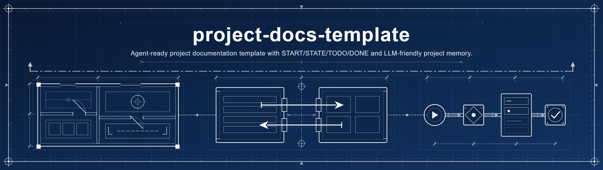
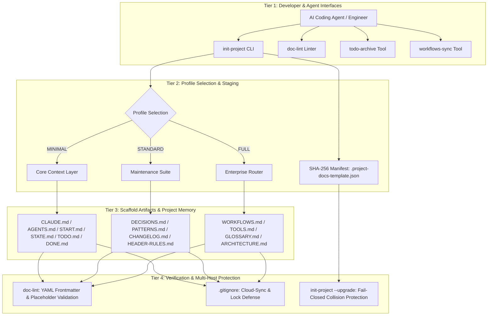
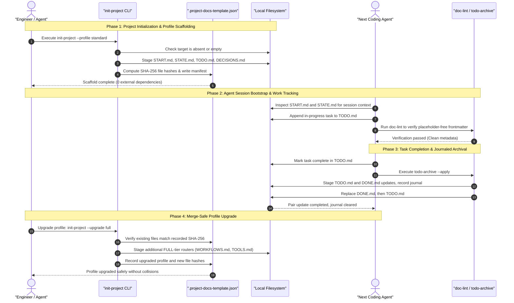

# Project Docs Template

**[English](README.md) · [Deutsch](README_de.md) · [Español](README_es.md) · [Français](README_fr.md) · [Русский](README_ru.md) · [日本語](README_ja.md) · [简体中文](README_zh.md) · [हिन्दी](README_hi.md) · [العربية](README_ar.md) · [বাংলা](README_bn.md) · [Português](README_pt.md)**

<p align="center"></p>

[](https://github.com/ellmos-ai/project-docs-template)
[](./pyproject.toml)
[](./pyproject.toml)
[](./RELEASE_GATE.md)
[](./tests)
[](./CONTRIBUTING.md)
[](./SECURITY.md)
[](./SECURITY.md)
[](./SECURITY.md)
[](./THIRD_PARTY_LICENSES.txt)
[](./SECURITY.md)
[](./NOTICE)
[](https://github.com/ellmos-ai)
[](https://github.com/open-bricks)
[](./llms.txt)
[](https://github.com/ellmos-ai/project-docs-template/actions/workflows/ci.yml)
[](./README_de.md)
[](./LICENSE)
[](./MARKETING-LOG.txt)
[](./THIRD_PARTY_LICENSES.md)
[](./MARKETING-LOG.txt)

START/STATE/TODO/DONEを備えた、エージェント対応のプロジェクト文書テンプレートです。
ワークフロー、軽量なツール、LLMに適したプロジェクトメモリーを提供します。

> [!NOTE]
> **AI / LLM向けインデックス**：AIエージェントや自動化ツールは[llms.txt](llms.txt)を参照して、機械可読な概要、検索語、曖昧さを解消する情報を確認できます。最終確認日：**2026-10-30**。

> Anthropic、OpenAI、Googleとは提携していない独立プロジェクトです。
> [商標](#trademarks)を参照してください。

### 🧭 クイックナビゲーション

1. [概要と中核となる考え方](#executive-summary--core-identity)
2. [視覚的なアーキテクチャと分離されたレイヤー](#visual-architecture-topology)
3. [複数エージェントのエンドツーエンドのライフサイクルとツール連携](#end-to-end-multi-agent-lifecycle)
4. [対象となる利用者と主要なユースケース](#target-personas--core-use-cases)
5. [プロジェクトの機能と制約](#comparative-matrix-vs-alternatives)
6. [ガバナンスと実行時不変条件のマトリックス](#governance--runtime-invariants)
7. [このテンプレートを使う場面](#use-this-template-when)
8. [含まれるものとスキャフォールドの構成](#what-is-included)
9. [クイックスタートと一般的なCLIワークフロー](#quick-start)
10. [変更を検出するプロファイル更新と移行](#merge-safe-profile-upgrades)
11. [プロファイル比較マトリックス（MINIMAL / STANDARD / FULL）](#profile-comparison)
12. [設計原則とアーキテクチャ上の不変条件](#design-principles)
13. [テスト、検証、品質ゲート](#verification)
14. [セキュリティポリシーと脆弱性の報告](#security-policy)
15. [サードパーティライセンスと依存関係一覧](#third-party-licenses--transparency)
16. [バンドル、パートナー、エコシステムの関連ツール](#ecosystem--sibling-tools)
17. [商標と独立性に関する通知](#trademarks)
18. [法的通知、責任の制限、ライセンス（§ 521 BGB）](#license)

---

## <a id="sec-01"></a><a id="executive-summary--core-identity"></a><a id="what-is-project-docs-template"></a>1. 概要と中核となる考え方

`project-docs-template`は、Claude Code、OpenAI Codex、Antigravity/Geminiなどの自律型AIコーディングエージェント、マルチエージェント群、そしてソフトウェア、研究、運用の各リポジトリを扱う人間のメンテナー向けに設計された、軽量でエージェント対応のドキュメントおよびプロジェクトメモリーのアーキテクチャを提供します。

重くて硬直したオペレーティングシステムのような仕組みにプロジェクトを変えたり、独自のSaaSポータルに依存したりする代わりに、`project-docs-template`は透明で標準的なプレーンテキストのMarkdown台帳（`START.md`、`STATE.md`、`TODO.md`、`DONE.md`、`DECISIONS.md`）を使用します。共通の入口となるファイル（`CLAUDE.md`、`AGENTS.md`）により、エージェントはプロジェクトの状態、アーキテクチャ上の不変条件、進行中のタスクを一貫した場所で確認できます。これらのファイルはコンテキストを提供しますが、エージェントがそれを正しく解釈したり、従ったりすることまでは保証しません。

### 主な価値
- **ローカル優先の動作**：`SECURITY.md`では、テンプレート生成と列挙されたメンテナンスツールについて、ローカルディスク上で動作し、テレメトリーや外部へのネットワーク通信を行わないことが説明されています。
- **実行時依存関係なし**：雛形の作成、ステージング、検証、タスクのアーカイブに使うすべてのツールは、Python 3.10以降の標準ライブラリのみを使用します。
- **エージェント間の引き継ぎに使う共有セッションコンテキスト**：セッションメモ（`START.md`）と現在の状態を示すスナップショット（`STATE.md`）が、後続セッションの共通の参照先になります。これらのファイルは引き継ぎを支援しますが、エージェントの動作を保証したり、コンテキストの喪失を防いだりするものではありません。
- **変更検出を伴うプロファイル更新**：SHA-256マニフェスト（`.project-docs-template.json`）で管理対象ファイルを確認し、検出された編集や未管理ファイルとの衝突があれば、次のプロファイル段階を確定する前に更新を拒否できます。
- **ジャーナル付きタスクアーカイブ**：`todo-archive`は2つのタスクファイルの更新をステージングし、ジャーナルを記録し、ファイル置換後のエラー時にロールバックを試みます。また、中断された2ファイル一組のコミットを復旧できます。ファイル間に不一致があると、ジャーナルの手動確認が必要になる場合があります。

---

## <a id="sec-02"></a><a id="visual-architecture-topology"></a><a id="architecture--flow"></a>2. 視覚的なアーキテクチャと分離されたレイヤー

次の図は、開発者やエージェントのインターフェースから、リポジトリ内のファイル、検証、文書化されたクラウド同期時の競合コピー用フィルターまで、`project-docs-template`の4つの運用層を示しています。



### 4つの視点から見たアーキテクチャ

```text
+--------------------------------------------------------------------------------------------------+
|                  [VIEW 1: CLI COCKPIT, LINTER & AGENT INTERFACE HARNESS]                         |
|  - init-project: Deterministic scaffolding, SHA-256 manifest stamping & profile migrations      |
|  - doc-lint: Static markdown validation, frontmatter linting & header contract enforcement       |
|  - todo-archive: Journaled two-file task archive with staged replacement & recovery            |
|  - workflows-sync: Bidirectional orchestration synchronization & prompt template extraction      |
+--------------------------------------------------------------------------------------------------+
                                                |
                                                v
+--------------------------------------------------------------------------------------------------+
|                  [VIEW 2: TIERED PROFILE ENGINE & MERGE-SAFE STAGING]                            |
|  - MINIMAL Profile: Lightweight context boundary (CLAUDE.md, AGENTS.md, START.md, STATE.md)     |
|  - STANDARD Profile: Complete project memory (TODO.md, DONE.md, DECISIONS.md, PATTERNS.md)       |
|  - FULL Profile: Enterprise architecture & governance (WORKFLOWS.md, TOOLS.md, GLOSSARY.md)      |
|  - SHA-256 Manifest: tracks managed files and detects edits or unowned collisions                |
+--------------------------------------------------------------------------------------------------+
                                                |
                                                v
+--------------------------------------------------------------------------------------------------+
|                  [VIEW 3: RUNTIME PERSISTENCE, REPOSITORY MEMORY & AUDIT]                        |
|  - Entry Instructions: CLAUDE.md / AGENTS.md provide a place to read project guidance             |
|  - Session Memory: START.md (session bootloader) & STATE.md (live operational ledger)            |
|  - Task Tracking: Structured task cards, recurring checklists, and verification criteria        |
|  - Decision Ledger: ADR-style architectural records (DECISIONS.md) & code patterns (PATTERNS.md)|
+--------------------------------------------------------------------------------------------------+
                                                |
                                                v
+--------------------------------------------------------------------------------------------------+
|                  [VIEW 4: DOCUMENTED SECURITY POLICY & FILE CONFLICT FILTERS]                     |
|  - User Context: tools run without requiring administrator or root elevation                    |
|  - Zero-Egress Policy: SECURITY.md documents local operation without outbound traffic             |
|  - Conflict-Copy Filters: .gitignore lists known cloud-sync conflict patterns                    |
|  - Legal & Governance: § 521 BGB notice; SECURITY.md says best-effort, no guaranteed response    |
+--------------------------------------------------------------------------------------------------+
```

---

## <a id="sec-03"></a><a id="end-to-end-multi-agent-lifecycle"></a>3. 複数エージェントのエンドツーエンドのライフサイクルとツール連携

次のシーケンス図は、開発者やAIコーディングエージェントが、雛形の生成、セッション開始、タスク完了、プロファイル更新で`project-docs-template`をどう使えるかを示しています。ドキュメントは引き継ぎに必要なコンテキストを提供しますが、内容を読み適用する責任は各エージェントにあります。



---

## <a id="sec-04"></a><a id="target-personas--discoverability"></a><a id="target-personas--core-use-cases"></a>4. 対象となる利用者と主なユースケース

`project-docs-template`は、コンテキストのずれ、引き継ぎ時の情報損失、ガバナンス上の摩擦に対処するため、4つの主要な技術系利用シナリオを支援するよう設計されています。

| 対象となる利用者 | 主な課題 | `project-docs-template`による支援 | 主なファイル |
|:---|:---|:---|:---|
| **マルチエージェントシステムのエンジニア** | 異なるコーディングエージェント（Claude Code、Antigravity/Gemini、Codex）は、セッション間でプロジェクトのコンテキストを失ったり、異なるファイル形式を使ったりすることがあります。 | 共通の入口となるファイル（`CLAUDE.md`、`AGENTS.md`）とセッション／状態の台帳（`START.md`、`STATE.md`）により、指示や記録されたコンテキストを共有の場所で確認できます。確実な引き継ぎには、エージェントとメンテナーがそれらのファイルを使うことが前提です。 | `CLAUDE.md`、`AGENTS.md`、`START.md`、`STATE.md` |
| **個人開発者とオープンソースメンテナー** | 大がかりなプロジェクト管理SaaSを使わずに、課題、機能バックログ、リリース履歴を管理すること。 | 手間の少ないMarkdownタスク管理（`TODO.md`、`DONE.md`）に、ジャーナル付きアーカイブツール（`todo-archive`）と標準の`CHANGELOG.md`を組み合わせます。 | `TODO.md`、`DONE.md`、`_tools/todo-archive`、`CHANGELOG.md` |
| **エンタープライズアーキテクチャ／AIガバナンスの責任者** | 監査可能な意思決定記録やコンプライアンスの透明性が不足していること、企業のエージェントワークフローで誤ってデータが外部に送信されるリスク。 | アーキテクチャ決定記録（`DECISIONS.md`）、`SECURITY.md`に記載されたローカル優先の原則、実行時の外部依存関係がない構成。 | `DECISIONS.md`、`SECURITY.md`、`THIRD_PARTY_LICENSES.md` |
| **研究・科学パイプラインの開発者** | 複雑な多段階の実験パイプラインは、数週間にわたる自律的なLLM推論の実行中に変化していくことがあります。 | 拡張可能なFULLプロファイルに、運用手順書（`WORKFLOWS.md`）、ドメイン用語集（`GLOSSARY.md`）、自動化された表の同期（`workflows-sync`）が含まれます。 | `WORKFLOWS.md`、`GLOSSARY.md`、`_tools/workflows-sync` |

### 関心度の高い検索クエリ
- `agent-ready project documentation template`
- `claude code documentation scaffold`
- `multi-agent session handoff state start todo done`
- `offline local-first project template python`
- `zero-egress developer scaffolding stdlib`
- `deterministic documentation staging and profile upgrades`
- `llm friendly project memory repository template`

---

## <a id="sec-05"></a><a id="comparative-matrix-vs-alternatives"></a><a id="comparative-architecture"></a>5. プロジェクトの機能と制約

次の表は、文書化された10のプロジェクト不変条件と、このソースコミットで確認できる動作および制限をまとめたものです。

| # | 不変条件 | 文書化された機能 | 範囲／制限 |
|---|:---|:---|:---|
| 1 | **INV-LOCAL-01：ローカル優先、外部通信なし** | `SECURITY.md`には、テンプレート生成と列挙されたメンテナンスツールがローカルディスク上で動作し、外部向けテレメトリーやネットワーク通信を行わないと記載されています。 | これはこれらのツールについて文書化された範囲であり、OSレベルのネットワークサンドボックスではありません。 |
| 2 | **INV-SEC-02：呼び出し元プロセスの実行コンテキスト** | スクリプトは呼び出し元プロセスの実行コンテキストを引き継ぎます。CLIは権限昇格を要求しません。 | すでに特権で実行されている呼び出し元は、その権限を保持します。標準ユーザーとしての実行を強制する機能や認定は主張していません。 |
| 3 | **INV-FAIL-03：失敗時に処理を拒否する検査** | 生成処理は既存の空でない出力先を拒否します。プロファイル更新は、管理対象ファイルの変更や未管理ファイルとの衝突が検出された場合、変更を確定する前に拒否します。 | 生成処理では親ディレクトリとステージング領域を作成し、準備したファイルを書き込んでから配置します。失敗時に一切書き込みが起きないことを包括的に保証するものではありません。 |
| 4 | **INV-STG-04：段階的なプロファイル更新** | 更新処理はマニフェストのハッシュを検証し、次のプロファイルをステージングしてファイルをバックアップします。変更の確定に失敗した場合、ハッシュで保護したロールバックを試みます。 | 復元は条件付きです。競合する変更や追加のファイルシステムエラーにより、完全なロールバックができない場合があります。 |
| 5 | **INV-HANDOFF-05：セッションコンテキスト** | `START.md`と`STATE.md`は、エージェントやメンテナーが共有するプロジェクトおよびセッションの記録になります。 | エージェントが記録を読んだり、従ったり、保持したりすることをテンプレートは保証できません。 |
| 6 | **INV-TIER-06：階層型プロファイル** | テンプレートには`MINIMAL`、`STANDARD`、`FULL`の各プロファイルがあり、更新は一度に1段階ずつ進みます。 | これらはドキュメントの雛形であり、エージェントの実行フレームワークではありません。 |
| 7 | **INV-SYNC-07：競合コピーのフィルタリング** | リポジトリとテンプレートの`.gitignore`には、既知の競合コピーやロックファイルのパターンが記載されています。 | ignoreパターンは同時書き込みを調整せず、稼働中の分散ロックも提供しません。 |
| 8 | **INV-AUDIT-08：TODO/DONEのアーカイブ** | `todo-archive`は2つのファイルの更新をジャーナルに記録してステージングし、置換エラーの後にロールバックを試み、中断された2ファイルのコミットを復旧できます。 | ファイルに不一致があると、ジャーナルの手動確認が必要です。重大なファイルシステム障害ではロールバック自体が失敗する可能性もあります。 |
| 9 | **INV-LIC-09：実行時依存関係の範囲** | プロジェクトでは`dependencies = []`を宣言し、実行時にはPython標準ライブラリを使用します。 | これは実行時依存関係についての説明です。開発用とテスト用のツールは別に扱います。 |
| 10 | **INV-SLA-10：セキュリティ対応ポリシー** | `SECURITY.md`では、サポート対象の`0.1.x`についてベストエフォートの保守を行い、セキュリティ修正を優先するとしています。応答時間は保証されません。 | 48時間以内の応答や5営業日以内のトリアージが約束されていると解釈しないでください。記載された非公開の報告窓口を利用してください。 |

---

## <a id="sec-06"></a><a id="governance--runtime-invariants"></a>6. ガバナンスと実行時不変条件のマトリックス

このプロジェクトでは、雛形生成ツール、メンテナンス用CLI、生成されるリポジトリプロファイルに関する、実行、ステージング、ガバナンス上の不変条件を10項目文書化しています。

| 正式ID | 不変条件 | 文書化された動作と範囲 |
|:---|:---|:---|
| **INV-LOCAL-01** | **ローカル優先、外部通信なし** | `SECURITY.md`では、テンプレート生成と列挙されたメンテナンススクリプトが、プロジェクト作成や更新の際に外部向けテレメトリーやネットワーク通信を行わず、ローカルディスク上で動作すると説明しています。 |
| **INV-SEC-02** | **呼び出し元プロセスの実行コンテキスト** | スクリプトは呼び出し元プロセスの実行コンテキストを引き継ぎます。CLIは権限昇格を要求しません。すでに特権で実行されている呼び出し元は、その権限を保持します。標準ユーザーとしての実行を強制する機能や認定は主張していません。 |
| **INV-FAIL-03** | **失敗時に処理を拒否する検査** | 新規生成では既存の空でない出力先を拒否します。更新では管理対象ファイルの変更や未管理ファイルとの衝突が検出された場合、変更を確定する前に拒否します。生成時には親ディレクトリとステージング領域を作成し、配置前にそこへファイルを書き込みます。 |
| **INV-STG-04** | **段階的な更新と保護された復旧** | 変更の確定前にマニフェストのハッシュを検証し、プロファイルのファイルをステージングします。バックアップとハッシュ検査により復元を試みますが、復元は条件付きです。追加のファイルシステムエラーや競合する変更で妨げられる場合があります。 |
| **INV-HANDOFF-05** | **エージェントのセッションコンテキスト** | `START.md`と`STATE.md`にプロジェクトとセッションのコンテキストを記録します。エージェントがそれを読むか、従うか、保持するかは、エージェントの動作と周囲のワークフローによります。 |
| **INV-TIER-06** | **拡張可能な階層型プロファイル** | 3つのプロファイル（`MINIMAL`、`STANDARD`、`FULL`）は、異なるドキュメント構成とメンテナンス範囲を提供します。 |
| **INV-SYNC-07** | **クラウド同期時の競合フィルタリング** | ルートとテンプレートの`.gitignore`は、列挙された競合コピーやロックファイルのパターンを除外します。同時書き込みは調整しません。 |
| **INV-AUDIT-08** | **ジャーナル付きタスクアーカイブ** | `todo-archive`は`TODO.md`と`DONE.md`の更新をステージングして記録し、置換エラーの後に復元を試み、中断された2ファイルのコミットからの復旧を支援します。差異がある場合、ジャーナルの手動確認が必要です。 |
| **INV-LIC-09** | **実行時依存関係** | 実行時依存関係は`dependencies = []`として宣言され、プログラムはPython標準ライブラリを使用します。開発用とテスト用のツールは、この実行時依存関係の説明には含まれません。 |
| **INV-SLA-10** | **セキュリティ報告ポリシー** | `SECURITY.md`では、`0.1.x`の保守はベストエフォートで行い、応答時間は保証せず、セキュリティ修正を優先するとしています。 |

---

## <a id="sec-07"></a><a id="use-this-template-when"></a>7. このテンプレートを使う場面

| 状況 | 役立つ理由 |
|:---|:---|
| 新しいプロジェクトをClaude Code、Codex、Gemini CLIなどのコーディングエージェントで保守する | 予測しやすい初期設定手順と、現在の状態を記録するファイルをエージェントに提供します。 |
| 既存リポジトリにメモが散在し、タスクファイルが古い、または引き継ぎの記録がない | 進行中と完了済みの作業、決定事項、パターン、セッションの状態を分けて管理できます。 |
| 複数のエージェントや人が安全に作業を再開する必要がある | 指示、現在の状態、ワークフロー、ツールを別々のファイルに整理できます。 |

これは実行フレームワークではなく、ドキュメント作成と調整のためのテンプレートです。
一般的なソフトウェア、研究、運用のリポジトリ内で使うことを想定しています。

---

## <a id="sec-08"></a><a id="what-is-included"></a>8. 含まれるものと雛形の構成

- エージェント向け指示を記載する`CLAUDE.md`と`AGENTS.md`
- セッション開始と現在の状態を記録する`START.md`と`STATE.md`
- 任意のアーカイブツールを備えた`TODO.md`と`DONE.md`
- `DECISIONS.md`、`PATTERNS.md`、`CHANGELOG.md`、`HEADER-RULES.md`
- FULLプロファイル向けの任意のルーター：`WORKFLOWS.md`、`TOOLS.md`、`GLOSSARY.md`
- `_tools/`内のローカルヘルパー。`init-project`、`doc-lint`、`todo-archive`、`workflows-sync`などを含みます。

実際のテンプレートファイルは[`template/`](./template/)にあります。

---

## <a id="sec-09"></a><a id="quick-start"></a>9. クイックスタートと一般的なCLIワークフロー

リポジトリをクローンして、エージェント対応のワークスペースを数秒で作成できます：

```bash
git clone https://github.com/ellmos-ai/project-docs-template.git
cd project-docs-template

# Inspect scaffold generation without writing changes (dry-run)
python template/_tools/init-project --target /path/to/my-project --name "my-project" --profile STANDARD --dry-run

# Render STANDARD profile (12 root contracts & tools with SHA-256 manifest)
python template/_tools/init-project --target /path/to/my-project --name "my-project" --profile STANDARD

# Optional: initialize Git repository with staged initial commit
python template/_tools/init-project --target /path/to/my-project --name "my-project" --profile STANDARD --git
```

### ステージング生成の手順（ターミナル出力）

`init-project`は実行時に、隣接するステージング用ディレクトリを作成し、選択したプロファイルを生成して準備と検証を行い、マニフェストを書き込みます。その後、準備済みの結果を出力先に配置します。出力先は存在しないか、既存の空ディレクトリである必要があります：

```text
==> Root:    /path/to/.my-project.staging-xyz123
==> Max age: 30 days

Results:
  OK   CLAUDE.md
  OK   START.md
  OK   STATE.md

OK: Alle geprüften Files bestehen (oder wurden gefixt)
==> Target:  /path/to/my-project
==> Name:    my-project
==> Author:  Alex Developer
==> Date:    2026-10-30

==> Profil: STANDARD
    Ernsthafte Projekte mit mehrmonatiger Lebensdauer
  OK: AGENTS.md
  OK: CLAUDE.md
  OK: README.md
  OK: START.md
  OK: STATE.md
  OK: CHANGELOG.md
  OK: HEADER-RULES.md
  OK: CUT-AND-CLUE.md
  OK: DECISIONS.md
  OK: PATTERNS.md
  OK: TODO.md
  OK: DONE.md
  OK: .gitignore
  OK: _tools/README.md
  OK: _tools/todo-archive
  OK: _tools/doc-lint

==> Fertig: /path/to/my-project
```

### 生成されたプロジェクトでの一般的なCLIメンテナンス作業

生成されたワークスペースには、依存関係のない軽量ツールが`_tools/`に含まれます：

```bash
# Lint project documentation and verify YAML frontmatter & staleness
python _tools/doc-lint

# Automatically insert missing frontmatter fields & refresh verification dates
python _tools/doc-lint --fix --update-dates

# Archive completed tasks with journaling
python _tools/todo-archive --apply

# Synchronize workflow tables across routers (FULL profile)
python _tools/workflows-sync --apply
```

> [!NOTE]
> **テンプレートの言語：** リポジトリのドキュメントは英語ですが、[`template/`](./template/)以下のテンプレート本体（`CLAUDE.md`、`START.md`、`STATE.md`、`TODO.md`など）と、`init-project`、`doc-lint`、`todo-archive`、`workflows-sync`のCLI出力はドイツ語です。ファイル名、プロファイルマーカー、YAMLフロントマターのキーは言語に依存しません。そのため、英語のプロジェクトでも構成を利用し、本文を置き換えられます。英語版テンプレート一式は今後追加予定です。詳しくは[`TODO.md`](./TODO.md)を参照してください。

---

## <a id="sec-10"></a><a id="merge-safe-profile-upgrades"></a>10. 変更を検出するプロファイル更新と移行

既存プロジェクトは、次のプロファイル段階に更新できます：

```bash
# Upgrade existing project to FULL profile
python template/_tools/init-project /path/to/my-project --upgrade full
```

### 更新時の安全確認
- **マニフェストの検証**：`.project-docs-template.json`を読み込み、管理対象ファイルのハッシュを比較します。
- **未管理ファイルとの衝突時は中止**：追加対象のファイルが以前のマニフェストに記録されていない状態で既に存在する場合、出力先への変更を確定する前に更新を中止します。この時点でステージング用ディレクトリが作成済みの場合があります。
- **管理対象ファイルが変更されていたら中止**：管理対象ファイルのハッシュがマニフェストと一致しなくなった場合、更新を拒否します。確認を求めたり、自動で上書きしたりはしません。
- **条件付きのロールバック試行**：変更の確定時には、バックアップと現在のハッシュの確認により、この実行で変更されたファイルの復元を試みます。別の変更が検出された場合は、それを上書きしないよう復元を行いません。追加のファイルシステムエラーによってロールバックが完了しないこともあります。

---

## <a id="sec-11"></a><a id="profile-comparison"></a>11. プロファイル比較マトリックス

| 機能／ドキュメント | `MINIMAL` | `STANDARD` | `FULL` |
|:---|:---:|:---:|:---:|
| `CLAUDE.md`と`AGENTS.md`（エージェント向け指示） | ✅ 含む | ✅ 含む | ✅ 含む |
| `START.md`と`STATE.md`（セッションメモリー） | ✅ 含む | ✅ 含む | ✅ 含む |
| `TODO.md`と`DONE.md`（タスク管理） | ✅ 含む | ✅ 含む | ✅ 含む |
| `_tools/todo-archive`（タスクのアーカイブ） | ✅ 含む | ✅ 含む | ✅ 含む |
| `_tools/doc-lint`（ドキュメントのリンター） | ✅ 含む | ✅ 含む | ✅ 含む |
| `DECISIONS.md`（アーキテクチャ上の決定事項） | — | ✅ 含む | ✅ 含む |
| `PATTERNS.md`（設計パターン） | — | ✅ 含む | ✅ 含む |
| `CHANGELOG.md`と`HEADER-RULES.md` | — | ✅ 含む | ✅ 含む |
| `WORKFLOWS.md`と`_tools/workflows-sync` | — | — | ✅ 含む |
| `TOOLS.md`と`GLOSSARY.md`（ドメイン別ルーター） | — | — | ✅ 含む |
| `ARCHITECTURE.md`と`.github/`のワークフロー | — | — | ✅ 含む |

---

## <a id="sec-12"></a><a id="design-principles"></a>12. 設計原則とアーキテクチャ上の不変条件

- **関心事の分離**：各ファイルには、明確に定義された運用上の責任が1つあります。
- **明示的なセッション引き継ぎ**：セッション開始時の情報と現在の状態を、エージェントやメンテナーが参照できる、短く予測しやすいファイル（`START.md`、`STATE.md`）に記録します。
- **メンテナンス負荷の軽減**：拡大し続けて放置されるWikiではなく、価値の高いコンテキスト文書に重点を置きます。
- **ルーターパターン**：上位のルーター（`WORKFLOWS.md`、`TOOLS.md`）は詳細を重複させず、参照先を示します。
- **ジャーナル付きタスクのライフサイクル**：`todo-archive`はジャーナルとステージング済みファイルの置き換えを使って完了タスクをアーカイブします。復旧はジャーナルとファイルの現在の状態に依存します。

設計の詳細な根拠は[`template/TEMPLATE.md`](./template/TEMPLATE.md)を参照してください。

---

## <a id="sec-13"></a><a id="verification"></a>13. テスト、検証、品質ゲート

テストスイートはPython標準の`unittest`または`pytest`で実行します：

```bash
# Run test suite via pytest
pytest -ra -v

# Run test suite via standard unittest
python -m unittest discover -s tests -v
```

テストでは、すべてのプロファイル、Gitの初期化、YAMLフロントマターの修復、ワークフローメタデータのエスケープ、変更された出力先や衝突がある場合の更新拒否、マニフェストの確定失敗を模擬した際のロールバック、TODO/DONEの2回目の置換失敗を模擬した後のロールバック、ジャーナルを使った中断アーカイブの復旧を確認します。同じテストスイートはLinux、Windows、macOS向けに設定されています。詳しくは[`RELEASE_GATE.md`](./RELEASE_GATE.md)を参照してください。

---

## <a id="sec-14"></a><a id="security-policy"></a>14. セキュリティポリシーと脆弱性の報告

`project-docs-template`は`SECURITY.md`に記載されたポリシーに従います：
- **ローカル優先、外部通信なし**：`SECURITY.md`には、テンプレート生成と列挙されたメンテナンスツールが、プロジェクトの作成と更新時にローカルディスク上で動作し、外部向けテレメトリーやネットワーク通信を行わないと記載されています。
- **ステージング生成と更新時の検査**：生成処理では出力先の隣に結果をステージングし、配置前に検証して、既存の空でない出力先を拒否します。プロファイル更新では、変更を確定する前に管理対象ファイルのハッシュと未管理ファイルとの衝突を確認します。ロールバックは条件付きです。
- **サポート対象バージョンと対応方針**：`SECURITY.md`では、`0.1.x`を`main`ブランチ上でベストエフォートにより保守し、セキュリティ修正を優先するとしています。応答時間は保証されません。`0.1.0`未満のバージョンはサポート対象外です。

脆弱性の可能性がある場合は[`SECURITY.md`](./SECURITY.md)の手順に従って報告してください。優先される方法はGitHubのPrivate Security Advisoryで、記載されたメンテナーへの直接連絡も利用できます。修正されていない脆弱性を公開issueで報告しないでください。修正の公開までは、調整された開示を行うよう求めています。ポリシーには`security@ellmos.ai`、`support@lukasgeiger.com`、`lukas@open-bricks.org`が記載されています。

---

## <a id="sec-15"></a><a id="third-party-licenses--transparency"></a>15. サードパーティライセンスと依存関係一覧

`project-docs-template`は**実行時依存関係を持たない厳格なアーキテクチャ**（`dependencies = []`）を採用しています。実行時コードはすべてPython標準ライブラリ（3.10以降）のみに依存します。

| コンポーネント | 範囲 | 宣言されたライセンス | 状態 |
|:---|:---|:---|:---|
| **Python標準ライブラリ** | コアの実行時機能 | PSFL-2.0 | 100% 許諾型（組み込み） |
| **pytest** | 開発／テスト | MIT License | 100% 許諾型 |
| **ruff** | 開発／品質保証 | MIT / Apache-2.0 | 100% 許諾型 |
| **setuptools** | ビルドバックエンド | MIT License | 100% 許諾型 |

実行時と開発時の依存関係に関する宣言済みライセンスおよび依存関係一覧は、[THIRD_PARTY_LICENSES.md](THIRD_PARTY_LICENSES.md)と、テキスト形式の付属ファイル[THIRD_PARTY_LICENSES.txt](THIRD_PARTY_LICENSES.txt)に記載されています。これらのファイルには列挙された項目が記録されています。ここでは独立した監査やLevel 1 SBOM認証を主張していません。

---

## <a id="sec-16"></a><a id="ecosystem--sibling-tools"></a><a id="bundles-and-partners"></a>16. バンドル、パートナー、エコシステムの関連ツール

`project-docs-template`は[`ellmos-ai`](https://github.com/ellmos-ai)エコシステムと、その上位にあるオープンソースの集合体[`open-bricks`](https://github.com/open-bricks)において、プロジェクト雛形を作成するための重要なコンポーネントです：

| リポジトリ | 目的 | 主なインターフェース |
|:---|:---|:---|
| [`policy-registry`](https://github.com/ellmos-ai/policy-registry) | 署名済み委任を扱う機械可読なポリシーレジストリ | CLI / API / MCP |
| [`DevCenter`](https://github.com/dev-bricks/DevCenter) | ローカル優先のPython IDEと開発者向けツールキット | GUI / PySide6 |
| [`CodeBox`](https://github.com/dev-bricks/CodeBox) | デスクトップ向けコードエディター兼IDE | GUI / PySide6 |
| [`companion-for-agy`](https://github.com/ellmos-ai/companion-for-agy) | Antigravity AIエージェント向け拡張機能とコンパニオンツール一式 | CLI / Node.js |
| [`safe-start-for-codex`](https://github.com/dev-bricks/safe-start-for-codex) | 防御的な初期設定と環境検証ツール | CLI / Python |
| [`automizer-for-claude-desktop`](https://github.com/dev-bricks/automizer-for-claude-desktop) | Claude Desktop用の連携・自動化ツールキット | CLI / Python |
| [`system-gap-master`](https://github.com/ellmos-ai/system-gap-master) | システム間の同期と差異分析 | CLI / Python |
| [`lock-master`](https://github.com/ellmos-ai/lock-master) | ファイルとリソースの同時利用を管理するロックマネージャー | CLI / Python |
| [`ticket-master`](https://github.com/ellmos-ai/ticket-master) | ローカル優先の課題・チケット管理オーケストレーター | CLI / Python |
| [`clutch`](https://github.com/ellmos-ai/clutch) | プロバイダーに依存しないLLMルーターおよびモデルオーケストレーションエンジン | CLI / Python |
| [`memoryhooker`](https://github.com/ellmos-ai/memoryhooker) | セッションメモリーの抽出とフックの注入 | CLI / Python |
| [`workflowhooker`](https://github.com/ellmos-ai/workflowhooker) | ワークフロー自動化のライフサイクルトリガー | CLI / Python |
| [`ellmos-controlcenter-mcp`](https://github.com/ellmos-ai/ellmos-controlcenter-mcp) | システム検査とスキル検索のためのMCPサーバー | MCP |
| [`ellmos-filecommander-mcp`](https://github.com/ellmos-ai/ellmos-filecommander-mcp) | ローカルファイル操作を安全に行うMCPサーバー | MCP |
| [`open-bricks`](https://github.com/open-bricks) | 開発者向け・AI向けツールを統括する組織 | ポータル |

<!-- BEGIN GENERATED ELLMOS BUNDLE DISCOVERY -->
### Bundles and Partners Discovery Projection
Generated discovery projection for `module:project-docs-template` from `catalog:v4-bundles` (`546290dafbaafd810df1d59ef5a3d7183738472b48cd5a8a81f1e8f2b64d852e`). Target repository visibility: `public`.

- **`ellmos-dev-lifecycle-bundle`**: role `declared-component`, requirement `required`. Partners: `module:bundle-installer`, `module:ellmos-code-tools`, `module:ellmos-tests`, `module:github-onedrive-mirror`, `module:stack-system-installer`.
- **`ellmos-knowledge-bundle`**: role `declared-component`, requirement `recommended`. Partners: `module:KnowledgeDigest`, `module:WikiStub-Seed`, `module:report-forge`, `module:web-scraper`.
<!-- END GENERATED ELLMOS BUNDLE DISCOVERY -->

---

## <a id="sec-17"></a><a id="trademarks"></a>17. 商標と独立性に関する通知

本プロジェクトは、コミュニティが保守する独立したドキュメントテンプレートです。
このプロジェクトは、Anthropic、OpenAI、Googleから**提携、承認、後援を受けておらず**、
これら各社とのその他の関係もありません。

「Claude」「Claude Code」「Codex」「Gemini」「Antigravity」は商標
または各権利者（Anthropic PBC、OpenAI、
Google LLC）の登録商標です。その他の製品名、ロゴ、ブランドは
それぞれの所有者に帰属します。これらは互換性や相互運用性を説明する
目的でのみ使用しており、その使用は推奨、承認、
許可、または商業上の関係を意味するものではありません。

---

## <a id="sec-18"></a><a id="license"></a><a id="statutory-notice-liability-limitation--license"></a>18. 法的通知、責任の制限、ライセンス（§ 521 BGB）

### 法的通知と責任の制限（§ 521 BGB）
このソフトウェアとテンプレートの雛形は、ドイツ民法典の**§ 521 BGB**にいう好意による無償提供（*Gefälligkeit* / *unentgeltliche Schenkung*）として、無償で提供されます。ドイツ法では、作者および貢献者の責任は故意と重過失に厳格に限定されます（*Vorsatz und grobe Fahrlässigkeit*）。法律上の強制責任、特に故意（BGB第276条第3項）および生命、身体、健康への侵害に関する責任は、引き続き適用されます。

### ライセンス
本プロジェクトは**MITライセンス**の条件に基づいてライセンスされています。著作権に関する完全な表示は[LICENSE](LICENSE)と[NOTICE](NOTICE)を参照してください。