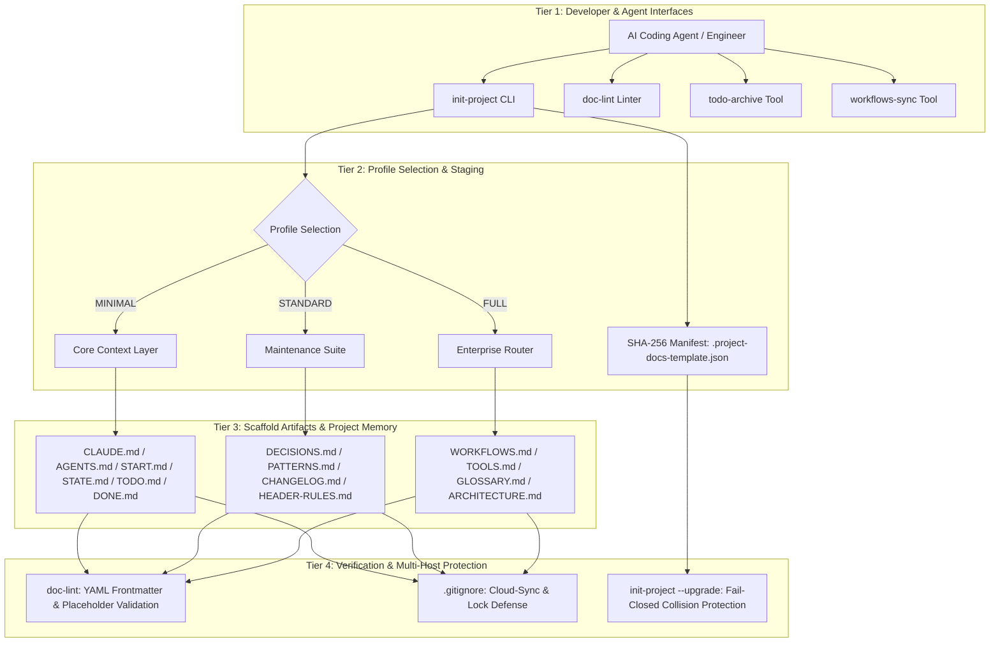
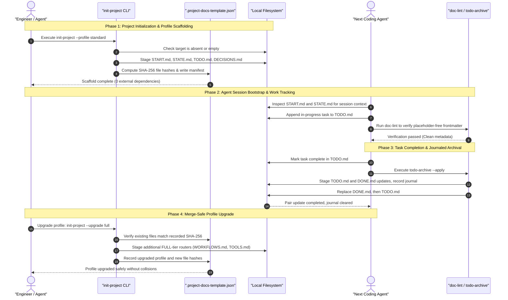

# Project Docs Template

**[English](README.md) · [Deutsch](README_de.md) · [Español](README_es.md) · [Français](README_fr.md) · [Русский](README_ru.md) · [日本語](README_ja.md) · [简体中文](README_zh.md) · [हिन्दी](README_hi.md) · [العربية](README_ar.md) · [বাংলা](README_bn.md) · [Português](README_pt.md)**

<p align="center"></p>

[](https://github.com/ellmos-ai/project-docs-template)
[](./pyproject.toml)
[](./pyproject.toml)
[](./RELEASE_GATE.md)
[](./tests)
[](./CONTRIBUTING.md)
[](./SECURITY.md)
[](./SECURITY.md)
[](./SECURITY.md)
[](./THIRD_PARTY_LICENSES.txt)
[](./SECURITY.md)
[](./NOTICE)
[](https://github.com/ellmos-ai)
[](https://github.com/open-bricks)
[](./llms.txt)
[](https://github.com/ellmos-ai/project-docs-template/actions/workflows/ci.yml)
[](./README_de.md)
[](./LICENSE)
[](./MARKETING-LOG.txt)
[](./THIRD_PARTY_LICENSES.md)
[](./MARKETING-LOG.txt)

Modelo de documentação de projetos pronto para agentes, com START/STATE/TODO/DONE,
fluxos de trabalho, ferramentas leves e memória de projeto adequada a LLMs.

> [!NOTE]
> **Indexação por IA / LLM**: agentes de IA e ferramentas automatizadas podem consultar [llms.txt](llms.txt) para obter um resumo legível por máquina, termos de busca e informações para desambiguar. Última verificação: **2026-10-30**.

> Projeto independente — sem afiliação à Anthropic, OpenAI ou Google.
> Consulte [Marcas registradas](#trademarks).

### 🧭 Navegação rápida

1. [Resumo executivo e identidade central](#executive-summary--core-identity)
2. [Topologia da arquitetura visual e camadas desacopladas](#visual-architecture-topology)
3. [Ciclo de vida multiagente de ponta a ponta e fluxo de ferramentas](#end-to-end-multi-agent-lifecycle)
4. [Personas-alvo e principais casos de uso](#target-personas--core-use-cases)
5. [Recursos e limites do projeto](#comparative-matrix-vs-alternatives)
6. [Matriz de governança e invariantes de execução](#governance--runtime-invariants)
7. [Quando usar este modelo](#use-this-template-when)
8. [O que está incluído e estrutura inicial](#what-is-included)
9. [Início rápido e fluxos CLI comuns](#quick-start)
10. [Atualizações de perfil com detecção de alterações e migração](#merge-safe-profile-upgrades)
11. [Matriz de comparação de perfis (MINIMAL / STANDARD / FULL)](#profile-comparison)
12. [Princípios de projeto e invariantes da arquitetura](#design-principles)
13. [Testes, verificação e critérios de qualidade](#verification)
14. [Política de segurança e relato de vulnerabilidades](#security-policy)
15. [Licenças de terceiros e inventário de dependências](#third-party-licenses--transparency)
16. [Pacotes, parceiros e ferramentas relacionadas do ecossistema](#ecosystem--sibling-tools)
17. [Marcas registradas e aviso de independência](#trademarks)
18. [Aviso legal, limitação de responsabilidade e licença (§ 521 BGB)](#license)

---

## <a id="sec-01"></a><a id="executive-summary--core-identity"></a><a id="what-is-project-docs-template"></a>1. Resumo executivo e identidade central

`project-docs-template` oferece uma estrutura leve de documentação e memória de projeto, pronta para agentes, concebida para agentes autônomos de codificação com IA (Claude Code, OpenAI Codex, Antigravity/Gemini), equipes multiagentes e pessoas responsáveis pela manutenção de repositórios de software, pesquisa e operações.

Em vez de transformar projetos em sistemas operacionais pesados e rígidos ou depender de portais SaaS proprietários, `project-docs-template` usa registros Markdown transparentes e padronizados em texto simples (`START.md`, `STATE.md`, `TODO.md`, `DONE.md`, `DECISIONS.md`). Arquivos de entrada universais (`CLAUDE.md`, `AGENTS.md`) oferecem aos agentes um lugar consistente para consultar o estado do projeto, as invariantes da arquitetura e as tarefas em andamento. Eles fornecem contexto, mas não garantem que um agente o interprete ou siga corretamente.

### Principais propostas de valor
- **Operação com prioridade local**: `SECURITY.md` documenta a operação em disco local, sem telemetria nem chamadas de rede de saída, para a geração do template e as ferramentas de manutenção listadas.
- **Sem dependências de execução**: todos os utilitários de estruturação, preparação, validação e arquivamento de tarefas usam apenas a biblioteca padrão do Python (3.10+).
- **Contexto de sessão compartilhado para a transferência entre agentes**: notas dedicadas à sessão (`START.md`) e um retrato do estado atual (`STATE.md`) oferecem uma referência comum para sessões posteriores. Os arquivos dão suporte à transferência, mas não garantem o comportamento dos agentes nem impedem a perda de contexto.
- **Atualizações de perfil com detecção de alterações**: o manifesto SHA-256 (`.project-docs-template.json`) acompanha os arquivos gerenciados e permite que as atualizações recusem alterações detectadas ou conflitos com arquivos não gerenciados antes de confirmar a próxima etapa do perfil.
- **Arquivamento de tarefas com diário**: `todo-archive` prepara as atualizações dos dois arquivos de tarefas, registra um diário, tenta reverter após erros de substituição e pode recuperar uma atualização interrompida do par de arquivos. Divergências entre os arquivos podem deixar o diário para revisão manual.

---

## <a id="sec-02"></a><a id="visual-architecture-topology"></a><a id="architecture--flow"></a>2. Topologia da arquitetura visual e camadas desacopladas

O diagrama abaixo ilustra os quatro níveis operacionais de `project-docs-template`, das interfaces para desenvolvedores e agentes até os arquivos do repositório, a validação e os filtros documentados para cópias de conflito da sincronização em nuvem:



### Projeção da arquitetura em quatro visões

```text
+--------------------------------------------------------------------------------------------------+
|                  [VIEW 1: CLI COCKPIT, LINTER & AGENT INTERFACE HARNESS]                         |
|  - init-project: Deterministic scaffolding, SHA-256 manifest stamping & profile migrations      |
|  - doc-lint: Static markdown validation, frontmatter linting & header contract enforcement       |
|  - todo-archive: Journaled two-file task archive with staged replacement & recovery            |
|  - workflows-sync: Bidirectional orchestration synchronization & prompt template extraction      |
+--------------------------------------------------------------------------------------------------+
                                                |
                                                v
+--------------------------------------------------------------------------------------------------+
|                  [VIEW 2: TIERED PROFILE ENGINE & MERGE-SAFE STAGING]                            |
|  - MINIMAL Profile: Lightweight context boundary (CLAUDE.md, AGENTS.md, START.md, STATE.md)     |
|  - STANDARD Profile: Complete project memory (TODO.md, DONE.md, DECISIONS.md, PATTERNS.md)       |
|  - FULL Profile: Enterprise architecture & governance (WORKFLOWS.md, TOOLS.md, GLOSSARY.md)      |
|  - SHA-256 Manifest: tracks managed files and detects edits or unowned collisions                |
+--------------------------------------------------------------------------------------------------+
                                                |
                                                v
+--------------------------------------------------------------------------------------------------+
|                  [VIEW 3: RUNTIME PERSISTENCE, REPOSITORY MEMORY & AUDIT]                        |
|  - Entry Instructions: CLAUDE.md / AGENTS.md provide a place to read project guidance             |
|  - Session Memory: START.md (session bootloader) & STATE.md (live operational ledger)            |
|  - Task Tracking: Structured task cards, recurring checklists, and verification criteria        |
|  - Decision Ledger: ADR-style architectural records (DECISIONS.md) & code patterns (PATTERNS.md)|
+--------------------------------------------------------------------------------------------------+
                                                |
                                                v
+--------------------------------------------------------------------------------------------------+
|                  [VIEW 4: DOCUMENTED SECURITY POLICY & FILE CONFLICT FILTERS]                     |
|  - User Context: tools run without requiring administrator or root elevation                    |
|  - Zero-Egress Policy: SECURITY.md documents local operation without outbound traffic             |
|  - Conflict-Copy Filters: .gitignore lists known cloud-sync conflict patterns                    |
|  - Legal & Governance: § 521 BGB notice; SECURITY.md says best-effort, no guaranteed response    |
+--------------------------------------------------------------------------------------------------+
```

---

## <a id="sec-03"></a><a id="end-to-end-multi-agent-lifecycle"></a>3. Ciclo de vida multiagente de ponta a ponta e fluxo de ferramentas

O diagrama de sequência abaixo mostra como engenheiros e agentes de codificação com IA podem usar `project-docs-template` durante a criação da estrutura, o início de sessões, a conclusão de tarefas e as atualizações de perfil. A documentação fornece contexto para a transferência, mas cabe ao agente lê-la e aplicá-la.



---

## <a id="sec-04"></a><a id="target-personas--discoverability"></a><a id="target-personas--core-use-cases"></a>4. Personas-alvo e principais casos de uso

O `project-docs-template` foi criado para ajudar a lidar com o desvio de contexto, a perda de informações nas transferências e a fricção de governança em quatro principais jornadas técnicas de uso:

| Persona-alvo | Principal problema | Como o `project-docs-template` ajuda | Artefatos principais |
|:---|:---|:---|:---|
| **Engenheiros de sistemas multiagentes** | Agentes de codificação heterogêneos (Claude Code, Antigravity/Gemini, Codex) podem perder o contexto do projeto entre sessões ou usar formatos de arquivo diferentes. | Arquivos de entrada padronizados (`CLAUDE.md`, `AGENTS.md`) e registros de sessão/estado (`START.md`, `STATE.md`) oferecem aos agentes um local compartilhado para consultar instruções e o contexto registrado. Transferências confiáveis ainda dependem de agentes e mantenedores usarem esses arquivos. | `CLAUDE.md`, `AGENTS.md`, `START.md`, `STATE.md` |
| **Desenvolvedores independentes e mantenedores de código aberto** | Gerenciar problemas, listas de funcionalidades pendentes e históricos de versões sem uma plataforma SaaS pesada de gerenciamento de projetos. | Ciclos de tarefas em Markdown com pouca sobrecarga (`TODO.md`, `DONE.md`), combinados com a ferramenta de arquivamento com diário (`todo-archive`) e um `CHANGELOG.md` padronizado. | `TODO.md`, `DONE.md`, `_tools/todo-archive`, `CHANGELOG.md` |
| **Lideranças de arquitetura corporativa e governança de IA** | Falta de registros de decisões auditáveis e transparência de conformidade, além do risco de saída acidental de dados nos fluxos corporativos com agentes. | Registros de decisões de arquitetura (`DECISIONS.md`), invariantes estritas de prioridade local documentadas em `SECURITY.md` e ausência de dependências externas em tempo de execução. | `DECISIONS.md`, `SECURITY.md`, `THIRD_PARTY_LICENSES.md` |
| **Desenvolvedores de pesquisa e de pipelines científicos** | Pipelines experimentais complexos e com várias etapas podem se desviar ao longo de semanas de execuções de raciocínio autônomo com LLMs. | O perfil FULL escalável inclui manuais operacionais (`WORKFLOWS.md`), terminologia do domínio (`GLOSSARY.md`) e sincronização automatizada de tabelas (`workflows-sync`). | `WORKFLOWS.md`, `GLOSSARY.md`, `_tools/workflows-sync` |

### Consultas de busca de alta intenção
- `agent-ready project documentation template`
- `claude code documentation scaffold`
- `multi-agent session handoff state start todo done`
- `offline local-first project template python`
- `zero-egress developer scaffolding stdlib`
- `deterministic documentation staging and profile upgrades`
- `llm friendly project memory repository template`

---

## <a id="sec-05"></a><a id="comparative-matrix-vs-alternatives"></a><a id="comparative-architecture"></a>5. Recursos e limites do projeto

A tabela abaixo resume as dez invariantes documentadas do projeto e o comportamento e os limites confirmados pelo código neste commit:

| Nº | Invariante | Recurso documentado | Escopo / limite |
|---|:---|:---|:---|
| 1 | **INV-LOCAL-01: prioridade local, sem tráfego de saída** | `SECURITY.md` declara que a geração do template e as ferramentas de manutenção listadas operam em disco local, sem telemetria de saída nem tráfego de rede. | Este é o escopo documentado dessas ferramentas, não um sandbox de rede no nível do sistema operacional. |
| 2 | **INV-SEC-02: contexto do processo chamador** | Os scripts herdam o contexto do processo que os invoca, e a CLI não solicita elevação de privilégios. | Um chamador já privilegiado continua privilegiado. Não se afirma que a execução seja imposta como usuário padrão nem que haja certificação. |
| 3 | **INV-FAIL-03: bloqueio em caso de falha** | A geração rejeita um destino existente e não vazio. As atualizações rejeitam alterações detectadas em arquivos gerenciados e conflitos com arquivos não gerenciados antes do commit. | A geração cria o diretório pai e a área de preparação, e grava os arquivos preparados antes de aplicá-los ao destino. Isso não garante que nenhuma gravação ocorra em qualquer falha. |
| 4 | **INV-STG-04: atualização de perfil por etapas** | As atualizações verificam hashes do manifesto, preparam o próximo perfil, fazem cópias de segurança e tentam uma reversão protegida por hash se o commit falhar. | A restauração é condicional. Alterações simultâneas ou outros erros no sistema de arquivos podem impedir a reversão completa. |
| 5 | **INV-HANDOFF-05: contexto da sessão** | `START.md` e `STATE.md` fornecem registros compartilhados do projeto e da sessão para agentes e mantenedores. | O modelo não pode garantir que um agente leia, siga ou retenha esses registros. |
| 6 | **INV-TIER-06: perfis em níveis** | O modelo oferece os perfis `MINIMAL`, `STANDARD` e `FULL`. As atualizações avançam um nível de perfil por vez. | São estruturas de documentação, não um framework de agentes em tempo de execução. |
| 7 | **INV-SYNC-07: filtragem de cópias conflitantes** | Os arquivos `.gitignore` do repositório e do modelo listam padrões conhecidos de cópias conflitantes e arquivos de bloqueio. | Os padrões de exclusão não coordenam gravações simultâneas nem fornecem um bloqueio distribuído ativo. |
| 8 | **INV-AUDIT-08: arquivamento de TODO/DONE** | `todo-archive` registra em diário e prepara a atualização dos dois arquivos, tenta reverter após erros de substituição e pode recuperar uma atualização interrompida do par de arquivos. | Divergências entre os arquivos deixam o diário para revisão manual. Uma falha grave do sistema de arquivos também pode impedir a reversão. |
| 9 | **INV-LIC-09: escopo das dependências de execução** | O projeto declara `dependencies = []` e usa a biblioteca padrão do Python em tempo de execução. | Isto descreve as dependências de execução. As ferramentas de desenvolvimento e teste são separadas. |
| 10 | **INV-SLA-10: política de resposta de segurança** | `SECURITY.md` prioriza correções para as versões `0.1.x` com melhores esforços e informa que não há prazo de resposta garantido. | Não presuma uma resposta em 48 horas nem um compromisso de triagem em 5 dias úteis. Use os canais privados de relato listados. |

---

## <a id="sec-06"></a><a id="governance--runtime-invariants"></a>6. Matriz de governança e invariantes de execução

O projeto documenta dez invariantes de execução, preparação e governança em suas ferramentas de geração da estrutura, utilitários CLI de manutenção e perfis de repositório gerados:

| ID canônico | Invariante | Comportamento e escopo documentados |
|:---|:---|:---|
| **INV-LOCAL-01** | **Prioridade local e sem tráfego de saída** | `SECURITY.md` documenta que a geração do template e os scripts de manutenção listados operam em disco local, sem telemetria de saída nem tráfego de rede durante a criação ou atualização. |
| **INV-SEC-02** | **Contexto do processo chamador** | Os scripts herdam o contexto do processo que os invoca, e a CLI não solicita elevação de privilégios. Um chamador já privilegiado continua privilegiado. Não se afirma que a execução seja imposta como usuário padrão nem que haja certificação. |
| **INV-FAIL-03** | **Bloqueio em caso de falha** | A geração inicial rejeita um destino existente e não vazio. As atualizações rejeitam alterações detectadas em arquivos gerenciados e conflitos com arquivos não gerenciados antes do commit. Ainda assim, a geração cria o diretório pai e a área de preparação e grava arquivos nessa área antes de aplicá-los ao destino. |
| **INV-STG-04** | **Atualização por etapas e recuperação protegida** | As atualizações verificam os hashes do manifesto e preparam um perfil antes do commit. Cópias de segurança e verificações de hash dão suporte às tentativas de reversão. A restauração é condicional e pode ser impedida por outros erros no sistema de arquivos ou por alterações simultâneas. |
| **INV-HANDOFF-05** | **Contexto da sessão do agente** | `START.md` e `STATE.md` armazenam o contexto do projeto e da sessão. A leitura, o uso ou a retenção dessas informações pelos agentes dependem do comportamento deles e do fluxo de trabalho ao redor. |
| **INV-TIER-06** | **Perfis escaláveis em níveis** | Os três perfis (`MINIMAL`, `STANDARD`, `FULL`) oferecem estruturas de documentação e escopos de manutenção diferentes. |
| **INV-SYNC-07** | **Filtragem de cópias conflitantes da sincronização em nuvem** | Os arquivos `.gitignore` da raiz e do modelo filtram os padrões listados de cópias conflitantes e arquivos de bloqueio. Eles não coordenam gravações simultâneas. |
| **INV-AUDIT-08** | **Arquivamento de tarefas com diário** | `todo-archive` prepara as atualizações de `TODO.md` e `DONE.md`, registra um diário, tenta restaurar os arquivos após um erro de substituição e ajuda a recuperar uma atualização interrompida do par de arquivos. Em caso de divergência, o diário precisa de revisão manual. |
| **INV-LIC-09** | **Dependências de execução** | As dependências de execução são declaradas como `dependencies = []` e o programa usa a biblioteca padrão do Python. As ferramentas de desenvolvimento e teste não fazem parte dessa declaração sobre dependências de execução. |
| **INV-SLA-10** | **Política de relato de segurança** | `SECURITY.md` prevê manutenção com melhores esforços para `0.1.x`, não garante prazo de resposta e prioriza correções de segurança. |

---

## <a id="sec-07"></a><a id="use-this-template-when"></a>7. Quando usar este modelo

| Situação | Por que ajuda |
|:---|:---|
| Um novo projeto será mantido com Claude Code, Codex, Gemini CLI ou outro agente de codificação | Oferece ao agente um caminho de inicialização previsível e um arquivo com o estado atual. |
| Um repositório existente tem notas dispersas, arquivos de tarefas desatualizados ou nenhum histórico de transferência | Separa trabalho ativo, trabalho concluído, decisões, padrões e estado da sessão. |
| Vários agentes ou pessoas precisam retomar o trabalho com segurança | Mantém instruções, estado atual, fluxos de trabalho e ferramentas em arquivos distintos. |

Este é um modelo de documentação e coordenação, não um framework de execução.
Ele foi pensado para uso dentro de repositórios comuns de software, pesquisa ou operações.

---

## <a id="sec-08"></a><a id="what-is-included"></a>8. O que está incluído e estrutura inicial

- `CLAUDE.md` e `AGENTS.md` para instruções dos agentes
- `START.md` e `STATE.md` para inicialização da sessão e estado atual
- `TODO.md` e `DONE.md` com ferramenta opcional de arquivamento
- `DECISIONS.md`, `PATTERNS.md`, `CHANGELOG.md` e `HEADER-RULES.md`
- Roteadores opcionais do perfil FULL: `WORKFLOWS.md`, `TOOLS.md`, `GLOSSARY.md`
- Ferramentas auxiliares locais em `_tools/`, incluindo `init-project`, `doc-lint`, `todo-archive` e `workflows-sync`

Os arquivos reais do modelo estão no diretório [`template/`](./template/).

---

## <a id="sec-09"></a><a id="quick-start"></a>9. Início rápido e fluxos CLI comuns

Clone o repositório e crie em segundos uma estrutura inicial de espaço de trabalho pronta para agentes:

```bash
git clone https://github.com/ellmos-ai/project-docs-template.git
cd project-docs-template

# Inspect scaffold generation without writing changes (dry-run)
python template/_tools/init-project --target /path/to/my-project --name "my-project" --profile STANDARD --dry-run

# Render STANDARD profile (12 root contracts & tools with SHA-256 manifest)
python template/_tools/init-project --target /path/to/my-project --name "my-project" --profile STANDARD

# Optional: initialize Git repository with staged initial commit
python template/_tools/init-project --target /path/to/my-project --name "my-project" --profile STANDARD --git
```

### Passo a passo da geração em etapas (saída do terminal)

Ao executar `init-project`, o programa cria um diretório de preparação ao lado do destino, renderiza o perfil selecionado, executa a preparação e a validação, grava o manifesto e então aplica o resultado preparado ao destino. O destino pode não existir ou ser um diretório existente e vazio:

```text
==> Root:    /path/to/.my-project.staging-xyz123
==> Max age: 30 days

Results:
  OK   CLAUDE.md
  OK   START.md
  OK   STATE.md

OK: Alle geprüften Files bestehen (oder wurden gefixt)
==> Target:  /path/to/my-project
==> Name:    my-project
==> Author:  Alex Developer
==> Date:    2026-10-30

==> Profil: STANDARD
    Ernsthafte Projekte mit mehrmonatiger Lebensdauer
  OK: AGENTS.md
  OK: CLAUDE.md
  OK: README.md
  OK: START.md
  OK: STATE.md
  OK: CHANGELOG.md
  OK: HEADER-RULES.md
  OK: CUT-AND-CLUE.md
  OK: DECISIONS.md
  OK: PATTERNS.md
  OK: TODO.md
  OK: DONE.md
  OK: .gitignore
  OK: _tools/README.md
  OK: _tools/todo-archive
  OK: _tools/doc-lint

==> Fertig: /path/to/my-project
```

### Fluxos comuns de manutenção por CLI em projetos gerados

Os espaços de trabalho gerados incluem ferramentas leves e sem dependências em `_tools/`:

```bash
# Lint project documentation and verify YAML frontmatter & staleness
python _tools/doc-lint

# Automatically insert missing frontmatter fields & refresh verification dates
python _tools/doc-lint --fix --update-dates

# Archive completed tasks with journaling
python _tools/todo-archive --apply

# Synchronize workflow tables across routers (FULL profile)
python _tools/workflows-sync --apply
```

> [!NOTE]
> **Idioma dos modelos:** A documentação do repositório está em inglês, mas o conteúdo dos modelos em [`template/`](./template/) — `CLAUDE.md`, `START.md`, `STATE.md`, `TODO.md` e os demais — e a saída CLI de `init-project`, `doc-lint`, `todo-archive` e `workflows-sync` estão em alemão. Os nomes dos arquivos, os marcadores de perfil e as chaves do front matter YAML são independentes de idioma. Assim, um projeto em inglês pode usar a estrutura e substituir o texto. Um conjunto de modelos em inglês está planejado — consulte [`TODO.md`](./TODO.md).

---

## <a id="sec-10"></a><a id="merge-safe-profile-upgrades"></a>10. Atualizações de perfil com detecção de alterações e migração

Projetos existentes podem ser atualizados para o próximo nível de perfil:

```bash
# Upgrade existing project to FULL profile
python template/_tools/init-project /path/to/my-project --upgrade full
```

### Verificações de segurança durante a atualização
- **Verificação do manifesto**: lê `.project-docs-template.json` e compara os hashes dos arquivos gerenciados.
- **Bloqueio por conflito com arquivo não gerenciado**: se um arquivo a ser adicionado já existir fora do manifesto anterior, a atualização é interrompida antes de confirmar alterações no destino. O diretório de preparação pode já ter sido criado.
- **Recusa diante de alterações em arquivos gerenciados**: se um arquivo gerenciado não corresponder mais ao hash do manifesto, a atualização se recusa a prosseguir. Não há prompt de confirmação nem substituição automática.
- **Tentativa condicional de reversão**: durante o commit, cópias de segurança e verificações dos hashes atuais ajudam a restaurar arquivos alterados por essa execução. Se outra alteração for detectada, a restauração é ignorada para evitar sobrescrevê-la. Um erro adicional no sistema de arquivos também pode impedir a conclusão da reversão.

---

## <a id="sec-11"></a><a id="profile-comparison"></a>11. Matriz comparativa de perfis

| Recurso / documento | `MINIMAL` | `STANDARD` | `FULL` |
|:---|:---:|:---:|:---:|
| `CLAUDE.md` e `AGENTS.md` (instruções dos agentes) | ✅ Incluído | ✅ Incluído | ✅ Incluído |
| `START.md` e `STATE.md` (memória da sessão) | ✅ Incluído | ✅ Incluído | ✅ Incluído |
| `TODO.md` e `DONE.md` (acompanhamento de tarefas) | ✅ Incluído | ✅ Incluído | ✅ Incluído |
| `_tools/todo-archive` (arquivamento de tarefas) | ✅ Incluído | ✅ Incluído | ✅ Incluído |
| `_tools/doc-lint` (lint de documentação) | ✅ Incluído | ✅ Incluído | ✅ Incluído |
| `DECISIONS.md` (decisões de arquitetura) | — | ✅ Incluído | ✅ Incluído |
| `PATTERNS.md` (padrões de projeto) | — | ✅ Incluído | ✅ Incluído |
| `CHANGELOG.md` e `HEADER-RULES.md` | — | ✅ Incluído | ✅ Incluído |
| `WORKFLOWS.md` e `_tools/workflows-sync` | — | — | ✅ Incluído |
| `TOOLS.md` e `GLOSSARY.md` (roteadores de domínio) | — | — | ✅ Incluído |
| `ARCHITECTURE.md` e fluxos de trabalho de `.github/` | — | — | ✅ Incluído |

---

## <a id="sec-12"></a><a id="design-principles"></a>12. Princípios de projeto e invariantes da arquitetura

- **Separação de responsabilidades**: cada arquivo tem uma responsabilidade operacional única e bem definida.
- **Transferência explícita de sessão**: o início da sessão e o estado atual são registrados em arquivos curtos e previsíveis (`START.md`, `STATE.md`) para consulta de agentes e mantenedores.
- **Baixa carga de manutenção**: prioriza documentos de contexto de alto valor em vez de gerar wikis extensas e sem manutenção.
- **Padrão de roteador**: roteadores de alto nível (`WORKFLOWS.md`, `TOOLS.md`) indexam detalhes em vez de duplicá-los.
- **Ciclo de vida de tarefas com diário**: `todo-archive` usa um diário e a substituição de arquivos preparados para arquivar tarefas concluídas. A recuperação depende do diário e do estado atual dos arquivos.

Consulte [`template/TEMPLATE.md`](./template/TEMPLATE.md) para ver a justificativa completa do projeto.

---

## <a id="sec-13"></a><a id="verification"></a>13. Testes, verificação e critérios de qualidade

A suíte de testes pode ser executada com o `unittest` padrão do Python ou com `pytest`:

```bash
# Run test suite via pytest
pytest -ra -v

# Run test suite via standard unittest
python -m unittest discover -s tests -v
```

Os testes abrangem todos os perfis, a inicialização do Git, o reparo do front matter YAML, o escape de metadados de fluxos de trabalho, a recusa de destinos de atualização alterados ou em conflito, a reversão após uma falha injetada no commit do manifesto, a reversão após uma falha injetada na segunda substituição de TODO/DONE e a recuperação, pelo diário, de um arquivamento interrompido. A mesma suíte está configurada para Linux, Windows e macOS. Consulte [`RELEASE_GATE.md`](./RELEASE_GATE.md).

---

## <a id="sec-14"></a><a id="security-policy"></a>14. Política de segurança e relato de vulnerabilidades

`project-docs-template` segue a política documentada em `SECURITY.md`:
- **Prioridade local e sem tráfego de saída**: `SECURITY.md` declara que a geração do modelo e as ferramentas de manutenção listadas operam em disco local sem telemetria de saída nem tráfego de rede durante a criação e a atualização.
- **Geração em etapas e verificações de atualização**: a geração prepara a saída ao lado do destino, valida antes de aplicá-la ao destino e rejeita destinos existentes e não vazios. As atualizações de perfil verificam os hashes dos arquivos gerenciados e os conflitos com arquivos não gerenciados antes do commit. A reversão é condicional.
- **Versões com suporte e política de resposta**: `SECURITY.md` lista `0.1.x` em `main` como mantida com melhores esforços e prioriza correções de segurança, sem garantir prazo de resposta. Versões anteriores a `0.1.0` não têm suporte.

Relate possíveis vulnerabilidades conforme as instruções em [`SECURITY.md`](./SECURITY.md): use o GitHub Private Security Advisory, de preferência, ou os contatos diretos dos mantenedores listados. Não relate vulnerabilidades ainda não corrigidas em issues públicas. A política solicita divulgação coordenada até que uma correção seja publicada. Ela lista os endereços `security@ellmos.ai`, `support@lukasgeiger.com` e `lukas@open-bricks.org`.

---

## <a id="sec-15"></a><a id="third-party-licenses--transparency"></a>15. Licenças de terceiros e inventário de dependências

`project-docs-template` mantém uma arquitetura com **zero dependências de execução** (`dependencies = []`). Todo o código de execução usa exclusivamente a biblioteca padrão do Python (3.10+).

| Componente | Escopo | Licença declarada | Status |
|:---|:---|:---|:---|
| **Biblioteca padrão do Python** | Execução principal | PSFL-2.0 | 100% permissiva (incluída) |
| **pytest** | Dependência de desenvolvimento/teste de terceiros | Licença MIT | 100% permissiva |
| **ruff** | Desenvolvimento / garantia de qualidade | MIT / Apache-2.0 | 100% permissiva |
| **setuptools** | Backend de build | Licença MIT | 100% permissiva |

As licenças declaradas das dependências de execução e desenvolvimento, junto com o inventário de dependências, estão em [THIRD_PARTY_LICENSES.md](THIRD_PARTY_LICENSES.md) e no arquivo complementar em texto simples [THIRD_PARTY_LICENSES.txt](THIRD_PARTY_LICENSES.txt). Esses arquivos documentam as entradas listadas. Não se afirma aqui que tenha havido auditoria independente nem certificação SBOM Nível 1.

---

## <a id="sec-16"></a><a id="ecosystem--sibling-tools"></a><a id="bundles-and-partners"></a>16. Pacotes, parceiros e ferramentas relacionadas do ecossistema

`project-docs-template` é um componente essencial de estruturação no ecossistema [`ellmos-ai`](https://github.com/ellmos-ai) e na organização guarda-chuva de código aberto [`open-bricks`](https://github.com/open-bricks):

| Repositório | Finalidade | Interface principal |
|:---|:---|:---|
| [`policy-registry`](https://github.com/ellmos-ai/policy-registry) | Registro de políticas legível por máquina com delegações assinadas | CLI / API / MCP |
| [`DevCenter`](https://github.com/dev-bricks/DevCenter) | IDE Python e kit de ferramentas para desenvolvedores com prioridade local | GUI / PySide6 |
| [`CodeBox`](https://github.com/dev-bricks/CodeBox) | Editor de código e IDE para desktop | GUI / PySide6 |
| [`companion-for-agy`](https://github.com/ellmos-ai/companion-for-agy) | Conjunto de extensões e ferramentas complementares para agentes Antigravity AI | CLI / Node.js |
| [`safe-start-for-codex`](https://github.com/dev-bricks/safe-start-for-codex) | Inicialização defensiva e verificador de ambiente | CLI / Python |
| [`automizer-for-claude-desktop`](https://github.com/dev-bricks/automizer-for-claude-desktop) | Ponte e kit de automação para Claude Desktop | CLI / Python |
| [`system-gap-master`](https://github.com/ellmos-ai/system-gap-master) | Analisador de sincronização e divergências entre sistemas | CLI / Python |
| [`lock-master`](https://github.com/ellmos-ai/lock-master) | Gerenciador de bloqueios de concorrência para arquivos e recursos | CLI / Python |
| [`ticket-master`](https://github.com/ellmos-ai/ticket-master) | Orquestrador de tickets e issues com prioridade local | CLI / Python |
| [`clutch`](https://github.com/ellmos-ai/clutch) | Roteador de LLM independente de provedor e mecanismo de orquestração de modelos | CLI / Python |
| [`memoryhooker`](https://github.com/ellmos-ai/memoryhooker) | Extração de memória de sessão e injetor de hooks | CLI / Python |
| [`workflowhooker`](https://github.com/ellmos-ai/workflowhooker) | Gatilhos do ciclo de vida de automações de fluxo de trabalho | CLI / Python |
| [`ellmos-controlcenter-mcp`](https://github.com/ellmos-ai/ellmos-controlcenter-mcp) | Servidor MCP para inspeção de sistemas e descoberta de habilidades | MCP |
| [`ellmos-filecommander-mcp`](https://github.com/ellmos-ai/ellmos-filecommander-mcp) | Servidor MCP para operações locais seguras com arquivos | MCP |
| [`open-bricks`](https://github.com/open-bricks) | Organização guarda-chuva de ferramentas para desenvolvedores e IA | Portal |

<!-- BEGIN GENERATED ELLMOS BUNDLE DISCOVERY -->
### Bundles and Partners Discovery Projection
Generated discovery projection for `module:project-docs-template` from `catalog:v4-bundles` (`546290dafbaafd810df1d59ef5a3d7183738472b48cd5a8a81f1e8f2b64d852e`). Target repository visibility: `public`.

- **`ellmos-dev-lifecycle-bundle`**: role `declared-component`, requirement `required`. Partners: `module:bundle-installer`, `module:ellmos-code-tools`, `module:ellmos-tests`, `module:github-onedrive-mirror`, `module:stack-system-installer`.
- **`ellmos-knowledge-bundle`**: role `declared-component`, requirement `recommended`. Partners: `module:KnowledgeDigest`, `module:WikiStub-Seed`, `module:report-forge`, `module:web-scraper`.
<!-- END GENERATED ELLMOS BUNDLE DISCOVERY -->

---

## <a id="sec-17"></a><a id="trademarks"></a>17. Marcas registradas e aviso de independência

Este projeto é um modelo de documentação independente, mantido pela comunidade.
Ele **não** é afiliado, aprovado, patrocinado nem de qualquer outra forma ligado
à Anthropic, OpenAI ou Google.

"Claude", "Claude Code", "Codex", "Gemini" e "Antigravity" são marcas
ou marcas registradas de seus respectivos proprietários (Anthropic PBC, OpenAI,
Google LLC). Todos os outros nomes de produtos, logotipos e marcas pertencem
a seus respectivos proprietários. Eles são usados aqui apenas para descrever compatibilidade
e interoperabilidade, e seu uso não implica endosso,
autorização nem relação comercial.

---

## <a id="sec-18"></a><a id="license"></a><a id="statutory-notice-liability-limitation--license"></a>18. Aviso legal, limitação de responsabilidade e licença (§ 521 BGB)

### Aviso legal e limitação de responsabilidade (§ 521 BGB)
A disponibilização deste software e da estrutura inicial do modelo é gratuita como cortesia prevista em lei (*Gefälligkeit* / *unentgeltliche Schenkung*, conforme **§ 521 BGB** do Código Civil alemão). Nos termos da legislação alemã, a responsabilidade do autor e dos colaboradores limita-se estritamente aos casos de dolo e negligência grave (*Vorsatz und grobe Fahrlässigkeit*). A responsabilidade legal obrigatória — em particular por dolo (Seção 276(3) do BGB) e por lesão à vida, à integridade física ou à saúde — permanece inalterada.

### Licença
Este projeto está licenciado nos termos da **Licença MIT**. Consulte [LICENSE](LICENSE) e [NOTICE](NOTICE) para ver a atribuição completa de direitos autorais.