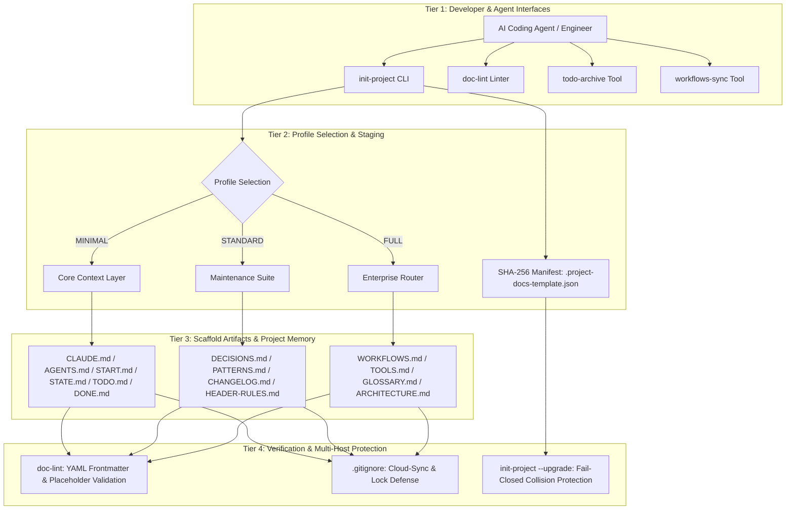
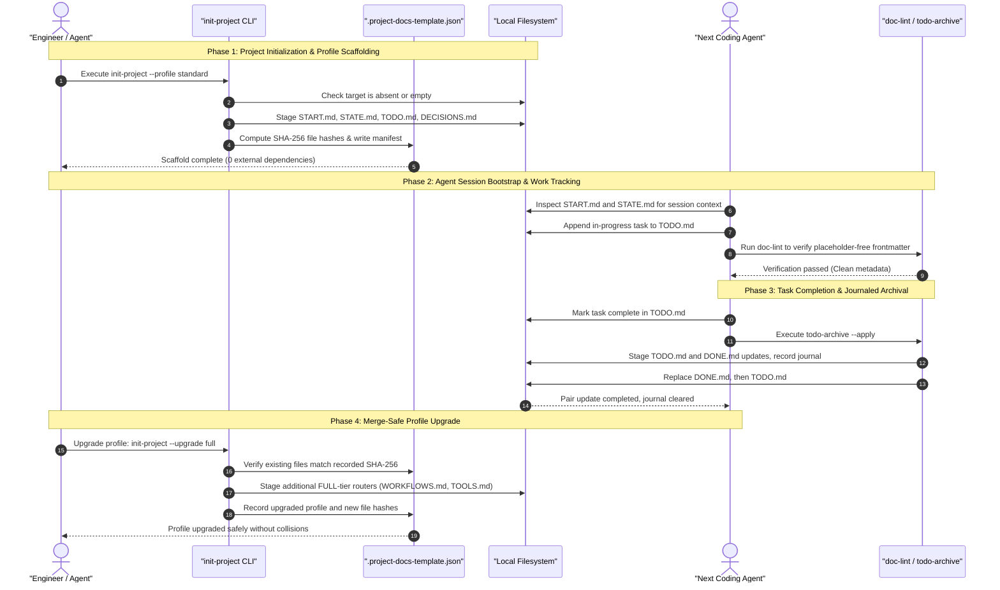

# Project Docs Template

**[English](README.md) · [Deutsch](README_de.md) · [Español](README_es.md) · [Français](README_fr.md) · [Русский](README_ru.md)**

<p align="center"></p>

[](https://github.com/ellmos-ai/project-docs-template)
[](./pyproject.toml)
[](./pyproject.toml)
[](./RELEASE_GATE.md)
[](./tests)
[](./CONTRIBUTING.md)
[](./SECURITY.md)
[](./SECURITY.md)
[](./SECURITY.md)
[](./THIRD_PARTY_LICENSES.txt)
[](./SECURITY.md)
[](./NOTICE)
[](https://github.com/ellmos-ai)
[](https://github.com/open-bricks)
[](./llms.txt)
[](https://github.com/ellmos-ai/project-docs-template/actions/workflows/ci.yml)
[](./README_de.md)
[](./LICENSE)
[](./MARKETING-LOG.txt)
[](./THIRD_PARTY_LICENSES.md)
[](./MARKETING-LOG.txt)

Шаблон документации проекта, готовый для работы с агентами, с файлами START/STATE/TODO/DONE,
рабочими процессами, лёгкими инструментами и памятью проекта, удобной для LLM.

> [!NOTE]
> **Индексация ИИ / LLM**: ИИ-агенты и автоматизированные инструменты могут обратиться к [llms.txt](llms.txt), чтобы получить машиночитаемое резюме, поисковые термины и пояснения для устранения неоднозначностей. Последняя проверка: **2026-10-30**.

> Независимый проект, не связанный с Anthropic, OpenAI или Google.
> См. раздел [Товарные знаки](#trademarks).

### 🧭 Быстрая навигация

1. [Краткое описание и основная идея](#executive-summary--core-identity)
2. [Визуальная архитектура и разделённые уровни](#visual-architecture-topology)
3. [Полный цикл работы нескольких агентов и поток инструментов](#end-to-end-multi-agent-lifecycle)
4. [Целевые аудитории и основные сценарии](#target-personas--core-use-cases)
5. [Возможности и ограничения проекта](#comparative-matrix-vs-alternatives)
6. [Матрица управления и инварианты выполнения](#governance--runtime-invariants)
7. [Когда использовать этот шаблон](#use-this-template-when)
8. [Состав и структура каркаса проекта](#what-is-included)
9. [Быстрый старт и типовые сценарии CLI](#quick-start)
10. [Обновление профилей с учётом изменений и миграция](#merge-safe-profile-upgrades)
11. [Сравнительная матрица профилей (MINIMAL / STANDARD / FULL)](#profile-comparison)
12. [Принципы проектирования и архитектурные инварианты](#design-principles)
13. [Тестирование, проверка и критерии качества](#verification)
14. [Политика безопасности и сообщение об уязвимостях](#security-policy)
15. [Лицензии сторонних компонентов и инвентаризация зависимостей](#third-party-licenses--transparency)
16. [Наборы, партнёры и инструменты экосистемы](#ecosystem--sibling-tools)
17. [Товарные знаки и уведомление о независимости](#trademarks)
18. [Правовое уведомление, ограничение ответственности и лицензия (§ 521 BGB)](#license)

---

## <a id="sec-01"></a><a id="executive-summary--core-identity"></a><a id="what-is-project-docs-template"></a>1. Краткое описание и основная идея

`project-docs-template` предлагает лёгкую архитектуру документации и памяти проекта, подготовленную для автономных ИИ-агентов программирования (Claude Code, OpenAI Codex, Antigravity/Gemini), групп нескольких агентов и людей, сопровождающих репозитории программного обеспечения, исследований и операционных процессов.

Вместо того чтобы превращать проекты в тяжёлые и жёсткие операционные системы или полагаться на закрытые SaaS-порталы, `project-docs-template` использует прозрачные стандартные текстовые реестры Markdown (`START.md`, `STATE.md`, `TODO.md`, `DONE.md`, `DECISIONS.md`). Универсальные точки входа (`CLAUDE.md`, `AGENTS.md`) дают агентам единое место для чтения состояния проекта, архитектурных инвариантов и активных задач. Они предоставляют контекст, но не гарантируют, что агент правильно его истолкует или будет ему следовать.

### Основные преимущества
- **Локальная работа**: в `SECURITY.md` описана работа с локальным диском без телеметрии и исходящих сетевых запросов при генерации шаблона и использовании перечисленных инструментов обслуживания.
- **Нет зависимостей во время выполнения**: все инструменты создания каркаса, подготовки, проверки и архивирования задач используют только стандартную библиотеку Python (3.10+).
- **Общий контекст сессии для передачи между агентами**: заметки о сессии (`START.md`) и снимок текущего состояния (`STATE.md`) дают последующим сессиям общую точку отсчёта. Эти файлы помогают передавать работу, но не гарантируют поведение агентов и не предотвращают потерю контекста.
- **Обновление профиля с обнаружением изменений**: манифест с SHA-256-хешами (`.project-docs-template.json`) проверяет управляемые файлы и позволяет отказаться от обновления при обнаруженных изменениях или коллизиях с неуправляемыми файлами перед переходом на следующий уровень профиля.
- **Архивирование задач с журналом**: `todo-archive` подготавливает обновления обоих файлов задач, записывает журнал, пытается выполнить откат после ошибок замены и может восстановить прерванное обновление пары файлов. При расхождении файлов журнал может потребовать ручной проверки.

---

## <a id="sec-02"></a><a id="visual-architecture-topology"></a><a id="architecture--flow"></a>2. Визуальная архитектура и разделённые уровни

На схеме показаны четыре операционных уровня `project-docs-template`: от интерфейсов для разработчиков и агентов до файлов репозитория, проверки и документированных фильтров конфликтных копий при облачной синхронизации.



### Архитектура в четырёх представлениях

```text
+--------------------------------------------------------------------------------------------------+
|                  [VIEW 1: CLI COCKPIT, LINTER & AGENT INTERFACE HARNESS]                         |
|  - init-project: Deterministic scaffolding, SHA-256 manifest stamping & profile migrations      |
|  - doc-lint: Static markdown validation, frontmatter linting & header contract enforcement       |
|  - todo-archive: Journaled two-file task archive with staged replacement & recovery            |
|  - workflows-sync: Bidirectional orchestration synchronization & prompt template extraction      |
+--------------------------------------------------------------------------------------------------+
                                                |
                                                v
+--------------------------------------------------------------------------------------------------+
|                  [VIEW 2: TIERED PROFILE ENGINE & MERGE-SAFE STAGING]                            |
|  - MINIMAL Profile: Lightweight context boundary (CLAUDE.md, AGENTS.md, START.md, STATE.md)     |
|  - STANDARD Profile: Complete project memory (TODO.md, DONE.md, DECISIONS.md, PATTERNS.md)       |
|  - FULL Profile: Enterprise architecture & governance (WORKFLOWS.md, TOOLS.md, GLOSSARY.md)      |
|  - SHA-256 Manifest: tracks managed files and detects edits or unowned collisions                |
+--------------------------------------------------------------------------------------------------+
                                                |
                                                v
+--------------------------------------------------------------------------------------------------+
|                  [VIEW 3: RUNTIME PERSISTENCE, REPOSITORY MEMORY & AUDIT]                        |
|  - Entry Instructions: CLAUDE.md / AGENTS.md provide a place to read project guidance             |
|  - Session Memory: START.md (session bootloader) & STATE.md (live operational ledger)            |
|  - Task Tracking: Structured task cards, recurring checklists, and verification criteria        |
|  - Decision Ledger: ADR-style architectural records (DECISIONS.md) & code patterns (PATTERNS.md)|
+--------------------------------------------------------------------------------------------------+
                                                |
                                                v
+--------------------------------------------------------------------------------------------------+
|                  [VIEW 4: DOCUMENTED SECURITY POLICY & FILE CONFLICT FILTERS]                     |
|  - User Context: tools run without requiring administrator or root elevation                    |
|  - Zero-Egress Policy: SECURITY.md documents local operation without outbound traffic             |
|  - Conflict-Copy Filters: .gitignore lists known cloud-sync conflict patterns                    |
|  - Legal & Governance: § 521 BGB notice; SECURITY.md says best-effort, no guaranteed response    |
+--------------------------------------------------------------------------------------------------+
```

---

## <a id="sec-03"></a><a id="end-to-end-multi-agent-lifecycle"></a>3. Полный цикл работы нескольких агентов и поток инструментов

На диаграмме последовательности показано, как разработчики и ИИ-агенты программирования могут использовать `project-docs-template` при создании каркаса, запуске сессии, завершении задач и обновлении профилей. Документация даёт контекст для передачи работы, а за её чтение и применение отвечает сам агент.



---

## <a id="sec-04"></a><a id="target-personas--discoverability"></a><a id="target-personas--core-use-cases"></a>4. Целевые аудитории и основные сценарии

`project-docs-template` помогает решать проблемы смещения контекста, потери информации при передаче работы и трудностей управления в четырёх основных технических сценариях:

| Целевая аудитория | Основная проблема | Как помогает `project-docs-template` | Основные файлы |
|:---|:---|:---|:---|
| **Инженеры систем с несколькими агентами** | Разнородные агенты программирования (Claude Code, Antigravity/Gemini, Codex) могут терять контекст проекта между сессиями или использовать разные форматы файлов. | Универсальные точки входа (`CLAUDE.md`, `AGENTS.md`) и реестры сессии и состояния (`START.md`, `STATE.md`) дают общее место для чтения инструкций и записанного контекста. Надёжность передачи всё равно зависит от того, используют ли эти файлы агенты и сопровождающие проекта. | `CLAUDE.md`, `AGENTS.md`, `START.md`, `STATE.md` |
| **Независимые разработчики и сопровождающие проекты с открытым исходным кодом** | Управление задачами, списком функций и историей выпусков без тяжёлой SaaS-платформы для управления проектами. | Простые списки задач в Markdown (`TODO.md`, `DONE.md`), инструмент архивирования с журналом (`todo-archive`) и стандартный `CHANGELOG.md`. | `TODO.md`, `DONE.md`, `_tools/todo-archive`, `CHANGELOG.md` |
| **Руководители по корпоративной архитектуре и управлению ИИ** | Недостаток проверяемой истории решений и прозрачности соответствия требованиям, а также риск случайной передачи данных во внешнюю сеть в корпоративных процессах с агентами. | Записи архитектурных решений (`DECISIONS.md`), строгие задокументированные принципы локальной работы в `SECURITY.md` и отсутствие внешних зависимостей во время выполнения. | `DECISIONS.md`, `SECURITY.md`, `THIRD_PARTY_LICENSES.md` |
| **Разработчики исследовательских и научных конвейеров** | Сложные многоэтапные экспериментальные конвейеры могут постепенно меняться за недели автономной работы LLM. | Масштабируемый профиль FULL с операционными инструкциями (`WORKFLOWS.md`), терминологией предметной области (`GLOSSARY.md`) и автоматической синхронизацией таблиц (`workflows-sync`). | `WORKFLOWS.md`, `GLOSSARY.md`, `_tools/workflows-sync` |

### Поисковые запросы для привлечения заинтересованной аудитории
- `agent-ready project documentation template`
- `claude code documentation scaffold`
- `multi-agent session handoff state start todo done`
- `offline local-first project template python`
- `zero-egress developer scaffolding stdlib`
- `deterministic documentation staging and profile upgrades`
- `llm friendly project memory repository template`

---

## <a id="sec-05"></a><a id="comparative-matrix-vs-alternatives"></a><a id="comparative-architecture"></a>5. Возможности и ограничения проекта

В таблице ниже приведены десять задокументированных инвариантов проекта, а также поведение и ограничения, подтверждённые исходным коммитом:

| № | Инвариант | Документированная возможность | Область действия / ограничение |
|---|:---|:---|:---|
| 1 | **INV-LOCAL-01: локальная работа без исходящего трафика** | В `SECURITY.md` указано, что генерация шаблона и перечисленные инструменты обслуживания работают с локальным диском без исходящей телеметрии и сетевого трафика. | Это документированная область действия этих инструментов, а не сетевая песочница на уровне операционной системы. |
| 2 | **INV-SEC-02: контекст вызывающего процесса** | Скрипты наследуют контекст вызывающего процесса. CLI не запрашивает повышения привилегий. | Процесс, уже запущенный с повышенными привилегиями, сохраняет их. Принудительный запуск от имени обычного пользователя или сертификация не заявлены. |
| 3 | **INV-FAIL-03: проверки с отказом при обнаружении конфликтов** | Генерация отклоняет существующую непустую целевую папку. Обновление отклоняет обнаруженные изменения управляемых файлов и конфликты с неуправляемыми файлами до фиксации изменений. | При генерации сначала создаются родительская папка и каталог подготовки, куда записываются подготовленные файлы, а затем результат переносится в целевое место. Это не является общей гарантией отсутствия записей при сбое. |
| 4 | **INV-STG-04: подготовленное обновление профиля** | При обновлении проверяются хеши манифеста, подготавливается следующий профиль и сохраняются резервные копии файлов. При сбое фиксации выполняются попытки отката с проверкой хешей. | Восстановление условно. Конкурирующие изменения или дополнительные ошибки файловой системы могут помешать полному откату. |
| 5 | **INV-HANDOFF-05: контекст сессии** | `START.md` и `STATE.md` содержат общие записи о проекте и сессиях для агентов и сопровождающих. | Шаблон не может гарантировать, что агент прочитает эти записи, будет им следовать или сохранит их. |
| 6 | **INV-TIER-06: профили нескольких уровней** | Шаблон предлагает профили `MINIMAL`, `STANDARD` и `FULL`. Обновление выполняется по одному уровню профиля за раз. | Это каркасы документации, а не среда выполнения для агентов. |
| 7 | **INV-SYNC-07: фильтрация конфликтных копий** | В `.gitignore` репозитория и шаблона перечислены шаблоны имён известных конфликтных копий и файлов блокировок. | Правила исключения не координируют одновременную запись и не обеспечивают действующую распределённую блокировку. |
| 8 | **INV-AUDIT-08: архивирование TODO/DONE** | `todo-archive` записывает журнал и подготавливает обновление двух файлов, пытается выполнить откат после ошибки замены и может восстановить прерванную фиксацию пары файлов. | При расхождении файлов журнал остаётся для ручной проверки. Сам откат тоже может завершиться ошибкой при серьёзном сбое файловой системы. |
| 9 | **INV-LIC-09: область действия зависимостей времени выполнения** | Проект указывает `dependencies = []` и использует стандартную библиотеку Python во время выполнения. | Это относится к зависимостям времени выполнения. Инструменты разработки и тестирования учитываются отдельно. |
| 10 | **INV-SLA-10: политика ответа по безопасности** | В `SECURITY.md` указано, что для поддерживаемой версии `0.1.x` исправления выпускаются по мере возможности, а исправления безопасности имеют приоритет. Срок ответа не гарантируется. | Не следует предполагать ответ в течение 48 часов или сортировку обращений в течение пяти рабочих дней. Используйте указанные закрытые каналы для сообщения об уязвимости. |

---

## <a id="sec-06"></a><a id="governance--runtime-invariants"></a>6. Матрица управления и инварианты выполнения

В проекте задокументированы десять инвариантов выполнения, подготовки и управления, относящихся к инструментам создания каркаса, CLI-утилитам обслуживания и создаваемым профилям репозитория:

| Канонический ID | Инвариант | Документированное поведение и область действия |
|:---|:---|:---|
| **INV-LOCAL-01** | **Локальная работа без исходящего трафика** | В `SECURITY.md` описана работа генерации шаблона и перечисленных скриптов обслуживания с локальным диском без исходящей телеметрии или сетевого трафика при создании проекта и обновлении. |
| **INV-SEC-02** | **Контекст вызывающего процесса** | Скрипты наследуют контекст вызывающего процесса. CLI не запрашивает повышения привилегий. Уже привилегированный вызывающий процесс сохраняет свои привилегии. Принудительный запуск от имени обычного пользователя или сертификация не заявлены. |
| **INV-FAIL-03** | **Проверки с отказом при обнаружении конфликтов** | Генерация отклоняет существующую непустую целевую папку. Обновления отклоняют обнаруженные изменения управляемых файлов и конфликты с неуправляемыми файлами до фиксации изменений. При генерации всё равно создаются родительская папка и каталог подготовки, куда записываются файлы до их переноса в целевое место. |
| **INV-STG-04** | **Подготовленное обновление и ограниченное восстановление** | Перед фиксацией изменений проверяются хеши манифеста и подготавливаются файлы профиля. Резервные копии и проверки хешей позволяют попытаться выполнить восстановление. Оно остаётся условным и может быть заблокировано дополнительными ошибками файловой системы или конкурирующими изменениями. |
| **INV-HANDOFF-05** | **Контекст сессии агента** | В `START.md` и `STATE.md` хранится контекст проекта и сессии. Чтение, применение и сохранение этих сведений агентами зависит от их поведения и окружающего рабочего процесса. |
| **INV-TIER-06** | **Масштабируемые профили нескольких уровней** | Три профиля (`MINIMAL`, `STANDARD`, `FULL`) предлагают разные структуры документации и объём сопровождения. |
| **INV-SYNC-07** | **Фильтрация конфликтов при облачной синхронизации** | Файлы `.gitignore` в корне и в шаблоне фильтруют перечисленные шаблоны конфликтных копий и файлов блокировок. Они не координируют одновременную запись. |
| **INV-AUDIT-08** | **Архивирование задач с журналом** | `todo-archive` подготавливает обновления `TODO.md` и `DONE.md`, записывает журнал, пытается выполнить восстановление после ошибки замены и поддерживает восстановление прерванной фиксации пары файлов. Расхождения могут потребовать ручной проверки журнала. |
| **INV-LIC-09** | **Зависимости времени выполнения** | Зависимости времени выполнения указаны как `dependencies = []`, а программа использует стандартную библиотеку Python. Инструменты разработки и тестирования не входят в это утверждение о зависимостях времени выполнения. |
| **INV-SLA-10** | **Политика сообщения об уязвимостях** | В `SECURITY.md` указано, что версии `0.1.x` сопровождаются по мере возможности, гарантированный срок ответа отсутствует, а исправления безопасности имеют приоритет. |

---

## <a id="sec-07"></a><a id="use-this-template-when"></a>7. Когда использовать этот шаблон

| Ситуация | Чем помогает |
|:---|:---|
| Новый проект будет сопровождаться с помощью Claude Code, Codex, Gemini CLI или другого агента программирования | Даёт агенту предсказуемый порядок начальной настройки и файл с актуальным состоянием. |
| В существующем репозитории заметки разбросаны, файлы задач устарели или отсутствует история передачи работы | Разделяет текущую и завершённую работу, решения, практики и состояние сессии. |
| Нескольким агентам или людям нужно безопасно продолжить работу | Разносит инструкции, текущее состояние, рабочие процессы и инструменты по отдельным файлам. |

Это шаблон для документации и координации, а не среда выполнения. Он
предназначен для обычных репозиториев программного обеспечения, исследований или операционной деятельности.

---

## <a id="sec-08"></a><a id="what-is-included"></a>8. Состав и структура каркаса проекта

- `CLAUDE.md` и `AGENTS.md` с инструкциями для агентов
- `START.md` и `STATE.md` для начальной настройки сессии и текущего состояния
- `TODO.md` и `DONE.md` с необязательными инструментами архивирования
- `DECISIONS.md`, `PATTERNS.md`, `CHANGELOG.md` и `HEADER-RULES.md`
- Необязательные маршрутизаторы профиля FULL: `WORKFLOWS.md`, `TOOLS.md`, `GLOSSARY.md`
- Локальные вспомогательные инструменты в `_tools/`, включая `init-project`, `doc-lint`, `todo-archive` и `workflows-sync`

Фактические файлы шаблона находятся в [`template/`](./template/).

---

## <a id="sec-09"></a><a id="quick-start"></a>9. Быстрый старт и типовые сценарии CLI

Клонируйте репозиторий и за несколько секунд создайте рабочее пространство, подготовленное для агентов:

```bash
git clone https://github.com/ellmos-ai/project-docs-template.git
cd project-docs-template

# Inspect scaffold generation without writing changes (dry-run)
python template/_tools/init-project --target /path/to/my-project --name "my-project" --profile STANDARD --dry-run

# Render STANDARD profile (12 root contracts & tools with SHA-256 manifest)
python template/_tools/init-project --target /path/to/my-project --name "my-project" --profile STANDARD

# Optional: initialize Git repository with staged initial commit
python template/_tools/init-project --target /path/to/my-project --name "my-project" --profile STANDARD --git
```

### Пошаговое создание проекта (вывод терминала)

При запуске `init-project` создаёт соседний временный каталог подготовки, формирует выбранный профиль, выполняет подготовку и проверку, записывает манифест, а затем размещает подготовленный результат на целевом пути. Целевая папка может отсутствовать или быть существующей пустой папкой:

```text
==> Root:    /path/to/.my-project.staging-xyz123
==> Max age: 30 days

Results:
  OK   CLAUDE.md
  OK   START.md
  OK   STATE.md

OK: Alle geprüften Files bestehen (oder wurden gefixt)
==> Target:  /path/to/my-project
==> Name:    my-project
==> Author:  Alex Developer
==> Date:    2026-10-30

==> Profil: STANDARD
    Ernsthafte Projekte mit mehrmonatiger Lebensdauer
  OK: AGENTS.md
  OK: CLAUDE.md
  OK: README.md
  OK: START.md
  OK: STATE.md
  OK: CHANGELOG.md
  OK: HEADER-RULES.md
  OK: CUT-AND-CLUE.md
  OK: DECISIONS.md
  OK: PATTERNS.md
  OK: TODO.md
  OK: DONE.md
  OK: .gitignore
  OK: _tools/README.md
  OK: _tools/todo-archive
  OK: _tools/doc-lint

==> Fertig: /path/to/my-project
```

### Типовые сценарии обслуживания через CLI в созданных проектах

Созданные рабочие пространства включают лёгкие инструменты без зависимостей в `_tools/`:

```bash
# Lint project documentation and verify YAML frontmatter & staleness
python _tools/doc-lint

# Automatically insert missing frontmatter fields & refresh verification dates
python _tools/doc-lint --fix --update-dates

# Archive completed tasks with journaling
python _tools/todo-archive --apply

# Synchronize workflow tables across routers (FULL profile)
python _tools/workflows-sync --apply
```

> [!NOTE]
> **Язык шаблонов:** документация репозитория написана на английском, но тексты файлов в [`template/`](./template/) — `CLAUDE.md`, `START.md`, `STATE.md`, `TODO.md` и других — и вывод CLI-команд `init-project`, `doc-lint`, `todo-archive` и `workflows-sync` написаны на немецком. Имена файлов, маркеры профилей и ключи блока метаданных YAML не зависят от языка, поэтому англоязычный проект может использовать эту структуру, заменив текст. Английский набор шаблонов запланирован. Подробнее см. [`TODO.md`](./TODO.md).

---

## <a id="sec-10"></a><a id="merge-safe-profile-upgrades"></a>10. Обновление профилей с обнаружением изменений и миграция

Существующие проекты можно обновить до следующего уровня профиля:

```bash
# Upgrade existing project to FULL profile
python template/_tools/init-project /path/to/my-project --upgrade full
```

### Проверки безопасности при обновлении
- **Проверка манифеста**: читает `.project-docs-template.json` и сравнивает хеши управляемых файлов.
- **Отказ при коллизиях с неуправляемыми файлами**: если файл, который нужно добавить, уже существует вне предыдущего манифеста, обновление прекращается до фиксации изменений в целевой папке. Каталог подготовки к этому моменту уже может быть создан.
- **Отказ при изменении управляемых файлов**: если файл больше не совпадает с хешем в манифесте, обновление не продолжается. Запрос подтверждения или автоматическая перезапись не предлагаются.
- **Условная попытка отката**: во время фиксации изменений резервные копии и проверка текущих хешей позволяют восстановить файлы, изменённые этим запуском. Если обнаружено другое изменение, восстановление пропускается, чтобы его не перезаписать. Дополнительная ошибка файловой системы тоже может помешать завершить откат.

---

## <a id="sec-11"></a><a id="profile-comparison"></a>11. Сравнительная матрица профилей

| Возможность / документ | `MINIMAL` | `STANDARD` | `FULL` |
|:---|:---:|:---:|:---:|
| `CLAUDE.md` и `AGENTS.md` (инструкции для агентов) | ✅ Включено | ✅ Включено | ✅ Включено |
| `START.md` и `STATE.md` (память сессии) | ✅ Включено | ✅ Включено | ✅ Включено |
| `TODO.md` и `DONE.md` (учёт задач) | ✅ Включено | ✅ Включено | ✅ Включено |
| `_tools/todo-archive` (архивирование задач) | ✅ Включено | ✅ Включено | ✅ Включено |
| `_tools/doc-lint` (проверка документации) | ✅ Включено | ✅ Включено | ✅ Включено |
| `DECISIONS.md` (архитектурные решения) | — | ✅ Включено | ✅ Включено |
| `PATTERNS.md` (шаблоны проектирования) | — | ✅ Включено | ✅ Включено |
| `CHANGELOG.md` и `HEADER-RULES.md` | — | ✅ Включено | ✅ Включено |
| `WORKFLOWS.md` и `_tools/workflows-sync` | — | — | ✅ Включено |
| `TOOLS.md` и `GLOSSARY.md` (маршрутизаторы по предметной области) | — | — | ✅ Включено |
| `ARCHITECTURE.md` и workflows в `.github/` | — | — | ✅ Включено |

---

## <a id="sec-12"></a><a id="design-principles"></a>12. Принципы проектирования и архитектурные инварианты

- **Разделение ответственности**: у каждого файла одна чётко определённая операционная задача.
- **Явная передача контекста сессии**: начало сессии и текущее состояние описываются в коротких предсказуемых файлах (`START.md`, `STATE.md`), которые могут читать агенты и сопровождающие проекта.
- **Низкие затраты на сопровождение**: приоритет отдан полезным документам с контекстом, а не разрастанию заброшенной вики.
- **Подход с маршрутизаторами**: маршрутизаторы верхнего уровня (`WORKFLOWS.md`, `TOOLS.md`) указывают на подробности, а не дублируют их.
- **Жизненный цикл задач с журналом**: `todo-archive` использует журнал и подготовленную замену файлов для архивирования завершённых задач. Восстановление зависит от журнала и текущего состояния файлов.

Полное обоснование проектных решений см. в [`template/TEMPLATE.md`](./template/TEMPLATE.md).

---

## <a id="sec-13"></a><a id="verification"></a>13. Тестирование, проверка и критерии качества

Набор тестов запускается с помощью стандартного для Python модуля `unittest` или `pytest`:

```bash
# Run test suite via pytest
pytest -ra -v

# Run test suite via standard unittest
python -m unittest discover -s tests -v
```

Тесты охватывают все профили, инициализацию Git, исправление блока метаданных YAML, экранирование метаданных рабочих процессов, отказ при обновлении изменённых целевых файлов или коллизиях, откат при искусственно вызванном сбое фиксации манифеста, откат после искусственно вызванного сбоя второй замены TODO/DONE и восстановление прерванного архивирования по журналу. Один и тот же набор настроен для Linux, Windows и macOS. См. [`RELEASE_GATE.md`](./RELEASE_GATE.md).

---

## <a id="sec-14"></a><a id="security-policy"></a>14. Политика безопасности и сообщение об уязвимостях

`project-docs-template` следует политике, описанной в `SECURITY.md`:
- **Локальная работа без исходящего трафика**: в `SECURITY.md` указано, что генерация шаблона и перечисленные инструменты обслуживания работают с локальным диском без исходящей телеметрии и сетевого трафика при создании проекта и обновлении.
- **Подготовленная генерация и проверки обновления**: при генерации результат готовится во временном каталоге подготовки рядом с целевой папкой, проверяется до размещения, а существующие непустые целевые папки отклоняются. Перед фиксацией изменений при обновлении профиля проверяются хеши управляемых файлов и конфликты с неуправляемыми файлами. Откат остаётся условным.
- **Поддерживаемые версии и политика ответа**: в `SECURITY.md` указано, что версия `0.1.x` в ветке `main` сопровождается по мере возможности, а исправления безопасности имеют приоритет. Срок ответа не гарантируется. Версии ниже `0.1.0` не поддерживаются.

О возможной уязвимости сообщайте согласно [`SECURITY.md`](./SECURITY.md): предпочтительно воспользуйтесь частным уведомлением GitHub о безопасности или указанными там прямыми контактами сопровождающих. Не публикуйте сведения о неисправленных уязвимостях в публичных задачах GitHub. До выпуска исправления политика рекомендует согласованное раскрытие информации. В документе указаны адреса `security@ellmos.ai`, `support@lukasgeiger.com` и `lukas@open-bricks.org`.

---

## <a id="sec-15"></a><a id="third-party-licenses--transparency"></a>15. Лицензии сторонних компонентов и инвентаризация зависимостей

В `project-docs-template` используется строгая архитектура **без зависимостей времени выполнения** (`dependencies = []`). Весь исполняемый код опирается только на стандартную библиотеку Python (3.10+).

| Компонент | Область применения | Указанная лицензия | Статус |
|:---|:---|:---|:---|
| **Стандартная библиотека Python** | Основная программа | PSFL-2.0 | 100 % разрешительная (входит в состав) |
| **pytest** | Разработка / тестирование | Лицензия MIT | 100 % разрешительная |
| **ruff** | Разработка / контроль качества | MIT / Apache-2.0 | 100 % разрешительная |
| **setuptools** | Бэкенд сборки | Лицензия MIT | 100 % разрешительная |

Указанные лицензии зависимостей времени выполнения и разработки, а также инвентаризация зависимостей приведены в [THIRD_PARTY_LICENSES.md](THIRD_PARTY_LICENSES.md) и в сопутствующем текстовом документе [THIRD_PARTY_LICENSES.txt](THIRD_PARTY_LICENSES.txt). В этих файлах описаны перечисленные компоненты. Независимый аудит и сертификация SBOM уровня 1 здесь не заявляются.

---

## <a id="sec-16"></a><a id="ecosystem--sibling-tools"></a><a id="bundles-and-partners"></a>16. Наборы, партнёры и инструменты экосистемы

`project-docs-template` — один из ключевых компонентов для создания каркасов проектов в экосистеме [`ellmos-ai`](https://github.com/ellmos-ai) и зонтичном сообществе проектов с открытым исходным кодом [`open-bricks`](https://github.com/open-bricks):

| Репозиторий | Назначение | Основной интерфейс |
|:---|:---|:---|
| [`policy-registry`](https://github.com/ellmos-ai/policy-registry) | Машиночитаемый реестр политик с подписанными делегированиями | CLI / API / MCP |
| [`DevCenter`](https://github.com/dev-bricks/DevCenter) | Локальная среда разработки на Python и набор инструментов разработчика | GUI / PySide6 |
| [`CodeBox`](https://github.com/dev-bricks/CodeBox) | Настольный редактор кода и IDE | GUI / PySide6 |
| [`companion-for-agy`](https://github.com/ellmos-ai/companion-for-agy) | Расширение и набор сопутствующих инструментов для ИИ-агентов Antigravity | CLI / Node.js |
| [`safe-start-for-codex`](https://github.com/dev-bricks/safe-start-for-codex) | Защитная начальная настройка и проверка окружения | CLI / Python |
| [`automizer-for-claude-desktop`](https://github.com/dev-bricks/automizer-for-claude-desktop) | Инструментарий интеграции и автоматизации для Claude Desktop | CLI / Python |
| [`system-gap-master`](https://github.com/ellmos-ai/system-gap-master) | Межсистемная синхронизация и анализ расхождений | CLI / Python |
| [`lock-master`](https://github.com/ellmos-ai/lock-master) | Управление блокировками файлов и общих ресурсов | CLI / Python |
| [`ticket-master`](https://github.com/ellmos-ai/ticket-master) | Локальный оркестратор задач и заявок | CLI / Python |
| [`clutch`](https://github.com/ellmos-ai/clutch) | Маршрутизатор LLM, независимый от поставщика, и движок оркестрации моделей | CLI / Python |
| [`memoryhooker`](https://github.com/ellmos-ai/memoryhooker) | Извлечение памяти сессий и внедрение хуков | CLI / Python |
| [`workflowhooker`](https://github.com/ellmos-ai/workflowhooker) | Триггеры жизненного цикла автоматизированных процессов | CLI / Python |
| [`ellmos-controlcenter-mcp`](https://github.com/ellmos-ai/ellmos-controlcenter-mcp) | MCP-сервер для анализа системы и поиска навыков | MCP |
| [`ellmos-filecommander-mcp`](https://github.com/ellmos-ai/ellmos-filecommander-mcp) | MCP-сервер для безопасной работы с локальными файлами | MCP |
| [`open-bricks`](https://github.com/open-bricks) | Зонтичная организация инструментов для разработчиков и ИИ | Портал |

<!-- BEGIN GENERATED ELLMOS BUNDLE DISCOVERY -->
### Bundles and Partners Discovery Projection
Generated discovery projection for `module:project-docs-template` from `catalog:v4-bundles` (`546290dafbaafd810df1d59ef5a3d7183738472b48cd5a8a81f1e8f2b64d852e`). Target repository visibility: `public`.

- **`ellmos-dev-lifecycle-bundle`**: role `declared-component`, requirement `required`. Partners: `module:bundle-installer`, `module:ellmos-code-tools`, `module:ellmos-tests`, `module:github-onedrive-mirror`, `module:stack-system-installer`.
- **`ellmos-knowledge-bundle`**: role `declared-component`, requirement `recommended`. Partners: `module:KnowledgeDigest`, `module:WikiStub-Seed`, `module:report-forge`, `module:web-scraper`.
<!-- END GENERATED ELLMOS BUNDLE DISCOVERY -->

---

## <a id="sec-17"></a><a id="trademarks"></a>17. Товарные знаки и уведомление о независимости

Этот проект представляет собой независимый шаблон документации, который поддерживается сообществом.
Он **не** связан с Anthropic, OpenAI или Google, не одобрен ими, не спонсируется ими и не имеет с ними иных связей.

«Claude» и «Claude Code», «Codex», «Gemini» и «Antigravity» являются товарными знаками
или зарегистрированными товарными знаками соответствующих владельцев (Anthropic PBC, OpenAI,
Google LLC). Остальные названия продуктов, логотипы и бренды принадлежат их
соответствующим владельцам. Они используются здесь только для описания совместимости
и взаимодействия. Их использование не подразумевает одобрения,
разрешения или деловых отношений.

---

## <a id="sec-18"></a><a id="license"></a><a id="statutory-notice-liability-limitation--license"></a>18. Правовое уведомление, ограничение ответственности и лицензия (§ 521 BGB)

### Правовое уведомление и ограничение ответственности (§ 521 BGB)
Это программное обеспечение и каркас шаблона предоставляются бесплатно в качестве предусмотренной законом любезности (*Gefälligkeit* / *unentgeltliche Schenkung* согласно **§ 521 BGB** Гражданского кодекса Германии). По немецкому законодательству ответственность автора и участников проекта строго ограничена умыслом и грубой неосторожностью (*Vorsatz und grobe Fahrlässigkeit*). Обязательная ответственность, установленная законом, в частности за умысел (раздел 276(3) BGB) и за причинение вреда жизни, здоровью или физической неприкосновенности, сохраняется.

### Лицензия
Проект распространяется на условиях **лицензии MIT**. Полные сведения об авторских правах см. в [LICENSE](LICENSE) и [NOTICE](NOTICE).