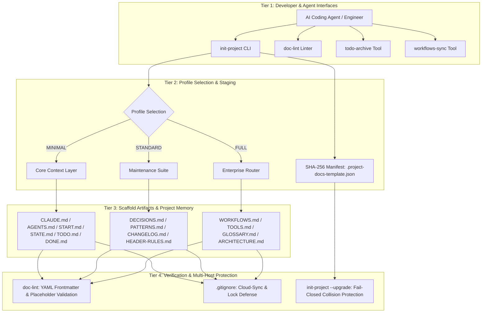
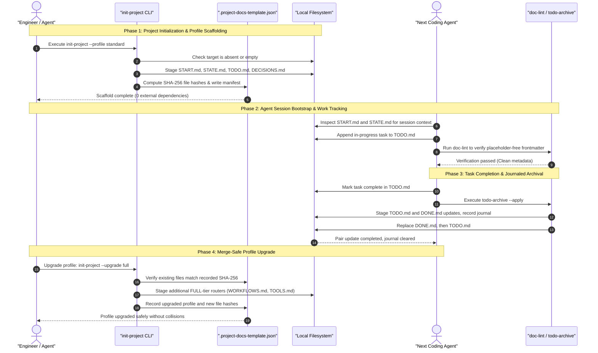

# Project Docs Template

**[English](README.md) · [Deutsch](README_de.md) · [Español](README_es.md) · [Français](README_fr.md) · [Русский](README_ru.md) · [日本語](README_ja.md) · [简体中文](README_zh.md) · [हिन्दी](README_hi.md)**

<p align="center"></p>

[](https://github.com/ellmos-ai/project-docs-template)
[](./pyproject.toml)
[](./pyproject.toml)
[](./RELEASE_GATE.md)
[](./tests)
[](./CONTRIBUTING.md)
[](./SECURITY.md)
[](./SECURITY.md)
[](./SECURITY.md)
[](./THIRD_PARTY_LICENSES.txt)
[](./SECURITY.md)
[](./NOTICE)
[](https://github.com/ellmos-ai)
[](https://github.com/open-bricks)
[](./llms.txt)
[](https://github.com/ellmos-ai/project-docs-template/actions/workflows/ci.yml)
[](./README_de.md)
[](./LICENSE)
[](./MARKETING-LOG.txt)
[](./THIRD_PARTY_LICENSES.md)
[](./MARKETING-LOG.txt)

面向智能体的项目文档模板，包含 START/STATE/TODO/DONE，
以及工作流、轻量工具和适合 LLM 使用的项目记忆。

> [!NOTE]
> **AI / LLM 索引**：AI 智能体和自动化工具可以查看 [llms.txt](llms.txt)，获取机器可读的摘要、搜索词和消歧说明。最后检查日期：**2026-10-30**。

> 本项目独立维护，与 Anthropic、OpenAI 或 Google 无关联。
> 参阅[商标](#trademarks)。

### 🧭 快速导航

1. [概述与核心定位](#executive-summary--core-identity)
2. [可视化架构与解耦层](#visual-architecture-topology)
3. [多智能体端到端生命周期与工具流程](#end-to-end-multi-agent-lifecycle)
4. [目标用户与核心使用场景](#target-personas--core-use-cases)
5. [项目能力与限制](#comparative-matrix-vs-alternatives)
6. [治理与运行时不变量矩阵](#governance--runtime-invariants)
7. [适用场景](#use-this-template-when)
8. [模板内容与项目骨架结构](#what-is-included)
9. [快速开始与常见 CLI 工作流](#quick-start)
10. [带变更检测的配置升级与迁移](#merge-safe-profile-upgrades)
11. [配置比较矩阵（MINIMAL / STANDARD / FULL）](#profile-comparison)
12. [设计原则与架构不变量](#design-principles)
13. [测试、验证与质量门禁](#verification)
14. [安全策略与漏洞报告](#security-policy)
15. [第三方许可证与依赖项清单](#third-party-licenses--transparency)
16. [生态系统中的套件、合作方与关联工具](#ecosystem--sibling-tools)
17. [商标与独立性声明](#trademarks)
18. [法律声明、责任限制与许可证（§ 521 BGB）](#license)

---

## <a id="sec-01"></a><a id="executive-summary--core-identity"></a><a id="what-is-project-docs-template"></a>1. 概述与核心定位

`project-docs-template`为自主 AI 编程智能体（Claude Code、OpenAI Codex、Antigravity/Gemini）、多智能体协作群体，以及维护软件、研究和运维类仓库的人员，提供轻量、面向智能体的文档与项目记忆架构。

`project-docs-template`不把项目变成笨重僵化的操作系统，也不依赖专有 SaaS 门户，而是使用透明、标准的纯文本 Markdown 记录文件（`START.md`、`STATE.md`、`TODO.md`、`DONE.md`、`DECISIONS.md`）。通用入口文件（`CLAUDE.md`、`AGENTS.md`）为智能体提供一致的位置，以读取项目状态、架构不变量和当前任务。这些文件提供上下文，但不能保证智能体能准确理解或遵循其中内容。

### 核心价值
- **本地优先运行**：`SECURITY.md`说明，模板生成和列出的维护工具在本地磁盘上运行，不使用遥测，也不发起外部网络请求。
- **无运行时依赖**：所有生成骨架、暂存、验证和任务归档工具仅使用 Python 3.10+ 标准库。
- **支持智能体交接的共享会话上下文**：专门的会话记录（`START.md`）和当前状态快照（`STATE.md`）为后续会话提供共同参考。这些文件有助于交接，但不能保证智能体的行为，也不能防止上下文丢失。
- **支持变更检测的配置升级**：SHA-256 清单（`.project-docs-template.json`）会检查受管理文件，并可在检测到文件修改或与未管理文件冲突时，在提交下一配置级别前拒绝升级。
- **带日志的任务归档**：`todo-archive`会暂存两个任务文件的更新，记录日志，在替换出错后尝试回滚，并可恢复被中断的双文件提交。文件不一致时，可能需要手动检查日志。

---

## <a id="sec-02"></a><a id="visual-architecture-topology"></a><a id="architecture--flow"></a>2. 可视化架构与解耦层

下图展示了`project-docs-template`的四个运行层级，从开发者／智能体界面，到仓库文件、验证流程，以及文档中描述的云同步冲突副本过滤规则：



### 四视图架构示意

```text
+--------------------------------------------------------------------------------------------------+
|                  [VIEW 1: CLI COCKPIT, LINTER & AGENT INTERFACE HARNESS]                         |
|  - init-project: Deterministic scaffolding, SHA-256 manifest stamping & profile migrations      |
|  - doc-lint: Static markdown validation, frontmatter linting & header contract enforcement       |
|  - todo-archive: Journaled two-file task archive with staged replacement & recovery            |
|  - workflows-sync: Bidirectional orchestration synchronization & prompt template extraction      |
+--------------------------------------------------------------------------------------------------+
                                                |
                                                v
+--------------------------------------------------------------------------------------------------+
|                  [VIEW 2: TIERED PROFILE ENGINE & MERGE-SAFE STAGING]                            |
|  - MINIMAL Profile: Lightweight context boundary (CLAUDE.md, AGENTS.md, START.md, STATE.md)     |
|  - STANDARD Profile: Complete project memory (TODO.md, DONE.md, DECISIONS.md, PATTERNS.md)       |
|  - FULL Profile: Enterprise architecture & governance (WORKFLOWS.md, TOOLS.md, GLOSSARY.md)      |
|  - SHA-256 Manifest: tracks managed files and detects edits or unowned collisions                |
+--------------------------------------------------------------------------------------------------+
                                                |
                                                v
+--------------------------------------------------------------------------------------------------+
|                  [VIEW 3: RUNTIME PERSISTENCE, REPOSITORY MEMORY & AUDIT]                        |
|  - Entry Instructions: CLAUDE.md / AGENTS.md provide a place to read project guidance             |
|  - Session Memory: START.md (session bootloader) & STATE.md (live operational ledger)            |
|  - Task Tracking: Structured task cards, recurring checklists, and verification criteria        |
|  - Decision Ledger: ADR-style architectural records (DECISIONS.md) & code patterns (PATTERNS.md)|
+--------------------------------------------------------------------------------------------------+
                                                |
                                                v
+--------------------------------------------------------------------------------------------------+
|                  [VIEW 4: DOCUMENTED SECURITY POLICY & FILE CONFLICT FILTERS]                     |
|  - User Context: tools run without requiring administrator or root elevation                    |
|  - Zero-Egress Policy: SECURITY.md documents local operation without outbound traffic             |
|  - Conflict-Copy Filters: .gitignore lists known cloud-sync conflict patterns                    |
|  - Legal & Governance: § 521 BGB notice; SECURITY.md says best-effort, no guaranteed response    |
+--------------------------------------------------------------------------------------------------+
```

---

## <a id="sec-03"></a><a id="end-to-end-multi-agent-lifecycle"></a>3. 多智能体端到端生命周期与工具流程

下方的时序图展示了开发者和 AI 编程智能体如何在生成项目骨架、启动会话、完成任务和升级配置时使用`project-docs-template`。文档提供交接所需的上下文，智能体仍需自行阅读并应用这些内容。



---

## <a id="sec-04"></a><a id="target-personas--discoverability"></a><a id="target-personas--core-use-cases"></a>4. 目标用户与核心使用场景

`project-docs-template`旨在帮助应对上下文漂移、交接信息丢失和治理摩擦，覆盖四类主要技术使用场景：

| 目标用户 | 主要痛点 | `project-docs-template`如何提供帮助 | 核心文件 |
|:---|:---|:---|:---|
| **多智能体系统工程师** | 不同的编程智能体（Claude Code、Antigravity/Gemini、Codex）可能在会话间丢失项目上下文，或使用不同的文件格式。 | 通用入口文件（`CLAUDE.md`、`AGENTS.md`）和会话／状态记录文件（`START.md`、`STATE.md`）为智能体提供共享位置，用于读取指令和已记录的上下文。交接是否可靠，仍取决于智能体和维护者是否使用这些文件。 | `CLAUDE.md`、`AGENTS.md`、`START.md`、`STATE.md` |
| **独立开发者与开源维护者** | 不依赖沉重的项目管理 SaaS 平台，仍需处理问题、功能待办和发布历史。 | 简洁的 Markdown 任务循环（`TODO.md`、`DONE.md`）搭配带日志的归档工具（`todo-archive`）和标准的`CHANGELOG.md`。 | `TODO.md`、`DONE.md`、`_tools/todo-archive`、`CHANGELOG.md` |
| **企业架构与 AI 治理负责人** | 缺少可审计的决策记录和合规透明度，企业智能体工作流还存在意外向外传输数据的风险。 | 架构决策记录（`DECISIONS.md`）、`SECURITY.md`中严格的本地优先原则，以及运行时没有外部依赖项。 | `DECISIONS.md`、`SECURITY.md`、`THIRD_PARTY_LICENSES.md` |
| **研究与科学流程开发者** | 复杂的多阶段实验流程可能在数周的自主 LLM 推理过程中逐渐偏离原计划。 | 可扩展的 FULL 配置包含运行手册（`WORKFLOWS.md`）、领域术语（`GLOSSARY.md`）和自动表格同步（`workflows-sync`）。 | `WORKFLOWS.md`、`GLOSSARY.md`、`_tools/workflows-sync` |

### 高意向发现类搜索词
- `agent-ready project documentation template`
- `claude code documentation scaffold`
- `multi-agent session handoff state start todo done`
- `offline local-first project template python`
- `zero-egress developer scaffolding stdlib`
- `deterministic documentation staging and profile upgrades`
- `llm friendly project memory repository template`

---

## <a id="sec-05"></a><a id="comparative-matrix-vs-alternatives"></a><a id="comparative-architecture"></a>5. 项目能力与限制

下表汇总了十项已记录的项目不变量，以及此源代码提交所支持的行为和限制：

| # | 不变量 | 文档所述能力 | 范围／限制 |
|---|:---|:---|:---|
| 1 | **INV-LOCAL-01：本地优先，无外发流量** | `SECURITY.md`说明，模板生成和列出的维护工具在本地磁盘上运行，不产生外部遥测或网络流量。 | 这是这些工具在文档中声明的范围，并非操作系统级网络沙箱。 |
| 2 | **INV-SEC-02：调用方进程上下文** | 脚本继承调用方进程的执行上下文。CLI不会请求提升权限。 | 已具有特权的调用方会继续保有这些权限。项目不声称强制以标准用户身份运行，也不声称获得了相关认证。 |
| 3 | **INV-FAIL-03：检测冲突时拒绝继续** | 生成操作会拒绝已有的非空目标目录。配置升级会在提交更改前，拒绝已检测到的受管理文件修改和与未管理文件的冲突。 | 生成操作会先创建父目录和暂存区域，并在其中写入准备好的文件，然后再将结果移入目标位置。这并不构成失败时绝不写入的全面保证。 |
| 4 | **INV-STG-04：暂存式配置升级** | 升级会验证清单哈希，暂存下一个配置级别并备份文件。如果更改提交失败，会尝试通过哈希保护的回滚恢复文件。 | 恢复是有条件的。并发更改或其他文件系统错误可能导致无法完全回滚。 |
| 5 | **INV-HANDOFF-05：会话上下文** | `START.md`和`STATE.md`为智能体和维护者提供共享的项目与会话记录。 | 模板无法确保智能体会读取、遵循或保留这些记录。 |
| 6 | **INV-TIER-06：分层配置** | 模板提供`MINIMAL`、`STANDARD`和`FULL`配置。升级每次前进一个配置级别。 | 这些是文档骨架，并非智能体运行时框架。 |
| 7 | **INV-SYNC-07：冲突副本过滤** | 仓库和模板中的`.gitignore`文件列出了已知冲突副本及锁文件的匹配模式。 | 忽略模式不会协调并发写入者，也不提供实时分布式锁。 |
| 8 | **INV-AUDIT-08：TODO/DONE归档** | `todo-archive`会为两个文件的更新记录日志并暂存更新，在替换出错后尝试回滚，也可恢复中断的双文件提交。 | 文件不一致时，需要手动检查日志。严重文件系统故障也可能导致回滚本身失败。 |
| 9 | **INV-LIC-09：运行时依赖范围** | 项目声明`dependencies = []`，并在运行时使用Python标准库。 | 这描述的是运行时依赖。开发和测试工具另行计算。 |
| 10 | **INV-SLA-10：安全响应策略** | `SECURITY.md`说明，受支持的`0.1.x`版本采用尽力而为的维护方式，并优先处理安全修复。响应时间不作保证。 | 不要推断项目承诺48小时内响应或5个工作日内完成初步评估。请使用列出的私密报告渠道。 |

---

## <a id="sec-06"></a><a id="governance--runtime-invariants"></a>6. 治理与运行时不变量矩阵

项目记录了十项运行时、暂存和治理不变量，适用于骨架生成工具、维护用CLI工具以及生成的仓库配置：

| 规范ID | 不变量 | 文档所述行为与范围 |
|:---|:---|:---|
| **INV-LOCAL-01** | **本地优先，无外发流量** | `SECURITY.md`说明，模板生成和列出的维护脚本在本地磁盘上运行，在项目初始化或升级期间不产生外部遥测或网络流量。 |
| **INV-SEC-02** | **调用方进程上下文** | 脚本继承调用方进程的执行上下文。CLI不会请求提升权限。已具有特权的调用方会继续保有这些权限。项目不声称强制以标准用户身份运行，也不声称获得相关认证。 |
| **INV-FAIL-03** | **检测冲突时拒绝继续** | 新建项目时会拒绝已有的非空目标目录。升级会在提交更改前，拒绝已检测到的受管理文件修改和与未管理文件的冲突。生成时仍会创建父目录和暂存区域，并在将文件移入目标位置前先写入这些文件。 |
| **INV-STG-04** | **暂存式升级与受保护恢复** | 提交更改前会检查清单哈希并暂存配置文件。备份和哈希检查支持尝试恢复，但恢复是有条件的，可能因额外的文件系统错误或并发更改而受阻。 |
| **INV-HANDOFF-05** | **智能体会话上下文** | `START.md`和`STATE.md`保存项目及会话上下文。智能体是否读取、遵循或保留这些内容，取决于其行为和周边工作流。 |
| **INV-TIER-06** | **可扩展的分层配置** | 三种配置（`MINIMAL`、`STANDARD`、`FULL`）提供不同的文档结构和维护范围。 |
| **INV-SYNC-07** | **云同步冲突过滤** | 根目录和模板中的`.gitignore`文件过滤列出的冲突副本和锁文件模式，但不会协调并发写入者。 |
| **INV-AUDIT-08** | **带日志的任务归档** | `todo-archive`暂存`TODO.md`和`DONE.md`的更新，记录日志，在替换出错后尝试恢复，并支持恢复中断的双文件提交。文件不一致时需要手动检查日志。 |
| **INV-LIC-09** | **运行时依赖** | 运行时依赖声明为`dependencies = []`，程序使用Python标准库。开发和测试工具不在此运行时依赖声明范围内。 |
| **INV-SLA-10** | **安全漏洞报告策略** | `SECURITY.md`说明，`0.1.x`采用尽力而为的维护方式，响应时间不作保证，并优先处理安全修复。 |

---

## <a id="sec-07"></a><a id="use-this-template-when"></a>7. 何时使用此模板

| 情况 | 作用 |
|:---|:---|
| 新项目将由Claude Code、Codex、Gemini CLI或其他编程智能体维护 | 为智能体提供可预测的启动流程和记录当前状态的文件。 |
| 现有仓库的笔记分散、任务文件过时，或缺少交接记录 | 将进行中的工作、已完成的工作、决策、模式和会话状态分别记录。 |
| 多个智能体或人员需要安全地恢复工作 | 将说明、当前状态、工作流和工具放在不同文件中。 |

这是一个用于文档和协作的模板，并非运行时框架。
它适用于普通的软件、研究或运营类仓库。

---

## <a id="sec-08"></a><a id="what-is-included"></a>8. 模板内容与项目骨架结构

- 用于智能体指令的`CLAUDE.md`和`AGENTS.md`
- 用于会话启动和当前状态的`START.md`和`STATE.md`
- 可选配归档工具的`TODO.md`和`DONE.md`
- `DECISIONS.md`、`PATTERNS.md`、`CHANGELOG.md`和`HEADER-RULES.md`
- FULL配置的可选路由文件：`WORKFLOWS.md`、`TOOLS.md`、`GLOSSARY.md`
- `_tools/`中的本地辅助工具，包括`init-project`、`doc-lint`、`todo-archive`和`workflows-sync`

实际的模板文件位于[`template/`](./template/)目录。

---

## <a id="sec-09"></a><a id="quick-start"></a>9. 快速开始与常见 CLI 工作流

克隆仓库，即可在几秒内创建适用于智能体的工作区：

```bash
git clone https://github.com/ellmos-ai/project-docs-template.git
cd project-docs-template

# Inspect scaffold generation without writing changes (dry-run)
python template/_tools/init-project --target /path/to/my-project --name "my-project" --profile STANDARD --dry-run

# Render STANDARD profile (12 root contracts & tools with SHA-256 manifest)
python template/_tools/init-project --target /path/to/my-project --name "my-project" --profile STANDARD

# Optional: initialize Git repository with staged initial commit
python template/_tools/init-project --target /path/to/my-project --name "my-project" --profile STANDARD --git
```

### 分阶段生成示例（终端输出）

运行`init-project`时，它会创建一个相邻的暂存目录，生成所选配置，执行准备和验证，写入清单，然后将暂存结果放置到目标位置。目标可以不存在，也可以是已存在的空目录：

```text
==> Root:    /path/to/.my-project.staging-xyz123
==> Max age: 30 days

Results:
  OK   CLAUDE.md
  OK   START.md
  OK   STATE.md

OK: Alle geprüften Files bestehen (oder wurden gefixt)
==> Target:  /path/to/my-project
==> Name:    my-project
==> Author:  Alex Developer
==> Date:    2026-10-30

==> Profil: STANDARD
    Ernsthafte Projekte mit mehrmonatiger Lebensdauer
  OK: AGENTS.md
  OK: CLAUDE.md
  OK: README.md
  OK: START.md
  OK: STATE.md
  OK: CHANGELOG.md
  OK: HEADER-RULES.md
  OK: CUT-AND-CLUE.md
  OK: DECISIONS.md
  OK: PATTERNS.md
  OK: TODO.md
  OK: DONE.md
  OK: .gitignore
  OK: _tools/README.md
  OK: _tools/todo-archive
  OK: _tools/doc-lint

==> Fertig: /path/to/my-project
```

### 生成项目中的常见 CLI 维护工作流

生成的工作区在`_tools/`中包含轻量且无依赖的工具：

```bash
# Lint project documentation and verify YAML frontmatter & staleness
python _tools/doc-lint

# Automatically insert missing frontmatter fields & refresh verification dates
python _tools/doc-lint --fix --update-dates

# Archive completed tasks with journaling
python _tools/todo-archive --apply

# Synchronize workflow tables across routers (FULL profile)
python _tools/workflows-sync --apply
```

> [!NOTE]
> **模板语言：**仓库文档使用英语，但[`template/`](./template/)目录中的模板正文（`CLAUDE.md`、`START.md`、`STATE.md`、`TODO.md`等）以及`init-project`、`doc-lint`、`todo-archive`和`workflows-sync`的CLI输出使用德语。文件名、配置标记和YAML前置元数据的键与语言无关，因此英语项目可以使用该结构并替换正文。英语版模板集已列入计划。详见[`TODO.md`](./TODO.md)。

---

## <a id="sec-10"></a><a id="merge-safe-profile-upgrades"></a>10. 带变更检测的配置升级与迁移

现有项目可以升级到下一个配置级别：

```bash
# Upgrade existing project to FULL profile
python template/_tools/init-project /path/to/my-project --upgrade full
```

### 升级期间的安全检查
- **清单验证**：读取`.project-docs-template.json`并比较受管理文件的哈希值。
- **遇到未管理文件冲突时拒绝继续**：如果待添加文件已存在且不在先前的清单中，升级会在向目标目录提交更改前中止。此时暂存目录可能已经创建。
- **受管理文件被修改时拒绝继续**：如果受管理文件的哈希不再与清单一致，升级会拒绝继续。程序不会要求确认，也不会自动覆盖文件。
- **有条件地尝试回滚**：提交更改时，备份和当前哈希检查可用于恢复本次运行修改的文件。如果检测到其他更改，会跳过恢复以免覆盖它。进一步的文件系统错误也可能导致回滚无法完成。

---

## <a id="sec-11"></a><a id="profile-comparison"></a>11. 配置比较矩阵

| 功能／文档 | `MINIMAL` | `STANDARD` | `FULL` |
|:---|:---:|:---:|:---:|
| `CLAUDE.md`和`AGENTS.md`（智能体指令） | ✅ 包含 | ✅ 包含 | ✅ 包含 |
| `START.md`和`STATE.md`（会话记忆） | ✅ 包含 | ✅ 包含 | ✅ 包含 |
| `TODO.md`和`DONE.md`（任务跟踪） | ✅ 包含 | ✅ 包含 | ✅ 包含 |
| `_tools/todo-archive`（任务归档） | ✅ 包含 | ✅ 包含 | ✅ 包含 |
| `_tools/doc-lint`（文档检查器） | ✅ 包含 | ✅ 包含 | ✅ 包含 |
| `DECISIONS.md`（架构决策） | — | ✅ 包含 | ✅ 包含 |
| `PATTERNS.md`（设计模式） | — | ✅ 包含 | ✅ 包含 |
| `CHANGELOG.md`和`HEADER-RULES.md` | — | ✅ 包含 | ✅ 包含 |
| `WORKFLOWS.md`和`_tools/workflows-sync` | — | — | ✅ 包含 |
| `TOOLS.md`和`GLOSSARY.md`（领域路由文件） | — | — | ✅ 包含 |
| `ARCHITECTURE.md`和`.github/`工作流 | — | — | ✅ 包含 |

---

## <a id="sec-12"></a><a id="design-principles"></a>12. 设计原则与架构不变量

- **职责分离**：每个文件都有一个清晰定义的运维职责。
- **明确的会话交接**：在简短、可预测的文件（`START.md`、`STATE.md`）中记录会话开始信息和当前状态，供智能体和维护者查阅。
- **降低维护负担**：重点保留高价值的上下文文档，避免生成庞大且无人维护的Wiki。
- **路由模式**：高层路由文件（`WORKFLOWS.md`、`TOOLS.md`）索引详细内容，而不是重复存放这些内容。
- **带日志的任务生命周期**：`todo-archive`使用日志和暂存文件替换来归档已完成任务。恢复取决于日志和文件当前状态。

完整的设计依据见[`template/TEMPLATE.md`](./template/TEMPLATE.md)。

---

## <a id="sec-13"></a><a id="verification"></a>13. 测试、验证与质量门禁

测试套件使用Python标准库中的`unittest`或第三方工具`pytest`运行：

```bash
# Run test suite via pytest
pytest -ra -v

# Run test suite via standard unittest
python -m unittest discover -s tests -v
```

测试覆盖所有配置、Git初始化、YAML前置元数据修复、工作流元数据转义、拒绝修改过的升级目标或发生冲突的目标、模拟清单提交失败后的回滚、模拟第二次TODO/DONE替换失败后的回滚，以及根据日志恢复中断的归档。同一测试套件已配置用于Linux、Windows和macOS。详见[`RELEASE_GATE.md`](./RELEASE_GATE.md)。

---

## <a id="sec-14"></a><a id="security-policy"></a>14. 安全策略与漏洞报告

`project-docs-template`遵循`SECURITY.md`中记载的策略：
- **本地优先，无外发流量**：`SECURITY.md`说明，模板生成和列出的维护工具在项目初始化和升级期间都使用本地磁盘，不产生外部遥测或网络流量。
- **分阶段生成与升级检查**：生成时会在目标目录旁准备输出，在放置前进行验证，并拒绝已有的非空目标目录。配置升级会在提交更改前检查受管理文件的哈希和与未管理文件的冲突。回滚仍然是有条件的。
- **支持的版本与响应策略**：`SECURITY.md`将受支持的`0.1.x`在`main`上的维护说明为尽力而为，并优先处理安全修复。响应时间不作保证。低于`0.1.0`的版本不受支持。

请按照[`SECURITY.md`](./SECURITY.md)中的说明报告潜在漏洞，优先使用GitHub Private Security Advisory，也可使用其中列出的维护者直接联系方式。请勿在公开issue中报告尚未修复的漏洞。策略要求在补丁发布前进行协调披露。文档中列出的联系方式为`security@ellmos.ai`、`support@lukasgeiger.com`和`lukas@open-bricks.org`。

---

## <a id="sec-15"></a><a id="third-party-licenses--transparency"></a>15. 第三方许可证与依赖项清单

`project-docs-template`采用**严格的无运行时依赖架构**（`dependencies = []`）。所有运行时代码仅依赖Python标准库（3.10+）。

| 组件 | 范围 | 声明的许可证 | 状态 |
|:---|:---|:---|:---|
| **Python标准库** | 核心运行时 | PSFL-2.0 | 100% 宽松许可（内置） |
| **pytest** | 开发／测试 | MIT许可证 | 100% 宽松许可 |
| **ruff** | 开发／质量保障 | MIT / Apache-2.0 | 100% 宽松许可 |
| **setuptools** | 构建后端 | MIT许可证 | 100% 宽松许可 |

运行时和开发依赖项的声明许可证及依赖项清单见[THIRD_PARTY_LICENSES.md](THIRD_PARTY_LICENSES.md)以及纯文本配套文件[THIRD_PARTY_LICENSES.txt](THIRD_PARTY_LICENSES.txt)。这些文件记录了所列条目。此处不声称已进行独立审计或获得一级SBOM认证。

---

## <a id="sec-16"></a><a id="ecosystem--sibling-tools"></a><a id="bundles-and-partners"></a>16. 生态系统中的套件、合作方与关联工具

`project-docs-template`是[`ellmos-ai`](https://github.com/ellmos-ai)生态系统以及上层开源组织[`open-bricks`](https://github.com/open-bricks)中的重要项目骨架组件：

| 仓库 | 用途 | 主要接口 |
|:---|:---|:---|
| [`policy-registry`](https://github.com/ellmos-ai/policy-registry) | 带签名委托的机器可读策略注册表 | CLI / API / MCP |
| [`DevCenter`](https://github.com/dev-bricks/DevCenter) | 本地优先的Python IDE和开发者工具集 | GUI / PySide6 |
| [`CodeBox`](https://github.com/dev-bricks/CodeBox) | 桌面代码编辑器和IDE | GUI / PySide6 |
| [`companion-for-agy`](https://github.com/ellmos-ai/companion-for-agy) | 面向Antigravity AI智能体的扩展与配套工具套件 | CLI / Node.js |
| [`safe-start-for-codex`](https://github.com/dev-bricks/safe-start-for-codex) | 防护性启动配置和环境验证工具 | CLI / Python |
| [`automizer-for-claude-desktop`](https://github.com/dev-bricks/automizer-for-claude-desktop) | Claude Desktop桥接与自动化工具包 | CLI / Python |
| [`system-gap-master`](https://github.com/ellmos-ai/system-gap-master) | 跨系统同步与差异分析 | CLI / Python |
| [`lock-master`](https://github.com/ellmos-ai/lock-master) | 文件和资源并发锁管理器 | CLI / Python |
| [`ticket-master`](https://github.com/ellmos-ai/ticket-master) | 本地优先的问题与工单编排器 | CLI / Python |
| [`clutch`](https://github.com/ellmos-ai/clutch) | 提供商中立的LLM路由器和模型编排引擎 | CLI / Python |
| [`memoryhooker`](https://github.com/ellmos-ai/memoryhooker) | 会话记忆提取与钩子注入器 | CLI / Python |
| [`workflowhooker`](https://github.com/ellmos-ai/workflowhooker) | 工作流自动化生命周期触发器 | CLI / Python |
| [`ellmos-controlcenter-mcp`](https://github.com/ellmos-ai/ellmos-controlcenter-mcp) | 用于系统检查和技能发现的MCP服务器 | MCP |
| [`ellmos-filecommander-mcp`](https://github.com/ellmos-ai/ellmos-filecommander-mcp) | 用于安全本地文件操作的MCP服务器 | MCP |
| [`open-bricks`](https://github.com/open-bricks) | 面向开发者和AI工具的统筹组织 | 门户 |

<!-- BEGIN GENERATED ELLMOS BUNDLE DISCOVERY -->
### Bundles and Partners Discovery Projection
Generated discovery projection for `module:project-docs-template` from `catalog:v4-bundles` (`546290dafbaafd810df1d59ef5a3d7183738472b48cd5a8a81f1e8f2b64d852e`). Target repository visibility: `public`.

- **`ellmos-dev-lifecycle-bundle`**: role `declared-component`, requirement `required`. Partners: `module:bundle-installer`, `module:ellmos-code-tools`, `module:ellmos-tests`, `module:github-onedrive-mirror`, `module:stack-system-installer`.
- **`ellmos-knowledge-bundle`**: role `declared-component`, requirement `recommended`. Partners: `module:KnowledgeDigest`, `module:WikiStub-Seed`, `module:report-forge`, `module:web-scraper`.
<!-- END GENERATED ELLMOS BUNDLE DISCOVERY -->

---

## <a id="sec-17"></a><a id="trademarks"></a>17. 商标与独立性声明

本项目是由社区维护的独立文档模板。
本项目与Anthropic、OpenAI或Google**没有关联**，也未获得其认可或赞助，
与这些公司也不存在其他联系。

“Claude”和“Claude Code”、“Codex”、“Gemini”及“Antigravity”是商标
或其各自所有者（Anthropic PBC、OpenAI、
Google LLC）的注册商标。其他产品名称、徽标和品牌均归其
各自所有者所有。此处仅使用这些名称来说明兼容性
和互操作性，不表示任何认可、
授权或商业关系。

---

## <a id="sec-18"></a><a id="license"></a><a id="statutory-notice-liability-limitation--license"></a>18. 法律声明、责任限制与许可证（§ 521 BGB）

### 法律声明与责任限制（§ 521 BGB）
本软件和模板骨架依据德国民法典（BGB）**§ 521**所述的无偿善意提供（*Gefälligkeit* / *unentgeltliche Schenkung*）免费提供。根据德国法，作者和贡献者的责任严格限于故意和重大过失（*Vorsatz und grobe Fahrlässigkeit*）。法定强制责任不受影响，尤其是故意（BGB第276条第3款）以及对生命、身体或健康造成损害的责任。

### 许可证
本项目依据**MIT许可证**的条款授权。完整的版权归属信息请参见[LICENSE](LICENSE)和[NOTICE](NOTICE)。